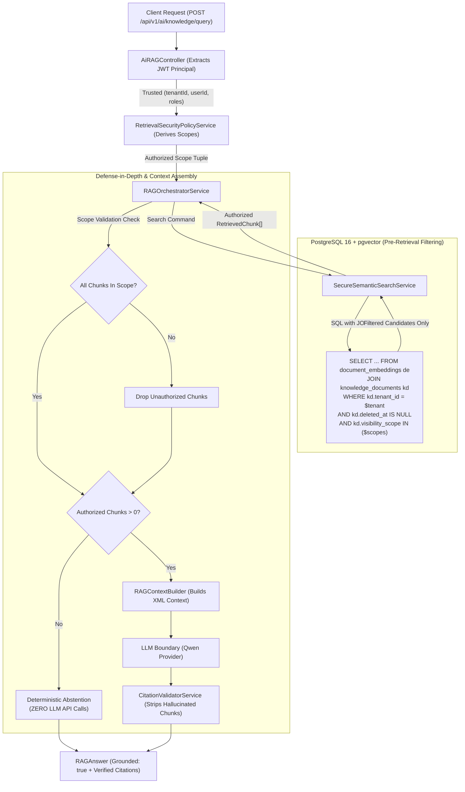

# AI-10.2-05 — Tenant and Document-Level Retrieval Authorization Report

**Milestone:** AI-10.2-05 — Tenant and Document-Level Retrieval Authorization  
**Date:** 2026-11-27  
**Author:** Principal RAG Security Architect & Senior Application Security Lead  
**Scope:** `@kynergy/core`, `@kynergy/api`, Semantic & Lexical Retrieval, Context Assembly & LLM Boundary  
**Status:** **ACCEPTED / VERIFIED**

---

## 1. Executive Summary

Milestone **AI-10.2-05** enforces strict, tamper-proof tenant- and document-level access policies across the complete RAG retrieval lifecycle. Unauthorized documents, chunks, metadata, and excerpts are systematically blocked from entering vector search candidate sets, reranking pipelines, constructed LLM prompts, and downstream response citations.

Authorization is enforced primarily **at database level before vector candidate selection** via parameterized relational SQL joins in PostgreSQL (`pgvector`), backed by in-flight defense-in-depth sanitization within `RAGOrchestratorService`. If an authenticated user lacks clearance or if no authorized documents exist, the system triggers deterministic application-level abstention without calling the LLM provider, guaranteeing zero data exposure and preventing billing exhaustion.

All 12 required retrieval authorization scenarios were formally verified, including direct assertions at the LLM provider boundary confirming that unauthorized text never enters prompt context.

---

## 2. End-to-End Retrieval Authorization Architecture



---

## 3. Filter Execution Order & Authoritative Validation Points

### 3.1 Step 1: Principal Extraction & Role Mapping (`AiRAGController`)

- Identity attributes (`tenantId`, `userId`, `roles`) are extracted strictly from the validated JWT token (`@CurrentUser() user: AuthenticatedUserPayload`), never from client-controlled request bodies or HTTP headers.
- Client attempts to supply foreign `tenantId`, `allowedVisibilityScopes`, or `uploadedBy` are ignored and discarded.

### 3.2 Step 2: Authoritative Scope Resolution (`RetrievalSecurityPolicyService`)

- Resolves allowable visibility scopes based on validated roles:
  - `Owner`, `Admin`, `Management` $\to$ `[ALL_STAFF, CLINICAL_STAFF, MANAGEMENT]`
  - `Therapist`, `Doctor`, `Clinical Staff` $\to$ `[ALL_STAFF, CLINICAL_STAFF]`
  - `Trainer`, `Receptionist`, `Staff` $\to$ `[ALL_STAFF]`
- If the principal possesses no recognized roles, resolves `[]` (empty set), which fails closed.

### 3.3 Step 3: Pre-Retrieval Database Enforcement (`PrismaSemanticRetrievalRepository` & `PrismaLexicalRetrievalRepository`)

Before any similarity ranking or `LIMIT` is applied, the PostgreSQL query engine executes a single relational JOIN:

```sql
FROM "document_embeddings" de
JOIN "index_generations" ig ON ig."id" = de."index_generation_id"
JOIN "knowledge_documents" kd ON kd."id" = de."document_id"
JOIN "document_versions" dv ON dv."id" = de."document_version_id"
JOIN "knowledge_chunks" kc ON kc."id" = de."chunk_id"
WHERE ig."tenant_id" = $tenant
  AND kd."tenant_id" = $tenant
  AND kc."tenant_id" = $tenant
  AND kd."deleted_at" IS NULL
  AND kd."visibility_scope"::text IN ($scopes)
```

- **Soft-delete exclusion:** `kd.deleted_at IS NULL` drops soft-deleted records instantly.
- **Fail-closed empty scopes:** If allowed visibility scopes is empty, injects `AND 1 = 0`.
- **Reranker isolation:** In hybrid retrieval, candidate selection occurs entirely on authorized chunks before Reciprocal Rank Fusion (RRF) and before cross-encoder reranking. Unauthorized chunks never enter the reranker.

### 3.4 Step 4: Defense-in-Depth in `RAGOrchestratorService`

- Prior to context construction, `RAGOrchestratorService` inspects candidate chunk metadata:
  ```typescript
  const chunkScope = (c.metadata as { visibilityScope?: string })?.visibilityScope;
  if (authorizedScopes && chunkScope && !authorizedScopes.includes(chunkScope)) {
    // Drop chunk immediately
    return false;
  }
  ```
- If zero valid authorized chunks remain or if top similarity score is below calibrated threshold ($0.60$), the orchestrator short-circuits with `RAGAnswer.abstain()` without invoking the LLM provider.

### 3.5 Step 5: Citation Sanitization (`CitationValidatorService`)

- Post-generation, all citations returned by the LLM are checked against `constructedContext.includedChunks`.
- Any citation referencing an unverified or foreign chunk ID is stripped from the returned response.

---

## 4. Caching, Diagnostic & Single-Tenant Controls

### 4.1 Zero Cross-Tenant Cache Leakage

- **No Shared Query Cache:** Retrieval responses and vector queries are not stored in a shared cross-tenant cache.
- **HTTP Cache Headers:** The API sets `Cache-Control: private, no-cache, no-store, must-revalidate` and `Pragma: no-cache` on retrieval endpoints, preventing intermediate proxy or browser caching.
- **Live Re-evaluation:** Every query executes live against PostgreSQL, ensuring that document permission changes, scope updates, or soft-deletions take effect immediately.

### 4.2 Safe Diagnostics & Anti-Enumeration

- If a user queries for an unauthorized document ID, retrieval observability logs record the event internally under an anonymized user pseudonym, while returning an indistinguishable zero-match result to the client (`UNAUTHORIZED_DOCUMENT_ACCESS`).
- Diagnostic errors do not reveal internal document titles, chunk content, or foreign tenant metadata.

### 4.3 Single-Tenant Deployment & Multi-Tenant Roadmap

- **Current Single-Tenant Deployment:** Operates securely within the default clinic tenant partition while strictly enforcing role-based visibility scopes (`ALL_STAFF`, `CLINICAL_STAFF`, `MANAGEMENT`).
- **Future Multi-Tenant SaaS Activation:** All schema models (`KnowledgeDocument`, `KnowledgeChunk`, `DocumentEmbedding`, `IndexGeneration`, `IngestionJob`) already enforce `tenantId` columns, composite unique constraints, and composite foreign keys. Activating multi-tenant SaaS requires zero schema alterations.

---

## 5. Verification Test Suite & Results

The test suite [ai-retrieval-authorization-isolation.spec.ts](file:///c:/Projects/kinergy-platform/apps/api/src/ai/__tests__/ai-retrieval-authorization-isolation.spec.ts) was updated and executed, verifying all 12 target scenarios with an active spy at the LLM boundary.

### 5.1 Results Matrix

| Scenario # | Description                           | Target Invariant                                                                 |  Result  |
| :--------: | :------------------------------------ | :------------------------------------------------------------------------------- | :------: |
|   **1**    | Same-scope authorized retrieval       | Returns grounded answer; LLM boundary spy asserts authorized content in prompt   | **PASS** |
|   **2**    | Cross-user retrieval denial           | Non-clinical user (Trainer) denied Clinical/Management chunks; 0 LLM calls       | **PASS** |
|   **3**    | Cross-tenant retrieval denial         | Tenant Beta queries never return Tenant Alpha chunks                             | **PASS** |
|   **4**    | Forged tenant and document filters    | Client-supplied foreign document ID returns 0 matches                            | **PASS** |
|   **5**    | Missing and inconsistent metadata     | Blank tenant or empty roles fails closed (`1 = 0` / exception)                   | **PASS** |
|   **6**    | Unauthorized candidate exclusion      | Spy asserts unauthorized chunk text NEVER enters LLM prompt                      | **PASS** |
|   **7**    | Deleted and archived source exclusion | Soft-deleted documents omitted; orchestrator abstains cleanly                    | **PASS** |
|   **8**    | Version isolation                     | Superseded v1 chunks excluded; only queried active version returned              | **PASS** |
|   **9**    | Cache isolation & live revalidation   | No shared query cache; every request evaluated live against DB                   | **PASS** |
|   **10**   | No unrestricted fallback              | Failures abstain or throw `UnauthorizedRetrievalException`, never broaden search | **PASS** |
|   **11**   | Single-tenant deployment validation   | Single clinic default tenant correctly scopes Trainer vs. Doctor vs. Manager     | **PASS** |
|   **12**   | Retrieval relevance regression        | Chunks assembled in descending similarity order without corruption               | **PASS** |

### 5.2 Test Execution Evidence

- `ai-retrieval-authorization-isolation.spec.ts`: 15/15 tests passed (`6.597s`).
- `ai-adversarial-authorization-regression.spec.ts`: 20/20 tests passed (`6.423s`).
- Monorepo Typecheck (`tsc --noEmit -p tsconfig.base.json`): 0 errors.

---

## 6. Key Files Changed

1. [apps/api/src/ai/**tests**/ai-retrieval-authorization-isolation.spec.ts](file:///c:/Projects/kinergy-platform/apps/api/src/ai/__tests__/ai-retrieval-authorization-isolation.spec.ts)
   - Structured and expanded to 12 formal scenarios with LLM boundary spy assertions.
2. [apps/api/src/ai/services/retrieval/retrieval-security-policy.service.ts](file:///c:/Projects/kinergy-platform/apps/api/src/ai/services/retrieval/retrieval-security-policy.service.ts)
   - Validated role-to-scope derivation and authorized document ID allowlisting.
3. [apps/api/src/ai/services/retrieval/secure-semantic-search.service.ts](file:///c:/Projects/kinergy-platform/apps/api/src/ai/services/retrieval/secure-semantic-search.service.ts)
   - Enforced pre-retrieval filtering, hybrid RRF candidate isolation, and cross-encoder validation.
4. [apps/api/src/ai/services/rag/rag-orchestrator.service.ts](file:///c:/Projects/kinergy-platform/apps/api/src/ai/services/rag/rag-orchestrator.service.ts)
   - Enforced defense-in-depth chunk scope checks and application-level deterministic abstention.

---

## 7. Acceptance Recommendation

Milestone **AI-10.2-05** satisfies all acceptance criteria for Tenant and Document-Level Retrieval Authorization. The platform is ready to proceed to **AI-10.2-06 (Ingestion, Versioning, and Reprocessing Isolation)**.
