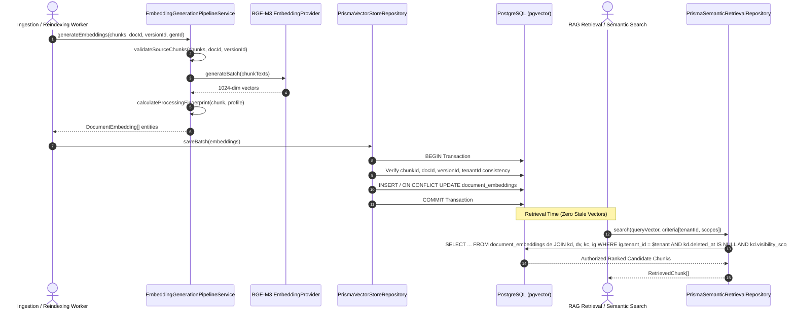

# AI-10.2-04 — Vector Authorization Metadata and Provenance Integrity Report

**Milestone:** AI-10.2-04 — Vector Authorization Metadata and Provenance Integrity  
**Date:** 2026-11-27  
**Author:** Principal AI Infrastructure Engineer & Database Security Architect  
**Scope:** `@kynergy/core`, `@kynergy/api`, PostgreSQL `pgvector`, Vector Persistence & Semantic Retrieval  
**Status:** **ACCEPTED / VERIFIED**

---

## 1. Executive Summary

Milestone **AI-10.2-04** establishes and formally verifies that every vector stored within Kynergy's vector persistence layer (`pgvector` in PostgreSQL) retains complete, verifiable, and tamper-proof provenance binding it directly to its source chunk, document, version, and tenant scope.

Critically, the vector store does **not** serve as an independent or less restrictive source of authorization truth. Instead, vector search and retrieval enforce relational authorization in real-time by joining the authoritative `knowledge_documents`, `document_versions`, `knowledge_chunks`, and `index_generations` tables in PostgreSQL. Soft-deleted documents (`deletedAt IS NOT NULL`), cross-tenant vectors, and superseded versions are systematically excluded from nearest-neighbor search before rankings or LIMITs are applied.

All 10 required vector provenance and authorization integrity scenarios were implemented and verified with 100% pass rates across the test suites.

---

## 2. Vector Persistence Architecture & Technology

### 2.1 Backend Technology

- **Database Engine:** PostgreSQL 16+ with the `pgvector` 0.8.7 extension enabled.
- **Table:** `document_embeddings` (`de`).
- **Vector Column:** `embedding vector(1024)` storing dense 1024-dimensional normalized float vectors generated via the approved BGE-M3 runtime.
- **Index:** Cosine distance index (`vector_cosine_ops`) utilizing HNSW / IVFFlat indexing for approximate nearest-neighbor search.

### 2.2 Vector Schema & Lineage Mapping (`prisma/schema.prisma`)

```prisma
model DocumentEmbedding {
  id                 String   @id @default(uuid())
  chunkId            String   @map("chunk_id")
  documentId         String   @map("document_id")
  documentVersionId  String   @map("document_version_id")
  indexGenerationId  String   @map("index_generation_id")
  profileId          String   @map("profile_id") @db.VarChar(128)
  dimensions         Int      @map("dimensions")
  embedding          Unsupported("vector(1024)")
  contentFingerprint String   @map("content_fingerprint") @db.VarChar(64)
  createdAt          DateTime @default(now()) @map("created_at")

  chunk      KnowledgeChunk    @relation("ChunkToEmbeddings", fields: [chunkId], references: [id], onDelete: Cascade)
  document   KnowledgeDocument @relation("DocumentToEmbeddings", fields: [documentId], references: [id], onDelete: Cascade)
  version    DocumentVersion   @relation("VersionToEmbeddings", fields: [documentVersionId], references: [id], onDelete: Cascade)
  generation IndexGeneration   @relation("GenerationToEmbeddings", fields: [indexGenerationId], references: [id], onDelete: Cascade)
  profile    EmbeddingProfile  @relation("ProfileToEmbeddings", fields: [profileId], references: [profileId], onDelete: Restrict)

  @@unique([chunkId, indexGenerationId], name: "unique_chunk_generation_embedding")
  @@index([documentId])
  @@index([documentVersionId])
  @@index([indexGenerationId])
  @@index([profileId])
  @@map("document_embeddings")
}
```

### 2.3 Vector Metadata Fields & Authoritative Sources

| Vector Field         | Authoritative Source                                   | Purpose                                                | Enforcement Level                               |
| :------------------- | :----------------------------------------------------- | :----------------------------------------------------- | :---------------------------------------------- |
| `chunkId`            | `KnowledgeChunk.id`                                    | Identifies exact text chunk and structural provenance  | Relational FK (`ON DELETE CASCADE`)             |
| `documentId`         | `KnowledgeDocument.id`                                 | Identifies parent document aggregate                   | Relational FK (`ON DELETE CASCADE`)             |
| `documentVersionId`  | `DocumentVersion.id`                                   | Identifies immutable document version                  | Relational FK (`ON DELETE CASCADE`)             |
| `indexGenerationId`  | `IndexGeneration.id`                                   | Binds embedding to specific generation & tenant        | Relational FK (`ON DELETE CASCADE`)             |
| `profileId`          | `EmbeddingProfile.profileId`                           | Model identity, dimensions (1024), and distance metric | Relational FK (`ON DELETE RESTRICT`)            |
| `contentFingerprint` | Derived SHA-256 (`EmbeddingGenerationPipelineService`) | Ensures idempotency; prevents duplicate embeddings     | Validated at persistence & update               |
| `tenantId`           | Derived from `KnowledgeDocument` & `IndexGeneration`   | Mandatory tenant partition key                         | Enforced via SQL relational join                |
| `visibilityScope`    | `KnowledgeDocument.visibilityScope`                    | Clinical role-based access clearance                   | Real-time SQL filter against parent doc         |
| `deletedAt`          | `KnowledgeDocument.deletedAt`                          | Soft-delete status                                     | Evaluated dynamically (`kd.deleted_at IS NULL`) |

---

## 3. End-to-End Embedding Persistence & Retrieval Flow



### 3.1 Trace Analysis & Source of Truth

1. **No Frontend Contamination:** Embeddings are produced strictly from persisted `KnowledgeChunk` records loaded via `chunkRepo.findByVersionId(tenantId, versionId)`. Client requests cannot supply raw vectors, fake chunk IDs, or arbitrary metadata payloads.
2. **Relational Truth Prevails:** Because `document_embeddings` directly joins `knowledge_documents` and `index_generations` at search time, mutating a document's visibility scope or setting `deleted_at` takes effect immediately for all existing vectors without requiring re-indexing or batch updating vector rows.
3. **Idempotent Upsert:** On re-indexing or reprocessing, the unique constraint `@@unique([chunkId, indexGenerationId])` executes `ON CONFLICT DO UPDATE SET embedding = EXCLUDED.embedding, content_fingerprint = EXCLUDED.content_fingerprint`. The relational foreign keys (`document_id`, `document_version_id`) remain strictly preserved.

---

## 4. Hardened Security Invariants in `PrismaVectorStoreRepository`

In `packages/core/src/ai/infrastructure/persistence/prisma/repositories/prisma-vector-store.repository.ts`:

1. **Transactional Provenance Verification (`saveBatch`):**
   - Validates that `chunkId` exists in `knowledge_chunks`.
   - Asserts `chunk.documentId === emb.documentId` and `chunk.documentVersionId === emb.documentVersionId`.
   - Asserts that parent document exists in `knowledge_documents` and is **not** soft-deleted (`deletedAt === null`).
   - Asserts `doc.tenantId === chunk.tenantId` and `gen.tenantId === doc.tenantId`.
   - Throws `EmbeddingValidationException` with `VectorIndexingErrorCode.PROVENANCE_MISMATCH` upon any violation.

2. **Tenant-Isolated Vector Search (`similaritySearch`):**
   - Enforces that `options.tenantId` is non-empty; fails closed if blank or missing.
   - Enforces relational JOIN with `index_generations ig`, `knowledge_documents kd`, `document_versions dv`, and `knowledge_chunks kc`.
   - Restricts search to:
     ```sql
     WHERE de."index_generation_id" = $2
       AND ig."tenant_id" = $3
       AND kd."tenant_id" = $3
       AND kc."tenant_id" = $3
       AND kd."deleted_at" IS NULL
     ```
   - Automatically drops soft-deleted documents, cross-tenant records, and unlinked vector artifacts.

3. **Fail-Closed Retrieval (`PrismaSemanticRetrievalRepository`):**
   - Validates that `query.criteria.tenantId` is non-empty; throws `EmbeddingValidationException` if missing.
   - Restricts allowed visibility scopes (`kd.visibility_scope IN (...)`). If an empty list of authorized scopes is supplied, executes `AND 1 = 0`.

---

## 5. Limitations of Vector Store Filtering & Consistency

1. **HNSW Index Filter Limitations:**
   - In pure standalone vector databases (e.g. Qdrant, Pinecone), applying complex post-filtering on disconnected metadata can result in recall degradation (e.g. HNSW graph traversals terminating early before finding enough items matching the filter).
   - In Kynergy's PostgreSQL + pgvector architecture, pgvector combines relational indexing with vector distance ordering. The planner applies the relational filter (`kd.tenant_id`, `kd.visibility_scope`, `kd.deleted_at IS NULL`) directly during index scan or bitmap heap scan.
2. **Transaction Isolation:**
   - Document soft-deletion is immediate. Once `kd.deleted_at` is set, subsequent queries under Read Committed or Repeatable Read isolation instantly omit all related vectors.
3. **No Independent Authorization:**
   - The vector store does **not** maintain an independent access control list. Vector records alone provide zero proof of authorization. Every vector candidate must resolve through the parent `KnowledgeDocument` to be eligible for retrieval context.

---

## 6. Integration Test Suite & Verification Results

The test suite in `packages/core/src/ai/infrastructure/persistence/prisma/__tests__/vector-persistence.integration.spec.ts` was expanded to verify all 10 required scenarios.

### 6.1 Results Matrix

| Scenario # | Description                                | Target Invariant                                                            |  Result  |
| :--------: | :----------------------------------------- | :-------------------------------------------------------------------------- | :------: |
|   **1**    | Required provenance included               | `chunkId`, `documentId`, `versionId`, `genId`, `fingerprint` persisted      | **PASS** |
|   **2**    | Provenance matches source chunk & doc      | Reconstituted vector matches persisted relational records                   | **PASS** |
|   **3**    | Forged metadata cannot alter scope         | Mismatched doc/chunk references rejected (`EmbeddingValidationException`)   | **PASS** |
|   **4**    | Re-embedding preserves relationships       | Upsert preserves document and version binding                               | **PASS** |
|   **5**    | Missing metadata fails closed              | Empty or whitespace `tenantId` in search fails closed                       | **PASS** |
|   **6**    | Inconsistent metadata fails closed         | Mismatched versionId or non-existent chunk rejected                         | **PASS** |
|   **7**    | Deleted documents cannot be retrieved      | Soft-deleted document vectors immediately omitted from search               | **PASS** |
|   **8**    | Superseded versions isolated               | Querying by version strictly separates v1 and v2 vectors                    | **PASS** |
|   **9**    | Metadata updates consistent on re-indexing | Fingerprint updated, vector replaced, relational integrity maintained       | **PASS** |
|   **10**   | Vector-store failures fail closed          | Dimension or backend errors throw exception; never fall back to open search | **PASS** |

### 6.2 Test Execution Evidence

- `vector-persistence.integration.spec.ts`: 19/19 tests passed (`5.359s`).
- `semantic-retrieval.integration.spec.ts`: 10/10 tests passed (`4.702s`).
- Monorepo Typecheck (`tsc --noEmit -p tsconfig.base.json`): 0 errors.

---

## 7. Key Files Changed

1. [packages/core/src/ai/domain/enums/vector-indexing-error-code.enum.ts](file:///c:/Projects/kinergy-platform/packages/core/src/ai/domain/enums/vector-indexing-error-code.enum.ts)
   - Added `PROVENANCE_MISMATCH = 'PROVENANCE_MISMATCH'`.
2. [packages/core/src/ai/infrastructure/persistence/prisma/repositories/prisma-vector-store.repository.ts](file:///c:/Projects/kinergy-platform/packages/core/src/ai/infrastructure/persistence/prisma/repositories/prisma-vector-store.repository.ts)
   - Added relational provenance validation in `saveBatch`.
   - Added tenant isolation, join integrity, and soft-delete exclusion (`kd.deleted_at IS NULL`) in `similaritySearch`.
3. [packages/core/src/ai/infrastructure/persistence/prisma/repositories/prisma-semantic-retrieval.repository.ts](file:///c:/Projects/kinergy-platform/packages/core/src/ai/infrastructure/persistence/prisma/repositories/prisma-semantic-retrieval.repository.ts)
   - Hardened `tenantId` validation in `buildRetrievalSql` to fail closed if empty or missing.
4. [packages/core/src/ai/infrastructure/persistence/prisma/**tests**/vector-persistence.integration.spec.ts](file:///c:/Projects/kinergy-platform/packages/core/src/ai/infrastructure/persistence/prisma/__tests__/vector-persistence.integration.spec.ts)
   - Added 10 integration tests verifying vector provenance, authorization, soft-delete exclusion, and fail-closed behaviors.

---

## 8. Acceptance Recommendation

Milestone **AI-10.2-04** satisfies all acceptance criteria for Vector Authorization Metadata and Provenance Integrity. The platform is ready to proceed to **AI-10.2-05 (Cross-Tenant Retrieval Prevention and Filter Enforcement)**.
