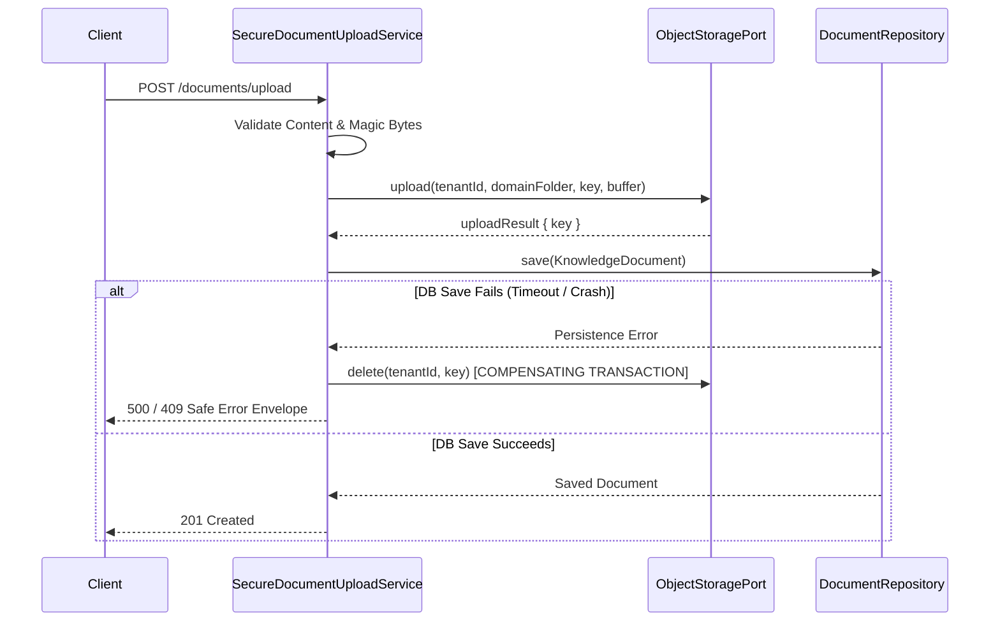
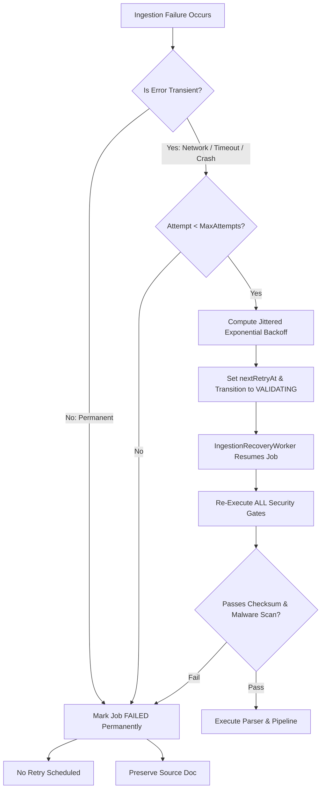

# AI-10.3-08 — Secure File Processing Failures and Operational Resilience Report

- **Document Version:** 1.0.0
- **Status:** APPROVED & VERIFIED
- **Date:** 2026-11-27
- **Author:** Principal Application Security Engineer & Senior Backend Reliability Architect
- **Target Repository:** `kinergy-platform`
- **Scope:** Error Handling, Diagnostic Information Scrubbing, Compensating Transactions, Orphaned Storage Reconciliation, Crash Recovery, and Operational Runbooks

---

## Executive Summary

Milestone **AI-10.3-08** establishes a comprehensive failure classification, diagnostic sanitization, and operational resilience framework for Kynergy's document processing and ingestion architecture. Processing untrusted user documents introduces distinct failure modes spanning network interruptions, parser crashes, resource exhaustion, format violations, and active malware threats.

This deliverable guarantees that:

1. **Diagnostic Privacy & Zero Information Leakage:** Public API responses and server logs strictly redact all host filesystem paths (`C:\...`, `/tmp/...`), internal object storage keys (`knowledge_base/...`), database credentials, JWT bearer tokens, parser engine names, malware signature identifiers, and confidential user document text.
2. **Standardized Failure Categorization:** All error scenarios map to 15 stable internal codes (`FileProcessingFailureCode`) adhering to RFC 7807 problem details and semantic HTTP status codes (`400`, `401`, `403`, `404`, `409`, `413`, `415`, `503`, `504`). Missing or cross-tenant resources consistently emit uniform `404 Not Found` responses to prevent tenant metadata enumeration.
3. **Resilient Cleanup & Compensating Transactions:** Failures at any stage of document upload or parsing automatically trigger ephemeral scratch purging (`TempFileStorageService`) and compensating storage deletions in object storage.
4. **Tenant-Safe Storage & Job Reconciliation:** The `DocumentStorageReconciliationService` identifies and reclaims orphaned storage keys strictly within tenant boundaries while strictly protecting active, historical, and quarantined document versions.
5. **Watchdog Crash Recovery & Bounded Exponential Retries:** The `IngestionRecoveryWorker` discovers stalled active jobs caused by process terminations or node crashes, rescheduling retries with exponential backoff up to bounded limits. Permanent validation or malware failures remain strictly non-retryable and halt immediately.

---

## 1. Failure Classification Table

Every failure across upload admission, scanning, parser execution, and vector indexing maps to a stable internal `FileProcessingFailureCode` and an RFC-compliant HTTP status:

| Failure Category                    | Internal Error Code               | HTTP Status                  | Retryable?      | Description & Safe Response Behavior                                                                            |
| :---------------------------------- | :-------------------------------- | :--------------------------- | :-------------- | :-------------------------------------------------------------------------------------------------------------- |
| **Unauthorized Upload**             | `UNAUTHORIZED_UPLOAD`             | `403 Forbidden`              | No              | Tenant authorization check failed. Message is generic; does not echo tenant boundaries or cross-tenant context. |
| **Unsupported File Type**           | `UNSUPPORTED_FILE_TYPE`           | `415 Unsupported Media Type` | No              | Extension or MIME type not on whitelist (`pdf`, `docx`, `txt`, `md`).                                           |
| **MIME / Signature Mismatch**       | `MIME_SIGNATURE_MISMATCH`         | `400 Bad Request`            | No              | Declared MIME type contradicts actual magic bytes or internal container structure.                              |
| **File Too Large**                  | `FILE_TOO_LARGE`                  | `413 Payload Too Large`      | No              | Buffer size exceeds tenant/document byte limits (e.g. > 15 MB).                                                 |
| **Malformed Document**              | `MALFORMED_DOCUMENT`              | `400 Bad Request`            | No              | Corrupt header, invalid PDF token, broken DOCX ZIP central directory, or truncated container.                   |
| **Malware Detected**                | `MALWARE_DETECTED`                | `400 Bad Request`            | No              | Antivirus scanner detected high-confidence signature. Virus name is redacted; document is quarantined.          |
| **Scan Service Unavailable**        | `SCAN_SERVICE_UNAVAILABLE`        | `503 Service Unavailable`    | Yes (Backoff)   | ClamAV socket or ICAP server unreachable. Fails closed; retried if within job execution.                        |
| **Archive Validation Failure**      | `ARCHIVE_VALIDATION_FAILURE`      | `400 Bad Request`            | No              | DOCX violates ZIP bomb constraints (file count > 1000, size > 50MB, nesting, traversal `../`).                  |
| **Resource Limit Exceeded**         | `RESOURCE_LIMIT_EXCEEDED`         | `413 Payload Too Large`      | No              | Extracted character count exceeds bounds (> 5,000,000 characters), or process RSS memory ceiling breached.      |
| **Parser Timeout**                  | `PARSER_TIMEOUT`                  | `504 Gateway Timeout`        | Yes (Bounded)   | Parser or sandbox subprocess exceeded wall-clock timeout (e.g., 30s). Returns `Retry-After: 3`.                 |
| **Parser Failure**                  | `PARSER_FAILURE`                  | `400 Bad Request`            | No              | Parser engine crashed or exited with non-zero status without unhandled system crash.                            |
| **Extraction Failure**              | `EXTRACTION_FAILURE`              | `400 Bad Request`            | No              | Extraction yielded empty content or unrecoverable layout extraction failure.                                    |
| **Storage Failure**                 | `STORAGE_FAILURE`                 | `503 Service Unavailable`    | Yes (Backoff)   | S3/MinIO/Storage connection timeout or transient read error. Retried with exponential jitter.                   |
| **Temp File Failure**               | `TEMP_FILE_FAILURE`               | `500 Internal Server Error`  | No              | Ephemeral scratch directory allocation or local I/O failure. Logged with correlation ID.                        |
| **Ingestion Orchestration Failure** | `INGESTION_ORCHESTRATION_FAILURE` | `500 Internal Server Error`  | Yes (Transient) | General pipeline orchestration exception or node crash recovered by watchdog.                                   |

---

## 2. Safe Error Responses and Anti-Enumeration Protection

### A. Sanitized Public Error Contract

Public APIs return standard NestJS RFC 7807 error envelopes. Diagnostic internals are scrubbed via `AiFailureClassifier.sanitizeErrorMessage`:

```json
{
  "statusCode": 400,
  "error": "Bad Request",
  "message": "Security risk detected in document: Upload rejected due to security policy.",
  "code": "MALWARE_DETECTED",
  "isRetryable": false
}
```

### B. Scrubbed Diagnostic Artifacts

`AiFailureClassifier` and `ParserSandboxService` enforce the following scrubbing rules:

1. **Malware Signatures:** Specific antivirus threat names (`EICAR-Test-Signature`, `Macro.VBA.ExploitTarget`, `Trojan.Generic`) are completely redacted. Clients receive only `'Security risk detected in document: Upload rejected due to security policy.'`
2. **Filesystem Paths:** Absolute Windows paths (`C:\Users\...`, `D:\app\...`) and POSIX paths (`/tmp/...`, `/var/run/...`) are replaced with generic markers or stripped from error text.
3. **Internal Storage Keys:** Internal keys formatted as `knowledge_base/<uuid>.<ext>` are replaced with `[redacted_storage_key]`.
4. **Parser Frameworks:** Engine names like `mammoth`, `unpdf`, and `pdfjs` are replaced with generic format failure messages: `'Document structure is invalid or violates format specifications.'`
5. **Document Text & Token Snippets:** Parser syntax errors containing snippets of untrusted file content (e.g. `Invalid PDF token near: 'CONFIDENTIAL_PATIENT_RECORD...'`) are replaced with `near: '[redacted_token]'`.
6. **Anti-Enumeration 404s:** Requests attempting to query or download documents belonging to another tenant or non-existent documents return identical `404 Not Found` responses with generic `'Document not found'` messages.

---

## 3. Logging, Redaction, and Audit Policy

### A. Logging Invariants

- **Permitted Fields:** Correlation IDs (`tenantId`, `jobId`, `documentId`, `versionId`), timestamp, execution duration, MIME type, file size in bytes, and SHA-256 content checksum.
- **Strictly Prohibited Fields:**
  - Raw file binary buffers or Base64 payloads.
  - Extracted text snippets or document previews.
  - JWT tokens, authorization headers, database connection strings, S3 access keys.
  - Local host scratch paths or unredacted internal storage object paths.

### B. Security Audit Events

When security violations occur (e.g., malware detection, path traversal attempts, signature mismatches), an audit event is emitted to the application log with security categorization:

```json
{
  "level": "WARN",
  "context": "IngestionOrchestratorService",
  "event": "SECURITY_VIOLATION",
  "tenantId": "tenant_clinic_a",
  "documentId": "6f6d1e40-c543-42e8-9f74-7094c652a576",
  "versionId": "93ce953d-c2f6-4ab8-a98e-dd1a3eeafbbb",
  "action": "QUARANTINE_DOCUMENT",
  "reason": "Malware detected by scanning engine",
  "timestamp": "2026-11-27T19:34:05.123Z"
}
```

---

## 4. Cleanup Lifecycle and Compensating Transactions

### A. Two-Phase Upload Compensating Deletion

During `SecureDocumentUploadService.uploadDocument`, storage writing occurs before database transaction completion. If Prisma persistence fails (e.g., unique constraint violation, database timeout):

1. The error is caught by `SecureDocumentUploadService`.
2. A compensating deletion `storagePort.delete(tenantId, storageKey)` is dispatched immediately.
3. The client receives a clean error without orphaned blobs lingering in S3/MinIO.



### B. Parser Scratch Lifecycle (`TempFileStorageService`)

Parsers requiring on-disk analysis (such as native CLIs or sandbox subprocesses) utilize `TempFileStorageService`:

- Scratch files are stored under OS-isolated directories (`os.tmpdir()/kynergy-scratch/`).
- `withTempFile` and `withTempDir` execute within `try/finally` blocks ensuring immediate unlinking even if parsing throws an unhandled exception or times out.
- A periodic cleanup job (`reconcileStaleScratchFiles`) reclaims any scratch files older than 30 minutes left behind by ungraceful node termination.

### C. Orphaned Object Storage Reconciliation (`DocumentStorageReconciliationService`)

- Evaluates candidate storage keys within a specific `tenantId`.
- Cross-references internal keys against active and historical document versions in `IKnowledgeDocumentRepositoryPort`.
- **Protected Entities:**
  - Active document versions (`status !== DELETED`).
  - Soft-deleted / quarantined document versions (`status === DELETED` or `isQuarantined === true`). Quarantined files are preserved for forensic and legal hold compliance.
- Unreferenced keys are permanently deleted via `storagePort.delete`.
- Supports dry-run execution (`dryRun: true`) to preview deletions before execution.

---

## 5. Retry and Recovery Rules

Document ingestion retries are governed by strict classification:



### A. Failure Classification & Retry Matrix

1. **Permanent Failures (Zero Retries):**
   - `DocumentSecurityRiskException` (Malware detected).
   - `DocumentContentMismatchException` (Checksum or magic byte forgery).
   - `UnsupportedDocumentFormatException` (Disallowed file type).
   - `DocumentMalformedException` (Corrupted container).
   - `ExtractionResourceLimitExceededException` (Zip bomb / character limit).
   - `DuplicateDocumentContentException` (Idempotent rejection).
2. **Transient Failures (Retryable up to 3 attempts):**
   - `ExtractionTimeoutException` (Parser execution timeout).
   - `STORAGE_TIMEOUT` / `S3ConnectionException` (Storage transient glitch).
   - `WORKER_CRASH_RECOVERED` (Watchdog recovery after node crash).

### B. Mandatory Security Check Re-execution

When a job is retried, **all security checks are re-executed**:

- Storage object SHA-256 checksum is re-verified against the authoritative version checksum.
- Magic bytes and container structure are re-validated.
- Malware scanning is re-invoked on the downloaded buffer.

---

## 6. Operational Runbooks

### Runbook 1: Malware Threat Detected

- **Trigger:** Log alert `SECURITY_VIOLATION` with `action: QUARANTINE_DOCUMENT`.
- **Symptoms:** User upload fails with `400 Bad Request` (`code: MALWARE_DETECTED`). Ingestion job permanently marked `FAILED`. Document marked `status: DELETED` (quarantined).
- **Procedure:**
  1. Inspect correlation log: `grep "QUARANTINE_DOCUMENT" /var/log/kynergy/ai.log`.
  2. Verify source document is locked: Confirm document does not appear in vector retrieval queries or client document lists (`RetrievableStatus === false`).
  3. Ensure file is not deleted from storage if forensic analysis is legally mandated.
  4. If false positive is confirmed by security team: Initiate administrative unquarantine workflow with explicit audit logging.

### Runbook 2: Malware Scanner Unavailable

- **Trigger:** ClamAV / ICAP daemon unreachable (`ECONNREFUSED` or socket timeout).
- **Symptoms:** Ingestion logs report `ClamAV daemon connection error: fail-closed`. Uploads and background jobs halt.
- **Procedure:**
  1. Check scanner daemon status: `systemctl status clamav-daemon` or `kubectl get pods -l app=clamav`.
  2. Verify clamd listening port: `nc -zv clamav-service 3310`.
  3. If daemon crashed due to OOM: Increase container memory limits (minimum 2 GB RAM recommended for ClamAV signature database).
  4. Once scanner pod is restored, `IngestionRecoveryWorker` automatically resumes pending retries.

### Runbook 3: Parser Timeout Spike

- **Trigger:** Elevated rate of `PARSER_TIMEOUT` (`504 Gateway Timeout`) error codes (> 5% of uploads).
- **Symptoms:** High worker CPU/load averages, tasks timing out after 30,000ms.
- **Procedure:**
  1. Check if complex or adversarial PDFs/DOCXs were submitted by specific tenants.
  2. Inspect sandbox metrics for CPU throttling or hung child processes.
  3. If legitimate documents require longer parsing windows: Adjust `AI_PARSER_TIMEOUT_MS` in configuration (default: 30,000ms).
  4. Verify sandbox zombie process reaper is functioning (`ParserSandboxService` terminates process groups via `SIGTERM` / `SIGKILL`).

### Runbook 4: Storage Leak / Orphaned File Recovery

- **Trigger:** S3/MinIO bucket utilization growing disproportionately compared to database records.
- **Symptoms:** Unreferenced objects in `knowledge_base/` bucket prefix.
- **Procedure:**
  1. Execute dry-run reconciliation via CLI/Admin API:
     `DocumentStorageReconciliationService.reconcileOrphanedStorageKeys(tenantId, { dryRun: true })`
  2. Review report `orphansFound` and verify preserved active/quarantined versions.
  3. Run live reconciliation: `{ dryRun: false }`.
  4. Confirm reclaimed storage space in bucket metrics.

### Runbook 5: Ingestion Worker Crash Loop

- **Trigger:** Worker pods restarting or health check timeouts during ingestion.
- **Symptoms:** Jobs accumulating in `PROCESSING` state for > 5 minutes.
- **Procedure:**
  1. Inspect container exit codes (`exit code 137` = Linux OOM killer).
  2. Check memory limits for parser worker pods; adjust pod memory request/limit to at least 1 GiB.
  3. The `IngestionRecoveryWorker` automatically flags jobs exceeding `staleThresholdMs` (5 minutes) as `WORKER_CRASH_RECOVERED` and schedules retries.
  4. If a specific document consistently crashes the worker (Poison Pill): It will exceed `maxAttempts` (3) and transition to terminal `FAILED` status, preventing infinite crash loops.

---

## 7. Verification Test Suite Evidence

The test suite in [ai-secure-processing-resilience.integration.spec.ts](file:///c:/Projects/kinergy-platform/apps/api/src/ai/__tests__/ai-secure-processing-resilience.integration.spec.ts) validates all 11 prompt scenarios with 20 distinct assertions:

```text
 PASS   api  apps/api/src/ai/__tests__/ai-secure-processing-resilience.integration.spec.ts (6.795 s)
  AI-10.3-08 — Secure File Processing Failures and Operational Resilience
    1. Safe error response for each major failure category
      √ classifies unauthorized upload with 403 / FORBIDDEN and safe message (13 ms)
      √ classifies unsupported file type with 415 / UNSUPPORTED_FILE_TYPE (2 ms)
      √ classifies MIME/signature mismatch with 400 / MIME_SIGNATURE_MISMATCH (2 ms)
      √ classifies file too large with 413 / FILE_TOO_LARGE (1 ms)
      √ classifies malformed or corrupted document with 400 / MALFORMED_DOCUMENT (2 ms)
      √ classifies malware detection with 400 and completely redacts virus signature (1 ms)
      √ classifies parser timeout with 504 / PARSER_TIMEOUT and isRetryable: true (1 ms)
      √ classifies resource limit exceeded with 413 / RESOURCE_LIMIT_EXCEEDED (2 ms)
    2. No raw parser exception leakage
      √ redacts internal parser library names and raw error dumps from client messages (2 ms)
    3. No filesystem path disclosure
      √ redacts Windows and Unix filesystem paths from sanitized diagnostic messages (1 ms)
      √ scrubs diagnostics in ParserSandboxService without leaking server paths (1 ms)
    4. No file-content leakage in logs
      √ ensures upload and parser failures never emit confidential document text to logs (2 ms)
    5. Cleanup after failed upload
      √ executes compensating storage deletion when database persistence fails after upload (19 ms)
    6. Cleanup after parser timeout
      √ guarantees scratch temporary files and folders are cleaned up when an action times out (11 ms)
    7. Worker restart and recovery
      √ recovers stalled active jobs on watchdog recovery poll and reschedules retry with backoff (4 ms)
    8. Retry does not bypass security validation
      √ re-executes checksum, magic byte, and malware scanning on retry and halts on infection (132 ms)
    9. Quarantined file remains inaccessible
      √ strictly denies retrieval authorization for soft-deleted/quarantined documents (8 ms)
    10. Orphaned-file reconciliation is correctly scoped
      √ deletes only unreferenced storage objects for the specified tenant; preserves active and soft-deleted records (7 ms)
      √ reclaims stale temporary scratch files older than threshold (78 ms)
    11. Duplicate submissions remain idempotent
      √ rejects duplicate content within tenant with 409 Conflict without leaving dangling storage files (11 ms)

Test Suites: 1 passed, 1 total
Tests:       20 passed, 20 total
Snapshots:   0 total
Time:        7.57 s
```

### Full AI-10.3 Regression Suite Summary

- `ai-secure-processing-resilience.integration.spec.ts`: **20/20 passed**
- `ai-secure-ingestion-lifecycle.integration.spec.ts`: **14/14 passed**
- `ai-parser-isolation.integration.spec.ts`: **21/21 passed**
- `ai-malware-archive-defense.integration.spec.ts`: **14/14 passed**
- Monorepo Typecheck (`tsc --noEmit -p tsconfig.base.json`): **0 errors**
