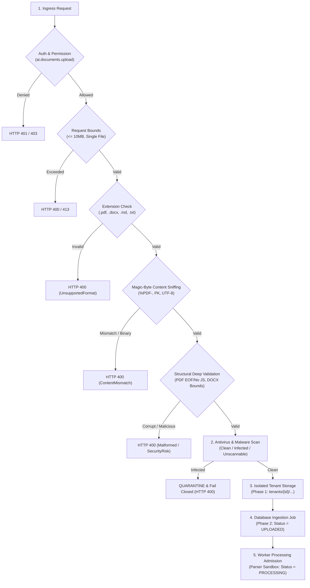
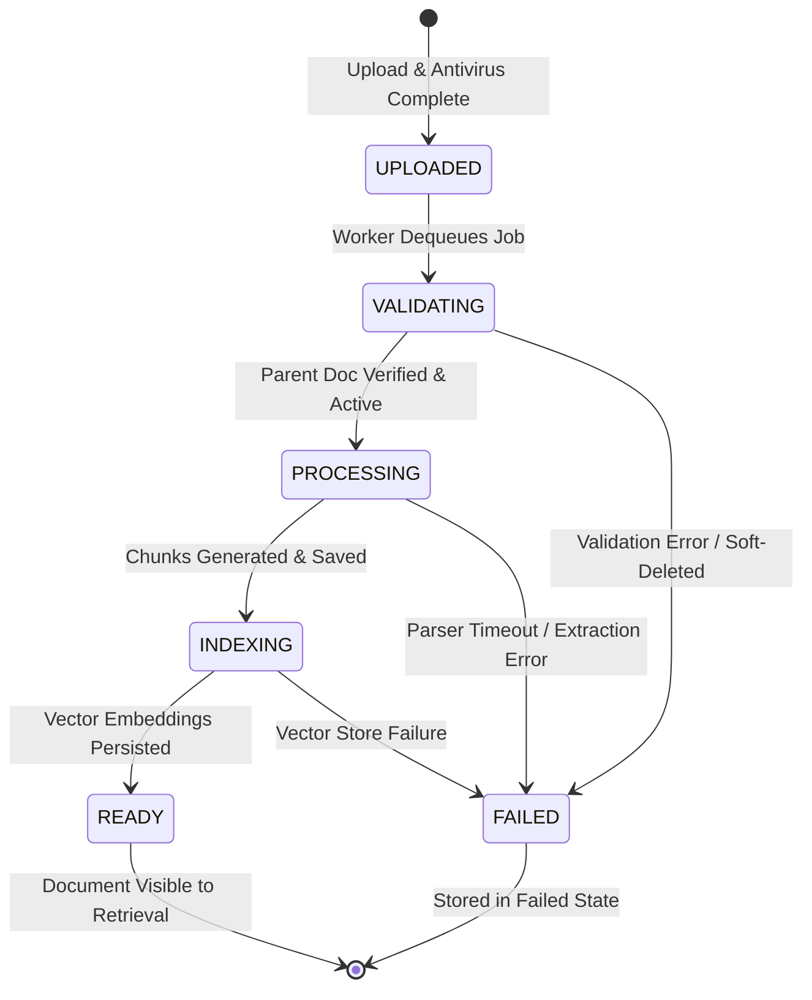

# AI-10.3-02 — Secure File Validation and Processing Policy

**Status:** APPROVED & ADOPTED POLICY  
**Date:** November 27, 2026  
**Role:** Principal Security Architect & Senior Backend Engineer  
**Scope:** Authoritative policy governing accepted file formats, deep content validation, size/resource limits, storage segregation, malware scanning, parser execution isolation, and publication lifecycle within Kynergy Intelligence.

---

## 1. Executive Summary & Policy Objective

This policy establishes the mandatory security rules governing how files are accepted, validated, quarantined, stored, parsed, and admitted into Kynergy's RAG ingestion pipeline.

### Core Security Tenets:

1. **Never Trust File Extensions or Client Headers:** File extensions and client-supplied `Content-Type` headers are considered untrusted user input. Admission is governed strictly by magic-byte content sniffing, structural integrity verification, and cryptographic checksums.
2. **Fail-Closed Admission:** Corrupt, malformed, empty, truncated, polyglot, or unscannable files are rejected immediately. Untrusted bytes must never reach a document parser before validation and malware clearance.
3. **Strict Tenant & Physical Segregation:** Storage keys are deterministically generated by the system under tenant-partitioned namespaces (`tenants/{tenantId}/knowledge_base/...`). Client-provided filenames are never used in filesystem or object-storage paths.
4. **Zero Unvalidated Retrieval Exposure:** Ingestion follows a strict sequential lifecycle (`UPLOADED` -> `VALIDATING` -> `PROCESSING` -> `INDEXING` -> `READY`). Chunks and embeddings are queryable if and only if the document has completed all security stages and reached `READY`.

---

## 2. Supported File Formats & Compatibility Matrix

Kynergy accepts strictly four clinical and operational document formats. Formats without verified, sandboxed parsers and direct clinical/operational business justification are rejected.

| Format Identifier | File Extension(s)  | Canonical MIME Type                                                       | File Signature / Magic Bytes          | Structural Validation Strategy                                                                                                                   | Parser Dependency                                  |
| :---------------- | :----------------- | :------------------------------------------------------------------------ | :------------------------------------ | :----------------------------------------------------------------------------------------------------------------------------------------------- | :------------------------------------------------- |
| **PDF**           | `.pdf`             | `application/pdf`                                                         | `%PDF-` (`0x25 0x50 0x44 0x46 0x2d`)  | Header version check (`%PDF-1.x` or `2.x`), `%%EOF` trailer verification, static prohibition of `/Launch` and `/JavaScript` actions.             | `unpdf` (pure JS PDF.js fork)                      |
| **DOCX**          | `.docx`            | `application/vnd.openxmlformats-officedocument.wordprocessingml.document` | `PK\x03\x04` (`0x50 0x4b 0x03 0x04`)  | OpenXML ZIP central directory inspection, verification of `[Content_Types].xml` and `word/document.xml`, strict ZIP bomb ratio and entry limits. | `mammoth` (^1.13.0)                                |
| **Markdown**      | `.md`, `.markdown` | `text/markdown`, `text/x-markdown`                                        | UTF-8 byte stream (no binary headers) | Strict UTF-8 validation, zero null bytes (`0x00`), prohibition of non-printable control characters (except `\t`, `\n`, `\r`).                    | `marked` (AST Lexer only; HTML rendering disabled) |
| **Plain Text**    | `.txt`             | `text/plain`                                                              | UTF-8 byte stream (no binary headers) | Strict UTF-8 validation, zero null bytes (`0x00`), prohibition of non-printable control characters (except `\t`, `\n`, `\r`).                    | Native `TextDecoder` (pure JS)                     |

### Explicitly Unsupported & Prohibited Formats:

- **Executable & Binary Files:** `.exe`, `.dll`, `.so`, `.bin`, `.elf`, `.bat`, `.cmd`, `.sh`, `.ps1` (Hard rejected via magic-byte signatures `MZ`, `ELF`).
- **Image & Audio Formats:** `.png`, `.jpg`, `.jpeg`, `.gif`, `.webp`, `.mp3`, `.wav` (Hard rejected via signatures). Image-only scanned PDFs require dedicated OCR pipelines and are rejected by default with `UnsupportedDocumentFeatureException`.
- **Legacy Microsoft Office Formats:** `.doc`, `.xls`, `.ppt` (Rejected due to complex OLE2 binary structures and macro execution risks).
- **Macro-Enabled Formats:** `.docm`, `.xlsm`, `.pptm` (Strictly rejected).
- **Generic Archive Formats:** `.zip`, `.tar`, `.gz`, `.7z`, `.rar` (Direct archive uploads are strictly prohibited).

---

## 3. Size and Resource Limits Matrix

All limits are enforced at the API gateway, controller, validator, and worker layers to protect against Denial of Service (DoS) and memory exhaustion.

| Dimension                         | Maximum Bound                        | Enforcement Layer                          | Failure Behavior                                         |
| :-------------------------------- | :----------------------------------- | :----------------------------------------- | :------------------------------------------------------- |
| **Individual Upload Size**        | **10 MB** (10,485,760 bytes)         | Multer & `DocumentContentValidatorService` | HTTP 400 (`DocumentSizeLimitExceededException`)          |
| **Multipart Request Size**        | **12 MB** (includes form metadata)   | Reverse Proxy / Express Body Parser        | HTTP 413 (`PayloadTooLarge`)                             |
| **Files Per Request**             | **1 file** (single-file upload only) | `FileInterceptor('file')`                  | HTTP 400 (`BadRequestException`)                         |
| **Concurrent Uploads Per Tenant** | **5 concurrent uploads**             | Tenant Concurrency Throttler               | HTTP 429 (`TooManyRequestsException`)                    |
| **Minimum File Size**             | **1 byte** (0-byte files rejected)   | `DocumentContentValidatorService`          | HTTP 400 (`DocumentValidationException`: `EMPTY_FILE`)   |
| **DOCX Uncompressed Size**        | **50 MB** (52,428,800 bytes)         | `DocumentContentValidatorService`          | HTTP 400 (`DocumentSecurityRiskException`: ZIP Bomb)     |
| **DOCX Entry Count**              | **1,000 entries**                    | `DocumentContentValidatorService`          | HTTP 400 (`DocumentSecurityRiskException`: ZIP Bomb)     |
| **DOCX Compression Ratio**        | **100:1 max** per entry              | `DocumentContentValidatorService`          | HTTP 400 (`DocumentSecurityRiskException`: ZIP Bomb)     |
| **PDF Page Count**                | **500 pages**                        | `PdfParserAdapter`                         | HTTP 400 (`UnsupportedDocumentFeatureException`)         |
| **Parser Timeout**                | **30,000 ms** (30 seconds)           | Parser Execution Wrapper                   | `ExtractionTimeoutException` -> `IngestionStatus.FAILED` |
| **Parser Memory Allocation**      | **512 MB** per execution             | Worker Container / Node Subprocess         | `ExtractionResourceLimitExceededException`               |
| **Extracted Text Size**           | **15 MB** (character count)          | `DocumentProcessingPipelineService`        | `ExtractionResourceLimitExceededException`               |

---

## 4. Sequential File Validation Pipeline

Untrusted bytes must pass through ordered, discrete validation gates. A failure at any gate halts processing immediately (**fail-closed**).



### Gate Execution Sequence:

1. **Gate 1 — Authentication & Authorization:** Validates JWT signature; resolves authoritative `tenantId`; verifies caller holds `ai.documents.upload`.
2. **Gate 2 — Request & Size Verification:** Enforces single-file constraint; verifies `0 < buffer.length <= 10MB`.
3. **Gate 3 — Filename & Extension Sanitization:** Strips path traversal sequences; asserts extension exists in allowlist.
4. **Gate 4 — Magic-Byte Content Sniffing:** Sniffs initial header bytes; determines true format independently of extension or declared MIME.
5. **Gate 5 — Format Consistency Assertion:** Asserts declared extension and MIME match detected magic bytes.
6. **Gate 6 — Structural Security & Bomb Inspection:**
   - _PDF:_ Asserts `%PDF-` header, `%%EOF` marker; verifies zero `/Launch` or `/JavaScript` dictionary keys.
   - _DOCX:_ Verifies Central Directory bounds, ZIP entry counts (<=1,000), uncompressed bounds (<=50MB), ratio (<=100:1), and required OpenXML manifests (`[Content_Types].xml`, `word/document.xml`).
   - _Text/Markdown:_ Validates strict UTF-8 decoding without null bytes or control characters.
7. **Gate 7 — Malware & Antivirus Clearance:** Executes antivirus scanner. Clean files proceed; infected files are quarantined and rejected.
8. **Gate 8 — Cryptographic Fingerprinting:** Computes SHA-256 digest; checks intra-document duplicate versions (409 Conflict).
9. **Gate 9 — Safe Tenant-Partitioned Storage:** Persists buffer to isolated object storage using randomized UUID key.
10. **Gate 10 — Ingestion Job Enqueueing:** Inserts `KnowledgeDocument`, `DocumentVersion`, and `IngestionJob` (`UPLOADED`) in a single database transaction.

---

## 5. Filename & Storage Security Policy

### 5.1 Storage Path Construction Invariants

- **Original Filename Disassociation:** The user-supplied filename **never** determines a physical filesystem path or object-storage key.
- **Deterministic Key Pattern:** Storage keys are strictly generated by the backend:
  ```
  tenants/{tenantId}/knowledge_base/{year}/{month}/{randomUuid12}-{sanitizedBasename}
  ```
- **Basename Sanitization (`StorageKeyUtil`):**
  - Path traversal sequences (`../`, `..\\`) are stripped.
  - Non-alphanumeric characters (except `.`, `_`, `-`) are replaced with underscores.
  - Leading and trailing periods and underscores are removed.
- **Display Filename Preservation:** The original filename is sanitized and stored as a metadata string (`DocumentVersion.originalFileName`) solely for UI presentation and citation generation.

### 5.2 Storage Access & Leakage Prevention

- **Private By Default:** All object-storage buckets and local disk directories must have public read/write access disabled at the infrastructure level.
- **Internal Key Redaction:** Internal storage keys (`storageKey`) must **never** be exposed in public API responses or serialized into client-facing DTOs.
- **Download Authorization:** Access to raw file downloads requires either:
  1. A short-lived, cryptographically signed preview token (`PreviewTokenService` HMAC-SHA256, 15-minute expiry) validated against the authenticated caller, OR
  2. A temporary AWS S3 presigned URL generated on demand after backend ownership verification.

### 5.3 Incomplete & Failed Upload Cleanup

- If database insertion fails during Phase 2, `SecureDocumentUploadService` must execute compensating deletion of the uploaded storage object.
- A daily background reconciliation task scans storage for files older than 24 hours that lack corresponding database `DocumentVersion` records, deleting orphaned storage blobs.

---

## 6. Malware Scanning & Quarantine Policy

### 6.1 Scanning Requirements

- Every uploaded document (PDF, DOCX, TXT, MD) must be evaluated by an antivirus scanning engine (e.g. ClamAV daemon via streaming TCP socket or cloud scanning sidecar).
- Scanning must occur **prior to document admission** into worker parsing pipelines.

### 6.2 Malware Classification & Behavior

- **CLEAN:** File passes signature and heuristic checks with zero threat detections. File is marked clean and admitted to the ingestion queue.
- **INFECTED:** File matches a known virus, trojan, macro payload, or malicious signature.
  - File is immediately rejected with HTTP 400 (`DocumentSecurityRiskException`).
  - The upload payload is discarded from memory; no database `KnowledgeDocument` or version record is created.
  - A structured, redacted security audit event is logged (`[SECURITY] Malware detected in upload attempt`).
- **SUSPICIOUS / UNKNOWN:** File contains anomalous binary artifacts or triggers high-entropy heuristic alerts. File is quarantined; notification sent to security administrators.
- **SCANNER UNAVAILABLE (Fail-Closed Default):** If the malware scanning service is unreachable or errors out:
  - In production: **Fail-Closed.** Upload is rejected with HTTP 503 (`ServiceUnavailableException`: "Document security verification unavailable").
  - In local development / test: Governed by `AiConfiguration.malwareScanOptional` (default: disabled in dev with explicit warning log).

---

## 7. Parser Execution & Isolation Policy

### 7.1 Parser Capabilities & Constraints

- **Pure Library Parsers:** Document extraction must be executed using pure JavaScript/TypeScript parsers (`unpdf`, `mammoth`, `marked`, native `TextDecoder`).
- **Prohibited Parser Behaviors:**
  - **No Shell Execution:** Zero spawning of external executables, shell commands, or native C/C++ binaries (`child_process.exec`, `execFile`, or `spawn` are strictly forbidden in parsing pipelines).
  - **No Outbound Network Access:** Parsers must have external network resolution disabled:
    - PDF font, image, or URL fetching is disabled.
    - DOCX external entity resolution (`XXE`) and external hyperlink fetching are disabled.
    - Markdown HTML rendering is disabled (AST lexer only).
  - **No Local Filesystem Access:** Parsers receive in-memory `Uint8Array` buffers and must never read from or write to arbitrary filesystem paths.

### 7.2 Resource Bounds & Timeouts

- **Execution Timeout:** Every extraction call is wrapped with an `AbortController` bounded by `DEFAULT_TIMEOUT_MS = 30000` (30 seconds). Exceeding this bound throws `ExtractionTimeoutException`.
- **Memory Cap:** Node.js worker threads processing documents are bounded by `--max-old-space-size=512`.
- **Safe Output Sanitization:** Extracted text is normalized by `DeterministicDocumentNormalizerService` to strip remaining ANSI escape codes, null bytes, and non-printable control characters before chunking.

---

## 8. Ingestion Lifecycle & Publication Safeguards

### 8.1 State Machine Alignment

The ingestion lifecycle maps directly to the existing domain aggregate `IngestionJob`:



### 8.2 Publication Invariants

1. **Zero Premature Retrieval:** Documents in `UPLOADED`, `VALIDATING`, `PROCESSING`, `INDEXING`, `FAILED`, or `CANCELLED` status are strictly excluded from retrieval SQL joins (`kd.status = 'READY'` or `ig.status = 'ACTIVE'`).
2. **Atomic Readiness:** Chunks and embeddings are published atomically upon completion of Stage 4 (`READY`).
3. **Soft-Delete Invariance:** When a document is soft-deleted (`deletedAt IS NOT NULL`), all derived chunks and vector embeddings are immediately and synchronously excluded from search queries, regardless of background cleanup job status.

---

## 9. Operational & Deployment Requirements

1. **Ingress Reverse Proxy:** NGINX / Cloudflare reverse proxies must enforce:
   - `client_max_body_size 12M;`
   - Request timeout: 60s.
2. **Structured Observability:**
   - Security events must log structured JSON: `event: "document_validation_failure"`, `reason`, `tenantId`, `userPseudonym`, `fileSize`, `detectedFormat`.
   - Raw document contents, patient health information (PHI), and user passwords must **never** be logged.
3. **Automated Regression Suite:** Every format, boundary condition, and malformed vector must have executable automated regression tests before deployment.

---

## 10. Conclusion & Acceptance

This policy establishes the authoritative boundary for **AI-10.3**. It eliminates ambiguity around accepted formats, sets explicit, evidence-based resource bounds, mandates fail-closed validation, defines strict storage isolation, and guarantees that no untrusted or unscanned document can ever become retrievable.

- **Status:** **APPROVED & ADOPTED**
- **Next Step:** Implement **AI-10.3-03** (Antivirus & Malware Scanning Integration) and **AI-10.3-04** (Multer Stream Hardening & Parser Isolation).
