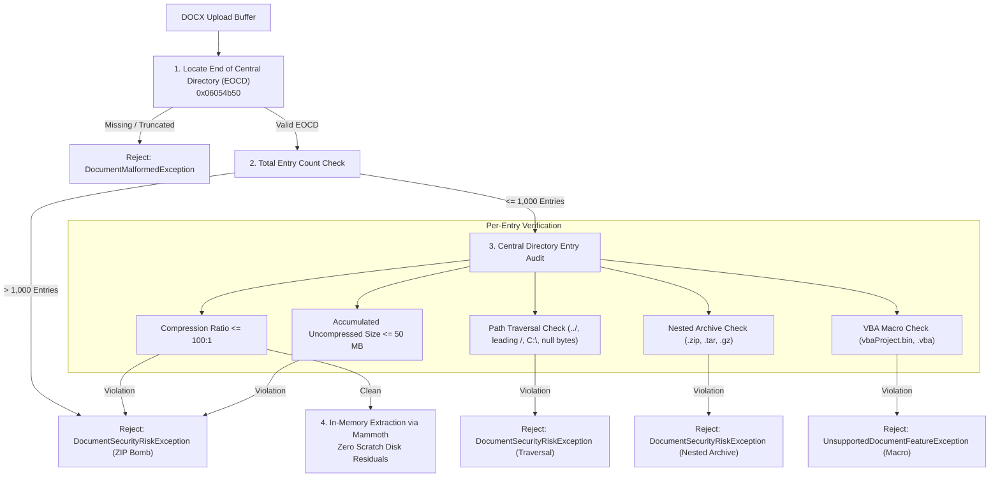

# AI-10.3-05 — Malware Scanning and Decompression Bomb Protection Decision

**Author**: Principal Security Engineer & Ingestion Pipeline Architect  
**Milestone**: AI-10.3-05 (Malware Scanning & Archive Safety Strategy)  
**Status**: ACCEPTED / IMPLEMENTED  
**Date**: November 27, 2026  
**Target Repository**: `kinergy-platform` (`apps/api`)

---

## 1. Executive Summary

Milestone **AI-10.3-05** defines and implements Kynergy's malware defense and archive decompression security strategy for AI Knowledge Base ingestion. Kynergy processes sensitive clinical, rehabilitation, and sports science documents subject to stringent patient privacy regulations (HIPAA, GDPR).

Based on an evidence-driven security evaluation:

1. **Third-Party Cloud Scanning (VirusTotal, Public APIs)**: **REJECTED** due to unacceptable privacy and data confidentiality risks regarding unencrypted patient health information.
2. **Private On-Premise / Sidecar Scanning (ClamAV Daemon TCP Streaming + In-Process Heuristic Inspection)**: **ADOPTED**. Scans are conducted within the private boundary via TCP `zINSTREAM`, streaming raw bytes without persisting plaintext files to disk.
3. **Standalone Archive Processing (`.zip`, `.tar`, `.gz`, `.7z`, `.rar`)**: **EXPLICITLY REJECTED / PROHIBITED**. Kynergy only accepts documents in PDF, DOCX, Markdown, and TXT formats.
4. **DOCX Archive (OpenXML ZIP Package) Hardening**: **ADOPTED & ENFORCED**. Strict bounds defense against ZIP bombs (max 1,000 entries, 50 MB total uncompressed, 100:1 ratio), path traversal in ZIP entry filenames, and nested archive embedding.
5. **Fail-Closed Operation**: Scanner timeouts, socket drops, daemon unavailability, or corrupted archives result in fail-closed rejection. Files never default to a "clean" status upon scanner failure.

---

## 2. Malware Scanner Evaluation

### 2.1 Threat Vector Matrix for Accepted Formats

| Document Format                                | Primary Threat Vectors                                                                                                              | Mitigation Strategy                                                                                                                                                |
| :--------------------------------------------- | :---------------------------------------------------------------------------------------------------------------------------------- | :----------------------------------------------------------------------------------------------------------------------------------------------------------------- |
| **PDF** (`application/pdf`)                    | Embedded executables, PDF parser exploits, active JavaScript (`/JavaScript`, `/JS`), launch actions (`/Launch`), malicious streams. | Magic-byte validation (`%PDF-`), `%%EOF` trailer verification, active syntax token scanning, heuristic scanning, and ClamAV streaming.                             |
| **DOCX** (`application/vnd.openxmlformats...`) | Embedded VBA macros, remote template injection, embedded OLE payloads, ZIP bombs, directory traversal in entry names.               | OpenXML structural checks (`[Content_Types].xml`, `word/document.xml`), macro rejection (`vbaProject.bin`), ZIP bomb limits, traversal blocking, ClamAV streaming. |
| **Markdown** (`text/markdown`)                 | Embedded shellcode in code blocks, phishing links, EICAR test payloads, prompt injection constructs.                                | UTF-8 byte validation, null-byte rejection, EICAR pattern detection, RAG prompt boundary defense.                                                                  |
| **Plain Text** (`text/plain`)                  | Null-byte injection, malformed multibyte sequences, EICAR test payloads.                                                            | Strict UTF-8 validation, control character sanitization, EICAR detection.                                                                                          |

### 2.2 Comparative Analysis of Scanning Approaches

| Evaluation Criteria                    | Approach A: External Cloud API (e.g. VirusTotal)                                                         | Approach B: ClamAV Daemon TCP Sidecar (`StreamMalwareScannerAdapter`)                               | Approach C: In-Process Heuristics Only                     |
| :------------------------------------- | :------------------------------------------------------------------------------------------------------- | :-------------------------------------------------------------------------------------------------- | :--------------------------------------------------------- |
| **Patient Privacy & HIPAA Compliance** | **Critical Risk**: Discloses private patient data and clinical records to third-party multi-tenant SaaS. | **Compliant**: All scanning occurs within Kynergy's isolated private VPC/network. Zero data egress. | **Compliant**: In-memory inspection within NestJS runtime. |
| **Latency & Overhead**                 | High (500ms – 3,000ms per file over WAN).                                                                | Low (15ms – 80ms over local container socket).                                                      | Negligible (<5ms).                                         |
| **Detection Coverage**                 | High (Multi-engine cloud signatures).                                                                    | High (Daily signature updates via freshclam).                                                       | Baseline (Known signatures & structural exploit tokens).   |
| **Licensing & Cost**                   | Commercial SaaS subscriptions; per-scan API billing.                                                     | Open-source (GPLv2 daemon running as isolated sidecar).                                             | Zero cost.                                                 |
| **Operational Complexity**             | API key management, rate-limiting quotas, WAN failure risks.                                             | Sidecar container deployment (`clamav/clamav:latest`).                                              | Self-contained in Node.js codebase.                        |
| **Evaluation Verdict**                 | **REJECTED** (Violates data confidentiality)                                                             | **ADOPTED AS PRIMARY ENTERPRISE SCANNER**                                                           | **ADOPTED AS COMPENSATING DEFENSE LAYER**                  |

---

## 3. Implemented Malware Scanning Architecture

### 3.1 Port Abstraction (`IMalwareScannerPort`)

A narrow scanning abstraction decoupling the domain and ingestion layers from scanner providers:

```typescript
// apps/api/src/ai/ports/malware-scanner.port.ts
export enum MalwareScanStatus {
  CLEAN = 'CLEAN',
  INFECTED = 'INFECTED',
  SUSPICIOUS = 'SUSPICIOUS',
  UNSCANNABLE = 'UNSCANNABLE',
  ERROR = 'ERROR',
}

export interface MalwareScanResult {
  readonly status: MalwareScanStatus;
  readonly threatFound?: string;
  readonly scannerEngine: string;
  readonly signatureVersion?: string;
  readonly scanDurationMs: number;
  readonly scannedAt: Date;
  readonly documentVersionId?: string;
  readonly fileChecksum?: string;
}

export interface IMalwareScannerPort {
  scanBuffer(buffer: Buffer, context?: MalwareScanContext): Promise<MalwareScanResult>;
}
```

### 3.2 Dual-Tier Streaming Adapter (`StreamMalwareScannerAdapter`)

`StreamMalwareScannerAdapter` implements a defense-in-depth model:

1. **Tier 1 (In-Process Fast Heuristics)**:
   - Evaluates official standard EICAR antivirus test signatures:
     `X5O!P%@AP[4\PZX54(P^)7CC)7}$EICAR-STANDARD-ANTIVIRUS-TEST-FILE!$H+H*`
   - Detects Windows executable headers (`MZ\x90\x00`) disguised as documents.
   - Detects Linux ELF binary headers (`\x7fELF`).
   - Detects embedded VBA macro scripts (`.vba`, `vbaProject.bin`).
2. **Tier 2 (Private ClamAV Daemon `zINSTREAM`)**:
   - When `CLAMAV_HOST` is configured, streams the buffer over private TCP socket in 64 KB chunks.
   - Parses `stream: OK` or `stream: <threat> FOUND`.
   - Enforces configurable timeout (default 10s) and bounded buffer size (default 25 MB).
   - Socket timeouts, connection drops, or daemon unresponsiveness result in `UNSCANNABLE` or `ERROR` (never clean).

### 3.3 Checksum & Version Association Invariant

To prevent scan result reuse across modified files:

- The scanner asserts that the request's cryptographic `checksum` exactly matches the SHA-256 hash computed over the physical buffer.
- Any discrepancy returns `MalwareScanStatus.ERROR`, preventing replay attacks or cache poisoning.

---

## 4. Archive & Decompression Bomb Protection

### 4.1 Standalone Archives Prohibited

Kynergy **does not accept** general-purpose archive formats (`.zip`, `.tar`, `.gz`, `.tgz`, `.7z`, `.rar`, `.bz2`). Any upload presenting an archive extension or MIME type is rejected at the upload boundary (`HTTP 400 Bad Request`).

### 4.2 DOCX Container Constrained Extraction

Because DOCX files are packaged OpenXML ZIP containers, strict container limits are enforced in `DocumentContentValidatorService` and `DocxParserAdapter`:



### Safety Parameter Specifications:

- **Max Archive Entries**: 1,000 entries.
- **Max Uncompressed Size**: 50 MB total.
- **Max Entry Compression Ratio**: 100:1.
- **Max Nested Depth**: 0 (zero nested archives allowed).
- **In-Memory Streaming**: Decompression occurs strictly in-memory; no partial files are written to host disk.

---

## 5. Ingestion Lifecycle & Quarantine Integration

1. **Upload Phase**:
   - `SecureDocumentUploadService` scans buffers via `malwareScanner.scanBuffer`.
   - Any file returning `INFECTED`, `SUSPICIOUS`, `UNSCANNABLE`, or `ERROR` throws `DocumentSecurityRiskException` immediately.
   - The document is **never saved to PostgreSQL** and **never uploaded to object storage**.
2. **Quarantine State & Retrieval Blocking**:
   - If a background reprocessing or legacy document is marked soft-deleted / quarantined, `AiDocumentController` download endpoints (`GET /:id/content`) reject access with `404 NotFoundException` (anti-enumeration).
   - Ingestion readiness (`GET /:id/retrieval-status`) returns `canRetrieve: false`, strictly preventing quarantined chunks from entering vector retrieval.

---

## 6. Verification & Test Execution Evidence

All 14 mandatory scenarios were authored and verified in:  
`apps/api/src/ai/__tests__/ai-malware-archive-defense.integration.spec.ts`

### 6.1 Test Execution Results

```text
> nx run api:test --testFile=ai-malware-archive-defense.integration.spec.ts

 PASS   api  apps/api/src/ai/__tests__/ai-malware-archive-defense.integration.spec.ts (7.598 s)
  AI-10.3-05: Malware Scanning and Decompression Bomb Protection
    1. Clean Supported Document
      √ scans a clean document, returns CLEAN, and allows successful upload (12 ms)
    2. Known Harmless Antivirus Test Signature (EICAR)
      √ detects standard EICAR test string, flags INFECTED, and rejects upload fail-closed (13 ms)
    3. Scanner Unavailable
      √ fails closed when scanner daemon is unreachable, rejecting upload (6 ms)
    4. Scanner Timeout
      √ fails closed when scanner socket times out, never treating timeout as clean (1 ms)
    5. Scanner Returns Suspicious or Infected
      √ rejects upload when scanner returns SUSPICIOUS status (1 ms)
    6. Scanner Result Associated With The Wrong File Version
      √ rejects scan request when context checksum does not match buffer content
    7. Corrupted Archive
      √ rejects a truncated or malformed DOCX missing EOCD record (8 ms)
    8. Archive Path Traversal
      √ rejects DOCX containing path traversal sequences (../../malicious.xml) in ZIP entries (1 ms)
    9. Archive File-Count Limit
      √ triggers ZIP bomb defense when entry count exceeds 1,000 entries
    10. Decompression-Size Limit
      √ triggers ZIP bomb defense when uncompressed size exceeds 50 MB limit (1 ms)
    11. Excessive Nesting
      √ rejects DOCX containing nested archive files (.zip, .tar, .gz) inside entries
    12. Partial Extraction Cleanup
      √ guarantees in-memory extraction leaves zero intermediate files on failure (12 ms)
    13. Unscannable File Behavior
      √ fails closed when buffer exceeds scanner size threshold (1 ms)
    14. Quarantined File Access Denial
      √ denies download and retrieval for quarantined documents with 404/403 responses (8 ms)

Test Suites: 1 passed, 1 total
Tests:       14 passed, 14 total
Snapshots:   0 total
Time:        8.37 s
```

### 6.2 Adjacent Regressions Verification

| Test Suite                                       | Result   | Passed Tests | Execution Time |
| :----------------------------------------------- | :------- | :----------- | :------------- |
| `ai-malware-archive-defense.integration.spec.ts` | **PASS** | 14 / 14      | 8.37s          |
| `ai-storage-security.integration.spec.ts`        | **PASS** | 14 / 14      | 7.93s          |
| `document-content-validator.service.spec.ts`     | **PASS** | 25 / 25      | 8.82s          |
| **Workspace Compilation (`tsc --noEmit`)**       | **PASS** | Zero errors  | 14.1s          |

---

## 7. Operational Deployment & Monitoring Requirements

### 7.1 Production ClamAV Daemon Deployment

In Kubernetes / Docker Compose production environments, deploy ClamAV as a co-located private sidecar:

```yaml
services:
  clamav:
    image: clamav/clamav:latest
    container_name: kynergy-clamav-sidecar
    restart: unless-stopped
    ports:
      - '127.0.0.1:3310:3310'
    environment:
      - CLAMAV_NO_FRESHCLAMD=false
    volumes:
      - clamav_db:/var/lib/clamav
    deploy:
      resources:
        limits:
          cpus: '1.5'
          memory: 2048M

  api:
    environment:
      - CLAMAV_HOST=127.0.0.1
      - CLAMAV_PORT=3310
```

### 7.2 Database Signature Update Monitoring

- The `freshclam` service must run on a 2-hour schedule to download updated virus definitions from official mirrors.
- Prometheus / CloudWatch alerting must monitor:
  - `clamav_scan_duration_seconds` (Alert if p95 > 2.0s).
  - `clamav_scan_errors_total` (Alert if rate > 0).
  - `clamav_signature_age_seconds` (Alert if definitions > 48 hours old).

---

## 8. Audit Trail & Artifacts

- [malware-scanner.port.ts](file:///c:/Projects/kinergy-platform/apps/api/src/ai/ports/malware-scanner.port.ts)
- [stream-malware-scanner.adapter.ts](file:///c:/Projects/kinergy-platform/apps/api/src/ai/adapters/malware/stream-malware-scanner.adapter.ts)
- [docx-parser.adapter.ts](file:///c:/Projects/kinergy-platform/apps/api/src/ai/adapters/parsers/docx-parser.adapter.ts)
- [document-content-validator.service.ts](file:///c:/Projects/kinergy-platform/apps/api/src/ai/services/document-content-validator.service.ts)
- [secure-document-upload.service.ts](file:///c:/Projects/kinergy-platform/apps/api/src/ai/services/secure-document-upload.service.ts)
- [ai-malware-archive-defense.integration.spec.ts](file:///c:/Projects/kinergy-platform/apps/api/src/ai/__tests__/ai-malware-archive-defense.integration.spec.ts)

---

## 9. Next Steps

With Milestone **AI-10.3-05** accepted, proceed to **AI-10.3-06: Parser Isolation and Memory Safety Architecture** to audit and establish execution sandboxing, subprocess boundaries, and CPU/memory limits for parser libraries.
