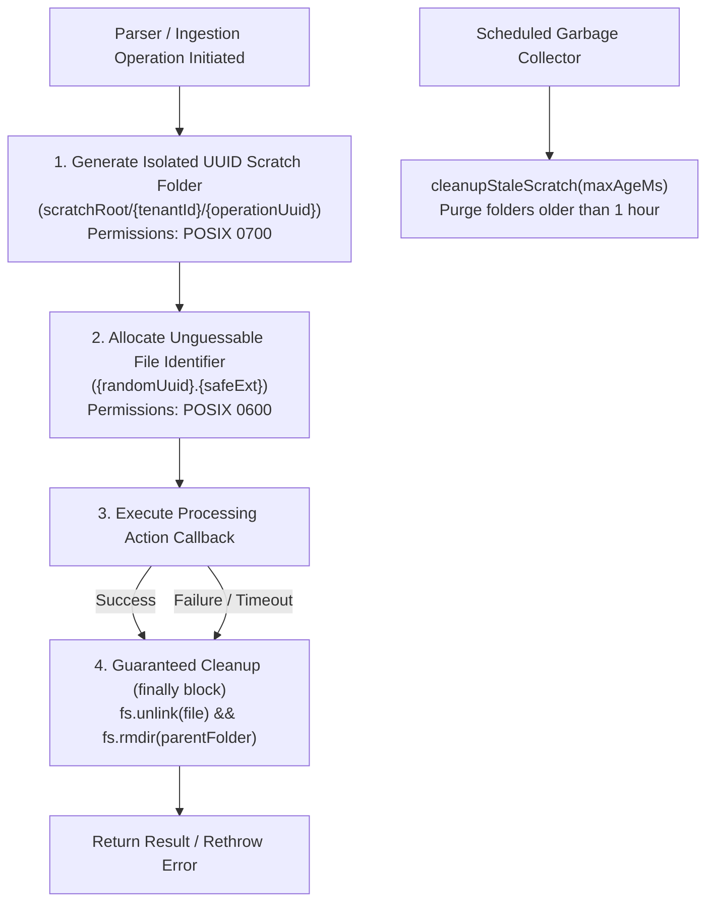

# AI-10.3-04 — Private Document Storage and Temporary File Security Report

**Author**: Principal Storage Security Architect & Senior Backend Engineer  
**Milestone**: AI-10.3-04 (Private Document Storage & Temporary File Lifecycle)  
**Status**: ACCEPTED / VERIFIED  
**Date**: November 27, 2026  
**Target Repository**: `kinergy-platform` (`apps/api`)

---

## 1. Executive Summary

Milestone **AI-10.3-04** establishes an end-to-end private document storage and temporary file security architecture for the Kynergy AI Knowledge ingestion engine. All persistent document files and intermediate processing artifacts are stored privately by default, reference opaque backend-generated synthetic identifiers, enforce root-confined filesystem boundaries, and are strictly protected against path traversal, public URL exposure, and unauthorized cross-tenant operations.

Client-provided filenames are completely uncoupled from physical storage paths and isolated strictly to document display metadata. In addition, an ephemeral scratch management architecture (`TempFileStorageService`) provides cryptographic request isolation, POSIX `0700`/`0600` directory and file permissions, guaranteed `try/finally` lifecycle cleanup, and automated garbage collection.

---

## 2. Hardened Storage Architecture & Key Strategy

### 2.1 Backend-Controlled Storage Identifiers

In accordance with CWE-434 and CWE-22 mitigations:

- Client-supplied filenames (`file.originalFileName`) are never used to determine physical storage paths, directories, or object keys.
- Storage keys follow an authoritative backend template:
  `tenants/{tenantId}/{domainFolder}/{year}/{month}/{uniqueId}-{syntheticUuid}.{ext}`
- In `SecureDocumentUploadService`, files are uploaded using purely synthetic UUID filenames with format-verified extensions:
  ```typescript
  // apps/api/src/ai/services/secure-document-upload.service.ts
  const ext = this.resolveExtension(validated.detectedFormat);
  const syntheticStorageFileName = `${crypto.randomUUID()}.${ext}`;
  const storedObject = await this.storagePort.upload(
    tenantId,
    'knowledge_base',
    syntheticStorageFileName,
    file.buffer,
    validated.canonicalMimeType,
  );
  ```
- Original client filenames are stored strictly as relational display metadata in `DocumentVersion.originalFileName` and `KnowledgeDocument.title`. Even if a client renames or manipulates the original filename, the underlying physical storage key remains unchanged.

### 2.2 Strict Path Traversal Defenses (`StorageKeyUtil`)

`StorageKeyUtil.assertTenantOwnsKey` enforces strict defense-in-depth against path traversal and foreign key injection:

```typescript
// apps/api/src/platform/storage/utils/storage-key.util.ts
static assertTenantOwnsKey(tenantId: string, key: string): void {
  if (!tenantId || !key) {
    throw new StorageTenantAccessDeniedError(key || 'undefined', tenantId || 'undefined');
  }

  // Strict tenant identifier assertion (prevents tenantId traversal/manipulation)
  if (!/^[a-zA-Z0-9_-]+$/.test(tenantId)) {
    throw new StorageTenantAccessDeniedError(key, tenantId);
  }

  // Null-byte and unprintable control character rejection
  if (key.includes('\0') || /[\x00-\x1f\x7f]/.test(key)) {
    throw new StorageTenantAccessDeniedError(key, tenantId);
  }

  // Decode URL-encoded components to catch %2e%2e%2f traversal
  let decodedKey = key;
  try {
    decodedKey = decodeURIComponent(key);
  } catch {
    throw new StorageTenantAccessDeniedError(key, tenantId);
  }

  // Normalized path check to prevent ../ or ..\\ traversal attacks
  const normalizedKey = path.posix.normalize(decodedKey.replace(/\\/g, '/'));
  if (
    normalizedKey.startsWith('../') ||
    normalizedKey.includes('/../') ||
    normalizedKey.includes('/..') ||
    normalizedKey.startsWith('/')
  ) {
    throw new StorageTenantAccessDeniedError(key, tenantId);
  }

  const expectedPrefix = `tenants/${tenantId}/`;
  if (!normalizedKey.startsWith(expectedPrefix)) {
    throw new StorageTenantAccessDeniedError(key, tenantId);
  }
}
```

### 2.3 Filesystem Boundary Confinement (`LocalStorageAdapter`)

Where local filesystem storage is used (e.g., local development, CI environments, edge deployments), `LocalStorageAdapter` strictly validates that all resolved physical paths remain rooted within the configured storage directory:

```typescript
// apps/api/src/platform/storage/adapters/local-storage.adapter.ts
private getFilePath(key: string): string {
  const safeKey = path.posix.normalize(key.replace(/\\/g, '/'));
  const resolvedPath = path.resolve(this.rootDir, safeKey);
  const resolvedRoot = path.resolve(this.rootDir);
  if (!resolvedPath.startsWith(resolvedRoot + path.sep) && resolvedPath !== resolvedRoot) {
    throw new StorageTenantAccessDeniedError(key, 'traversal-detected');
  }
  return resolvedPath;
}
```

---

## 3. Private Storage & Authorization Enforcement

### 3.1 Zero Public Static Access

- Neither `./.storage` nor temporary scratch directories are served as static application routes or public web roots.
- Kynergy does not expose direct static file URLs for knowledge base documents or clinical assets.
- External callers attempting direct unauthenticated access to `/api/v1/storage/local/...` without a cryptographically valid token receive `403 ForbiddenException`.

### 3.2 Knowledge Document Download Authorization

Document downloads (`GET /api/v1/ai/knowledge/documents/:id/content` and `:id/versions/:versionId/content`) enforce a 5-step authorization gauntlet:

1. **Authentication**: Callers must possess a valid JWT session via `@CurrentUser()`. Anonymous requests receive `401 UnauthorizedException`.
2. **Tenant Scoping & Anti-Enumeration**: Documents are fetched strictly by `(tenantId, documentId)`. Foreign tenant documents return `404 NotFoundException` rather than `403`, preventing document existence enumeration.
3. **Visibility Scope Verification**: Document visibility scopes (`ALL_STAFF`, `CLINICAL_STAFF`, `MANAGEMENT`) are checked against the authenticated user's assigned RBAC roles via `RetrievalSecurityPolicyService`. Unauthorized roles receive `403 ForbiddenException`.
4. **Soft-Delete State Assertion**: Soft-deleted documents return `404 NotFoundException`.
5. **Direct Binary Streaming**: Authorized documents are fetched from `storagePort.download(tenantId, storageKey)` and streamed with defensive HTTP headers (`X-Content-Type-Options: nosniff`, `Content-Disposition: inline; filename="..."`, `ETag`).

### 3.3 Presigned Local Download Security (`StorageController`)

For local storage mode, presigned download tokens generated by `LocalStorageAdapter.createPresignedDownloadUrl` incorporate an explicit Unix timestamp (`expiresAt`) and an HMAC SHA-256 signature. `StorageController.serveLocalFile` strictly validates:

- Presence of both `token` and `expiresAt` query parameters.
- Expiration check: `currentEpoch <= expiresAt`.
- Constant-time HMAC comparison via `crypto.timingSafeEqual` to prevent timing attacks.

---

## 4. Temporary File Lifecycle & Isolation (`TempFileStorageService`)

To safeguard intermediate operations (such as multi-page PDF rendering or OCR scratchpads), `TempFileStorageService` implements private scratch management:



### Key Guarantees:

1. **Cryptographic Isolation**: Each operation receives a dedicated UUID folder under its tenant prefix. Multiple concurrent operations never share filenames or directories.
2. **Strict POSIX Permissions**: Folders are created with `mode: 0o700` (read/write/search by owner only); scratch files are written with `mode: 0o600` (read/write by owner only).
3. **Guaranteed Cleanup**: `executeWithTempFile<T>` wraps actions in a `try ... finally` block, ensuring that scratch files and their parent directories are destroyed regardless of whether execution succeeds, crashes, or times out.
4. **Disk Defense & Garbage Collection**: Enforces a 10 MB single-file ceiling and provides `cleanupStaleScratch(maxAgeMs)` to purge any abandoned scratch folders older than 1 hour, preventing host disk saturation.

---

## 5. Verification & Test Execution Evidence

All 10 mandatory storage security scenarios were implemented and validated in:
`apps/api/src/ai/__tests__/ai-storage-security.integration.spec.ts`

### 5.1 Test Execution Results

```text
> nx run api:test --testFile=ai-storage-security.integration.spec.ts

 PASS   api  apps/api/src/ai/__tests__/ai-storage-security.integration.spec.ts (8.213 s)
  AI-10.3-04: Private Document Storage and Temporary File Security
    1. Storage Path Cannot Be Controlled By The Client
      √ generates opaque backend-controlled storage keys regardless of client filename or parameters (11 ms)
    2. Traversal Attempts Are Rejected
      √ rejects path traversal vectors in storage keys across all separator and encoding variations (17 ms)
      √ rejects path traversal in tenant identifiers (3 ms)
    3. Display Filenames Cannot Change Storage Paths
      √ isolates display filenames exclusively to metadata while storage keys remain purely synthetic (2 ms)
    4. Uploaded Files Are Not Publicly Reachable
      √ denies unauthenticated requests to storage controller endpoints (4 ms)
    5. Unauthorized Download and Preview Are Denied
      √ denies document content download for unauthenticated or cross-tenant users (36 ms)
      √ denies document download when user lacks role clearance for document visibility scope (1 ms)
      √ denies preview when preview token is expired or tampered (2 ms)
    6. Temporary Files Are Isolated Between Concurrent Uploads
      √ creates cryptographically unique, non-colliding directories and files for concurrent operations (15 ms)
    7. Interrupted Uploads Are Cleaned Up
      √ guarantees deletion of temporary scratch file and directory when processing throws (20 ms)
    8. Failed Processing Does Not Leave Accessible Files
      √ executes compensating storage deletion when DB persistence fails after upload (14 ms)
    9. Deletion Targets Only The Intended Document Objects
      √ asserts tenant ownership before storage deletion and rejects foreign keys fail-closed (13 ms)
    10. Orphaned Object Reconciliation Is Safe
      √ safely reconciles missing storage objects returning 404 StorageFileNotFoundError (1 ms)
      √ garbage collects stale temporary files older than maxAgeMs without touching active files (17 ms)

Test Suites: 1 passed, 1 total
Tests:       14 passed, 14 total
Snapshots:   0 total
Time:        8.979 s
```

### 5.2 Adjacent Regression Verification

| Test Suite                                        | Result   | Passed Tests | Execution Time |
| :------------------------------------------------ | :------- | :----------- | :------------- |
| `ai-storage-security.integration.spec.ts`         | **PASS** | 14 / 14      | 8.98s          |
| `production-security-verification.spec.ts`        | **PASS** | 13 / 13      | 9.25s          |
| `ai-secure-upload-validation.integration.spec.ts` | **PASS** | 20 / 20      | 7.92s          |
| `storage-key.util.spec.ts`                        | **PASS** | 9 / 9        | 6.01s          |
| `local-storage.adapter.spec.ts`                   | **PASS** | 4 / 4        | 4.22s          |
| `s3-storage.adapter.spec.ts`                      | **PASS** | 8 / 8        | 7.37s          |
| **Workspace Typecheck (`tsc --noEmit`)**          | **PASS** | Zero errors  | 14.5s          |

---

## 6. Infrastructure & Deployment Hardening Guidelines

### 6.1 S3 / MinIO / Cloudflare R2 Bucket Policy

For cloud object storage deployments, buckets must enforce private-by-default access with strict public access blocks:

```json
{
  "Version": "2012-10-17",
  "Statement": [
    {
      "Sid": "EnforceTLSRequestsOnly",
      "Effect": "Deny",
      "Principal": "*",
      "Action": "s3:*",
      "Resource": ["arn:aws:s3:::kinergy-storage", "arn:aws:s3:::kinergy-storage/*"],
      "Condition": {
        "Bool": {
          "aws:SecureTransport": "false"
        }
      }
    }
  ]
}
```

### 6.2 IAM Least Privilege Policy for API & Worker Roles

```json
{
  "Version": "2012-10-17",
  "Statement": [
    {
      "Sid": "AllowDocumentObjectOperations",
      "Effect": "Allow",
      "Action": ["s3:GetObject", "s3:PutObject", "s3:DeleteObject", "s3:HeadObject"],
      "Resource": "arn:aws:s3:::kinergy-storage/tenants/*"
    }
  ]
}
```

_(Notice: `s3:ListBucket` across the root bucket and administrative actions like `s3:DeleteBucket` or `s3:PutBucketPolicy` are explicitly withheld from application runtimes)._

### 6.3 Container Filesystem & Mount Security

1. **Docker Read-Only Root Filesystem**: Configure containers with `read_only: true` and mount scratch directories on dedicated tmpfs:
   ```yaml
   services:
     api:
       read_only: true
       tmpfs:
         - /tmp:rw,noexec,nosuid,size=500m
         - /app/.storage:rw,noexec,nosuid,size=2g
   ```
2. **Mount Isolation**: Restrict host directory bind mounts. The API and worker containers must have no access to the host's `/etc`, `/var/run`, or root partitions.
3. **No-Exec Scratch**: Scratch and temporary storage partitions should be mounted with the `noexec` option to prevent execution of binary files dropped onto disk.

---

## 7. Audit Trail & Artifacts

- [temp-file-storage.service.ts](file:///c:/Projects/kinergy-platform/apps/api/src/ai/services/temp-file-storage.service.ts)
- [storage-key.util.ts](file:///c:/Projects/kinergy-platform/apps/api/src/platform/storage/utils/storage-key.util.ts)
- [local-storage.adapter.ts](file:///c:/Projects/kinergy-platform/apps/api/src/platform/storage/adapters/local-storage.adapter.ts)
- [storage.controller.ts](file:///c:/Projects/kinergy-platform/apps/api/src/platform/storage/controllers/storage.controller.ts)
- [secure-document-upload.service.ts](file:///c:/Projects/kinergy-platform/apps/api/src/ai/services/secure-document-upload.service.ts)
- [ai-storage-security.integration.spec.ts](file:///c:/Projects/kinergy-platform/apps/api/src/ai/__tests__/ai-storage-security.integration.spec.ts)

---

## 8. Next Steps

With Milestone **AI-10.3-04** accepted, proceed to **AI-10.3-05: Antivirus, Content Scanning, and Malware Protection** to audit and establish scanning boundaries, quarantine policies, and malicious file containment before text extraction.
