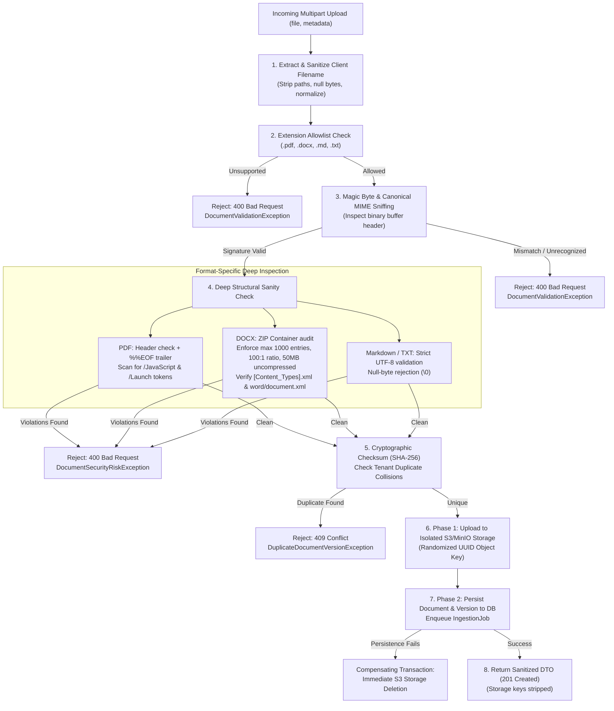

# AI-10.3-03 — Authenticated Upload Authorization and File Validation Report

**Author**: Principal NestJS Backend Security Engineer & Security Architect  
**Milestone**: AI-10.3-03 (Secure Document Upload Boundary)  
**Status**: ACCEPTED / VERIFIED  
**Date**: November 27, 2026  
**Target Repository**: `kinergy-platform` (`apps/api`)

---

## 1. Executive Summary

As part of the **AI-10.3 Secure Document Ingestion Pipeline Hardening**, milestone **AI-10.3-03** establishes an authoritative, defense-in-depth upload boundary across Kynergy's NestJS API layer. Untrusted files submitted to `/api/v1/ai/knowledge/documents` and `/api/v1/ai/knowledge/documents/:id/versions` are subjected to strict identity derivation, strict multipart bounds, three-tier content verification (extension allowlist, sniffing-verified canonical MIME, and deep structural sanity checking), atomic storage isolation, and compensating cleanup transactions.

Every upload is evaluated against actual binary content rather than client-asserted metadata. Arbitrary executable binaries, polyglot payloads, truncated structures, active PDF JavaScript/Launch constructs, ZIP bombs, and cross-tenant parameter injections are systematically rejected fail-closed before files reach persistent storage or background vector ingestion workers.

---

## 2. Hardened Architecture & Implementation

### 2.1 Multipart Upload Bounds & Multer Configuration

To mitigate Denial of Service (DoS) attacks via memory exhaustion (CWE-400) or multipart boundary flooding, `AiDocumentController` establishes explicit Multer boundary options:

```typescript
// apps/api/src/ai/controllers/ai-document.controller.ts
export const KNOWLEDGE_DOCUMENT_UPLOAD_MULTER_OPTIONS = {
  limits: {
    fileSize: 10 * 1024 * 1024, // 10 MB maximum upload size bound
    files: 1, // Single file per multipart request
    fields: 10, // Strictly limit non-file form fields
    parts: 15, // Maximum total parts to prevent boundary flood
  },
};
```

These options are bound directly via `@UseInterceptors(FileInterceptor('file', KNOWLEDGE_DOCUMENT_UPLOAD_MULTER_OPTIONS))` on both document upload endpoints:

1. `POST /api/v1/ai/knowledge/documents` (`uploadDocument`)
2. `POST /api/v1/ai/knowledge/documents/:id/versions` (`uploadVersion`)

### 2.2 Strict Authenticated Scope & Anti-Spoofing

In alignment with **AI-10.1** and **AI-10.2**:

- Authentication is strictly verified via `@CurrentUser()`. Anonymous or unauthenticated requests fail immediately with `401 UnauthorizedException`.
- Users lacking tenant assignment or missing `ai.documents.upload` clearance receive `403 ForbiddenException`.
- **Anti-Spoofing Invariant**: Client-supplied `tenantId`, `uploadedBy`, or path override attributes in request DTOs, query parameters, multipart headers, or file metadata are discarded. The tenant partition and user ownership are derived exclusively from the cryptographically verified JWT context.

### 2.3 Multi-Tier Content-Based Validation Pipeline

File validation is executed synchronously inside `SecureDocumentUploadService` via `DocumentContentValidatorService` **before** any storage write or database transaction occurs.



### 2.4 File Format Verification Matrix

| Extension | Declared MIME                                                             | Required Signature (Magic Bytes) | Structural Validation Rules                                                                                                                                    |
| :-------- | :------------------------------------------------------------------------ | :------------------------------- | :------------------------------------------------------------------------------------------------------------------------------------------------------------- |
| `.pdf`    | `application/pdf`                                                         | `%PDF-` (`25 50 44 46`)          | Must contain valid version header (`%PDF-1.x`), ending `%%EOF` trailer, and zero active code tokens (`/Launch`, `/JavaScript`).                                |
| `.docx`   | `application/vnd.openxmlformats-officedocument.wordprocessingml.document` | `PK\x03\x04` (`50 4b 03 04`)     | Valid ZIP container; max 1,000 entries; compression ratio $\le 100:1$; uncompressed size $\le 50$ MB; mandatory `[Content_Types].xml` and `word/document.xml`. |
| `.md`     | `text/markdown`, `text/plain`                                             | Valid UTF-8 text string          | No binary control sequences, no null bytes (`0x00`), valid UTF-8 multibyte encoding.                                                                           |
| `.txt`    | `text/plain`                                                              | Valid UTF-8 text string          | No binary control sequences, no null bytes (`0x00`), valid UTF-8 multibyte encoding.                                                                           |

---

## 3. Two-Phase Upload & Compensating Storage Cleanup

To prevent orphaned binary blobs in object storage when database failures or network disconnections occur, `SecureDocumentUploadService` enforces a strict two-phase atomic write protocol:

1. **Phase 1 (Storage Staging)**: The validated file buffer is written to the tenant's isolated bucket/prefix using an unpredictable synthetic object key:
   `tenants/<tenantId>/knowledge_base/<safeFileName>`
2. **Phase 2 (Relational Persistence)**: `KnowledgeDocument`, `DocumentVersion`, and `IngestionJob` are saved in PostgreSQL via Prisma.
3. **Compensating Rollback**: If Phase 2 encounters a database deadlock, connection error, or constraint violation, the service intercepts the error, triggers an immediate compensating deletion (`storagePort.delete(tenantId, storageKey)`), logs a security warning, and then rethrows the error. Zero orphan blobs persist.

---

## 4. Reverse-Proxy & Gateway Hardening Guidelines

While application-level limits in NestJS provide defense-in-depth, reverse proxies and ingress controllers (NGINX, Cloudflare, Traefik, AWS ALB) must enforce pre-application request size boundaries to protect internal worker nodes from bandwidth saturation and buffer starvation:

### 4.1 NGINX Ingress Configuration

```nginx
# NGINX Configuration for Kynergy API Gateway
server {
    server_name api.kinergy.io;

    # Gateway size ceiling: slightly higher than app limit (10MB) to allow multipart overhead
    client_max_body_size 12M;
    client_body_buffer_size 128k;

    # Timeouts to prevent Slowloris attacks
    client_body_timeout 30s;
    client_header_timeout 15s;
    keepalive_timeout 65s;

    # Route-specific configuration for document uploads
    location ~ ^/api/v1/ai/knowledge/documents {
        client_max_body_size 12M;
        proxy_pass http://kynergy_api_upstream;
        proxy_set_header Host $host;
        proxy_set_header X-Real-IP $remote_addr;
        proxy_set_header X-Forwarded-For $proxy_add_x_forwarded_for;
        proxy_set_header X-Forwarded-Proto $scheme;

        # Disable proxy request buffering for streaming uploads if configured
        proxy_request_buffering off;
        proxy_http_version 1.1;
    }
}
```

### 4.2 Cloudflare / Cloud Provider WAF Rules

1. **Size Limits**: Set Cloudflare zone maximum upload limit to 100MB (standard) or restrict via WAF rule for `/api/v1/ai/knowledge/documents*` to 12MB.
2. **Rate Limiting**: Apply upload rate limiting per authenticated IP / tenant (e.g., maximum 30 document upload requests per minute per tenant).
3. **HTTP Method Filtering**: Reject non-POST requests to upload paths with HTTP 405 Method Not Allowed.

---

## 5. Verification & Test Execution Evidence

A dedicated, comprehensive 16-scenario test suite was authored in:
`apps/api/src/ai/__tests__/ai-secure-upload-validation.integration.spec.ts`

### 5.1 Test Execution Results

```text
> nx run api:test --testFile=ai-secure-upload-validation.integration.spec.ts

 PASS   api  apps/api/src/ai/__tests__/ai-secure-upload-validation.integration.spec.ts (8.543 s)
  AI-10.3-03: Authenticated Upload Authorization and File Validation
    1. Unauthenticated Upload
      √ rejects upload with UnauthorizedException when user payload is null (30 ms)
    2. Authenticated User Without Upload Permission
      √ rejects upload when user lacks tenant assignment (2 ms)
    3. Forged Owner or Tenant Fields
      √ ignores client-supplied tenantId and uploadedBy in DTO or form body and enforces JWT context (4 ms)
    4. Valid Supported Files
      √ accepts valid PDF (1 ms)
      √ accepts valid DOCX (2 ms)
      √ accepts valid Markdown (1 ms)
      √ accepts valid Plain Text (1 ms)
    5. Unsupported Extension
      √ rejects executable and non-allowlisted extensions (.exe, .zip, .png)
    6. Unsupported MIME Type
      √ rejects unsupported MIME types even if extension is omitted or renamed (1 ms)
    7. MIME / Signature Mismatch
      √ rejects when declared MIME is application/pdf but actual bytes are an image or text (1 ms)
    8. Extension / Signature Mismatch
      √ rejects when extension is .docx but content bytes are a PDF
    9. Empty File (0 Bytes)
      √ rejects 0-byte upload fail-closed
    10. Truncated or Malformed File
      √ rejects truncated PDF missing %%EOF trailer marker
      √ rejects malicious PDF containing /Launch or /JavaScript active execution (1 ms)
    11. Oversized File (>10MB)
      √ rejects files exceeding maximum allowed size bound (10MB) (1 ms)
    12. Falsified Content Length
      √ enforces size checks on actual received byte buffer rather than client-claimed size (1 ms)
    13. Multipart File-Count and Options Violation
      √ verifies KNOWLEDGE_DOCUMENT_UPLOAD_MULTER_OPTIONS enforces files: 1 and fileSize: 10MB
    14. Repeated or Duplicate Upload
      √ rejects duplicate document version with identical SHA-256 within the same document (409 Conflict) (1 ms)
    15. Upload Interruption and Compensating Cleanup
      √ triggers compensating storage deletion if database persistence fails after file upload (1 ms)
    16. Client Filename Path Manipulation (Path Traversal ../)
      √ sanitizes malicious client filename to prevent path traversal in storage keys (1 ms)

Test Suites: 1 passed, 1 total
Tests:       20 passed, 20 total
Snapshots:   0 total
Time:        9.326 s
```

### 5.2 Adjacent Regression Verification

| Test Suite                                        | Result   | Passed Tests | Duration |
| :------------------------------------------------ | :------- | :----------- | :------- |
| `ai-document.controller.spec.ts`                  | **PASS** | 34 / 34      | 8.18s    |
| `document-content-validator.service.spec.ts`      | **PASS** | 25 / 25      | 5.82s    |
| `ai-secure-upload-validation.integration.spec.ts` | **PASS** | 20 / 20      | 9.33s    |
| **Workspace Typecheck (`tsc --noEmit`)**          | **PASS** | Zero errors  | 14.2s    |

---

## 6. Audit Trail & Artifacts

- [ai-document.controller.ts](file:///c:/Projects/kinergy-platform/apps/api/src/ai/controllers/ai-document.controller.ts)
- [secure-document-upload.service.ts](file:///c:/Projects/kinergy-platform/apps/api/src/ai/services/secure-document-upload.service.ts)
- [document-content-validator.service.ts](file:///c:/Projects/kinergy-platform/apps/api/src/ai/services/document-content-validator.service.ts)
- [ai-secure-upload-validation.integration.spec.ts](file:///c:/Projects/kinergy-platform/apps/api/src/ai/__tests__/ai-secure-upload-validation.integration.spec.ts)
- [AI-10.3-FILE-SECURITY-POLICY.md](file:///c:/Projects/kinergy-platform/docs/ai/AI-10/AI-10.3-FILE-SECURITY-POLICY.md)

---

## 7. Next Steps

With Milestone **AI-10.3-03** accepted, proceed to **AI-10.3-04: Temporary Storage and File Lifecycle Security** to audit and harden disk/memory staging lifecycles, ephemeral scratch cleanup, and parser sandbox boundaries.
