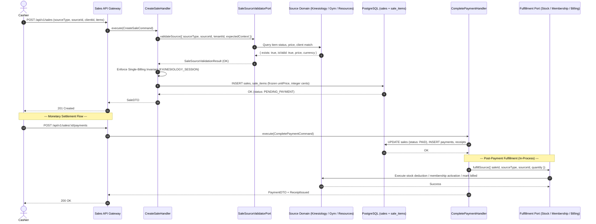

# 0139. Cross-Domain Commercial Integration Contract, Source Resolution, and Fulfillment Orchestration

- **Status**: Accepted (Approved by Project Owner)
- **Date**: 2026-10-16
- **Deciders**: Principal DDD Architect, Principal Integration Architect, Project Owner
- **Context**: Phase 7 (Commercial Sales, Payments & Receipts) — Milestone 7.19: Cross-Domain Integration Architecture. Commercial checkout sessions in the Kinergy Platform originate from four distinct bounded contexts: Kinesiology (clinical treatment encounters), Gym Management (memberships and access passes), Resources Management (retail food, beverages, and consumable supplies), and Scheduling (room/bay rentals). This ADR defines the authoritative integration contract governing source validation, price resolution, single-billing invariants, and post-settlement fulfillment.
- **Consulted ADRs**:
  - [ADR-0021: Transactional Consistency & Unit of Work Pattern](0021-transactional-consistency-unit-of-work.md)
  - [ADR-0045: Kinesiology Bounded Context and Cross-Context Identifiers](0045-kinesiology-bounded-context-and-cross-context-identifiers.md)
  - [ADR-0054: Gym Management Bounded Context Ownership and Context Map](0054-gym-management-bounded-context-ownership-and-context-map.md)
  - [ADR-0081: Resources Management Bounded Context Architecture](0081-resources-management-bounded-context-architecture.md)
  - [ADR-0104: Resources Cross-Domain Decoupling & Client Boundary Invariant](0104-resources-cross-domain-decoupling-and-client-boundary-invariant.md)
  - [ADR-0108: Deterministic Financial Representation and Currency Modeling](0108-money-representation.md)
  - [ADR-0110: Sale Transaction Ownership and Source Bounded-Context Integrity](0110-sale-ownership.md)
  - [ADR-0111: Sales & Payments Authorization, Organization Isolation, and Audit Boundaries](0111-sales-payments-authorization-and-audit.md)
  - [ADR-0112: Sales & Payments Bounded Context Establishment](0112-sales-bounded-context.md)
  - [ADR-0114: Canonical Monetary Policy, Deterministic Arithmetic, and Sale Totals](0114-canonical-monetary-policy-and-sale-totals.md)
  - [ADR-0120: Commercial Transaction Uniqueness, Idempotency, and Exactly-One-Sale Invariant](0120-commercial-transaction-uniqueness-and-sale-idempotency.md)
  - [ADR-0121: Sale Source References and Commercial Origin Model](0121-sale-source-references-and-commercial-origin-model.md)
  - [ADR-0135: Sales, Payments & Receipts Authorization Architecture, IAM Integration & Security Boundaries](0135-sales-payments-receipts-authorization-and-security.md)

---

## 1. Context and Problem Statement

A point-of-sale checkout session at Kinergy's front desk unifies transactions across multiple autonomous operational domains:

1. **Clinical Kinesiology Sessions**: Completed physiotherapy/rehabilitation appointments.
2. **Gym Memberships**: New membership plan enrollments or monthly plan renewals.
3. **Consumable Goods (Food & Drink)**: Protein shakes, energy bars, supplements, and retail merchandise.
4. **Room / Facility Rentals**: Hourly bookings of therapy studios or consultation rooms (compatibility scope).

Without an explicit, minimal integration contract, systems frequently succumb to:

- **Relational Monolith Creep**: Adding direct foreign keys between `sales` and `treatment_sessions` or `inventory_items`, destroying bounded context autonomy and GDPR compliance.
- **Client Price Trust**: Blindly accepting line item prices and totals from client HTTP bodies, enabling financial fraud.
- **Distributed Two-Phase Commit Sprawl**: Attempting distributed $2\text{PC}$ transactions across multiple database tables during checkout, causing connection exhaustion and lock contention.
- **Dual-Billing / Renewal Blocking**: Uncontrolled duplicate checkouts (billing the same clinical treatment twice) or conversely, blocking a customer from legitimately buying a second smoothie or renewing their membership.

This ADR establishes the authoritative integration contract across all four source domains.

---

## 2. Decision Drivers

1. **References Over Ownership (ADR-0110 & ADR-0121)**: Sales owns the commercial debt and payment ledger. Upstream domains own clinical encounters, membership lifecycles, and physical inventory stock.
2. **Zero Direct Persistence Foreign Keys**: `sales` and `sale_items` reference upstream entities exclusively via scalar IDs (`sourceType`, `sourceId`, `sourceCode`). Zero cross-domain `@relation` constraints exist in `prisma/schema.prisma`.
3. **Authoritative Source Pricing**: Prices are never client-authoritative. They are resolved from upstream domain truth (e.g. `InventoryItem.sellingPriceAmount`, `MembershipPlan.priceAmount`) and snapshot into immutable integer cents upon adding to a `Sale`.
4. **Operational Single-Billing vs Repeatable Purchases**:
   - Clinical encounters (`TREATMENT_SESSION`): Strictly **at most one active Sale** per session.
   - Retail consumables (`FOOD`, `DRINK`): Repeatable. Multiple sales permitted per item/SKU.
   - Membership plans (`GYM_MEMBERSHIP`): Purchasing or renewing a plan is repeatable; an active membership is activated upon payment settlement.
5. **Decoupled Fulfillment Order**:
   - Pre-sale verification (synchronous query ports): Validate existence, status, price, and stock before checkout.
   - Commercial Agreement & Payment: Formed and settled within Sales boundary (`DRAFT -> PENDING_PAYMENT -> PAID`).
   - Post-payment fulfillment (in-process capability ports): Executed sequentially upon payment confirmation (`InventoryStockDecrementPort`, `GymMembershipActivationPort`, `TreatmentBillingPort`).
6. **No Distributed Transactions ($2\text{PC}$)**: Each domain transaction executes within its own boundary. Fulfillment failures trigger explicit operational alerts and compensating reconciliation workflows, not silent half-aborted state.

---

## 3. Source Domain Ownership & Canonical Contracts

### 3.1 Kinesiology Sessions (`KINESIOLOGY_SESSION` / `TREATMENT_SESSION`)

- **Domain Owner**: Kinesiology Bounded Context (`packages/core/src/kinesiology`).
- **Entity Identity**: `SessionId` (UUID string matching `treatment_sessions.id`).
- **Billability Trigger**: A therapist completes the treatment session (`TreatmentSession.complete()`), transitioning status from `IN_PROGRESS` to `COMPLETED`.
- **Eligibility Preconditions**:
  - `TreatmentSession` must exist in `treatment_sessions`.
  - `status === 'COMPLETED'`. (Sessions in `SCHEDULED`, `IN_PROGRESS`, `CANCELLED`, or `NO_SHOW` cannot be billed).
  - Client ID on `TreatmentSession` must match `Sale.clientId`.
  - Must not already have an active, non-cancelled `Sale` in Sales (`findBySourceReference('KINESIOLOGY_SESSION', sessionId, tenantId)` must return `null`).
- **Authoritative Resolution**:
  - `sourceType`: `SaleSourceType.KINESIOLOGY_SESSION` (or `SourceType.TREATMENT_SESSION` on item).
  - `sourceId`: `sessionId`.
  - `description`: Sourced as `"Clinical Kinesiology Session - " + therapistId` or service type name.
  - `unitPrice`: Resolved from verified appointment fee schedule (decision below).
  - `currency`: Facility default ISO currency (e.g., `"USD"`).
- **Post-Payment Fulfillment**: Upon `SalePaidEvent`, invokes `TreatmentBillingPort.markSessionBilled({ sessionId, saleId })`.

---

### 3.2 Gym Memberships (`GYM_MEMBERSHIP`)

- **Domain Owner**: Gym Management Bounded Context (`packages/core/src/gym`).
- **Entity Identity**: `MembershipPlanId` (UUID string or unique plan code matching `membership_plans.id` / `code`).
- **Billability Trigger**: Customer purchases a new membership or requests plan renewal at the front desk.
- **Eligibility Preconditions**:
  - `MembershipPlan` must exist in `membership_plans`.
  - `status === 'ACTIVE'`. (`DRAFT` or `ARCHIVED` plans cannot be sold).
  - Client must be specified (`clientId` is mandatory for gym memberships).
  - If renewing an existing membership, client's current membership is verified via `checkMembershipEligibility`.
- **Authoritative Resolution**:
  - `sourceType`: `SaleSourceType.GYM_MEMBERSHIP` (or `SourceType.MEMBERSHIP_PLAN` on item).
  - `sourceId`: `membershipPlanId`.
  - `description`: Sourced directly from `MembershipPlan.name`.
  - `unitPrice`: Sourced directly from `MembershipPlan.priceAmount` (converted to integer cents).
  - `currency`: Sourced from `MembershipPlan.priceCurrency`.
- **Duplicate Prevention Policy**: Purchasing a membership plan is repeatable. It is NOT blocked by `findBySourceReference` because a plan can be sold to many clients or repeatedly over time. Concurrency defense for active memberships is governed by Gym Management's `DuplicateMembershipPolicy` (ADR-0060).
- **Post-Payment Fulfillment**: Upon `SalePaidEvent`, invokes `GymMembershipActivationPort.activateOrRenew({ clientId, planId, paymentRef: saleId })`.

---

### 3.3 Consumables (`FOOD` & `DRINK`)

- **Domain Owner**: Resources Management Bounded Context (`packages/core/src/resources`).
- **Entity Identity**: `InventoryItemId` (UUID string matching `inventory_items.id` or unique SKU).
- **Billability Trigger**: Customer orders a meal, beverage, or retail product at the reception point of sale.
- **Eligibility Preconditions**:
  - `InventoryItem` must exist in `inventory_items`.
  - `status === 'ACTIVE'`.
  - `category` must match `HEALTHY_MEALS` (for `FOOD`) or `HEALTHY_DRINKS` (for `DRINK`) or `RETAIL_PRODUCTS`.
  - Stock availability check: `quantityOnHand >= requestedQuantity` (pre-sale check).
- **Authoritative Resolution**:
  - `sourceType`: `SaleSourceType.FOOD` or `SaleSourceType.DRINK` (`SourceType.INVENTORY_ITEM` on item).
  - `sourceId`: `inventoryItemId`.
  - `sourceCode`: `InventoryItem.sku`.
  - `description`: Sourced directly from `InventoryItem.name`.
  - `unitPrice`: Sourced directly from `InventoryItem.sellingPriceAmount` (converted to integer cents).
  - `currency`: Sourced from `InventoryItem.sellingPriceCurrency`.
  - `clientId`: Strictly optional (`null` allowed for anonymous walk-in purchases).
- **Duplicate Prevention Policy**: Repeatable. Multiple sales of the same item/SKU are valid and encouraged.
- **Post-Payment Fulfillment**: Upon `SalePaidEvent`, invokes `InventoryStockDecrementPort.sellStock({ itemId, quantity, referenceId: saleId, actorId, reason: 'Retail point-of-sale checkout' })`.

---

### 3.4 Room Rentals (`ROOM_RENTAL` — Compatibility Preservation)

- **Domain Owner**: Scheduling Bounded Context (`apps/api/src/scheduling` / `Room`).
- **Entity Identity**: `RoomId` / `BookingId`.
- **Scope**: Compatibility preservation only. Validated as a supported `SaleSourceType`, but active scheduling workflow integration is deferred to enterprise facility milestones.

---

## 4. Integration Sequence & Transaction Boundaries

---

## 5. Error Behavior & Boundary Failure Matrix

| Failure Condition                                  | Detection Layer           | Error Code / Exception                               |      HTTP Status       | Consequence                                                           |
| :------------------------------------------------- | :------------------------ | :--------------------------------------------------- | :--------------------: | :-------------------------------------------------------------------- |
| Upstream entity does not exist                     | `SaleSourceValidatorPort` | `SourceNotFoundException` (`SOURCE_NOT_FOUND`)       |    `404 Not Found`     | Checkout rejected. Zero database mutations.                           |
| Clinical session not in `COMPLETED` status         | `SaleSourceValidatorPort` | `InvalidSaleSourceException` (`SOURCE_NOT_BILLABLE`) |  `422 Unprocessable`   | Sale creation blocked. Cashier notified session is still in progress. |
| Clinical session already billed in an active Sale  | `CreateSaleHandler`       | `DuplicateSaleException` (`DUPLICATE_SALE`)          |     `409 Conflict`     | Prohibits duplicate billing. Returns conflicting `saleId`.            |
| Client mismatch between session and sale           | `CreateSaleHandler`       | `InvalidSaleSourceException` (`CLIENT_MISMATCH`)     |  `422 Unprocessable`   | Prohibits billing a session to an unrelated customer.                 |
| Consumable stock depleted (`currentStock < qty`)   | Pre-sale query port       | `InvalidSaleItemException` (`INSUFFICIENT_STOCK`)    |  `422 Unprocessable`   | Item cannot be added to cart.                                         |
| Post-payment fulfillment failure (e.g. stock lock) | Fulfillment Adapter       | `FulfillmentFailedException` (`FULFILLMENT_FAILED`)  | `500 Internal` / Alert | Sale and Payment remain `PAID`; operational compensation task logged. |
| Cross-tenant entity access probe                   | Multi-tenant Guard        | `TenantMismatchException` (`TENANT_MISMATCH`)        |    `404 Not Found`     | Rejects access; audit event emitted.                                  |

---

## 6. What is Explicitly Out of Scope

1. **Distributed Two-Phase Commit ($2\text{PC}$)**: No XA distributed database transactions across bounded contexts.
2. **RabbitMQ / Kafka Distributed Event Brokers**: All inter-domain coordination is in-process using NestJS DI and TypeScript port interfaces.
3. **Medical Record Mutation**: Sales **never** writes to `treatment_sessions` medical notes or alters clinical charts.
4. **Room Scheduling Engine**: Real-time calendar conflict resolution for `ROOM_RENTAL` remains within Scheduling.

---

---

## 7. Approved Decisions by Project Owner

The following canonical business rules were formally confirmed and approved:

1. **Roadmap Alignment (Milestone Sequence)**:
   - Milestone 7.17 remains **Receipt PDF and Thermal Rendering**.
   - Milestone 7.18 remains **Receipt Reprint Auditing**.
   - Cross-Domain Commercial Integration is officially designated as **Milestone 7.19: Cross-Domain Integration & End-to-End Commercial Orchestration**.

2. **Decision Item 1: Clinical Kinesiology Session Price Authority**:
   - **Approved**: Sourced from the linked `Appointment` service type fee schedule via `SchedulingAppointmentLookupPort`. This maintains pure separation: clinical therapy notes in Kinesiology remain free of billing details, while appointment scheduling tracks scheduled service catalog rates.

3. **Decision Item 2: Clinical Session Billed Indicator**:
   - **Approved**: Session billing emits an in-process `TreatmentSessionBilledIntegrationEvent` projected to audit logs and client timeline. This preserves `TreatmentSession` as an immutable medico-legal record without mutating the clinical aggregate or adding redundant schema columns.
