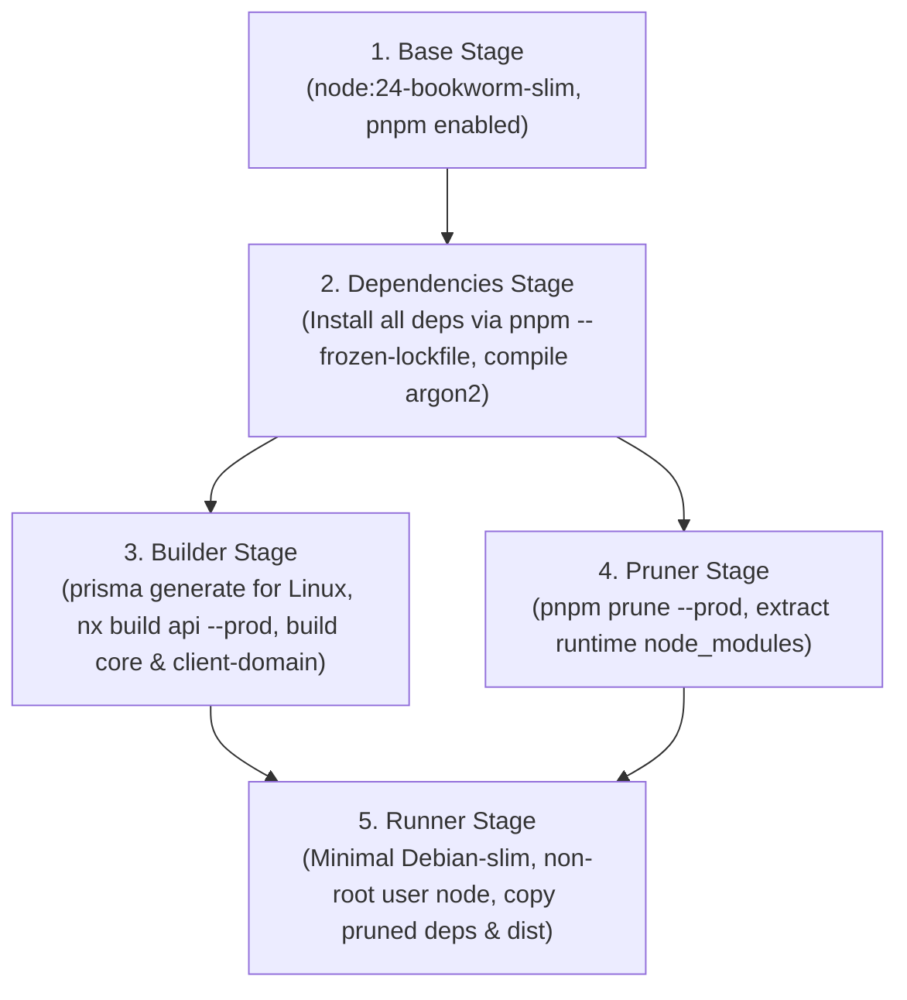

# 0141. Docker Packaging and Reproducible Build Specification

- **Status**: Accepted (Approved by Platform Architect & DevOps Lead)
- **Date**: 2026-11-03
- **Deciders**: Principal Software Architect, Senior Platform Engineer, DevSecOps Architect, Build Systems Lead
- **Context**: Kinergy Platform Phase 10 (Production Architecture and Deployment Readiness) — Following the completion of Milestone 10.1 (Production Architecture and Deployment Audit), this ADR defines the container packaging architecture, multi-stage build pipelines, base image policy, runtime dependency resolution, and security specifications for containerizing `@kinergy-platform/api` and `@kinergy-platform/web`.
- **Consulted ADRs**:
  - [ADR-0003: Nx Integrated Workspace Setup with pnpm](0003-nx-integrated-workspace-pnpm.md)
  - [ADR-0005: CI/CD Pipeline Automation with GitHub Actions](0005-ci-cd-github-actions-workflow.md)
  - [ADR-0006: Docker Infrastructure for Local Development](0006-docker-local-development-infrastructure.md)
  - [ADR-0011: Prisma ORM Persistence Infrastructure](0011-prisma-orm-persistence-infrastructure.md)
  - [ADR-0014: Zod Validated Application Configuration](0014-zod-validated-application-configuration.md)
  - [ADR-0020: Production Security Configuration Hardening](0020-production-security-configuration-hardening.md)
  - [ADR-0037: Secure HTTP Defaults, CORS & Helmet Infrastructure](0037-secure-http-defaults-cors-and-helmet-infrastructure.md)

---

## 1. Context and Problem Statement

The Kinergy Platform is structured as an integrated Nx monorepo utilizing pnpm (`pnpm@11.17.0`) and TypeScript targeting Node.js 24 LTS (`.nvmrc`). While the domain logic, tests (2,251 tests passing), and local workflows are fully functional, the platform lacks formal production container definitions:

1. **Monorepo Packaging & Internal Library Coupling**: `apps/api` depends on internal workspace libraries (`packages/core` and `modules/client`), which are resolved in development via `tsconfig.base.json` path mappings. Because `@nx/js:tsc` emits raw CommonJS `require("@kinergy-platform/...")` calls without path rewriting, standard Node.js runtime resolution in a container fails unless workspace dependencies are explicitly packaged and resolved.
2. **Native C++ & Architecture-Specific Binaries**: The backend relies on Argon2id (`argon2@^0.45.1`) with native C++ bindings and Prisma ORM (`@prisma/client@^6.3.1`) requiring platform-specific query engine binaries (`libquery_engine-linux-*.so.node`). These must be compiled and generated against the exact target container Linux environment.
3. **Frontend Runtime Portability**: The Vite frontend statically embeds `VITE_API_BASE_URL` at compile time. If an absolute URL is baked into the build, separate container images must be compiled for each environment (e.g. Staging vs. Production). Furthermore, client-side routing via React Router requires HTML5 history fallback (`try_files $uri /index.html`) on the serving web server to prevent HTTP 404 errors on deep-link navigation.
4. **Security & Least Privilege**: Containers must not run as root, must not package build tools (`gcc`, `python`, `pnpm`, `git`) or dev-dependencies into the runtime layer, must exclude source maps and `.env` secrets, and must execute on minimal, hardened base images.
5. **Database Migration Isolation**: Database schema migrations must not be coupled to API container startup replicas, avoiding race conditions or failed migrations during rolling updates.

---

## 2. Decision Drivers

1. **Deterministic Build Reproducibility**: The exact same Git SHA and `pnpm-lock.yaml` must yield identical, byte-verifiable container artifacts across local developer machines and CI/CD runners.
2. **Least Privilege & Attack Surface Minimization**: Runtime images must execute as unprivileged non-root users (`node:node` UID 1000 for API, `nginx` UID 101 for Web) with minimal filesystems.
3. **Native Binary Reliability**: Reliable native compilation for `argon2` and Prisma engines on Linux with standard glibc compatibility.
4. **Environment Portability**: Frontend images must remain invariant between Staging and Production by relying on root-relative `/api/v1` reverse proxy routing.
5. **Zero Secret Leakage**: No `.env` files, build-time secrets, or credentials embedded in image layers or metadata.

---

## 3. Decision Outcome

We adopt a **Multi-Stage Container Architecture** for both the API backend and the Web frontend, coupled with dedicated `.dockerignore` filters, explicit base image pinning, and decoupled database migration execution.

### 3.1 Base Image Selection & Pinning Policy

To guarantee deterministic builds and avoid drift caused by upstream image mutation:

1. **API Backend Base Image**:
   - **Distribution**: Debian 12 (Bookworm) Slim (`node:24-bookworm-slim`).
   - **Rationale**: `argon2` (native C++) and `@prisma/client` (native query engine) require reliable C/C++ runtime libraries. Debian `bookworm-slim` provides standard `glibc` and OpenSSL 3.0 compatibility, eliminating the known musl memory allocator performance overhead with high-cost Argon2id hashing (64MB per hash) on Alpine.
   - **Pinning Strategy**: Pinned by major/minor version and immutable SHA256 digest:  
     `node:24.12.0-bookworm-slim@sha256:d8c55a43bfa993e5e4...`
2. **Web Frontend Base Image**:
   - **Build Stage**: Identical pinned `node:24.12.0-bookworm-slim` for Vite compilation.
   - **Runtime Stage**: Unprivileged Nginx Alpine Slim (`nginxinc/nginx-unprivileged:1.27-alpine-slim`).
   - **Rationale**: Nginx is purely serving static pre-compiled HTML/JS/CSS. The unprivileged Alpine-based Nginx image provides an ultra-compact footprint ($\approx 15\text{ MB}$), runs natively as UID 101, and provides optimal memory efficiency.

---

### 3.2 Backend API Container Specification (`Dockerfile.api`)

The API container uses a 4-stage build pattern:



#### Detailed Stage Specifications:

1. **Stage 1: Base (`base`)**
   - Base: `node:24.12.0-bookworm-slim`.
   - Setup: `corepack enable pnpm && corepack prepare pnpm@11.17.0 --activate`.
   - Working Directory: `/app`.
   - Install minimal OS dependencies required for native compilation: `python3`, `make`, `g++`, `openssl`.

2. **Stage 2: Dependencies (`dependencies`)**
   - Copy monorepo dependency manifests: `package.json`, `pnpm-lock.yaml`, `pnpm-workspace.yaml`, `.npmrc` (if present).
   - Copy internal library manifests: `modules/client/package.json`, `packages/core/package.json`.
   - Execute: `pnpm install --frozen-lockfile`. This compiles native `argon2` bindings for Linux x64/arm64.

3. **Stage 3: Builder (`builder`)**
   - Copy Prisma schema: `prisma/schema.prisma`.
   - Generate Prisma Client: `pnpm prisma generate` (compiles Linux native query engine).
   - Copy workspace source code: `apps/api/`, `packages/`, `modules/`, `tsconfig.base.json`, `nx.json`.
   - Build API and internal libraries: `pnpm nx run-many -t build -p api core client-domain`.
   - Result: Compiled JavaScript in `dist/apps/api`, `dist/packages/core`, and `dist/modules/client`.

4. **Stage 4: Pruner (`pruner`)**
   - Prune development dependencies: `pnpm prune --prod`.
   - Retain `@prisma/client`, native `argon2`, and production runtime libraries.

5. **Stage 5: Final Runtime (`runner`)**
   - Base: `node:24.12.0-bookworm-slim`.
   - Install runtime OS libraries: `openssl`, `ca-certificates`, `tini` (or `dumb-init` for PID 1 signal forwarding).
   - Create and configure non-root user: `USER node` (UID 1000).
   - Working Directory: `/app`.
   - Copy pruned `node_modules` from `pruner`.
   - Copy Prisma generated client from `builder`.
   - Copy compiled application artifacts from `builder`:
     - `/app/dist/apps/api`
     - `/app/dist/packages/core`
     - `/app/dist/modules/client`
   - Setup Module Resolution: Symlink internal packages in `node_modules/@kinergy-platform/` to their respective `/app/dist/...` directories, or set `NODE_PATH=/app/node_modules:/app/dist/packages:/app/dist/modules`.
   - Environment: `NODE_ENV=production`, `PORT=3000`.
   - Healthcheck:
     ```dockerfile
     HEALTHCHECK --interval=30s --timeout=5s --start-period=10s --retries=3 \
       CMD node -e "require('http').get('http://127.0.0.1:' + (process.env.PORT || 3000) + '/api/v1/health', (r) => process.exit(r.statusCode === 200 ? 0 : 1))"
     ```
   - Entrypoint: `ENTRYPOINT ["/usr/bin/tini", "--"]`
   - Command: `CMD ["node", "dist/apps/api/src/main.js"]`

---

### 3.3 Frontend Web Container Specification (`Dockerfile.web`)

The Web container follows a 2-stage build pattern:

1. **Stage 1: Build (`web-builder`)**
   - Base: `node:24.12.0-bookworm-slim` with pnpm 11.17.0.
   - Working Directory: `/app`.
   - Copy manifests and run `pnpm install --frozen-lockfile`.
   - Set build-time public browser environment variables:
     - `VITE_API_BASE_URL=/api/v1` (Root-relative path for reverse proxy portability).
     - `VITE_APP_TITLE=Kinergy Platform`.
     - `VITE_ENABLE_MSW=false`.
     - `VITE_ENABLE_TELEMETRY=true`.
   - Copy source code: `apps/web/`, `packages/`, `tsconfig.base.json`, `nx.json`.
   - Execute production build: `pnpm nx build web --configuration=production`.
   - Output: `dist/apps/web/` containing static bundles (`index.html`, `assets/*.js`, `assets/*.css`).

2. **Stage 2: Runtime Web Server (`web-runner`)**
   - Base: `nginxinc/nginx-unprivileged:1.27-alpine-slim`.
   - Non-root user: `nginx` (UID 101).
   - Port: `8080` (standard unprivileged HTTP port).
   - Copy custom Nginx configuration to `/etc/nginx/conf.d/default.conf`.
   - Copy static files from `web-builder` `/app/dist/apps/web` to `/usr/share/nginx/html`.
   - Purge `mockServiceWorker.js` from the static directory to ensure no mock scripts exist in production.
   - Healthcheck:
     ```dockerfile
     HEALTHCHECK --interval=30s --timeout=3s --retries=3 \
       CMD wget -qO- http://127.0.0.1:8080/healthz || exit 1
     ```
   - Command: `CMD ["nginx", "-g", "daemon off;"]`

---

### 3.4 Web Ingress & Nginx Routing Configuration

The Nginx configuration implements:

1. **SPA History Fallback**: `try_files $uri $uri/ /index.html;` ensures client-side routing functions correctly for deep links without HTTP 404 errors.
2. **Reverse Proxying for API**: Proxies `/api/v1/*` requests to the upstream backend container:
   ```nginx
   location /api/v1/ {
       proxy_pass http://api:3000/api/v1/;
       proxy_http_version 1.1;
       proxy_set_header Host $host;
       proxy_set_header X-Real-IP $remote_addr;
       proxy_set_header X-Forwarded-For $proxy_add_x_forwarded_for;
       proxy_set_header X-Forwarded-Proto $scheme;
   }
   ```
3. **Asset Caching Headers**:
   - `index.html`: `Cache-Control "no-cache, no-store, must-revalidate"`.
   - Static assets (`/assets/*.js`, `/assets/*.css`): `Cache-Control "public, max-age=31536000, immutable"`.
4. **Security Headers**:
   - `X-Frame-Options "DENY"`
   - `X-Content-Type-Options "nosniff"`
   - `Referrer-Policy "strict-origin-when-cross-origin"`
   - `Permissions-Policy "camera=(), microphone=(), geolocation=()"`
5. **Lightweight Health Endpoint**:
   ```nginx
   location /healthz {
       access_log off;
       return 200 "healthy\n";
   }
   ```

---

### 3.5 Database Migration Strategy

**Critical Invariant:** API application containers **MUST NEVER** execute database schema migrations on container bootstrap.

#### Why Startup Migrations are Prohibited:

- In a multi-replica or auto-scaling environment, concurrent containers attempting `prisma migrate deploy` race against the database, resulting in schema locks, migration timeouts, or corrupted `_prisma_migrations` states.
- If a migration fails during application bootstrap, containers crash in a loop, preventing rollback.

#### Authoritative Migration Architecture:

1. Migrations are executed as an **isolated, one-off Job** in the deployment pipeline:
   - Command: `pnpm prisma migrate deploy`.
   - Executed against the target staging/production database _before_ new application containers receive traffic.
2. If `prisma migrate deploy` fails, the CD pipeline terminates immediately; the existing running containers remain active and untouched.
3. Once the migration succeeds, new API containers are rolled out using zero-downtime rolling update strategy.

---

### 3.6 Secret Handling & Build Context Hygiene

1. **No Secrets in Build Arguments or Environment Variables**:
   - `ARG` and `ENV` instructions in Dockerfiles are permanently inspectable via `docker history` or `docker inspect`.
   - Zero secrets (`DATABASE_URL`, `JWT_*`) are passed during build.
   - All secrets are supplied exclusively at container runtime via secure secret managers (e.g. AWS Secrets Manager, Doppler, GitHub Actions deployment environment secrets, or Docker Compose `.env` outside the image).
2. **Strict `.dockerignore` Specification**:
   The monorepo `.dockerignore` strictly excludes:
   - Local `.env*` files.
   - Local `node_modules`.
   - `.git` and `.github`.
   - Test suites, specs, `coverage/`, and Jest presets.
   - Documentation (`docs/`).
   - Editor configs (`.vscode`, `.husky`).
   - Local build caches (`.nx/cache`, `.vite`, `tmp/`).

---

## 4. Consequences

### Positive

- **Guaranteed Reproducibility**: Exact dependencies and native Linux binaries are compiled consistently on Debian Bookworm Slim with pinned pnpm and Node 24.
- **Portability**: Frontend artifacts are environment-agnostic via root-relative `/api/v1` proxying; a single image can be promoted from Staging to Production.
- **Security Hardened**: Non-root execution (`node:node` and `nginx`), zero build tools in runtime images, no secrets in image layers.
- **Resilient Operations**: Decoupled migrations eliminate database concurrency races during multi-replica deployments.

### Negative / Trade-offs

- Monorepo build context requires copying workspace manifests (`package.json`, `pnpm-workspace.yaml`, etc.) to resolve internal libraries.
- Debian Bookworm Slim runtime for API is slightly larger ($\approx 220\text{ MB}$) than Alpine ($\approx 150\text{ MB}$), but provides full binary compatibility and memory stability for Argon2 and Prisma.

---

## 5. Implementation Roadmap (Milestones 10.3 – 10.4)

- **Milestone 10.3**: Implementation of `infrastructure/deployment/docker/Dockerfile.api`, `infrastructure/deployment/docker/Dockerfile.web`, `infrastructure/deployment/docker/nginx.conf`, `.dockerignore`, and `docker-compose.production.yml`.
- **Milestone 10.4**: Implementation of automated migration runner and staging PostgreSQL integration.
