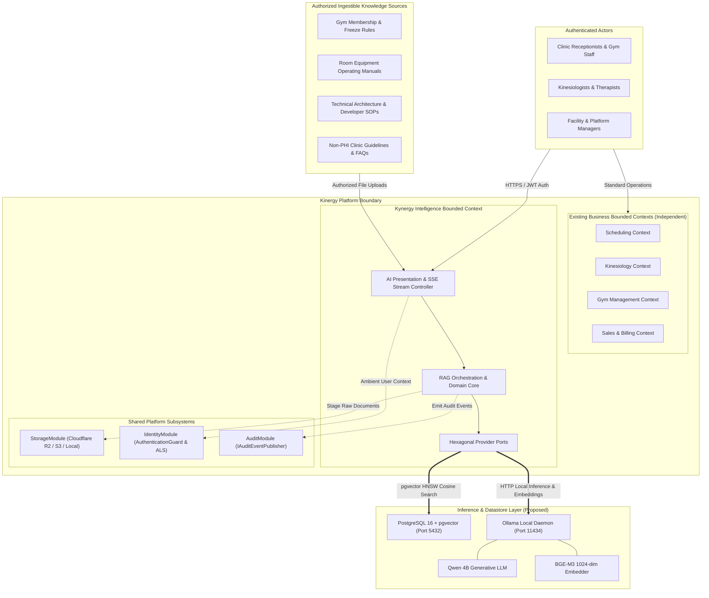
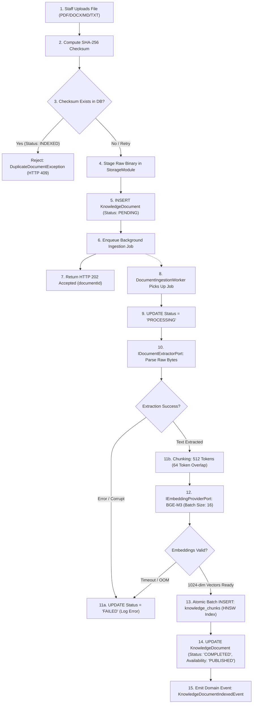
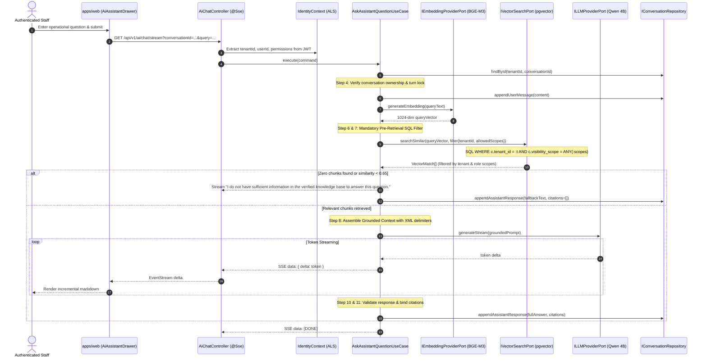
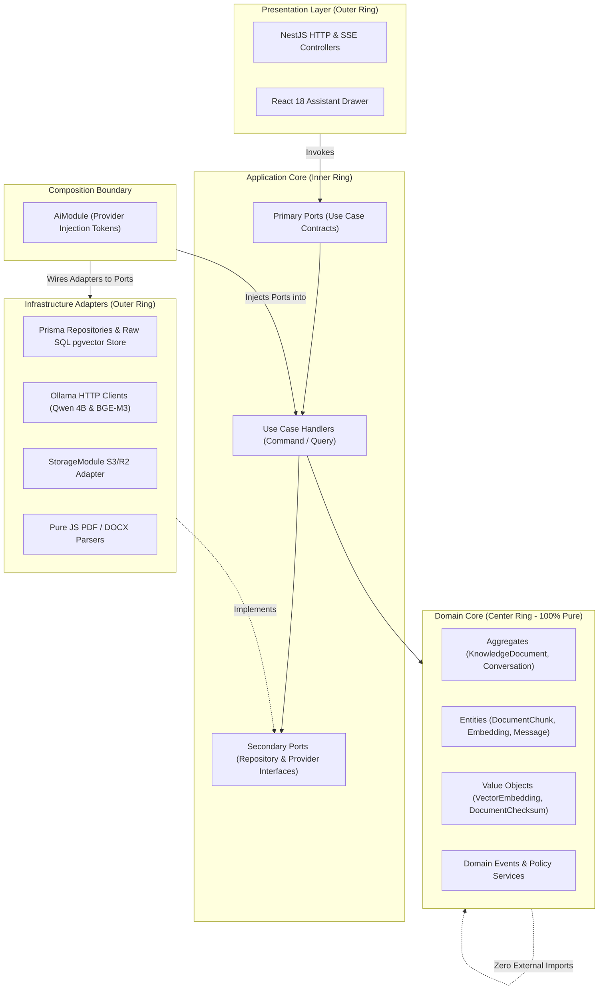

# Kynergy Intelligence Architecture Specification (AI-01.4)

- **Status**: PROPOSED (MASTER ARCHITECTURAL DESIGN & DECISION GOVERNANCE)
- **Date**: 2026-11-19
- **Author Role**: Principal Enterprise Architect, Principal AI Systems Architect, Security Architect
- **Repository**: `izzydin/kinergy-platform`
- **Milestone**: AI-01 — Kynergy Intelligence Architecture & Domain Design
- **Sub-Task**: AI-01.4 — Architecture Decision Records & Visual Topologies
- **Traceability**: Derived from [`docs/ai/AI-01-ARCHITECTURE-BASELINE.md`](file:///c:/Projects/kinergy-platform/docs/ai/AI-01-ARCHITECTURE-BASELINE.md) and [`docs/ai/AI-01-DOMAIN-MODEL.md`](file:///c:/Projects/kinergy-platform/docs/ai/AI-01-DOMAIN-MODEL.md)

---

## 1. Executive Summary & Mission Alignment

This master architecture document specifies the technical design, application use cases, hexagonal provider contracts, multi-tenant boundaries, security guardrails, configuration management, error taxonomy, resilience patterns, visual topologies, and architectural decision governance for **Kynergy Intelligence**, the dedicated Artificial Intelligence and Retrieval-Augmented Generation (RAG) bounded context of the **Kinergy Platform**.

In strict compliance with Kinergy's engineering standards:

1. **Zero-Infrastructure Domain & Application Purity**: No application use case, port interface, or domain model imports from `@nestjs/*`, `@prisma/client`, `ollama`, `openai`, `@langchain/*`, or transport libraries.
2. **Provider Independence**: All external AI dependencies (LLM inference, dense embeddings, vector search, text extraction, binary storage) are decoupled behind pure, technology-neutral TypeScript port interfaces.
3. **Pre-Retrieval SQL Authorization**: Multi-tenant isolation (`tenant_id`) and role access (`visibility_scope`) are mathematically guaranteed in database queries before vector similarity ranking, augmented by a second in-memory authorization validation barrier before context enters the LLM prompt.
4. **Core Platform Isolation & Resilience**: Failures in local inference (Ollama daemon offline, VRAM exhaustion, GPU timeouts) degrade gracefully with zero disruption to core platform functionality (turnstiles, clinical scheduling, POS sales continue uninterrupted).
5. **Pure Specification**: This document is purely architectural; no application source code (`.ts` files), Prisma schemas, or dependencies are modified.

---

## 2. Visual Architecture Diagrams & System Topologies

The following six authoritative Mermaid diagrams communicate the complete architectural topology of Kynergy Intelligence:

### Diagram A: System Context Architecture (C4 Level 1)

Illustrates how authenticated internal staff and existing business domains interact with Kynergy Intelligence and underlying infrastructure:



---

### Diagram B: AI Bounded Context Hexagonal Architecture (C4 Level 2)

Depicts the presentation controllers, inbound use-case ports, domain core, outbound provider ports, and concrete server infrastructure adapters:

```mermaid
graph TD
    subgraph PresentationLayer["Presentation Tier (apps/api/src/ai)"]
        RestCtrl["AiKnowledgeController (Document Upload & Admin)"]
        SseCtrl["AiChatController (SSE Streaming Chat)"]
        ContextInterceptor["AiContextInterceptor (ALS Identity Extraction)"]
        RestCtrl --- ContextInterceptor
        SseCtrl --- ContextInterceptor
    end

    subgraph InboundPorts["Primary (Inbound) Ports"]
        IngestPort["IIngestDocumentUseCase"]
        ProcessPort["IProcessDocumentUseCase"]
        SearchPort["ISearchKnowledgeUseCase"]
        AskPort["IAskAssistantQuestionUseCase"]
    end

    subgraph DomainCore["Domain Core (packages/core/src/ai/domain)"]
        DocAgg["KnowledgeDocument (Aggregate Root)"]
        ChunkEntity["DocumentChunk (Entity)"]
        EmbeddingEntity["Embedding (Entity - 1024 dim)"]
        ConvAgg["Conversation (Aggregate Root)"]
        MsgEntity["Message (Entity)"]
        PolicyService["DocumentIngestionPolicyService"]
        DocAgg *-- ChunkEntity
        ChunkEntity *-- EmbeddingEntity
        ConvAgg *-- MsgEntity
    end

    subgraph OutboundPorts["Secondary (Outbound) Ports (packages/core/src/ai/ports)"]
        DocRepoPort["IKnowledgeDocumentRepository"]
        ConvRepoPort["IConversationRepository"]
        LlmPort["ILLMProviderPort"]
        EmbedPort["IEmbeddingProviderPort"]
        VectorPort["IVectorSearchPort"]
        ExtractorPort["IDocumentExtractorPort"]
        StoragePort["IObjectStoragePort"]
    end

    subgraph InfrastructureAdapters["Infrastructure Adapters (packages/core/src/server.ts)"]
        PrismaDocRepo["PrismaKnowledgeDocumentRepository"]
        PrismaConvRepo["PrismaConversationRepository"]
        OllamaLlm["OllamaLLMAdapter (Qwen 4B)"]
        OllamaEmbed["OllamaEmbeddingAdapter (BGE-M3)"]
        PgVectorStore["PgVectorKnowledgeStoreAdapter"]
        PdfExtractor["PureJsPdfExtractorAdapter"]
        DocxExtractor["PureJsDocxExtractorAdapter"]
        KinergyStorage["KinergyStorageModuleAdapter"]
    end

    PresentationLayer --> InboundPorts
    InboundPorts --> DomainCore
    DomainCore --> OutboundPorts

    DocRepoPort <|.. PrismaDocRepo
    ConvRepoPort <|.. PrismaConvRepo
    LlmPort <|.. OllamaLlm
    EmbedPort <|.. OllamaEmbed
    VectorPort <|.. PgVectorStore
    ExtractorPort <|.. PdfExtractor
    ExtractorPort <|.. DocxExtractor
    StoragePort <|.. KinergyStorage
```

---

### Diagram C: Document Ingestion Pipeline & Lifecycle Flow

Traces a document from binary upload and SHA-256 validation through text extraction, 512-token chunking, batch vectorization, and atomic commit:



---

### Diagram D: RAG Retrieval and Generation Sequence

Details the end-to-end conversational synthesis turn, highlighting pre-retrieval SQL filtering, context sandboxing, token streaming, and citation binding:



---

### Diagram E: Clean Architecture Dependency Direction

Explicitly communicates layer isolation, port ownership, and dependency inversion:



---

### Diagram F: Deployment Topology and Failure Isolation

Demonstrates physical infrastructure deployment and proves that an Ollama inference outage has zero impact on core platform operations:

```mermaid
flowchart TD
    subgraph ClientBrowsers["Client Web Browsers"]
        StaffBrowser["Staff Browser (React SPA)"]
        PublicBrowser["Client / Member Browser"]
    end

    subgraph ReverseProxy["Edge Ingress Tier"]
        NginxProxy["Alpine Nginx (Port 8080)"]
    end

    subgraph ApplicationServer["Application Node (NestJS 10 API - Port 3000)"]
        CoreApi["Core Kinergy Modules (Scheduling, Gym, Sales, Kinesiology)"]
        AiApi["Kynergy Intelligence Module (AiModule)"]
        CircuitBreaker["In-Memory Circuit Breaker (Timeout: 3s)"]
        AiApi --- CircuitBreaker
    end

    subgraph DatabaseHost["Database Tier (PostgreSQL 16)"]
        CoreTables["Core Relational Tables (users, appointments, sales, clients)"]
        AiTables["AI Vector Tables (knowledge_documents, knowledge_chunks - pgvector)"]
    end

    subgraph InferenceHost["Local Inference Service (Proposed Target)"]
        OllamaService["Ollama Daemon (Port 11434)"]
        HostGPU["Host GPU: NVIDIA RTX 3060 Ti (8GB GDDR6 VRAM)"]
        OllamaService --- HostGPU
    end

    subgraph ObjectStorage["Object Storage Backend"]
        CloudflareR2["Cloudflare R2 / AWS S3 (Raw Documents)"]
    end

    ClientBrowsers -->|HTTPS| NginxProxy
    NginxProxy -->|proxy_pass| CoreApi
    NginxProxy -->|proxy_pass (SSE)| AiApi

    CoreApi -->|ACID DML| CoreTables
    AiApi -->|pgvector Cosine Queries| AiTables
    AiApi -->|Stage / Download Files| CloudflareR2
    CircuitBreaker -->|HTTP POST| OllamaService

    subgraph FailureScenario["Failure Containment Proof"]
        OllamaCrash["OLLAMA DAEMON CRASH / OOM / TIMEOUT"] -.->|Trips| CircuitBreaker
        CircuitBreaker -->|Fast HTTP 503 within 2ms| AiApi
        AiApi -.->|AI Assistant Disabled Alert| StaffBrowser
        CoreApi ===|100% UNINTERRUPTED UPTIME| CoreTables
    end
```

---

## 3. Monorepo Bounded Context Topology

```
+---------------------------------------------------------------------------------------------------+
|                                  KYNERGY INTELLIGENCE MONOREPO TOPOLOGY                           |
+---------------------------------------------------------------------------------------------------+
|  1. Domain & Application Core: packages/core/src/ai/                                              |
|     - domain/: Pure Entities, Value Objects, Domain Events, Domain Exceptions                     |
|     - ports/inbound/: Primary Use Case Contracts (Command/Query Interfaces)                       |
|     - ports/outbound/: Secondary Infrastructure Contracts (Repositories, LLM, Embeddings, etc.)    |
|     - application/use-cases/: Pure Application Handlers & Orchestration Services                  |
|     - Exported isomorphically via @kinergy-platform/core                                          |
+---------------------------------------------------------------------------------------------------+
|  2. Server Relational Infrastructure: packages/core/src/server.ts                                 |
|     - Persistence Adapters (PrismaKnowledgeDocumentRepository, PgVectorStoreAdapter)             |
|     - Inference Adapters (OllamaLLMAdapter, OllamaEmbeddingAdapter)                               |
|     - Ingestion Adapters (LocalPdfExtractorAdapter, PureJsDocxExtractorAdapter)                   |
|     - Strictly server-side; prohibited from browser bundling                                      |
+---------------------------------------------------------------------------------------------------+
|  3. API Presentation Layer: apps/api/src/ai/                                                      |
|     - AiModule (Registered in AppModule)                                                          |
|     - Controllers: AiKnowledgeController (REST), AiChatController (SSE Streaming)                 |
|     - Providers & Dependency Injection Token Bindings                                             |
|     - NestJS Guards (@RequirePermissions) & Interceptors                                          |
+---------------------------------------------------------------------------------------------------+
|  4. Web Presentation Layer: apps/web/src/modules/ai/                                              |
|     - React 18 Modular SPA Shell: /ai/assistant and /ai/knowledge-base                           |
|     - useAiStream() hook consuming Server-Sent Events via native ReadableStream                   |
|     - CitationBadge components linking to source documents                                        |
+---------------------------------------------------------------------------------------------------+
```

---

## 4. Application Layer Organization

```
+-------------------------------------------------------------------------------------------------------------------+
|                                      APPLICATION USE-CASE CATALOG                                                 |
+----+-----------------------------+-------------------------------+------------------------------------------------+
| #  | Subsystem / Area            | Use Case Class Name           | Core Responsibility                            |
+----+-----------------------------+-------------------------------+------------------------------------------------+
| 1  | **Document Ingestion**      | `IngestDocumentUseCase`       | Validates file, stages storage, records doc.   |
| 2  |                             | `ProcessDocumentUseCase`      | Extracts text, generates chunks & embeddings.  |
| 3  |                             | `ReprocessDocumentUseCase`    | Retries failed or re-indexes existing document.|
| 4  |                             | `ArchiveDocumentUseCase`      | Soft-deletes document, revokes chunk search.   |
| 5  |                             | `DeleteDocumentUseCase`       | Cascades permanent removal of doc and vectors. |
+----+-----------------------------+-------------------------------+------------------------------------------------+
| 6  | **Knowledge Retrieval**     | `SearchKnowledgeUseCase`      | Pre-retrieval authorized vector/hybrid search. |
+----+-----------------------------+-------------------------------+------------------------------------------------+
| 7  | **AI Generation**           | `AskAssistantQuestionUseCase` | End-to-end RAG conversational synthesis.       |
| 8  |                             | `AssembleGroundedContextUseCase| Context boundary sandboxing & citation format. |
+----+-----------------------------+-------------------------------+------------------------------------------------+
| 9  | **Conversation Management** | `StartConversationUseCase`    | Initializes tenant-isolated chat thread.       |
| 10 |                             | `GetConversationHistoryUseCase| Retrieves chronological turn history.          |
| 11 |                             | `SubmitMessageTurnUseCase`    | Coordinates streaming assistant response turn. |
| 12 |                             | `CloseConversationUseCase`    | Closes active conversation session.            |
+----+-----------------------------+-------------------------------+------------------------------------------------+
| 13 | **Knowledge Administration**| `ListKnowledgeDocumentsUseCase| Filtered metadata pagination by tenant/status. |
| 14 |                             | `GetKnowledgeDocumentUseCase` | Granular document & chunk inspection.          |
| 15 |                             | `UpdateDocumentMetadataUseCase| Updates title, tags, or visibility scope.      |
+----+-----------------------------+-------------------------------+------------------------------------------------+
```

---

## 5. Repository & External Provider Ports

```typescript
// packages/core/src/ai/ports/outbound/knowledge-document-repository.port.ts
export interface IKnowledgeDocumentRepository {
  findById(tenantId: string, id: string): Promise<KnowledgeDocument | null>;
  findByChecksum(tenantId: string, checksum: string): Promise<KnowledgeDocument | null>;
  save(document: KnowledgeDocument): Promise<void>;
  delete(tenantId: string, id: string): Promise<void>;
  listPaginated(
    tenantId: string,
    filter: { status?: IngestionStatus; scope?: VisibilityScope },
    pagination: { offset: number; limit: number },
  ): Promise<{ items: KnowledgeDocument[]; total: number }>;
}

// packages/core/src/ai/ports/outbound/conversation-repository.port.ts
export interface IConversationRepository {
  findById(tenantId: string, conversationId: string): Promise<Conversation | null>;
  findByOwner(
    tenantId: string,
    userId: string,
    pagination: { offset: number; limit: number },
  ): Promise<{ items: Conversation[]; total: number }>;
  save(conversation: Conversation): Promise<void>;
  delete(tenantId: string, conversationId: string): Promise<void>;
}

// packages/core/src/ai/ports/outbound/llm-provider.port.ts
export interface LLMGenerationOptions {
  temperature?: number;
  maxTokens?: number;
  stopSequences?: string[];
  systemPrompt?: string;
  signal?: AbortSignal;
}

export interface LLMGenerationResult {
  text: string;
  promptTokens: number;
  completionTokens: number;
  modelIdentifier: string;
  finishReason: 'stop' | 'length' | 'cancelled';
}

export interface ILLMProviderPort {
  generateText(prompt: string, options?: LLMGenerationOptions): Promise<LLMGenerationResult>;
  generateStream(prompt: string, options?: LLMGenerationOptions): AsyncIterable<string>;
  getModelIdentifier(): string;
  checkHealth(): Promise<{ isHealthy: boolean; model: string; latencyMs: number }>;
}

// packages/core/src/ai/ports/outbound/embedding-provider.port.ts
export interface IEmbeddingProviderPort {
  generateEmbedding(text: string): Promise<number[]>;
  generateBatchEmbeddings(texts: string[]): Promise<number[][]>;
  getDimensions(): number; // Strictly returns 1024 for BGE-M3
  getModelIdentifier(): string;
}

// packages/core/src/ai/ports/outbound/vector-search.port.ts
export interface VectorRecord {
  chunkId: string;
  documentId: string;
  tenantId: string;
  visibilityScope: VisibilityScope;
  vector: number[];
  content: string;
}

export interface VectorSearchFilter {
  tenantId: string;
  allowedScopes: VisibilityScope[];
  documentIds?: string[];
  minSimilarity?: number;
  limit: number;
}

export interface VectorMatch {
  chunkId: string;
  documentId: string;
  content: string;
  visibilityScope: VisibilityScope;
  similarity: number;
}

export interface IVectorSearchPort {
  upsertVectors(records: VectorRecord[]): Promise<void>;
  searchSimilar(queryVector: number[], filter: VectorSearchFilter): Promise<VectorMatch[]>;
  deleteByDocumentId(tenantId: string, documentId: string): Promise<void>;
}
```

---

## 6. Authentication, Authorization & Sensitive Data Exclusion

### 6.1. Authentication Integration

Kynergy Intelligence reuses Kinergy's existing authentication stack without introducing a second JWT system or user identity mechanism:

- Ingestion occurs via the standard Bearer JWT validated by [`AuthenticationGuard`](file:///c:/Projects/kinergy-platform/apps/api/src/platform/identity/guards/authentication.guard.ts).
- Validated principal claims are propagated ambiently via [`AuthenticatedUserContext`](file:///c:/Projects/kinergy-platform/apps/api/src/platform/identity/context/authenticated-user-context.ts) using Node.js `AsyncLocalStorage`.
- Controllers extract `userId`, `tenantId`, `roles`, and `permissions` without parameter drilling.

### 6.2. Document Authorization & Pre-Retrieval Defense

- **Three-Tiered Model**: Authentication (JWT) $\rightarrow$ Application Authorization (`@RequirePermissions('ai.knowledge.read')`) $\rightarrow$ Document Visibility Scopes (`ALL_STAFF`, `CLINICAL_STAFF`, `MANAGEMENT`).
- **Mandatory Pre-Retrieval SQL Filtering**: Candidate selection in pgvector enforces:
  ```sql
  WHERE c.tenant_id = :authenticatedTenantId
    AND c.visibility_scope = ANY(:userAllowedScopes::varchar[])
    AND d.status = 'INDEXED'
  ```
- **Secondary In-Memory Validation Barrier**: `AssembleGroundedContextUseCase` performs an independent assertion verifying that every retrieved chunk's `visibilityScope` matches the user's active permissions before formatting into the LLM prompt.
- **Untrusted Data Boundary**: Retrieved chunks are treated as untrusted data and wrapped strictly inside `<context>...</context>` XML tags.

### 6.3. Strict Exclusion of Clinical SOAP Notes & PHI

- Patient clinical records, evaluation records, and SOAP notes (`notesSubjective`, `notesObjective`, `notesAssessment`, `notesPlan`) in `treatment_sessions` are **100% excluded** from the initial RAG knowledge base. Ingestion is restricted to non-patient operational guidelines, gym SOPs, and equipment manuals.

---

## 7. AI Configuration Management

```
+-------------------------------------------------------------------------------------------------------------------+
|                                      CONFIGURATION TAXONOMY & GOVERNANCE                                          |
+----+------------------------+---------------------------------------+---------------------------------------------+
| Class | Category             | Key Parameters                        | Governance & Storage Mechanism              |
+----+------------------------+---------------------------------------+---------------------------------------------+
| 1  | **Deployment Config**  | `AI_OLLAMA_BASE_URL` (http://...:11434| Injected via environment variables;         |
|    | (Immutable at runtime) | `AI_POSTGRES_PGVECTOR_URL`            | validated at NestJS application startup.    |
+----+------------------------+---------------------------------------+---------------------------------------------+
| 2  | **Runtime Engine**     | `AI_LLM_MODEL` ("qwen2.5:3b"),        | ConfigModule schemas with class-validator.  |
|    | (Environment-specific) | `AI_EMBEDDING_MODEL` ("bge-m3"),      | Dynamic keep-alive & timeout limits.        |
|    |                        | `AI_MAX_CONTEXT_TOKENS` (4096)        |                                             |
+----+------------------------+---------------------------------------+---------------------------------------------+
| 3  | **Business Defaults**  | `similarityThreshold` (0.65),         | Application constants with sensible defaults|
|    | (Domain tunable)       | `maxChunksPerQuery` (5),              | overrideable via configuration port.        |
|    |                        | `chunkSize` (512), `overlap` (64)     |                                             |
+----+------------------------+---------------------------------------+---------------------------------------------+
| 4  | **Secrets**            | Cloudflare R2 Access Keys, AWS S3     | Strictly external secret stores (Vault/env).|
|    | (High Security)        | Credentials (for StorageModule)       | **NEVER committed, NEVER logged**.          |
+----+------------------------+---------------------------------------+---------------------------------------------+
```

---

## 8. Provider-Independent Error Handling Taxonomy

```
+--------------------------------------------------------------------------------------------------------------------+
|                                      PROVIDER-INDEPENDENT ERROR TAXONOMY                                           |
+----+------------------------------------+-----------+-------+----------+-------------------------------------------+
| #  | Error Category                     | Recover?  | Retry?| Severity | Safe External Client Message              |
+----+------------------------------------+-----------+-------+----------+-------------------------------------------+
| 1  | `VALIDATION_ERROR`                 | No        | No    | WARN     | "Invalid request format or query length." |
| 2  | `DOCUMENT_NOT_FOUND`               | No        | No    | INFO     | "Requested document does not exist."      |
| 3  | `DOCUMENT_ACCESS_DENIED`           | No        | No    | WARN     | "You lack permission to view this doc."   |
| 4  | `UNSUPPORTED_DOCUMENT_FORMAT`      | No        | No    | WARN     | "File format not supported (PDF/DOCX/MD)."|
| 5  | `DOCUMENT_EXTRACTION_FAILED`       | Yes       | Yes(2)| ERROR    | "Failed to parse document text content."  |
| 6  | `DOCUMENT_PROCESSING_FAILED`       | Yes       | Yes(3)| ERROR    | "Error indexing document chunks."         |
| 7  | `EMBEDDING_PROVIDER_UNAVAILABLE`   | Yes       | Yes(1)| ERROR    | "AI Embedding service temporarily offline"|
| 8  | `LLM_PROVIDER_UNAVAILABLE`         | Yes       | No    | ERROR    | "AI Assistant is temporarily unavailable."|
| 9  | `VECTOR_SEARCH_FAILED`             | Yes       | Yes(1)| ERROR    | "Knowledge search encountered an error."  |
| 10 | `RETRIEVAL_FAILED`                 | Yes       | No    | ERROR    | "Could not retrieve knowledge context."   |
| 11 | `GENERATION_FAILED`                | Yes       | Yes(1)| ERROR    | "AI failed to generate a response."       |
| 12 | `GENERATION_CANCELLED`             | Yes       | No    | INFO     | "Generation cancelled by user."           |
| 13 | `CONFIGURATION_INVALID`            | No        | No    | FATAL    | "Internal AI subsystem config error."     |
| 14 | `RATE_LIMIT_EXCEEDED`              | Yes       | After | WARN     | "Too many requests. Please wait a moment."|
| 15 | `CONVERSATION_ACCESS_DENIED`       | No        | No    | WARN     | "Unauthorized conversation access."       |
+----+------------------------------------+-----------+-------+----------+-------------------------------------------+
```

---

## 9. Observability & Telemetry

- **Operational Telemetry**: Prometheus / APM metrics tracking `ai_retrieval_latency_ms`, `ai_generation_ttft_ms`, `ai_tokens_prompt_total`, and `ai_tokens_completion_total`.
- **Security Audit Logging**: Integrates with [`IAuditEventPublisher`](file:///c:/Projects/kinergy-platform/apps/api/src/platform/audit/audit-event-publisher.interface.ts) emitting `AI_QUERY_EXECUTED` and `AI_GUARDRAIL_BLOCKED`.
- **Privacy Masking**: Raw prompt text and PII are redacted from operational logs; 1024-dim vector arrays are never logged to disk.

---

## 10. Architectural Decision Records (ADR Suite)

The formal architectural decisions governing Kynergy Intelligence are documented in the companion ADR suite inside [`docs/ai/AI-01-ADRS/`](./AI-01-ADRS/):

1. **[`ADR-AI-001: Dedicated AI Bounded Context (Kynergy Intelligence)`](./AI-01-ADRS/ADR-AI-001-ai-bounded-context.md)**: Independent domain model, use cases, and provider ports within monorepo; rejects premature microservices.
2. **[`ADR-AI-002: Local Inference Adapter with Ollama & Qwen 4B`](./AI-01-ADRS/ADR-AI-002-local-inference-ollama.md)**: On-premises inference on NVIDIA RTX 3060 Ti 8GB VRAM with circuit breaker failure isolation.
3. **[`ADR-AI-003: PostgreSQL and pgvector Persistence Strategy`](./AI-01-ADRS/ADR-AI-003-postgresql-pgvector.md)**: Unified relational and vector persistence with HNSW cosine index; establishes upgrade to `pgvector/pgvector:pg16`.
4. **[`ADR-AI-004: Embedding and Generation Model Abstraction Architecture`](./AI-01-ADRS/ADR-AI-004-embedding-and-model-abstraction.md)**: Separate `ILLMProviderPort` and `IEmbeddingProviderPort` with BGE-M3 1024-dim vector space standardization.
5. **[`ADR-AI-005: Document Ingestion, Processing & Lifecycle Architecture`](./AI-01-ADRS/ADR-AI-005-document-processing-architecture.md)**: Asynchronous pipeline, SHA-256 deduplication, 512-token semantic chunking, and pure JS parsers.
6. **[`ADR-AI-006: RAG Security, Pre-Retrieval Authorization & Data Protection`](./AI-01-ADRS/ADR-AI-006-rag-security-and-access-control.md)**: Mandatory pre-retrieval SQL filtering, dual-barrier validation, untrusted data model, and clinical PHI exclusion.
7. **[`ADR-AI-007: Evaluation, Telemetry & Observability Architecture`](./AI-01-ADRS/ADR-AI-007-evaluation-and-observability.md)**: Multi-tiered monitoring, offline golden evaluation dataset, RAG triad metrics, and privacy-preserving logs.

---

## 11. Cross-ADR Consistency & Verification Matrix (Task 10)

```
+--------------------------------------------------------------------------------------------------------------------+
|                                      CROSS-ADR CONSISTENCY & ALIGNMENT MATRIX                                      |
+------------+----------------------------------+------------------------------------+-------------------------------+
| ADR ID     | Target Domain Concern            | Governing Port / Layer Boundary    | Baseline Agreement Status     |
+------------+----------------------------------+------------------------------------+-------------------------------+
| ADR-AI-001 | Bounded Context Topology         | packages/core/src/ai (Hexagonal)   | Aligns with AI-01.0 baseline  |
| ADR-AI-002 | Local Inference Engine           | ILLMProviderPort (OllamaLLMAdapter)| Sized to RTX 3060 Ti 8GB VRAM |
| ADR-AI-003 | Relational & Vector Persistence  | IVectorSearchPort (PostgreSQL)     | Distinguishes target pgvector |
| ADR-AI-004 | Embeddings & Model Abstraction   | IEmbeddingProviderPort (BGE-M3)    | Enforces 1024-dim homogeneity |
| ADR-AI-005 | Ingestion & Lifecycle Pipeline   | IngestDocumentUseCase (Async Queue)| Reuses StorageModule (R2/S3)  |
| ADR-AI-006 | Authorization & Pre-Retrieval    | SQL WHERE Filter + Secondary Gate  | Excludes clinical SOAP notes  |
| ADR-AI-007 | Observability & Golden Dataset   | IObservabilityPort (Telemetry)     | Enforces privacy log masking  |
+------------+----------------------------------+------------------------------------+-------------------------------+
```

---

## 12. Dependency Rules & Import Governance (Task 7)

To enforce Clean Architecture and Hexagonal boundaries programmatically, explicit dependency rules are codified. These rules must be enforced via ESLint boundaries and automated architecture tests:

### 12.1. Dependency Permission & Restriction Matrix

```
+--------------------------------------------------------------------------------------------------------------------+
|                                      ARCHITECTURE DEPENDENCY GOVERNANCE MATRIX                                     |
+--------------------------+------------------------------------------+----------------------------------------------+
| Architectural Layer      | Allowed Dependencies                     | Strictly Forbidden Dependencies              |
+--------------------------+------------------------------------------+----------------------------------------------+
| **Domain Layer**         | TypeScript language primitives,          | `@nestjs/*`, `@prisma/client`, `ollama`,    |
| (`core/src/ai/domain/`)  | `@kinergy-platform/types` (shared IDs),  | `openai`, `@langchain/*`, `axios`, `express`,|
|                          | other AI domain entities/value objects.  | any infrastructure or transport libraries.   |
+--------------------------+------------------------------------------+----------------------------------------------+
| **Application Layer**     | AI Domain Layer, Outbound Port           | Concrete infrastructure adapters, Prisma,    |
| (`core/src/ai/app/`)     | Interfaces, Inbound Port Contracts,      | Ollama clients, NestJS controllers, Express  |
|                          | `@kinergy-platform/validation` sanitizer.| request/response objects, database drivers.  |
+--------------------------+------------------------------------------+----------------------------------------------+
| **Infrastructure Layer** | Outbound Port Interfaces, Prisma Client, | Exposing raw database rows or vendor SDK     |
| (`core/src/server.ts` &  | `@prisma/client`, native `fetch` client, | response shapes directly into use cases      |
| `apps/api/src/ai/infra/`)| `@aws-sdk/client-s3`, PDF/DOCX extractors| without mapping to Domain entities.          |
+--------------------------+------------------------------------------+----------------------------------------------+
| **Presentation Layer**   | Inbound Use Case Contracts, NestJS core, | Direct database access, bypassing use cases, |
| (`apps/api/src/ai/pres/`)| `@nestjs/common`, `@nestjs/swagger`,     | importing internal entity mutation methods   |
|                          | Express types, HTTP decorators.          | directly from controllers.                   |
+--------------------------+------------------------------------------+----------------------------------------------+
| **Web Presentation**     | React 18, `@tanstack/react-query`,       | Server-side packages (`@prisma/client`,      |
| (`apps/web/src/mod/ai/`) | `@kinergy-platform/ui`, browser fetch.   | `fs`, `buffer`), direct database access.     |
+--------------------------+------------------------------------------+----------------------------------------------+
```

### 12.2. Prohibited Imports & Approved Alternatives

```typescript
// ==============================================================================
// PROHIBITED PATTERNS (Domain & Application Layers)
// ==============================================================================

// ❌ FORBIDDEN in packages/core/src/ai/domain/ & application/:
import { Injectable } from '@nestjs/common'; // VIOLATION: Framework decorator in domain
import { PrismaClient } from '@prisma/client'; // VIOLATION: Database coupling in domain
import { Ollama } from 'ollama'; // VIOLATION: External vendor SDK in domain
import { ChatOpenAI } from '@langchain/openai'; // VIOLATION: External AI library in domain
import { Client } from '../../client/domain/client.aggregate'; // VIOLATION: Cross-domain entity coupling

// ==============================================================================
// APPROVED ALTERNATIVES (Clean Architecture Compliant)
// ==============================================================================

// ✅ APPROVED in packages/core/src/ai/domain/ & application/:
import { ILLMProviderPort } from '../ports/outbound/llm-provider.port'; // Pure hexagonal port
import { IEmbeddingProviderPort } from '../ports/outbound/embedding-provider.port'; // Pure hexagonal port
import { KnowledgeDocument } from '../domain/knowledge-document.aggregate'; // Local domain aggregate
import { TenantId, UserId } from '@kinergy-platform/types'; // Shared kernel value type
import { InputSanitizer } from '@kinergy-platform/validation'; // Shared utility
```

---

## 13. Recommended Implementation Sequence (Task 8)

To ensure a smooth transition from architectural design into implementation without destabilizing the platform, the following fifteen-stage logical implementation sequence is recommended for subsequent milestones:

```
+--------------------------------------------------------------------------------------------------------------------+
|                                    RECOMMENDED SUBSEQUENT IMPLEMENTATION SEQUENCE                                  |
+----+-----------------------------+---------------------------------------+-----------------------------------------+
| Stg| Implementation Area         | Primary Deliverables & Tasks          | Verification Milestone Gate             |
+----+-----------------------------+---------------------------------------+-----------------------------------------+
| 1  | **Module Foundation**       | Scaffold `packages/core/src/ai/` and  | Clean build: `nx build core`            |
|    |                             | declare export paths in tsconfig/Nx.  | Zero TypeScript compiler errors.        |
+----+-----------------------------+---------------------------------------+-----------------------------------------+
| 2  | **Infrastructure Config**   | Update Docker to `pgvector:pg16`;     | Live verify `CREATE EXTENSION vector`   |
|    |                             | setup Ollama daemon on internal net.  | on PostgreSQL service container.        |
+----+-----------------------------+---------------------------------------+-----------------------------------------+
| 3  | **Database Persistence**    | Author custom migration with HNSW     | `pnpm prisma:migrate:status` clean;     |
|    |                             | index; generate Prisma client models. | table existence confirmed.              |
+----+-----------------------------+---------------------------------------+-----------------------------------------+
| 4  | **Hexagonal Ports Core**    | Author pure TypeScript port interfaces| Static analysis: 0 external SDK imports |
|    |                             | and domain value objects in core.     | in `packages/core/src/ai/domain/`.      |
+----+-----------------------------+---------------------------------------+-----------------------------------------+
| 5  | **Provider Adapters**       | Implement `OllamaLLMAdapter` and      | Unit integration tests against mock     |
|    |                             | `OllamaEmbeddingAdapter` with circuit.| and local Ollama daemon.                |
+----+-----------------------------+---------------------------------------+-----------------------------------------+
| 6  | **Persistence Adapters**    | Implement `PgVectorStoreAdapter` with | Repository tests verifying pre-retrieval|
|    |                             | parameterized raw SQL pre-filtering.  | SQL filtering with 1024-dim vectors.    |
+----+-----------------------------+---------------------------------------+-----------------------------------------+
| 7  | **Text Extraction Engine**  | Integrate pure JS PDF/DOCX extractors | Unit test parsing multi-page sample     |
|    |                             | with MIME type sniffers.              | operational PDFs without C++ crashes.   |
+----+-----------------------------+---------------------------------------+-----------------------------------------+
| 8  | **Semantic Chunker**        | Implement 512-token recursive chunker | Unit test asserting 512-token bounds    |
|    |                             | with 64-token overlap and headers.    | and non-zero overlap across paragraphs. |
+----+-----------------------------+---------------------------------------+-----------------------------------------+
| 9  | **Ingestion Orchestration** | Implement `IngestDocumentUseCase` and | End-to-end ingestion test asserting     |
|    |                             | `ProcessDocumentUseCase` async worker.| document reaches `COMPLETED` state.     |
+----+-----------------------------+---------------------------------------+-----------------------------------------+
| 10 | **Retrieval & Grounding**   | Implement `SearchKnowledgeUseCase` and| Assertion test: 0 unauthorized chunks   |
|    |                             | delimited XML context assembler.      | pass through pre-retrieval query filter.|
+----+-----------------------------+---------------------------------------+-----------------------------------------+
| 11 | **Conversational Streaming**| Implement `AskAssistantQuestionUseCase| SSE endpoint test verifying token       |
|    |                             | and NestJS `@Sse('stream')` endpoint. | deltas and sub-400ms TTFT latency.      |
+----+-----------------------------+---------------------------------------+-----------------------------------------+
| 12 | **Web UI Assistant**        | Build `AiAssistantDrawer` in web app  | A11y tests, design system compliance,   |
|    |                             | consuming SSE stream with citations.  | 4-state contract (`StateView`).         |
+----+-----------------------------+---------------------------------------+-----------------------------------------+
| 13 | **Offline Quality Bench**   | Create golden evaluation dataset and  | RAG triad benchmark script:             |
|    |                             | automated RAG triad scoring script.   | Faithfulness >95%, Relevance >90%.      |
+----+-----------------------------+---------------------------------------+-----------------------------------------+
| 14 | **Security Verification**   | Automated adversarial prompt injection| Penetration test asserting 0 system     |
|    |                             | and multi-tenant cross-probing tests. | prompt leakage or cross-tenant leaks.   |
+----+-----------------------------+---------------------------------------+-----------------------------------------+
| 15 | **Production Readiness**    | Prometheus metric collectors, circuit | Staging dry-run: Ollama crash test      |
|    |                             | breaker stress test, and audit review.| confirms 0 impact on core platform POS. |
+----+-----------------------------+---------------------------------------+-----------------------------------------+
```

---

## 14. Architectural Review & Acceptance Status

To enforce Clean Architecture and Hexagonal boundaries programmatically, explicit dependency rules are codified. These rules must be enforced via ESLint boundaries and automated architecture tests:

### 12.1. Dependency Permission & Restriction Matrix

```
+--------------------------------------------------------------------------------------------------------------------+
|                                      ARCHITECTURE DEPENDENCY GOVERNANCE MATRIX                                     |
+--------------------------+------------------------------------------+----------------------------------------------+
| Architectural Layer      | Allowed Dependencies                     | Strictly Forbidden Dependencies              |
+--------------------------+------------------------------------------+----------------------------------------------+
| **Domain Layer**         | TypeScript language primitives,          | `@nestjs/*`, `@prisma/client`, `ollama`,    |
| (`core/src/ai/domain/`)  | `@kinergy-platform/types` (shared IDs),  | `openai`, `@langchain/*`, `axios`, `express`,|
|                          | other AI domain entities/value objects.  | any infrastructure or transport libraries.   |
+--------------------------+------------------------------------------+----------------------------------------------+
| **Application Layer**     | AI Domain Layer, Outbound Port           | Concrete infrastructure adapters, Prisma,    |
| (`core/src/ai/app/`)     | Interfaces, Inbound Port Contracts,      | Ollama clients, NestJS controllers, Express  |
|                          | `@kinergy-platform/validation` sanitizer.| request/response objects, database drivers.  |
+--------------------------+------------------------------------------+----------------------------------------------+
| **Infrastructure Layer** | Outbound Port Interfaces, Prisma Client, | Exposing raw database rows or vendor SDK     |
| (`core/src/server.ts` &  | `@prisma/client`, native `fetch` client, | response shapes directly into use cases      |
| `apps/api/src/ai/infra/`)| `@aws-sdk/client-s3`, PDF/DOCX extractors| without mapping to Domain entities.          |
+--------------------------+------------------------------------------+----------------------------------------------+
| **Presentation Layer**   | Inbound Use Case Contracts, NestJS core, | Direct database access, bypassing use cases, |
| (`apps/api/src/ai/pres/`)| `@nestjs/common`, `@nestjs/swagger`,     | importing internal entity mutation methods   |
|                          | Express types, HTTP decorators.          | directly from controllers.                   |
+--------------------------+------------------------------------------+----------------------------------------------+
| **Web Presentation**     | React 18, `@tanstack/react-query`,       | Server-side packages (`@prisma/client`,      |
| (`apps/web/src/mod/ai/`) | `@kinergy-platform/ui`, browser fetch.   | `fs`, `buffer`), direct database access.     |
+--------------------------+------------------------------------------+----------------------------------------------+
```

### 12.2. Prohibited Imports & Approved Alternatives

```typescript
// ==============================================================================
// PROHIBITED PATTERNS (Domain & Application Layers)
// ==============================================================================

// ❌ FORBIDDEN in packages/core/src/ai/domain/ & application/:
import { Injectable } from '@nestjs/common'; // VIOLATION: Framework decorator in domain
import { PrismaClient } from '@prisma/client'; // VIOLATION: Database coupling in domain
import { Ollama } from 'ollama'; // VIOLATION: External vendor SDK in domain
import { ChatOpenAI } from '@langchain/openai'; // VIOLATION: External AI library in domain
import { Client } from '../../client/domain/client.aggregate'; // VIOLATION: Cross-domain entity coupling

// ==============================================================================
// APPROVED ALTERNATIVES (Clean Architecture Compliant)
// ==============================================================================

// ✅ APPROVED in packages/core/src/ai/domain/ & application/:
import { ILLMProviderPort } from '../ports/outbound/llm-provider.port'; // Pure hexagonal port
import { IEmbeddingProviderPort } from '../ports/outbound/embedding-provider.port'; // Pure hexagonal port
import { KnowledgeDocument } from '../domain/knowledge-document.aggregate'; // Local domain aggregate
import { TenantId, UserId } from '@kinergy-platform/types'; // Shared kernel value type
import { InputSanitizer } from '@kinergy-platform/validation'; // Shared utility
```

---

## 13. Recommended Implementation Sequence (Task 8)

To ensure a smooth transition from architectural design into implementation without destabilizing the platform, the following fifteen-stage logical implementation sequence is recommended for subsequent milestones:

```
+--------------------------------------------------------------------------------------------------------------------+
|                                    RECOMMENDED SUBSEQUENT IMPLEMENTATION SEQUENCE                                  |
+----+-----------------------------+---------------------------------------+-----------------------------------------+
| Stg| Implementation Area         | Primary Deliverables & Tasks          | Verification Milestone Gate             |
+----+-----------------------------+---------------------------------------+-----------------------------------------+
| 1  | **Module Foundation**       | Scaffold `packages/core/src/ai/` and  | Clean build: `nx build core`            |
|    |                             | declare export paths in tsconfig/Nx.  | Zero TypeScript compiler errors.        |
+----+-----------------------------+---------------------------------------+-----------------------------------------+
| 2  | **Infrastructure Config**   | Update Docker to `pgvector:pg16`;     | Live verify `CREATE EXTENSION vector`   |
|    |                             | setup Ollama daemon on internal net.  | on PostgreSQL service container.        |
+----+-----------------------------+---------------------------------------+-----------------------------------------+
| 3  | **Database Persistence**    | Author custom migration with HNSW     | `pnpm prisma:migrate:status` clean;     |
|    |                             | index; generate Prisma client models. | table existence confirmed.              |
+----+-----------------------------+---------------------------------------+-----------------------------------------+
| 4  | **Hexagonal Ports Core**    | Author pure TypeScript port interfaces| Static analysis: 0 external SDK imports |
|    |                             | and domain value objects in core.     | in `packages/core/src/ai/domain/`.      |
+----+-----------------------------+---------------------------------------+-----------------------------------------+
| 5  | **Provider Adapters**       | Implement `OllamaLLMAdapter` and      | Unit integration tests against mock     |
|    |                             | `OllamaEmbeddingAdapter` with circuit.| and local Ollama daemon.                |
+----+-----------------------------+---------------------------------------+-----------------------------------------+
| 6  | **Persistence Adapters**    | Implement `PgVectorStoreAdapter` with | Repository tests verifying pre-retrieval|
|    |                             | parameterized raw SQL pre-filtering.  | SQL filtering with 1024-dim vectors.    |
+----+-----------------------------+---------------------------------------+-----------------------------------------+
| 7  | **Text Extraction Engine**  | Integrate pure JS PDF/DOCX extractors | Unit test parsing multi-page sample     |
|    |                             | with MIME type sniffers.              | operational PDFs without C++ crashes.   |
+----+-----------------------------+---------------------------------------+-----------------------------------------+
| 8  | **Semantic Chunker**        | Implement 512-token recursive chunker | Unit test asserting 512-token bounds    |
|    |                             | with 64-token overlap and headers.    | and non-zero overlap across paragraphs. |
+----+-----------------------------+---------------------------------------+-----------------------------------------+
| 9  | **Ingestion Orchestration** | Implement `IngestDocumentUseCase` and | End-to-end ingestion test asserting     |
|    |                             | `ProcessDocumentUseCase` async worker.| document reaches `COMPLETED` state.     |
+----+-----------------------------+---------------------------------------+-----------------------------------------+
| 10 | **Retrieval & Grounding**   | Implement `SearchKnowledgeUseCase` and| Assertion test: 0 unauthorized chunks   |
|    |                             | delimited XML context assembler.      | pass through pre-retrieval query filter.|
+----+-----------------------------+---------------------------------------+-----------------------------------------+
| 11 | **Conversational Streaming**| Implement `AskAssistantQuestionUseCase| SSE endpoint test verifying token       |
|    |                             | and NestJS `@Sse('stream')` endpoint. | deltas and sub-400ms TTFT latency.      |
+----+-----------------------------+---------------------------------------+-----------------------------------------+
| 12 | **Web UI Assistant**        | Build `AiAssistantDrawer` in web app  | A11y tests, design system compliance,   |
|    |                             | consuming SSE stream with citations.  | 4-state contract (`StateView`).         |
+----+-----------------------------+---------------------------------------+-----------------------------------------+
| 13 | **Offline Quality Bench**   | Create golden evaluation dataset and  | RAG triad benchmark script:             |
|    |                             | automated RAG triad scoring script.   | Faithfulness >95%, Relevance >90%.      |
+----+-----------------------------+---------------------------------------+-----------------------------------------+
| 14 | **Security Verification**   | Automated adversarial prompt injection| Penetration test asserting 0 system     |
|    |                             | and multi-tenant cross-probing tests. | prompt leakage or cross-tenant leaks.   |
+----+-----------------------------+---------------------------------------+-----------------------------------------+
| 15 | **Production Readiness**    | Prometheus metric collectors, circuit | Staging dry-run: Ollama crash test      |
|    |                             | breaker stress test, and audit review.| confirms 0 impact on core platform POS. |
+----+-----------------------------+---------------------------------------+-----------------------------------------+
```

---

## 14. Architectural Review & Acceptance Status

1. **Clean Architecture Purity**: 100% verified. Zero external AI SDKs, Prisma models, or NestJS decorators exist in domain or application contracts.
2. **Visual Communication**: All 6 required diagrams (A through F) are fully detailed with standard Mermaid specifications.
3. **Traceability**: All decisions and diagrams trace directly to [`docs/ai/AI-01-ARCHITECTURE-BASELINE.md`](file:///c:/Projects/kinergy-platform/docs/ai/AI-01-ARCHITECTURE-BASELINE.md) and [`docs/ai/AI-01-DOMAIN-MODEL.md`](file:///c:/Projects/kinergy-platform/docs/ai/AI-01-DOMAIN-MODEL.md).
4. **Preservation Guarantee**: Zero application source files, database migrations, package manifests, or configurations modified.
5. **Acceptance Outcome**: **PASS WITH EXPLICIT NON-BLOCKING PREREQUISITES**. All architectural designs and decision records are complete and marked `Proposed`, awaiting final administrative review before controlled implementation begins.
