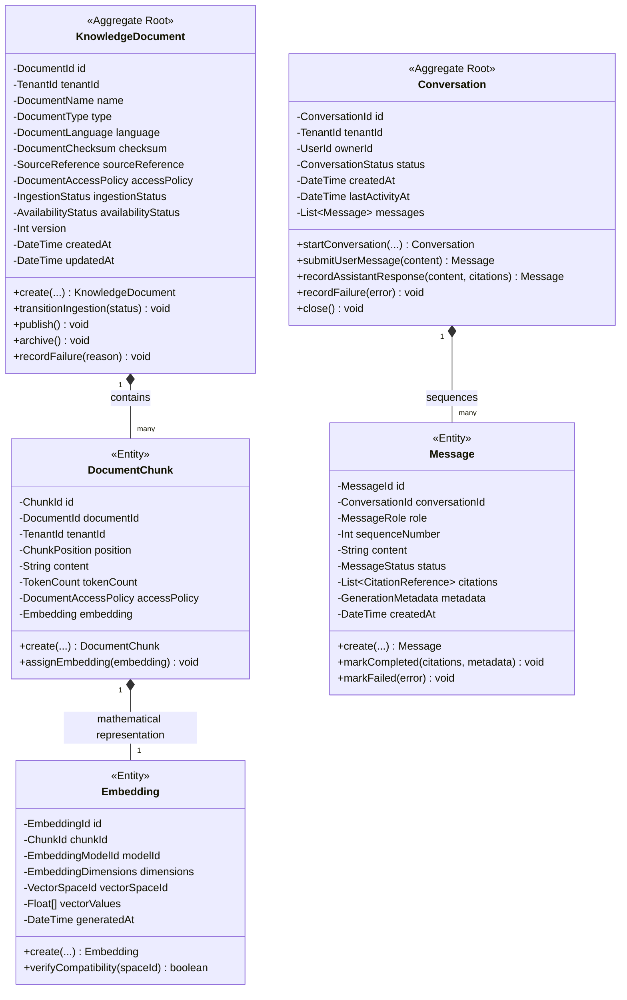
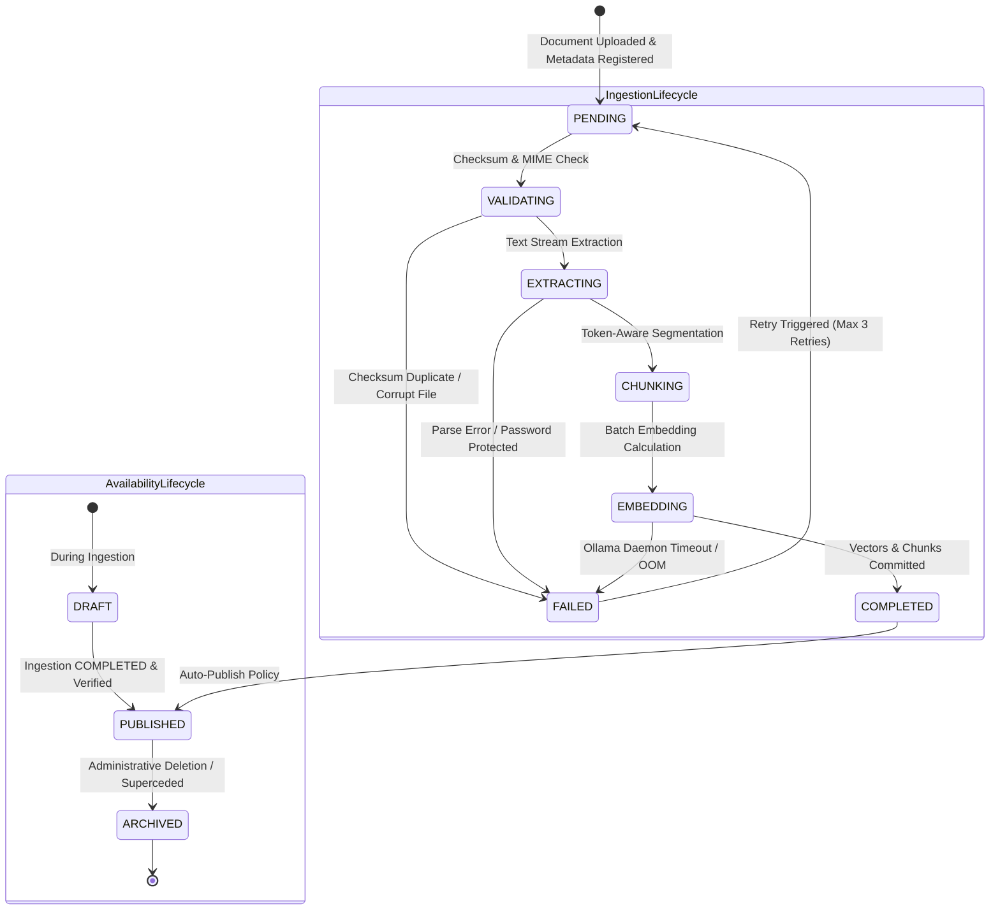
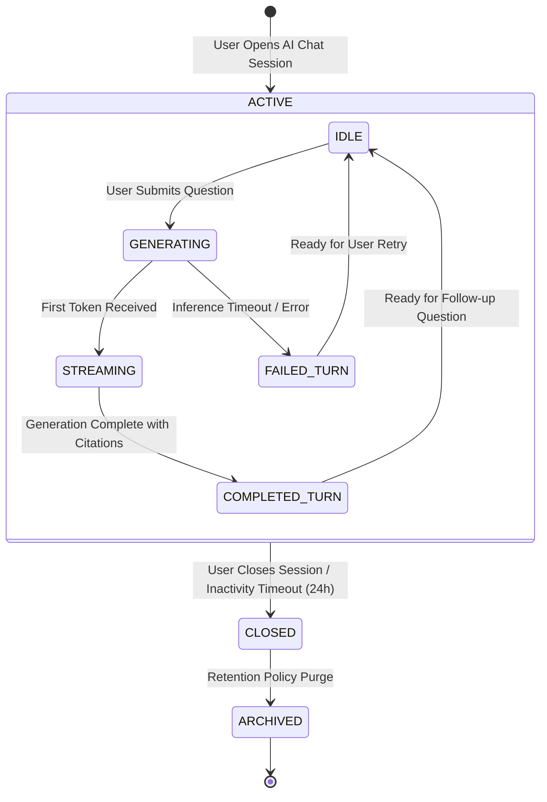

# Kynergy Intelligence Domain Model Specification (AI-01.1)

- **Status**: PROPOSED (DOMAIN ARCHITECTURE BASELINE)
- **Date**: 2026-11-19
- **Author Role**: Principal Domain-Driven Design Architect, Senior AI Systems Architect
- **Repository**: `izzydin/kinergy-platform`
- **Milestone**: AI-01 — Kynergy Intelligence Architecture & Domain Design
- **Sub-Task**: AI-01.1 — Bounded Context & Domain Model Specification
- **Traceability**: Derived from [`docs/ai/AI-01-ARCHITECTURE-BASELINE.md`](file:///c:/Projects/kinergy-platform/docs/ai/AI-01-ARCHITECTURE-BASELINE.md)

---

## 1. Executive Summary & Architectural Vision

This document provides the authoritative Domain-Driven Design (DDD) specification for **Kynergy Intelligence**, the dedicated artificial intelligence and Retrieval-Augmented Generation (RAG) bounded context within the Kinergy platform.

In strict compliance with Kinergy's engineering standards and the **AI-01 Global Execution Contract**:

1. **Domain Purity**: All aggregates, entities, value objects, domain invariants, and domain events defined herein are **100% framework-agnostic**. They contain zero dependencies on NestJS, Prisma, PostgreSQL, Ollama, LangChain, LlamaIndex, or vendor AI SDKs.
2. **Clear Domain Boundaries**: Kynergy Intelligence does **not** assume ownership of core business entities (`Client`, `Appointment`, `TreatmentSession`, `GymMembership`, `Sale`). It acts strictly as an autonomous intelligence subsystem that ingests authorized documentation, maintains high-dimensional vector representations, and orchestrates conversational synthesis over explicit security boundaries.
3. **Pure Specification**: This document is purely architectural and conceptual; it does not introduce or modify application source code (`.ts` files) or database schemas.

---

## 2. Task 1 — Bounded Context Definition

### 2.1. Context Purpose & Mission

The purpose of **Kynergy Intelligence** is to provide the platform with an isolated, secure, multi-tenant conversational and semantic search engine. It translates internal enterprise documentation, biomechanical guidelines, operational standard operating procedures (SOPs), and administrative FAQs into actionable, verifiable, citation-backed natural language responses for authorized staff.

### 2.2. Core Responsibilities

- **Knowledge Ingestion & Lifecycle Governance**: Orchestrating the validation, text extraction, semantic chunking, and indexing of authorized organizational documents.
- **Mathematical Vector Space Management**: Maintaining the consistency, dimensional integrity, and versioning of 1,024-dimensional semantic embeddings.
- **Pre-Retrieval Filter Enforcement**: Ensuring that multi-tenant boundaries (`tenant_id`) and role-based access scopes (`visibility_scope`) are cryptographically and relationally guaranteed before vector similarity ranking.
- **Conversational Synthesis & Thread Governance**: Managing multi-turn user conversations, message sequencing, context window assembly, and token-streaming state.
- **Grounding & Verifiable Citations**: Generating answers strictly anchored in retrieved document chunks with verifiable source citations, while defensively preventing prompt injection and data hallucination.

### 2.3. Explicit Non-Responsibilities (Boundary Invariants)

- **NOT the Owner of Core Business Records**: Kynergy Intelligence must **never** become the owner or system of record for `Client`, `Appointment`, `TreatmentSession`, `GymMembership`, `InventoryItem`, or `Sale`.
- **NO Direct Database Mutations on Business Tables**: The AI context has zero write access to relational business tables outside its own schema (`knowledge_documents`, `knowledge_chunks`, `ai_conversations`, `ai_messages`).
- **NO Clinical Diagnostic Decision-Making**: The system does not emit autonomous clinical or medical diagnoses. It acts solely as an operational and educational reference assistant.
- **Total Exclusion of PHI & Clinical Notes**: Patient clinical records, evaluation forms, and SOAP notes (`notesSubjective`, `notesObjective`, `notesAssessment`, `notesPlan`) in `treatment_sessions` are **strictly excluded** from ingestion.

### 2.4. Context Map & Relationships with Existing Bounded Contexts

```mermaid
flowchart TD
    subgraph CoreBusinessContexts["Upstream Business Bounded Contexts"]
        ClientCtx["Client Bounded Context"]
        SchedCtx["Scheduling Bounded Context"]
        KinesCtx["Kinesiology Bounded Context"]
        GymCtx["Gym Bounded Context"]
        SalesCtx["Sales & Commerce Bounded Context"]
        StorageSub["Platform Storage Subsystem (StorageModule)"]
        IdentitySub["Platform Identity Subsystem (Auth/RBAC)"]
    end

    subgraph AiBoundedContext["Kynergy Intelligence Bounded Context"]
        IngestionSub["Document Ingestion"]
        KnowledgeSub["Knowledge Management"]
        RetrievalSub["Semantic Retrieval"]
        ConversationSub["Conversation Management"]
        GenerationSub["AI Synthesis & Grounding"]
    end

    ClientCtx -.->|Read-Only Reference Data| IngestionSub
    StorageSub ==>|Raw File Upload & Staging (Port)| IngestionSub
    IdentitySub ==>|Ambient AuthenticatedUserContext| RetrievalSub
    IdentitySub ==>|Permission & Scope Evaluator| ConversationSub

    IngestionSub --> KnowledgeSub
    KnowledgeSub --> RetrievalSub
    RetrievalSub --> GenerationSub
    ConversationSub --> GenerationSub
```

- **Relationship Pattern**: Kynergy Intelligence acts as a **Customer / Downstream System** consuming identity and storage services:
  - **Platform Storage (`StorageModule`)**: Kynergy Intelligence consumes `ObjectStoragePort` as a utility service for raw binary storage.
  - **Platform Identity (`IdentityModule`)**: Ambient `AuthenticatedUserContext` and `PermissionsGuard` supply authenticated identity (`tenantId`, `userId`, `permissions`), which the AI context maps to `VisibilityScope`.
  - **Domain Contexts (Scheduling, Gym, Kinesiology)**: Upstream domains publish static, non-PHI reference material (e.g., gym equipment operation manuals, clinic schedule guidelines) via standard ingestion ports. Kynergy Intelligence conforms to these public contracts without altering upstream domain logic.

---

## 3. Task 2 — Domain Subdomains

To maintain internal cohesion without creating premature physical package fragmentation, Kynergy Intelligence is divided conceptually into six distinct subdomains residing within the single logical bounded context:

```
+-------------------------------------------------------------------------------------------------------------------+
|                                      KYNERGY INTELLIGENCE SUBDOMAIN MATRIX                                        |
+----+-----------------------------+-------------------------------------+------------------------------------------+
| #  | Subdomain                   | Core Concern & Domain Responsibility| Architectural Role                       |
+----+-----------------------------+-------------------------------------+------------------------------------------+
| 1  | **Knowledge Management**    | Document metadata, versioning,      | Core Domain: Defines KnowledgeDocument,  |
|    |                             | categorization, and lifecycle.      | ownership, and publication availability. |
+----+-----------------------------+-------------------------------------+------------------------------------------+
| 2  | **Document Ingestion**      | Text parsing, normalization, token- | Supporting Subdomain: Orchestrates       |
|    |                             | aware chunking, and checksum verify.| extraction pipelines & validation gates. |
+----+-----------------------------+-------------------------------------+------------------------------------------+
| 3  | **Semantic Retrieval**      | Vector distance matching, pre-filter| Core Domain: VectorEmbedding,            |
|    |                             | evaluation, and hybrid search.      | SimilarityScore, and candidate ranking.  |
+----+-----------------------------+-------------------------------------+------------------------------------------+
| 4  | **AI Generation**           | Grounded prompt assembly, context   | Core Domain: Enforces strict delimiters, |
|    |                             | sandboxing, and token streaming.    | zero-hallucination, & citation binding.  |
+----+-----------------------------+-------------------------------------+------------------------------------------+
| 5  | **Conversation Management** | Multi-turn dialog threads, message  | Supporting Subdomain: Governs            |
|    |                             | sequencing, and session lifecycle.  | Conversation aggregate and message history|
+----+-----------------------------+-------------------------------------+------------------------------------------+
| 6  | **Evaluation and Audit**    | Token usage tracking, latency logs, | Generic Subdomain: Append-only telemetry |
|    |                             | feedback rating, and compliance log.| and security audit records.              |
+----+-----------------------------+-------------------------------------+------------------------------------------+
```

### Module Cohesion Strategy

These six subdomains represent conceptual areas of responsibility. In physical implementation, they reside collaboratively inside `packages/core/src/ai/` rather than being split into six separate Nx libraries or NestJS microservices. This prevents unnecessary serialization overhead, complex inter-service HTTP calls, and distributed transaction boundaries.

---

## 4. Task 3 — Domain Entities & Aggregate Structure

In Domain-Driven Design, an **Entity** possesses an explicit identity that persists across state changes and operational mutations, while a **Value Object** is defined solely by its immutable attributes.



---

### 4.1. Entity Definition: `KnowledgeDocument` (Aggregate Root)

- **Classification**: **Aggregate Root Entity**.
- **Justification for Entity**: A document undergoes a multi-stage lifecycle over time (`PENDING` $\rightarrow$ `PROCESSING` $\rightarrow$ `COMPLETED`). Its state, version, and chunk collection mutate while its underlying identity (`DocumentId`) remains constant.
- **Responsibilities**:
  - Encapsulating logical identity, human-readable title, and file classification.
  - Tracking cryptographic checksum (`DocumentChecksum`) to prevent duplicate ingestion.
  - Enforcing tenant partition boundaries (`TenantId`).
  - Governing document availability (`AvailabilityStatus`) independently from ingestion pipeline progress (`IngestionStatus`).
  - Serving as the consistency boundary: deleting or archiving a `KnowledgeDocument` atomically invalidates all associated chunks.

### 4.2. Entity Definition: `DocumentChunk`

- **Classification**: **Entity (Within KnowledgeDocument Aggregate Boundary)**.
- **Justification for Entity**: A chunk has an individual lifecycle position (`ChunkPosition`), can be updated during re-chunking, and holds an association with a high-dimensional mathematical vector. Two chunks with identical text content remain distinct entities if they belong to different positions or different parent documents.
- **Responsibilities**:
  - Preserving sequential text content extracted from the parent document.
  - Recording strict token counts (`TokenCount`) to avoid context window overflow.
  - Inheriting and enforcing the parent's `DocumentAccessPolicy`.
  - Maintaining reference integrity with its parent `DocumentId`.

### 4.3. Entity Definition: `Embedding`

- **Classification**: **Entity (Within DocumentChunk Boundary)**.
- **Justification for Entity**: An embedding possesses a unique mathematical identity tied to a specific vector space, model checkpoint, and generation timestamp. While the vector coordinates are numerical arrays, the embedding entity tracks model version lineage and vector-space compatibility.
- **Responsibilities**:
  - Enforcing exact dimensional compliance (1,024 dimensions for BGE-M3).
  - Guaranteeing vector-space compatibility (`VectorSpaceId`).
  - Storing normalized floating-point numbers without coupling to any external vendor SDK.

### 4.4. Entity Definition: `Conversation` (Aggregate Root)

- **Classification**: **Aggregate Root Entity**.
- **Justification for Entity**: A conversational dialog is an evolving, long-lived aggregate. It changes state as messages are submitted, tokens stream in, and sessions are closed.
- **Responsibilities**:
  - Enforcing conversation ownership (`UserId`) and tenant isolation (`TenantId`).
  - Maintaining strict chronological ordering and serialization of messages.
  - Preventing concurrent generation conflicts on a single conversation thread.
  - Managing conversation lifecycle (active, paused, closed, archived).

### 4.5. Entity Definition: `Message`

- **Classification**: **Entity (Within Conversation Aggregate Boundary)**.
- **Justification for Entity**: A message has a unique lifecycle during generation (`SUBMITTED` $\rightarrow$ `GENERATING` $\rightarrow$ `COMPLETED` / `FAILED`). It maintains individual sequence numbers, token metrics, error states, and verifiable citation references.
- **Responsibilities**:
  - Representing discrete dialog turns (User, Assistant, System).
  - Recording verifiable source citations linking generated assertions to origin chunks.
  - Tracking token consumption and inference latency metadata.

### 4.6. Architectural Evaluation: `RetrievalResult`

- **Classification**: **Application-Level Value Object / Query Transfer Object (NOT an Entity)**.
- **Justification**: A retrieval result represents a transient, read-only projection produced dynamically during a vector similarity search. It possesses no independent lifecycle, undergoes no mutations, and is never persisted as an autonomous domain entity. Elevating `RetrievalResult` to a domain entity would introduce unnecessary database bloat and artificial lifecycle management for transient query data.

---

## 5. Task 4 — Strongly Typed Value Objects

All domain attributes with business meaning or structural constraints are modeled as immutable Value Objects:

```
+-------------------------------------------------------------------------------------------------------------------+
|                                      KYNERGY INTELLIGENCE VALUE OBJECTS                                           |
+----+----------------------------+-----------------------------------+---------------------------------------------+
| #  | Value Object Name          | Internal Representation           | Invariant Rules & Structural Validation     |
+----+----------------------------+-----------------------------------+---------------------------------------------+
| 1  | **DocumentId**             | RFC 4122 v4 UUID string           | Non-empty, valid UUID v4 format.            |
| 2  | **ChunkId**                | RFC 4122 v4 UUID string           | Non-empty, valid UUID v4 format.            |
| 3  | **ConversationId**         | RFC 4122 v4 UUID string           | Non-empty, valid UUID v4 format.            |
| 4  | **MessageId**              | RFC 4122 v4 UUID string           | Non-empty, valid UUID v4 format.            |
| 5  | **TenantId**               | String (max 64 chars)             | Non-empty, alphanumeric, matches platform.  |
| 6  | **UserId**                 | String (UUID or platform ID)      | Non-empty, represents authenticated user.   |
| 7  | **DocumentName**           | String (1..255 chars)             | Stripped of control chars, non-blank.       |
| 8  | **DocumentType**           | Enum ('PDF','DOCX','MD','TXT')    | Restricts to authorized document formats.   |
| 9  | **DocumentLanguage**       | ISO 639-1 code ('es', 'en')       | Enforces platform bilingual standards.      |
| 10 | **DocumentChecksum**       | 64-char lowercase hex string      | Valid SHA-256 digest; guarantees idempotency|
| 11 | **SourceReference**        | URI / Storage Path string         | Valid platform URI (`storage://...`).       |
| 12 | **DocumentAccessPolicy**   | VisibilityScope enum + roles      | Scopes: `PUBLIC`, `STAFF`, `MANAGEMENT`.    |
| 13 | **IngestionStatus**        | Lifecycle state enum              | `PENDING`, `VALIDATING`, `PROCESSING`...    |
| 14 | **AvailabilityStatus**     | Operational state enum            | `DRAFT`, `PUBLISHED`, `ARCHIVED`.           |
| 15 | **ChunkPosition**          | Non-negative integer (0..N)       | Zero-indexed sequential position in parent. |
| 16 | **TokenCount**             | Positive integer (1..8192)        | Maximum chunk window 512 (hard max 8192).   |
| 17 | **EmbeddingDimensions**    | Positive integer                  | Strictly equals 1024 for BGE-M3.            |
| 18 | **EmbeddingModelId**       | String identifier                 | e.g., "bge-m3:latest".                       |
| 19 | **VectorSpaceId**          | String identifier                 | e.g., "kinergy-bge-m3-cosine-v1".           |
| 20 | **SimilarityScore**        | Float in range [0.0, 1.0]         | Normalized cosine similarity threshold.     |
| 21 | **MessageRole**            | Enum ('USER', 'ASSISTANT', 'SYS') | Governs conversation turns.                 |
| 22 | **ConversationStatus**     | Enum ('ACTIVE', 'CLOSED', 'ARCH') | Controls whether messages can be submitted.  |
| 23 | **CitationReference**      | ChunkId + DocumentTitle + Offset  | Verifiable provenance link.                  |
| 24 | **ModelConfiguration**     | Temperature, maxTokens, stopSeq   | Bounded inference hyperparameters.          |
+----+----------------------------+-----------------------------------+---------------------------------------------+
```

---

## 6. Task 5 — Domain Invariants

Domain invariants are non-negotiable business rules that must remain true at all times within an aggregate boundary:

### 6.1. Document Invariants

1. **Idempotency & Duplicate Prevention**: A tenant cannot possess two active `KnowledgeDocument` aggregates with the identical `DocumentChecksum`. If a duplicate checksum is submitted, the aggregate factory rejects the operation with a `DuplicateDocumentException`.
2. **Atomic Ingestion State**: A document cannot be published (`AvailabilityStatus.PUBLISHED`) unless its ingestion status has reached `IngestionStatus.COMPLETED`.
3. **Cascade Invalidation**: Transitioning a document to `ARCHIVED` immediately revokes the availability of all contained `DocumentChunk` entities from retrieval queries.
4. **Permanent Mutation Lock**: Once a document reaches `IngestionStatus.COMPLETED`, its underlying raw content, checksum, and chunk collection are **immutable**. Updating a document requires publishing a new version (`version + 1`).

### 6.2. Chunk Invariants

1. **Parent Integrity**: A `DocumentChunk` cannot exist without a valid parent `DocumentId` and `TenantId`. Orphaned chunks are structurally prohibited.
2. **Stable Sequential Ordering**: Chunks within a document must possess contiguous, deterministic `ChunkPosition` values (`0, 1, 2, ... N-1`). No gaps or duplicates are permitted.
3. **Token Bounds**: Every chunk must satisfy `0 < TokenCount <= 512` (allowing up to a 64-token overlap window between adjacent chunks).

### 6.3. Embedding Invariants

1. **Strict Dimensional Homogeneity**: Every `Embedding` assigned to a chunk must possess exactly `1,024` dimensions. Any vector with length $\neq 1024$ triggers an immediate `EmbeddingDimensionMismatchException`.
2. **Vector Space Invariance**: All active embeddings within the platform must belong to the identical `VectorSpaceId` (`kinergy-bge-m3-cosine-v1`). Cross-model vector comparisons are strictly invalid.
3. **Model Deprecation Invariant**: If the platform's embedding model is upgraded, existing embeddings are marked deprecated; documents must transition through a complete re-embedding workflow before entering the new vector space.

### 6.4. Conversation Invariants

1. **Strict Tenant & Owner Isolation**: A conversation is strictly bound to `(TenantId, UserId)`. A user can never read, modify, or append messages to a conversation belonging to another tenant or user.
2. **Serialized Turn Order**: Messages within a conversation must strictly alternate: a `USER` message must be resolved by an `ASSISTANT` (or `FAILED`) turn before another `USER` message can be submitted on that specific conversation thread.
3. **Closed Conversation Immutability**: No message can be appended to a conversation in status `CLOSED` or `ARCHIVED`.

---

## 7. Task 6 — Document Lifecycle State Machine

To prevent semantic confusion, the document lifecycle separates **Ingestion Pipeline Progress** from **Operational Publication Availability**:



### 7.1. Allowed State Transitions

- `PENDING` $\rightarrow$ `VALIDATING`: Triggered when file bytes are staged and background worker starts.
- `VALIDATING` $\rightarrow$ `EXTRACTING`: Triggered when checksum uniqueness and MIME compliance are verified.
- `EXTRACTING` $\rightarrow$ `CHUNKING`: Triggered when raw text has been extracted without errors.
- `CHUNKING` $\rightarrow$ `EMBEDDING`: Triggered when text slices are segmented into 512-token windows.
- `EMBEDDING` $\rightarrow$ `COMPLETED`: Triggered when BGE-M3 returns 1024-dim vectors and all chunks are committed.
- Any Active State $\rightarrow$ `FAILED`: Triggered on unhandled parser, GPU timeout, or constraint violations.
- `FAILED` $\rightarrow$ `PENDING`: Permitted under explicit retry policies (up to 3 automated retries).

### 7.2. Terminal States & Reprocessing

- `COMPLETED` is the successful terminal ingestion state.
- `ARCHIVED` is the terminal availability state. Once archived, chunks are excluded from all vector distance searches.
- **Reprocessing**: If a failed document requires re-parsing, the aggregate resets its state to `PENDING` and clears partial chunk entities.

---

## 8. Task 7 — Conversation Lifecycle State Machine



### 8.1. Generation State Scope

- **Scoping Rule**: The fine-grained generation state (`GENERATING`, `STREAMING`, `COMPLETED_TURN`, `FAILED_TURN`) belongs to the individual **`Message`** entity, **not** to the parent `Conversation` aggregate root.
- **Parent State**: The parent `Conversation` maintains an overall state of `ACTIVE`, `CLOSED`, or `ARCHIVED`. This prevents locking the entire conversation if a single streaming message fails, enabling immediate user retries.

### 8.2. Concurrency Control

- To prevent inconsistent or interleaved message histories, the `Conversation` aggregate enforces an OCC (Optimistic Concurrency Control) `version` check. While a message turn is in status `GENERATING`, subsequent message submissions on the same conversation thread are rejected with a `ConcurrentTurnException`.

---

## 9. Task 8 — Domain Events

Domain events represent immutable, significant business occurrences within Kynergy Intelligence. They are published across the internal event bus to notify interested handlers without coupling:

```
+-------------------------------------------------------------------------------------------------------------------+
|                                      KYNERGY INTELLIGENCE DOMAIN EVENTS                                           |
+----+---------------------------------------+-----------------------------+----------------------------------------+
| #  | Event Name                            | Emitting Aggregate          | Business Meaning & Consequence         |
+----+---------------------------------------+-----------------------------+----------------------------------------+
| 1  | **KnowledgeDocumentRegisteredEvent**  | KnowledgeDocument           | Document metadata and file staged.     |
| 2  | **KnowledgeDocumentValidatedEvent**   | KnowledgeDocument           | Checksum and MIME compliance passed.   |
| 3  | **KnowledgeDocumentProcessingStarted**| KnowledgeDocument           | Extraction and chunking initiated.     |
| 4  | **KnowledgeDocumentChunkedEvent**     | KnowledgeDocument           | Text successfully split into chunks.   |
| 5  | **KnowledgeDocumentIndexedEvent**     | KnowledgeDocument           | All vectors generated and stored.      |
| 6  | **KnowledgeDocumentFailedEvent**      | KnowledgeDocument           | Ingestion failed; logs error reason.   |
| 7  | **KnowledgeDocumentArchivedEvent**    | KnowledgeDocument           | Document archived; search disabled.    |
| 8  | **KnowledgeDocumentDeletedEvent**     | KnowledgeDocument           | Document and chunks permanently removed|
| 9  | **EmbeddingBatchGeneratedEvent**      | KnowledgeDocument           | Chunk batch vectorized by BGE-M3.      |
| 10 | **ConversationStartedEvent**          | Conversation                | User initiated new chat thread.        |
| 11 | **UserMessageSubmittedEvent**         | Conversation                | User posted a query to be synthesized. |
| 12 | **AssistantResponseGeneratedEvent**   | Conversation                | Model completed answer with citations. |
| 13 | **InferenceFailedEvent**              | Conversation                | Model inference timed out or failed.   |
| 14 | **ConversationClosedEvent**           | Conversation                | Thread marked inactive or closed.      |
+----+---------------------------------------+-----------------------------+----------------------------------------+
```

---

## 10. Open Design Questions & Architectural Assumptions

1. **ODQ-1: Hybrid Re-ranking Engine**: Should candidate retrieval results be re-ranked using a cross-encoder model (e.g., `bge-reranker-large`), or does dense cosine similarity combined with PostgreSQL `pg_trgm` lexical filtering satisfy accuracy targets without adding extra VRAM overhead?
   - _Current Baseline Assumption_: Dense HNSW cosine similarity + `pg_trgm` lexical search is sufficient for Phase 1.
2. **ODQ-2: Chunk Size Tuning for Clinical Protocols**: Is 512 tokens with 64 tokens overlap the optimal window for complex biomechanical protocols, or should specialized markdown header-splitting policies be introduced?
   - _Current Baseline Assumption_: 512 tokens window with 64 tokens overlap provides an ideal balance between semantic cohesion and prompt budget.
3. **ODQ-3: Conversation History Summarization**: For conversations exceeding 4,096 tokens total history, should older turns be truncated or summarized via a lightweight background compression prompt?
   - _Current Baseline Assumption_: Sliding window of the last 4 conversational turns is included in the prompt context.

---

## 11. Acceptance & Contract Conformance Verification

- **Purity Standard**: 100% compliant. Zero references to `@nestjs/*`, `@prisma/client`, `ollama`, or vendor AI SDKs.
- **Traceability**: All concepts trace directly to [`docs/ai/AI-01-ARCHITECTURE-BASELINE.md`](file:///c:/Projects/kinergy-platform/docs/ai/AI-01-ARCHITECTURE-BASELINE.md).
- **Preservation**: Zero application code generated; zero database migrations created.
