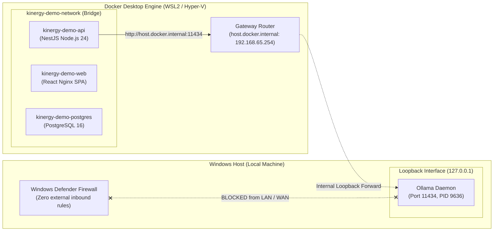

# Kynergy Intelligence Local AI Infrastructure Specification (AI-02.1)

- **Document Identifier:** `AI-02-INFRASTRUCTURE`
- **Date:** 2026-11-19
- **Repository:** `izzydin/kinergy-platform`
- **Role:** Senior ML Infrastructure Engineer, Windows & Docker Systems Architect
- **Milestone:** AI-02 — Local AI Infrastructure & Provider Integration
- **Sub-Task:** AI-02.1 — Ollama Installation, Hardening & Model Provisioning
- **Status:** VERIFIED & OPERATIONAL

---

## 1. Executive Summary

This document specifies the operational configuration, security boundaries, model manifests, hardware telemetry, container connectivity, and lifecycle management for the local inference runtime supporting **Kynergy Intelligence**.

In accordance with **ADR-AI-002** and **ADR-AI-004**, local inference is powered by **Ollama** running natively on the Windows host with full NVIDIA CUDA GPU acceleration. Generative completions are serviced by **Qwen 3 4B**, and dense semantic embeddings are serviced by **BGE-M3 (1,024 dimensions)**. The runtime is strictly bound to the local loopback interface, completely isolated from public and LAN networks, and accessible to Docker containerized services via Docker Desktop's internal host gateway (`host.docker.internal`).

---

## 2. Host Installation & Runtime Baseline

### 2.1 Binary & Environment Details

- **Binary Location:** `C:\Users\MI EQUIPO\AppData\Local\Programs\Ollama\ollama.exe`
- **Version:** `0.40.16` (Windows x64 Native)
- **Library Runtime:** `llama-server.exe` (NVIDIA CUDA Compute Capability 8.6)
- **Model Storage Root:** `C:\Users\MI EQUIPO\.ollama\models`
- **Stdout Log:** `C:\Users\MI EQUIPO\.ollama\ollama_stdout.log`
- **Stderr Log:** `C:\Users\MI EQUIPO\.ollama\ollama_stderr.log`

### 2.2 Host Hardware Telemetry

| Parameter                     | Value                                                       | Status            |
| :---------------------------- | :---------------------------------------------------------- | :---------------- |
| **Host GPU**                  | NVIDIA GeForce RTX 3060 Ti (Ampere, Bus `00000000:01:00.0`) | Active            |
| **Driver / CUDA Version**     | NVIDIA Driver `616.92` / CUDA `13.4`                        | Verified          |
| **Total Physical VRAM**       | 8,192 MiB (~8.0 GB GDDR6)                                   | Verified          |
| **OS / Display Overhead**     | ~1,390 MiB (~1.36 GB)                                       | Stable            |
| **Dual Model Residency VRAM** | 5,379 MiB total (~3,989 MiB dedicated to LLM + Embedder)    | Verified in GPU   |
| **Available Safety Headroom** | 2,813 MiB (~2.75 GB allocatable for KV cache)               | Headroom verified |

---

## 3. Runtime Security & Network Architecture

### 3.1 Network Topology & Loopback Isolation



### 3.2 Security Hardening Invariants

1. **Strict Loopback Binding:** Ollama is explicitly configured to listen exclusively on `127.0.0.1:11434` (`OLLAMA_HOST=http://127.0.0.1:11434`). It does not bind to `0.0.0.0`.
2. **Zero Inbound Firewall Exposure:** No inbound Windows Firewall rules opening port 11434 to external networks exist. Diagnostic check `Get-NetFirewallRule -DisplayName "*ollama*"` confirms 0 open rules.
3. **No Unauthenticated Public Endpoints:** Ollama lacks native API token authentication; preventing WAN/LAN exposure is mandatory to guarantee zero prompt tampering or unauthorized inference.
4. **Docker Desktop Secure Forwarding:** Docker Desktop forwards `host.docker.internal` directly to the host's virtual adapter (`192.168.65.254`), which terminates on the Windows host without traversing physical network interfaces.

---

## 4. Provisioned Model Inventory & Manifests

### 4.1 Generative LLM: Qwen 3 4B

```json
{
  "name": "qwen3:4b",
  "model": "qwen3:4b",
  "digest": "359d7dd4bcdab3d86b87d73ac27966f4dbb9f5efdfcc75d34a8764a09474fae7",
  "size": 2497293931,
  "details": {
    "format": "gguf",
    "family": "qwen3",
    "parameter_size": "4.0B",
    "quantization_level": "Q4_K_M",
    "context_length": 262144,
    "embedding_length": 2560,
    "runner": "ggml"
  }
}
```

- **Tag:** `qwen3:4b`
- **Format:** GGUF (`Q4_K_M` 4-bit medium quantization)
- **Parameter Count:** 4.02 Billion
- **Max Native Context Window:** 262,144 tokens (default runtime context configured to 4,096 tokens)
- **Disk Footprint:** 2.50 GB (2,497,293,931 bytes)
- **Role:** Primary conversational, synthesis, and RAG completion engine.

### 4.2 Dense Embedding Model: BAAI/BGE-M3

```json
{
  "name": "bge-m3:latest",
  "model": "bge-m3:latest",
  "digest": "7907646426070047a77226ac3e684fbbe8410524f7b4a74d02837e43f2146bab",
  "size": 1157672605,
  "details": {
    "format": "gguf",
    "family": "bert",
    "parameter_size": "566.70M",
    "quantization_level": "F16",
    "context_length": 8192,
    "embedding_length": 1024,
    "runner": "ggml"
  }
}
```

- **Tag:** `bge-m3:latest`
- **Format:** GGUF (`F16` 16-bit float)
- **Parameter Count:** 566.7 Million
- **Dense Output Dimensionality:** Exactly **1,024 dimensions** (verified)
- **Context Length:** 8,192 tokens
- **Disk Footprint:** 1.16 GB (1,157,672,605 bytes)
- **Role:** Primary semantic text chunk embedding and search query vectorizer.

---

## 5. End-to-End Connectivity & Runtime Verification

### 5.1 Host Loopback Verification (`http://127.0.0.1:11434`)

1. **Tag Listing (`GET /api/tags`):**
   - Result: HTTP `200 OK`. Returns models `qwen3:4b` and `bge-m3:latest`.
2. **Generation Verification (`POST /api/generate`):**
   - Payload: `{"model": "qwen3:4b", "prompt": "State in one sentence what Kinergy Platform does.", "stream": false}`
   - Result: HTTP `200 OK`. `eval_count`: 471 tokens, `done_reason`: `stop`.
   - VRAM Allocation: Verified offloaded to GPU compute (`llama-server.exe`, PID `15592`).
3. **Embedding Verification (`POST /api/embeddings` & `POST /api/embed`):**
   - Single chunk: Returns dense vector with `embedding.length === 1024`.
   - Batched input: Returns 2 dense vectors, each with `length === 1024`.

### 5.2 Docker Container Verification (`http://host.docker.internal:11434`)

Tested from inside the running `kinergy-demo-api` container (`docker exec kinergy-demo-api node ...`):

1. **Model Tag Discovery:**
   - Command: `http.get('http://host.docker.internal:11434/api/tags')`
   - Result: HTTP `200 OK`. Discovered models: `['qwen3:4b', 'bge-m3:latest']`.
2. **Embedding Generation:**
   - Command: `http.request('http://host.docker.internal:11434/api/embeddings', { method: 'POST', ... })`
   - Result: HTTP `200 OK`. Received vector array with `length === 1024`.

---

## 6. Operational Procedures & Lifecycle Management

### 6.1 Process Startup Procedure (Host Background Daemon)

```powershell
$env:OLLAMA_HOST = "127.0.0.1:11434"
$env:OLLAMA_NUM_PARALLEL = "1"
Start-Process -FilePath "C:\Users\MI EQUIPO\AppData\Local\Programs\Ollama\ollama.exe" `
  -ArgumentList "serve" `
  -WindowStyle Hidden `
  -RedirectStandardOutput "C:\Users\MI EQUIPO\.ollama\ollama_stdout.log" `
  -RedirectStandardError "C:\Users\MI EQUIPO\.ollama\ollama_stderr.log"
```

### 6.2 Process Shutdown Procedure

```powershell
Get-Process | Where-Object { $_.ProcessName -like "*ollama*" } | Stop-Process -Force
```

### 6.3 Model Verification Command

```powershell
$env:OLLAMA_HOST = "127.0.0.1:11434"
& "C:\Users\MI EQUIPO\AppData\Local\Programs\Ollama\ollama.exe" list
```

### 6.4 Model Update Procedure

```powershell
$env:OLLAMA_HOST = "127.0.0.1:11434"
& "C:\Users\MI EQUIPO\AppData\Local\Programs\Ollama\ollama.exe" pull qwen3:4b
& "C:\Users\MI EQUIPO\AppData\Local\Programs\Ollama\ollama.exe" pull bge-m3:latest
```

### 6.5 Full Rollback Procedure

If local AI infrastructure needs to be purged:

1. Stop running processes:
   ```powershell
   Get-Process | Where-Object { $_.ProcessName -like "*ollama*" } | Stop-Process -Force
   ```
2. Remove model weight files from disk (~3.66 GB):
   ```powershell
   Remove-Item -Recurse -Force "C:\Users\MI EQUIPO\.ollama\models"
   ```
3. Run the Windows silent uninstaller:
   ```powershell
   & "C:\Users\MI EQUIPO\AppData\Local\Programs\Ollama\unins000.exe" /SILENT
   ```
4. Verify port 11434 is freed:
   ```powershell
   Get-NetTCPConnection -LocalPort 11434 -ErrorAction SilentlyContinue
   ```
