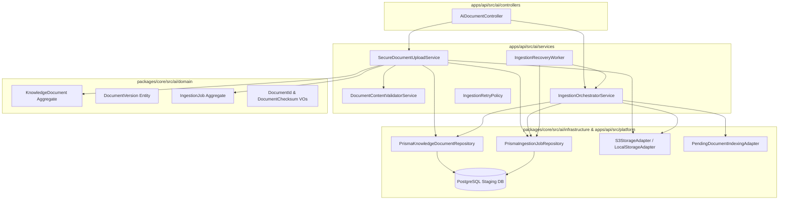
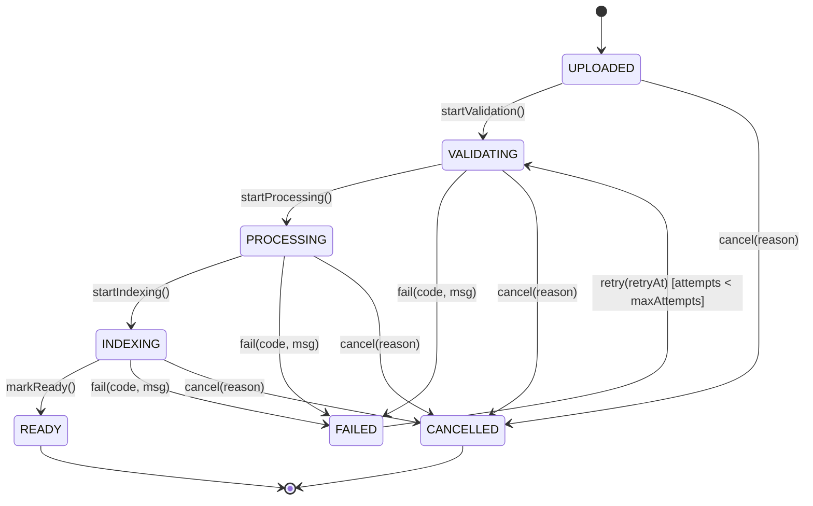

# AI-03 — Implementation Report: Knowledge Management & Document Lifecycle

**Milestone:** AI-03 (AI-03.0 through AI-03.6)  
**Bounded Context:** AI / Knowledge Management  
**Authors:** Principal Software Architect, Senior NestJS Architect, Database Architect, Application Security Lead  
**Status:** **ACCEPTED (PASS WITH EXPLICIT NON-BLOCKING ITEMS)**  
**Target Branches:** `main`  
**Quality Gate:** 100% Type-Safe (`tsc`), 0 ESLint warnings (`nx lint core` & `nx lint api`), 0 Browser Boundary Leaks, 105 AI Document/Ingestion Unit & Integration Tests Passing, 2,599 Workspace API Tests Passing

---

## 1. Executive Summary

Milestone **AI-03** delivers the secure knowledge management and document lifecycle subsystem within the existing Kinergy AI bounded context. It enables clinics to upload, validate, version, retrieve, and asynchronously process clinical manuals, operating procedures, and protocols.

The implementation strictly maintains:

1. **Hexagonal Architecture & Clean DDD:** Domain models in `@kinergy-platform/core` remain completely framework-independent with 0 imports of NestJS, Prisma, or cloud SDKs.
2. **Two-Phase Compensating Uploads:** Uploads to storage succeed first, followed by atomic database persistence. Any database failure triggers an immediate compensating storage deletion, preventing orphaned storage objects.
3. **Source Document Independence:** Ingestion processing failures, timeouts, worker crashes, or user cancellations never alter or destroy original source documents or versions.
4. **Asynchronous Processing Without External Queues:** Implemented using PostgreSQL partial unique constraints, atomic state leases, and a watchdog polling worker (`IngestionRecoveryWorker`), avoiding unapproved queue dependencies (e.g. BullMQ, Redis).
5. **Downstream Indexing Boundary:** Fulfills the complete lifecycle contract through `IDocumentIndexingPort` while explicitly documenting that full vector chunking and embedding persistence remain pending **Milestone AI-04**.

---

## 2. Implemented Architecture & Layering

---

## 3. API Endpoint Catalog

All routes are mounted under dual paths: `/api/v1/ai/knowledge/documents` (canonical) and `/api/v1/ai/documents` (convenience alias).

|   #    | HTTP Verb | Endpoint                     | Purpose                                                             | Guards / Auth             |
| :----: | :-------- | :--------------------------- | :------------------------------------------------------------------ | :------------------------ |
| **1**  | `POST`    | `/`                          | Upload new knowledge document + initial version                     | Bearer JWT, `ALL_STAFF`   |
| **2**  | `GET`     | `/`                          | Tenant-scoped paginated listing with filters & search               | Bearer JWT, Tenant Scoped |
| **3**  | `GET`     | `/:id`                       | Retrieve logical document metadata & version list                   | Bearer JWT, Tenant Scoped |
| **4**  | `PATCH`   | `/:id`                       | Update mutable metadata (`title`, `description`, `visibilityScope`) | Bearer JWT, Tenant Scoped |
| **5**  | `DELETE`  | `/:id`                       | Soft-delete document (retains versions for audit)                   | Bearer JWT, Tenant Scoped |
| **6**  | `GET`     | `/:id/versions`              | List all historical versions for a document                         | Bearer JWT, Tenant Scoped |
| **7**  | `GET`     | `/:id/versions/:ver`         | Retrieve specific historical version metadata                       | Bearer JWT, Tenant Scoped |
| **8**  | `POST`    | `/:id/versions`              | Upload a subsequent version to an existing document                 | Bearer JWT, Tenant Scoped |
| **9**  | `GET`     | `/:id/content`               | Authorized binary download/stream for current version               | Bearer JWT, Tenant Scoped |
| **10** | `GET`     | `/:id/versions/:ver/content` | Authorized binary download/stream for specific version              | Bearer JWT, Tenant Scoped |
| **11** | `GET`     | `/:id/ingestion`             | Ingestion status & attempt history across all versions              | Bearer JWT, Tenant Scoped |
| **12** | `POST`    | `/:id/ingestion/retry`       | Retry failed ingestion for document's current version               | Bearer JWT, Tenant Scoped |
| **13** | `POST`    | `/:id/ingestion/cancel`      | Cooperatively cancel active ingestion for current version           | Bearer JWT, Tenant Scoped |

---

## 4. Storage Behavior & Tenant Partitioning

- **Storage Port:** Reuses existing `ObjectStoragePort` (`packages/core/src/platform/storage/ports/object-storage.port.ts`).
- **Domain Partition:** Extended `StorageDomainFolder` with `'knowledge_base'`.
- **Key Scheme:** `tenants/{tenantId}/knowledge_base/{YYYY}/{MM}/{UUID}-{safeFileName}`.
- **Leakage Protection:** Internal storage keys are strictly stripped from all public DTOs.
- **Compensating Rollback:** If database metadata persistence fails after object storage upload, an immediate compensating call to `storagePort.delete(tenantId, storageKey)` removes the orphaned object.

---

## 5. Ingestion State Machine & Recovery Mechanics

### 5.1 States and Invariants

### 5.2 Fault Tolerance & Recovery

- **Crash Recovery:** `IngestionRecoveryWorker` continuously polls for stalled active jobs (`startedAt <= now() - 5m`) and automatically transitions them to `WORKER_CRASH_RECOVERED` or terminates them if max attempts are exceeded.
- **Exponential Backoff:** Calculates next retry with 20% jitter:
  $$T_{\text{delay}} = \min(5000 \times 2^{\text{attempt} - 1} \times (1 + 0.2 \times \text{rand}()), 300000)$$
- **Cancellation Immunity:** A cancelled job can never be failed or retried.

---

## 6. Downstream Integration Boundary

In accordance with Pre-Implementation Rule 10 and AI architectural guidance:

- Downstream vector chunking, embedding generation, and `pgvector` persistence belong strictly to **Milestone AI-04**.
- `PendingDocumentIndexingAdapter` fulfills the outbound port contract `IDocumentIndexingPort` during Milestone AI-03.
- No artificial chunks or mock embeddings are saved to the staging database.
