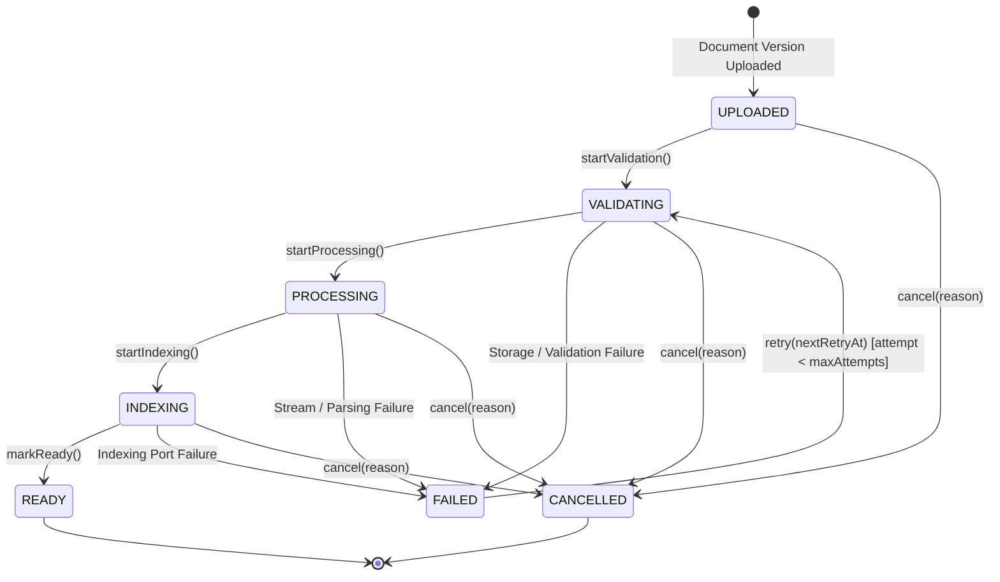
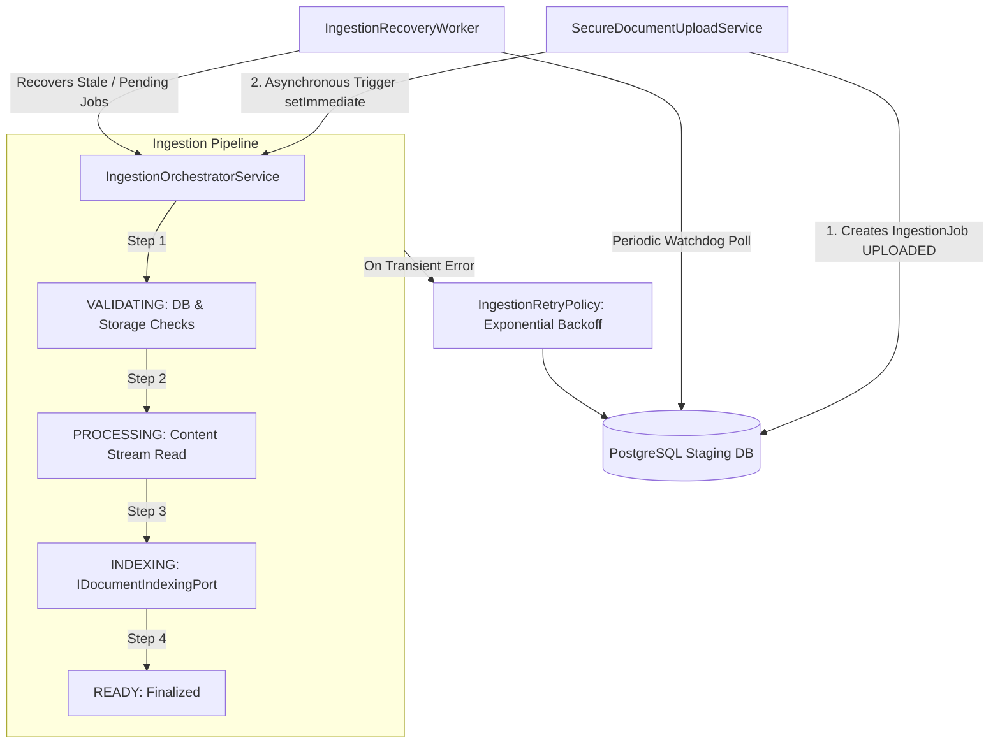

# AI-03.5 — Ingestion Lifecycle Orchestration & State Machine Specification

**Milestone:** AI-03.5  
**Bounded Context:** AI / Knowledge Management  
**Status:** Approved & Implemented  
**Package:** `@kinergy-platform/core`, `apps/api`  
**Quality Gate:** 100% Type-Safe, Pure DDD Boundaries, 0 Unsanctioned External Queues

---

## 1. Executive Summary

Milestone **AI-03.5** implements reliable, asynchronous ingestion lifecycle orchestration, attempt tracking, retries, and cancellation within the existing Kinergy AI bounded context. In strict compliance with architectural constraints:

1. **Pure Domain & Hexagonal Alignment:** Long-running processing is completely decoupled from the synchronous HTTP upload request.
2. **Zero External Queues:** Introduces no new messaging brokers (e.g. BullMQ, Redis) without architectural approval. Orchestration is driven by a resilient, database-backed active state machine, cooperative non-blocking triggers, and an automated background recovery worker (`IngestionRecoveryWorker`).
3. **Source Document Independence:** Source documents and immutable versions are independent from ingestion attempt failures. Ingestion failures never mutate or delete original files or document records.
4. **Downstream Indexing Boundary:** Fulfills the lifecycle contract via the outbound port `IDocumentIndexingPort` while explicitly documenting that full vector embedding and chunk storage remain pending downstream milestone integration (**AI-04**).

---

## 2. Ingestion State Machine Architecture

The ingestion lifecycle enforces strict, unidirectional progression with controlled retry and cancellation transitions.



### State Definitions & Invariants

| State            | Invariant / Boundary Condition                                                                                                           |
| :--------------- | :--------------------------------------------------------------------------------------------------------------------------------------- |
| **`UPLOADED`**   | Initial state. Document version metadata and file payload exist in tenant storage partition. Awaiting orchestrator pickup.               |
| **`VALIDATING`** | Active claim. Orchestrator verifies parent document existence, version integrity, and backing storage file accessibility.                |
| **`PROCESSING`** | Active payload inspection. Orchestrator opens file stream from storage port and prepares content for downstream chunking.                |
| **`INDEXING`**   | Outbound port invocation. Dispatches to `IDocumentIndexingPort`. Handshake confirmed.                                                    |
| **`READY`**      | Terminal successful state. Completed timestamp recorded. Job cannot be modified, retried, or cancelled.                                  |
| **`FAILED`**     | Non-terminal (if `attemptCount < maxAttempts`) or terminal (if exhausted/non-retryable). Last error code and sanitized message recorded. |
| **`CANCELLED`**  | Terminal cancelled state. Explicitly requested by tenant/user. Can never silently resume or be retried.                                  |

---

## 3. Orchestration Architecture

The orchestration engine consists of two primary application services in `apps/api`:



### 3.1 `IngestionOrchestratorService`

- **In-flight Memory Lock:** Uses a local `Set<string>` to deduplicate concurrent processing invocations of the same job on the local node.
- **Database Concurrency Guard:** The PostgreSQL partial unique index `unique_active_ingestion_per_version` on `(document_version_id) WHERE status IN ('UPLOADED', 'VALIDATING', 'PROCESSING', 'INDEXING')` strictly prevents duplicate active jobs across multi-instance deployments.
- **Cooperative Cancellation:** Before executing each pipeline phase (`VALIDATING`, `PROCESSING`, `INDEXING`, `READY`), the orchestrator refreshes the job state from the database. If a user or tenant administrator issued a cancellation, execution aborts immediately without marking the job as failed or completed.

### 3.2 Downstream Integration Boundary (`IDocumentIndexingPort`)

In compliance with DDD and Hexagonal Architecture:

```typescript
export interface IDocumentIndexingPort {
  indexDocument(request: DocumentIndexingRequest): Promise<DocumentIndexingResult>;
}
```

- In Milestone AI-03, `PendingDocumentIndexingAdapter` fulfills this port. It executes the lifecycle handshake, validates contract payloads, and logs that real vector embeddings and chunk storage await **Milestone AI-04** (pgvector / vector database integration).
- No mock chunks or fake vector embeddings are inserted into the database.

---

## 4. Verification & Quality Gates

The complete ingestion lifecycle is validated by automated test suites:

- **`ingestion-orchestrator.service.spec.ts`**: Verifies full linear progression (`UPLOADED` -> `READY`), downstream indexing dispatch, retry backoff calculation, retry exhaustion, immediate non-retryable failure, cooperative cancellation across all states, and source document preservation.
- **`ingestion-recovery.worker.spec.ts`**: Verifies watchdog pickup of pending uploads, elapsed retries, and stale job recovery.
- **`ingestion-retry.policy.spec.ts`**: Verifies mathematical backoff progression, jitter calculations, and error categorization.
