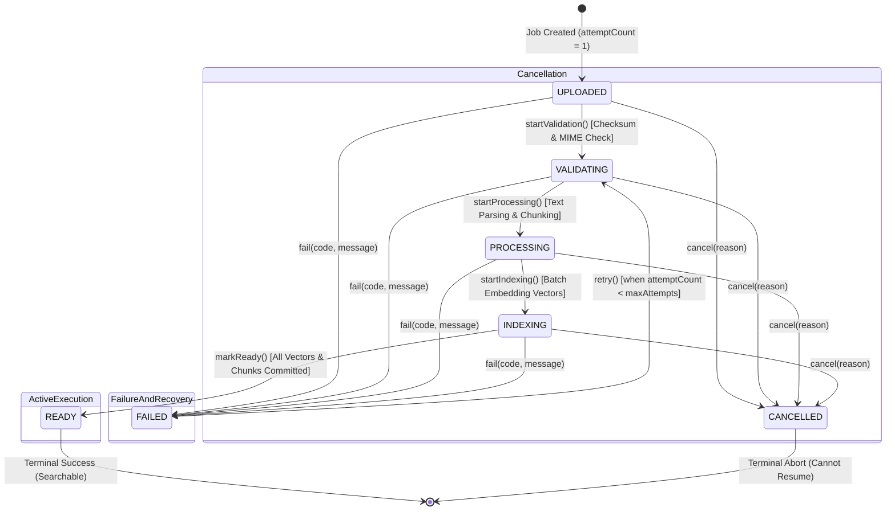

# Kynergy Intelligence Document & Ingestion Lifecycle Specification (Milestone AI-03.1)

- **Document Identifier:** `AI-03-LIFECYCLE`
- **Date:** 2026-11-19
- **Repository:** `izzydin/kinergy-platform`
- **Role:** Principal Domain-Driven Design Architect, State Machine Specialist
- **Milestone:** AI-03 — Knowledge Management & Document Lifecycle
- **Sub-Task:** AI-03.1 — State Machine & Lifecycle Implementation
- **Status:** IMPLEMENTED & VERIFIED

---

## 1. Executive Summary

This document specifies the authoritative state machine, allowed transitions, error conditions, retry mechanisms, and invariants governing the lifecycle of **Knowledge Documents** and **Ingestion Jobs** within **Kynergy Intelligence**.

In full alignment with the approved AI-01 architecture and Milestone AI-03 functional rules:

1. **Decoupled Lifecycles:** The logical document container, immutable physical versions, and background processing pipeline do not share a single monolithic lifecycle. A failure during text parsing or embedding calculation never corrupts, mutates, or deletes the source document version.
2. **Strict Transition Behavior:** State changes are executed strictly through dedicated domain methods (`startValidation()`, `startProcessing()`, `startIndexing()`, `markReady()`, `fail()`, `cancel()`, `retry()`). Arbitrary status property assignment is prevented by encapsulation.
3. **Confirmed Completion Invariant:** A document can only reach `READY` status after confirmed completion of both processing (parsing/chunking) and indexing (vector calculation). Skipping states or jumping to `READY` throws `InvalidStateTransitionException`.
4. **Controlled Idempotent Retries:** Failed jobs can be retried up to `maxAttempts` (default 3), advancing `attemptCount` and resetting error logs.
5. **Irreversible Cancellation:** Once cancelled, a job is permanently terminal and cannot silently resume or be retried.

---

## 2. Ingestion Job State Machine Topology



---

## 3. Comprehensive State Transition Matrix

| From State   | Trigger Method      | To State     | Preconditions & Invariants                                               | Emitted Domain Event                 |
| :----------- | :------------------ | :----------- | :----------------------------------------------------------------------- | :----------------------------------- |
| `UPLOADED`   | `startValidation()` | `VALIDATING` | Job must be in `UPLOADED`. Sets `startedAt` timestamp.                   | `IngestionJobValidationStartedEvent` |
| `VALIDATING` | `startProcessing()` | `PROCESSING` | Checksum format and MIME verification must have passed.                  | `IngestionJobProcessingStartedEvent` |
| `PROCESSING` | `startIndexing()`   | `INDEXING`   | Raw text extracted and chunked into $\le 512$ token slices.              | `IngestionJobIndexingStartedEvent`   |
| `INDEXING`   | `markReady()`       | `READY`      | **Terminal.** BGE-M3 vectors verified and persisted. Sets `completedAt`. | `IngestionJobCompletedEvent`         |
| Any Active*  | `fail(code, msg)`   | `FAILED`     | Code & message required. Cannot fail if `READY` or `CANCELLED`.          | `IngestionJobFailedEvent`            |
| Any Active*  | `cancel(reason)`    | `CANCELLED`  | **Terminal.** Sets `cancelledAt`. Cannot cancel `READY` or `CANCELLED`.  | `IngestionJobCancelledEvent`         |
| `FAILED`     | `retry(date?)`      | `VALIDATING` | Must satisfy `attemptCount < maxAttempts`. Increments attempt count.     | `IngestionJobRetriedEvent`           |

_\*Any Active state includes `UPLOADED`, `VALIDATING`, `PROCESSING`, and `INDEXING`._

---

## 4. Invariant Rules & Defense Against Invalid Transitions

### 4.1 Premature Ready Prevention

- Reaching `READY` directly from `UPLOADED`, `VALIDATING`, or `PROCESSING` is mathematically prohibited.
- Calling `job.markReady()` when `status !== INDEXING` throws `InvalidStateTransitionException`.
- This guarantees that untranslated or un-indexed files are never exposed to semantic vector searches.

### 4.2 Terminal Immutability

- **`READY` State:** Represents confirmed indexing success. Calling `cancel()`, `fail()`, or `retry()` on a `READY` job throws an exception.
- **`CANCELLED` State:** Represents user or administrative abortion. Calling `retry()`, `fail()`, or subsequent `cancel()` throws an exception. Cancelled operations **never silently resume**.

### 4.3 Retry Ceiling & Backoff

- Every `IngestionJob` is bounded by `maxAttempts` (default 3).
- Calling `retry()` when `attemptCount >= maxAttempts` throws `InvalidIngestionRetryException`:
  ```text
  Maximum retry attempts (3) reached for ingestion job 'job_xxx'.
  ```
- Retrying clears `lastErrorCode` and `lastErrorMessage`, sets `nextRetryAt` (if scheduled), and increments the aggregate OCC `version`.

---

## 5. Document Aggregate Lifecycle vs. Ingestion Lifecycle

```mermaid
flowchart TD
    subgraph DocAggregate["KnowledgeDocument Lifecycle (Aggregate Root)"]
        D_ACTIVE["ACTIVE\n(isDeleted = false)"]
        D_DELETED["SOFT_DELETED\n(deletedAt != null)"]
        D_ACTIVE -->|softDelete(user)| D_DELETED
        D_DELETED -->|restore()| D_ACTIVE
    end

    subgraph VersionEntity["DocumentVersion Lineage (Immutable Entity)"]
        V1["Version 1\n(Checksum A)"]
        V2["Version 2\n(Checksum B)"]
        V1 -.->|addVersion()| V2
    end

    subgraph JobAggregate["IngestionJob Lifecycle (Independent Aggregate)"]
        J_RUNNING["UPLOADED / VALIDATING / PROCESSING / INDEXING"]
        J_FAILED["FAILED\n(attemptCount < max)"]
        J_READY["READY\n(Searchable)"]
        J_CANCEL["CANCELLED\n(Aborted)"]

        J_RUNNING --> J_READY
        J_RUNNING --> J_FAILED
        J_RUNNING --> J_CANCEL
        J_FAILED -->|retry()| J_RUNNING
    end

    DocAggregate -->|currentVersionId| VersionEntity
    JobAggregate -.->|references documentVersionId| VersionEntity
```

### Key Lifecycle Decoupling Principles:

1. **Source Preservation:** If `IngestionJob` fails (e.g., GPU out-of-memory or corrupt PDF structure), `KnowledgeDocument` and `DocumentVersion` remain active, stored, and accessible in the system.
2. **Re-Ingestion Support:** When an infrastructure outage resolves, a new `IngestionJob` can be dispatched referencing the exact same `documentVersionId`.
3. **No Retroactive Mutation:** Adding Version 2 (`DocumentVersion.create`) updates `currentVersionId` on the document aggregate, but does not alter or re-ingest Version 1.

---

## 6. Error Taxonomy & Exception Codes

All lifecycle exceptions inherit from `AiDomainException` and emit standardized error codes:

| Exception Class                             | Error Code                     | HTTP Status Mapping | Trigger Scenario                                                          |
| :------------------------------------------ | :----------------------------- | :-----------------: | :------------------------------------------------------------------------ |
| `InvalidStateTransitionException`           | `INVALID_STATE_TRANSITION`     |   400 Bad Request   | Attempting disallowed transition (e.g. `UPLOADED` $\rightarrow$ `READY`). |
| `InvalidIngestionRetryException`            | `INVALID_INGESTION_RETRY`      |   400 Bad Request   | Retrying a cancelled job or exceeding `maxAttempts`.                      |
| `IngestionJobCancellationConflictException` | `CANCELLATION_CONFLICT`        |    409 Conflict     | Attempting to cancel an already completed or cancelled job.               |
| `DuplicateDocumentVersionException`         | `DUPLICATE_DOCUMENT_VERSION`   |    409 Conflict     | Uploading a version with identical checksum to an existing version.       |
| `DocumentAlreadyDeletedException`           | `DOCUMENT_ALREADY_DELETED`     |   400 Bad Request   | Modifying, versioning, or deleting an already soft-deleted document.      |
| `UnauthorizedDocumentAccessException`       | `UNAUTHORIZED_DOCUMENT_ACCESS` |    403 Forbidden    | Accessing a document belonging to another tenant partition.               |
| `DocumentValidationException`               | `DOCUMENT_VALIDATION_ERROR`    |  422 Unprocessable  | Invalid checksum length, empty title, or unsupported MIME type.           |
