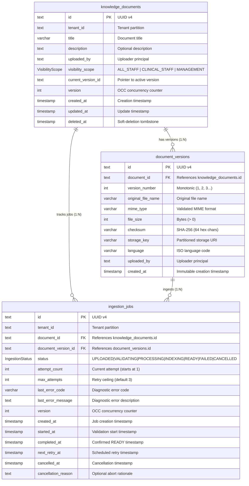
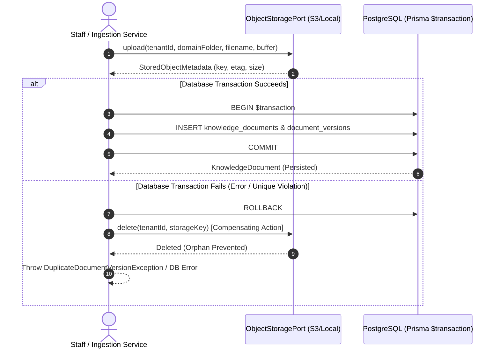

# Kynergy Intelligence Knowledge Persistence Specification (Milestone AI-03.2)

- **Document Identifier:** `AI-03-PERSISTENCE`
- **Date:** 2026-11-19
- **Repository:** `izzydin/kinergy-platform`
- **Role:** Principal Database Architect, Senior NestJS Persistence Engineer
- **Milestone:** AI-03 — Knowledge Management & Document Lifecycle
- **Sub-Task:** AI-03.2 — Relational Persistence, Migrations & Transactional Consistency
- **Status:** IMPLEMENTED, MIGRATED & VERIFIED (LIVE POSTGRESQL)

---

## 1. Executive Summary

Milestone **AI-03.2** implements the relational persistence layer for **Knowledge Management and Document Lifecycle** within the Kinergy Platform's PostgreSQL database using Prisma ORM.

In strict compliance with Kinergy's enterprise database standards:

1. **Additive Migrations Only:** Zero modifications to existing migrations. Deployed additively via migration [`20261119000000_add_knowledge_management_and_ingestion_tables`](file:///c:/Projects/kinergy-platform/prisma/migrations/20261119000000_add_knowledge_management_and_ingestion_tables/migration.sql).
2. **Zero `pgvector` Intrusion:** Document metadata, version lineage, and ingestion jobs are persisted purely relationally. No vector extensions or vector data types are introduced.
3. **Strict Multi-Tenant Boundary Defense:** All queries enforce `tenant_id` at the database level. Cross-tenant mutations are blocked and raise `UnauthorizedDocumentAccessException`.
4. **Clean Hexagonal Architecture:** Outbound repository ports (`IKnowledgeDocumentRepositoryPort`, `IIngestionJobRepositoryPort`) reside in `packages/core/src/ai/ports/outbound/`, while Prisma implementations reside in `packages/core/src/ai/infrastructure/persistence/prisma/`, accessible only via `@kinergy-platform/core/server`.
5. **Two-Phase Consistency & Storage Recovery:** Compensating transactions defend against orphaned storage objects when database commits fail.
6. **Active Ingestion Deduplication:** Enforced through a PostgreSQL partial unique index (`unique_active_ingestion_per_version`) and application-level concurrency guards.

---

## 2. Relational Schema & Entity-Relationship Design



---

## 3. Database Constraints & Indexing Rationale

### 3.1 Relational Constraints

| Constraint Name                           | Target Table          | Type             | Purpose                                                                                                                                                                                |
| :---------------------------------------- | :-------------------- | :--------------- | :------------------------------------------------------------------------------------------------------------------------------------------------------------------------------------- |
| `knowledge_documents_pkey`                | `knowledge_documents` | Primary Key      | RFC 4122 v4 UUID.                                                                                                                                                                      |
| `document_versions_pkey`                  | `document_versions`   | Primary Key      | RFC 4122 v4 UUID.                                                                                                                                                                      |
| `ingestion_jobs_pkey`                     | `ingestion_jobs`      | Primary Key      | RFC 4122 v4 UUID.                                                                                                                                                                      |
| `unique_document_version_number`          | `document_versions`   | Unique Composite | Enforces `UNIQUE(document_id, version_number)`. Prevents version collisions.                                                                                                           |
| `unique_document_checksum`                | `document_versions`   | Unique Composite | Enforces `UNIQUE(document_id, checksum)`. Prevents re-uploading duplicate content to the same document.                                                                                |
| `unique_active_ingestion_per_version`     | `ingestion_jobs`      | Partial Unique   | `UNIQUE(document_version_id) WHERE status IN ('UPLOADED', 'VALIDATING', 'PROCESSING', 'INDEXING')`. Structurally prevents concurrent active ingestion jobs for the same file revision. |
| `document_versions_document_id_fkey`      | `document_versions`   | Foreign Key      | `ON DELETE CASCADE`. Cleaning up a document cascades to all versions.                                                                                                                  |
| `ingestion_jobs_document_id_fkey`         | `ingestion_jobs`      | Foreign Key      | `ON DELETE CASCADE`.                                                                                                                                                                   |
| `ingestion_jobs_document_version_id_fkey` | `ingestion_jobs`      | Foreign Key      | `ON DELETE CASCADE`.                                                                                                                                                                   |

### 3.2 Indexing Strategy

1. **Tenant Isolation:**
   - `knowledge_documents(tenant_id)`
   - `ingestion_jobs(tenant_id)`
2. **Pre-Retrieval Scope Filtering (ADR-AI-006):**
   - `knowledge_documents(tenant_id, visibility_scope)`: Enables sub-10ms pre-filtering in vector candidate retrieval queries.
3. **Active Documents Filter:**
   - `knowledge_documents(tenant_id, deleted_at)`: Accelerates queries excluding soft-deleted documents (`deleted_at IS NULL`).
4. **Retry Scheduling:**
   - `ingestion_jobs(status, next_retry_at)`: Enables background workers to quickly poll jobs eligible for retry (`status = 'FAILED' AND next_retry_at <= NOW()`).
5. **Deduplication Lookups:**
   - `document_versions(checksum)`: Accelerates cross-document duplicate detection.

---

## 4. Transactional Consistency & Two-Phase Recovery

### 4.1 Storage & Database Two-Phase Commit Pattern

Object storage systems (local disk, AWS S3, Cloudflare R2) cannot participate in relational PostgreSQL database transactions. To prevent orphaned binary objects or dangling database references, the platform adheres to a strict two-phase commit protocol:



### 4.2 Compensating Action Rules

- **Upload Phase:** If database transaction fails (e.g., duplicate checksum violation, concurrency conflict, or network failure), the application catches the error and executes `storagePort.delete(tenantId, storageKey)`.
- **Soft Deletion Phase:** Calling `softDelete` sets `deleted_at = NOW()`. The underlying file in storage is **preserved** to maintain immutable audit trails and medico-legal compliance.
- **Hard Deletion Phase (if administratively mandated):** The database record is removed first within a transaction. After the transaction commits, the physical file is deleted from object storage.

---

## 5. Repository Architecture (Ports & Adapters)

```
packages/core/src/ai/
├── domain/                               # Pure Domain Models
│   ├── models/
│   │   ├── knowledge-document.aggregate.ts
│   │   ├── document-version.entity.ts
│   │   └── ingestion-job.aggregate.ts
├── ports/outbound/                       # Hexagonal Ports (Framework-Agnostic)
│   ├── knowledge-document-repository.port.ts
│   └── ingestion-job-repository.port.ts
└── infrastructure/persistence/prisma/    # Concrete Prisma Persistence
    ├── mappers/
    │   ├── prisma-knowledge-document.mapper.ts
    │   └── prisma-ingestion-job.mapper.ts
    └── repositories/
        ├── prisma-knowledge-document.repository.ts
        └── prisma-ingestion-job.repository.ts
```

### 5.1 Browser Boundary Isolation

- **`@kinergy-platform/core`:** Re-exports only pure domain models, value objects, events, and port contracts. Zero Prisma or database client modules are exposed.
- **`@kinergy-platform/core/server`:** Exposes concrete `PrismaKnowledgeDocumentRepository`, `PrismaIngestionJobRepository`, and mappers exclusively to server runtimes (`apps/api`) and integration test suites.
- Verified by `packages/core/src/__tests__/browser-boundary.spec.ts` (**5/5 passing**).

---

## 6. Migration Guide & Deployment Instructions

### 6.1 Migration File Details

- **Migration Path:** [`prisma/migrations/20261119000000_add_knowledge_management_and_ingestion_tables/migration.sql`](file:///c:/Projects/kinergy-platform/prisma/migrations/20261119000000_add_knowledge_management_and_ingestion_tables/migration.sql)
- **Classification:** Strictly additive. No existing columns or tables modified. Zero data loss.
- **Applied Status:** Verified applied against PostgreSQL on `127.0.0.1:5433` via `prisma migrate deploy`.

### 6.2 Executing Migrations in Staging & Production

```bash
# Apply pending migrations using privileged migrator role
pnpm exec prisma migrate deploy

# Regenerate Prisma Client bindings
pnpm exec prisma generate
```

---

## 7. Automated Test & Verification Evidence

Live PostgreSQL persistence integration tests executed in [`packages/core/src/ai/infrastructure/persistence/prisma/__tests__/knowledge-persistence.integration.spec.ts`](file:///c:/Projects/kinergy-platform/packages/core/src/ai/infrastructure/persistence/prisma/__tests__/knowledge-persistence.integration.spec.ts):

| Test Scenario               | Verification Objective                                                                    |  Result  | Latency |
| :-------------------------- | :---------------------------------------------------------------------------------------- | :------: | :-----: |
| **1. Atomic Creation**      | Persists `KnowledgeDocument` with initial version in a single transaction.                | **PASS** |  49 ms  |
| **2. Version History**      | Persists subsequent versions (v1, v2) and retrieves historical records by number.         | **PASS** |  29 ms  |
| **3. Duplicate Prevention** | Rejects re-uploading identical checksum within same document (`P2002`).                   | **PASS** |  27 ms  |
| **4. Tenant Isolation**     | Cross-tenant queries return `null`; cross-tenant mutations throw `Unauthorized`.          | **PASS** |  76 ms  |
| **5. Soft Deletion**        | Soft-deleting excludes document from standard queries; included with flag.                | **PASS** |  23 ms  |
| **6. Active Concurrency**   | Blocks second active ingestion job on same version (`DuplicateActiveIngestionException`). | **PASS** |  48 ms  |
| **7. Cascade Deletion**     | Hard deleting document cascades to all child `DocumentVersion` and `IngestionJob` rows.   | **PASS** |  24 ms  |

### Monorepo Quality Gate Status:

- **Core AI Test Suites:** **6/6 passed (54 tests passing, 100%)**
- **Browser Boundary Isolation:** **1/1 passed (5 tests passing, 100%)**
- **Monorepo Strict Typecheck:** `tsc --noEmit -p tsconfig.base.json`: **0 errors**
- **Monorepo Linting:** `eslint packages/core/src/ai`: **0 warnings, 0 errors**
