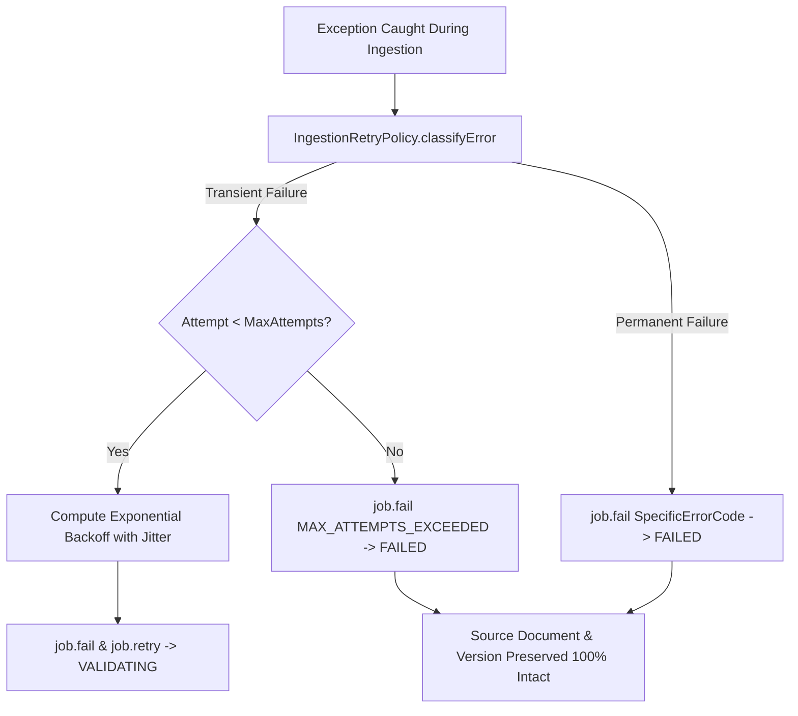

# AI-03.5 — Retry Policy, Fault Tolerance & Crash Recovery Architecture

**Milestone:** AI-03.5  
**Bounded Context:** AI / Knowledge Management  
**Status:** Approved & Implemented  
**Package:** `apps/api/src/ai/services/`  
**Quality Gate:** 100% Deterministic Retries, Zero Data Loss, Source Document Independence

---

## 1. Error Taxonomy & Classification Strategy

To prevent cascading failures and avoid futile retry loops, errors encountered during the ingestion pipeline are strictly bifurcated into **transient (retryable)** and **permanent (non-retryable)**:

### Detailed Taxonomy Table

| Category      | Error Code                 | Description                                                 | Action                                       |
| :------------ | :------------------------- | :---------------------------------------------------------- | :------------------------------------------- |
| **Transient** | `STORAGE_TIMEOUT`          | Read/write timeout contacting S3 / MinIO backend.           | Schedule retry with exponential backoff.     |
| **Transient** | `STORAGE_UNAVAILABLE`      | HTTP 503 Service Unavailable or storage throttling.         | Schedule retry with exponential backoff.     |
| **Transient** | `DATABASE_TRANSIENT_ERROR` | PostgreSQL concurrency deadlock (P2034) or pool exhaustion. | Schedule retry with exponential backoff.     |
| **Transient** | `NETWORK_TRANSIENT_ERROR`  | Socket reset (`ECONNRESET`, `ECONNREFUSED`).                | Schedule retry with exponential backoff.     |
| **Transient** | `WORKER_CRASH_RECOVERED`   | Worker process died while job was mid-execution.            | Scheduled for retry by watchdog worker.      |
| **Permanent** | `DOCUMENT_NOT_FOUND`       | Referenced document or document version was removed.        | Terminate immediately as `FAILED`. No retry. |
| **Permanent** | `STORAGE_OBJECT_MISSING`   | Backing object not found (`NoSuchKey` / 404).               | Terminate immediately as `FAILED`. No retry. |
| **Permanent** | `CHECKSUM_MISMATCH`        | SHA-256 integrity hash verification mismatch.               | Terminate immediately as `FAILED`. No retry. |
| **Permanent** | `MALFORMED_CONTENT`        | File fails structural parsing or is corrupted.              | Terminate immediately as `FAILED`. No retry. |
| **Permanent** | `SECURITY_VIOLATION`       | Malicious payload, embedded script, or zip bomb.            | Terminate immediately as `FAILED`. No retry. |
| **Permanent** | `CANCELLED_BY_USER`        | Explicit user/admin cancellation request.                   | Terminate immediately as `CANCELLED`.        |
| **Permanent** | `MAX_ATTEMPTS_EXCEEDED`    | Retry budget exhausted (`attemptCount >= maxAttempts`).     | Terminate immediately as `FAILED`.           |

---

## 2. Exponential Backoff & Jitter Mathematics

Retries are scheduled deterministically using exponential backoff with full additive jitter to prevent "thundering herd" spikes against backing storage and database infrastructure:

$$T_{\text{delay}} = \min\left( B \times 2^{\max(0, \text{attemptCount} - 1)} \times \left(1 + J \times \mathcal{U}(0, 1)\right), M \right)$$

$$\text{nextRetryAt} = \text{now} + T_{\text{delay}}$$

Where:

- $B$: Base delay ($5,000 \text{ ms} = 5 \text{ seconds}$)
- $M$: Maximum delay ($300,000 \text{ ms} = 5 \text{ minutes}$)
- $J$: Jitter factor ($0.2 = 20\% \text{ variance}$)
- $\mathcal{U}(0, 1)$: Uniform pseudo-random distribution in $[0, 1)$

### Progression Timeline

|      Attempt      |    Base Delay    |   With Full Jitter ($J = 0.2$)    |      Cumulative Wait Time      |
| :---------------: | :--------------: | :-------------------------------: | :----------------------------: |
|    **1 -> 2**     | $5.0 \text{ s}$  |  $5.0 \text{ s} - 6.0 \text{ s}$  |      $\sim 5.5 \text{ s}$      |
|    **2 -> 3**     | $10.0 \text{ s}$ | $10.0 \text{ s} - 12.0 \text{ s}$ |     $\sim 16.5 \text{ s}$      |
| **3 (Exhausted)** |    Terminated    |        No further retries         | Marked `MAX_ATTEMPTS_EXCEEDED` |

---

## 3. Worker Crash Recovery (`IngestionRecoveryWorker`)

If the Node.js API server process crashes, terminates abruptly (OOM, container restart), or loses network connectivity mid-execution, active jobs in `VALIDATING`, `PROCESSING`, or `INDEXING` could remain orphaned.

The `IngestionRecoveryWorker` runs as a continuous watchdog with three responsibilities:

1. **Pending Upload Discovery:** Queries jobs in `UPLOADED` state that were committed before an abrupt server shutdown and triggers initial validation.
2. **Elapsed Retry Discovery:** Queries failed jobs where `nextRetryAt <= now()` and triggers the next attempt.
3. **Stale Job Crash Recovery:** Identifies active jobs (`VALIDATING`, `PROCESSING`, `INDEXING`) whose `startedAt` is older than `staleThresholdMs` (default: 5 minutes).
   - If `attemptCount < maxAttempts`: Marks the job `WORKER_CRASH_RECOVERED` and schedules a retry.
   - If `attemptCount >= maxAttempts`: Marks the job `MAX_ATTEMPTS_EXCEEDED` and terminates.

---

## 4. Source Document Independence & Zero Data Loss Guarantee

Under **no circumstances** does an ingestion failure, worker crash, or cancellation delete or corrupt:

- The `KnowledgeDocument` logical record.
- The immutable `DocumentVersion` record.
- The source file stored in the tenant's isolated S3/MinIO bucket.

Failed jobs preserve full audit history (error code, sanitized message, attempt timestamps) so tenant users can review the error and initiate a manual retry via `POST /api/v1/ai/knowledge/documents/:id/ingestion/retry` once the root cause is resolved.

---

## 5. Observability & Safe Logging Standards

To maintain compliance with privacy regulations (HIPAA, GDPR) and tenant isolation:

- **Forbidden:** Document text payloads, chunk excerpts, embedding vectors, authentication tokens, and user PII are never logged.
- **Allowed:** Job ID, Tenant ID, Document ID, Version Number, Attempt Count, Safe Error Code, and Elapsed Duration.
