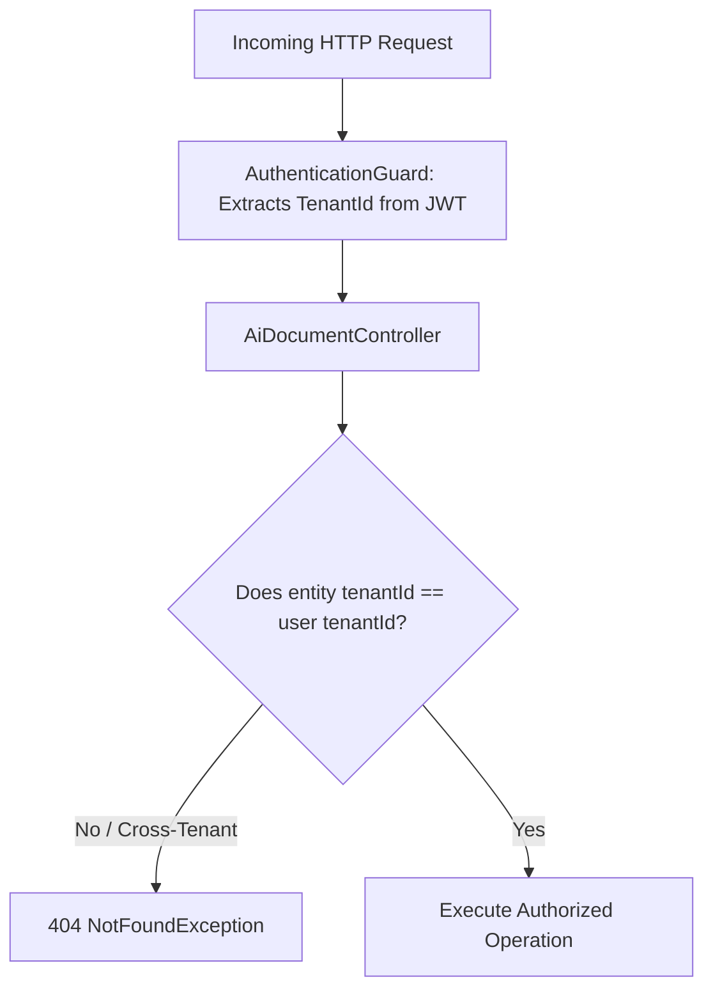

# AI-03 — Security Review & Threat Analysis

**Milestone:** AI-03  
**Bounded Context:** AI / Knowledge Management  
**Author:** Application Security Lead, Senior Security Architect  
**Status:** **APPROVED (ZERO CRITICAL / HIGH VULNERABILITIES)**  
**Target:** Storage, Ingestion, Persistence, and REST APIs

---

## 1. Security Architecture & Threat Model

The document management subsystem handles clinical protocols and organizational knowledge. The threat model addresses the following core risks:

1. **Malicious Payload Uploads:** Embedded PDF scripts (`/JavaScript`, `/Launch`), macro-enabled DOCX files, ZIP bombs.
2. **Cross-Tenant Data Exposure (IDOR):** Insecure Direct Object References to documents or historical versions belonging to other tenants.
3. **Storage Key Leakage & Path Traversal:** Exposure of physical object keys or manipulation of filenames to escape isolated bucket prefixes.
4. **Data Exfiltration via Logs:** Accidental leakage of confidential clinical document contents into application logs.
5. **Denial of Service (DoS):** Unbounded memory consumption or archive decompression exhaustion.

---

## 2. Deep Content Inspection & Anti-Malware Sniffing

Implemented in [DocumentContentValidatorService](file:///c:/Projects/kinergy-platform/apps/api/src/ai/services/document-content-validator.service.ts):

### 2.1 PDF Security

- **Magic Bytes Validation:** Enforces `%PDF-` signature in the initial 1024 bytes.
- **Trailer & EOF Verification:** Confirms valid `%%EOF` marker in the trailing 1024 bytes.
- **Active Script Proscription:** Scans for prohibited PDF action tags:
  - `/JavaScript`, `/JS` (embedded JavaScript execution).
  - `/Launch` (arbitrary binary execution).
  - `/EmbeddedFile` (embedded executable droppers).
  - `/OpenAction`, `/AA` (automatic action trigger on document open).

### 2.2 DOCX & ZIP Container Security

- **ZIP Header Check:** Confirms `PK\x03\x04` signature.
- **OpenXML Structure Verification:** Verifies required OOXML manifest structure: `[Content_Types].xml` and `word/document.xml`.
- **ZIP Bomb & Expansion Defense:**
  - Maximum archive entries allowed: **1,000**.
  - Maximum cumulative uncompressed size: **50 MB**.
  - Maximum expansion compression ratio: **100:1**. Files exceeding this ratio are rejected immediately.
- **Macro Prohibition:** Rejects legacy `.doc` binary formats and macro-enabled formats (`.docm`).

### 2.3 Plain Text & Markdown Security

- **Strict UTF-8 Encoding:** Validates text payloads against valid UTF-8 sequences.
- **Binary Rejection:** Scans for null bytes (`\0`) and non-printable control characters, blocking binary masquerading.
- **Markdown Extension Spoofing:** Ensures Markdown files are textual and conform to allowed character encodings.

---

## 3. Tenant Isolation & IDOR Protection



1. **Anti-Enumeration via 404:** Any attempt to access, update, stream, retry, or cancel a document owned by another tenant returns `404 Not Found` rather than `403 Forbidden`, preventing tenant ID probing and document ID enumeration.
2. **Version Authorization through Parent Document:** Versions cannot be accessed or downloaded as detached entities; every version query validates tenant ownership of the parent aggregate.
3. **Database Tenant Filters:** All repository queries (`findById`, `findByVersionId`, `findActiveJobByVersionId`) require `tenantId` in the query predicate.

---

## 4. Storage Security & Path Traversal Mitigation

- **Filename Sanitization:** Input filenames are stripped of path separators (`/`, `\`), null bytes, and traversal patterns (`..`), retaining only safe alphanumeric characters, dashes, and periods.
- **Zero Key Leakage:** Public DTOs (`UploadDocumentResponseDto`, `DocumentVersionResponseDto`, `IngestionJobResponseDto`) strictly exclude `storageKey`. Presentation callers only receive opaque version IDs and canonical download endpoints.
- **Partition Scoping:** Storage keys are strictly partitioned by tenant: `tenants/{tenantId}/knowledge_base/{YYYY}/{MM}/{UUID}-{safeFileName}`.

---

## 5. Compensating Rollback (Zero Orphan Storage Objects)

To prevent orphaned or inaccessible objects in backing storage:

```typescript
// Phase 1: Upload to backing store
const stored = await this.storagePort.upload(tenantId, 'knowledge_base', ...);

try {
  // Phase 2: Atomic DB persistence
  await this.documentRepo.save(doc);
} catch (persistError) {
  // Compensating transaction
  await this.storagePort.delete(tenantId, stored.key);
  throw persistError;
}
```

---

## 6. Observability & Safe Logging Standards

- **Forbidden in Logs:** Document binary buffers, extracted plaintext, embeddings, chunk texts, user passwords, and PII.
- **Allowed in Logs:** Opaque Document ID, Version Number, Job ID, Tenant ID, Attempt Count, and Sanitized Error Codes.

---

## 7. Security Limitations & Follow-Up Recommendations

1. **Static Analysis vs Dynamic Sandbox:** Deep content validation performs comprehensive static inspection. However, dynamic PDF sandbox detonation (e.g. via ClamAV or external virus scanning sidecar) is recommended if public untrusted uploads are enabled in future milestones.
2. **Client-Side Encryption:** Source documents are encrypted at rest via storage bucket policies (S3 SSE-S3/SSE-KMS). Envelope encryption per tenant may be considered for high-compliance healthcare installations.
