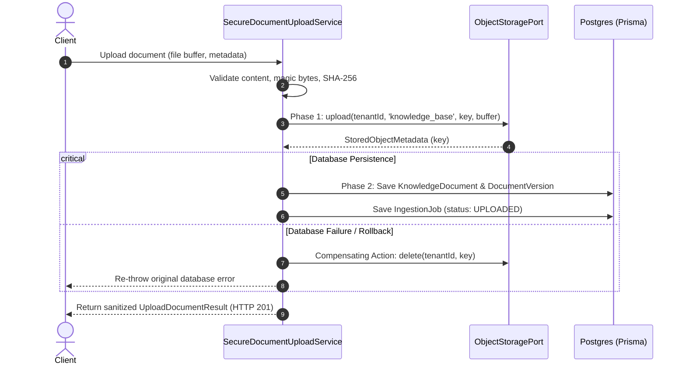

# AI-03.3 — Secure Document Upload & Content Validation Architecture

## 1. Overview & Threat Model

Milestone AI-03.3 implements production-grade, secure document upload for Kinergy's Knowledge Management bounded context. It integrates directly with the platform's existing `ObjectStoragePort` and `MediaStorageService`, enforcing strict tenant isolation, cryptographic integrity verification, format-specific structural validation, and automated compensating cleanup on failure.

```
[ HTTP Multipart Client ]
           │
           ▼
[ AiDocumentController ] ◄── Uses @CurrentUser() & AuthenticationGuard (Zero Untrusted Identity)
           │
           ▼
[ DocumentContentValidatorService ]
    ├── 1. Size Validation (Configurable limit, default: 10 MB, empty file rejected)
    ├── 2. Content Sniffing (Magic bytes inspection, reject masked formats)
    ├── 3. Structural Validation (PDF trailer & action tokens, DOCX ZIP OpenXML parts)
    ├── 4. Security Bounds (ZIP bomb limits: max entries, ratio, uncompressed size)
    ├── 5. Text Integrity (Strict UTF-8 parsing, reject null bytes \0 & control codes)
    └── 6. Cryptographic SHA-256 Checksum Calculation
           │
           ▼
[ SecureDocumentUploadService ] (Two-Phase Consistent Orchestration)
    ├── Phase 1: Upload to ObjectStoragePort (tenants/{tenantId}/knowledge_base/...)
    ├── Phase 2: Atomic DB Persistence (KnowledgeDocument + DocumentVersion + IngestionJob)
    └── Compensating Action: storagePort.delete(tenantId, key) on any DB failure
```

---

## 2. Configuration & Upload Size Limits

Document upload size and accepted MIME types are centrally managed via `AiConfiguration` and injected through `AI_CONFIG_TOKEN`.

| Parameter                  | Environment Variable         | Default Value             | Description                                                             |
| :------------------------- | :--------------------------- | :------------------------ | :---------------------------------------------------------------------- |
| `maxDocumentSizeBytes`     | `AI_MAX_DOCUMENT_SIZE_BYTES` | `10485760` (10 MB)        | Strict upper bound enforced before and during memory/stream consumption |
| `allowedDocumentMimeTypes` | `AI_ALLOWED_DOCUMENT_MIMES`  | PDF, DOCX, Markdown, Text | Whitelisted MIME types                                                  |
| Minimum File Size          | Hardcoded Invariant          | `1 byte`                  | Empty files (0 bytes) are rejected with `EMPTY_FILE` code               |

---

## 3. Supported Formats & MIME Mapping

Content headers and file extensions supplied by clients are treated as untrusted hints. The actual file format is determined via byte inspection and corroborated against the extension.

| Format         | Canonical MIME Type                                                       | Whitelisted Extensions | Magic Bytes / Header Signature       |
| :------------- | :------------------------------------------------------------------------ | :--------------------- | :----------------------------------- |
| **PDF**        | `application/pdf`                                                         | `.pdf`                 | `%PDF-` (`0x25 0x50 0x44 0x46 0x2D`) |
| **DOCX**       | `application/vnd.openxmlformats-officedocument.wordprocessingml.document` | `.docx`                | `PK\x03\x04` (`0x50 0x4B 0x03 0x04`) |
| **Markdown**   | `text/markdown`                                                           | `.md`, `.markdown`     | UTF-8 plain text without null bytes  |
| **Plain Text** | `text/plain`                                                              | `.txt`, `.text`        | UTF-8 plain text without null bytes  |

---

## 4. Content Sniffing & Structural Validation Rules

The `DocumentContentValidatorService` executes a multi-layer inspection:

### 4.1. PDF Validation

1. **Magic Bytes**: Must start with `%PDF-`.
2. **Version Header**: Verifies valid version specification (`%PDF-1.x` or `%PDF-2.x`). Malformed versions are rejected.
3. **Trailer / EOF**: Scans backwards for `%%EOF` marker. PDFs missing an EOF marker indicate incomplete uploads or corrupted structures.
4. **Prohibited Executable Actions**:
   - Searches dictionary tokens for `/Launch` actions (which can execute local shell commands).
   - Searches for embedded `/JavaScript` or `/JS` script execution blocks.
   - Any matches trigger `DocumentSecurityRiskException` with immediate rejection.

### 4.2. DOCX & ZIP Bomb Defense

DOCX files are OpenXML containers packaged as ZIP archives. Inspection evaluates the ZIP Central Directory:

1. **Container Integrity**: Locates End of Central Directory (EOCD) signature (`0x06054b50`). Rejects corrupted or truncated archives.
2. **ZIP Bomb Defense Limits**:
   - **Max Entries**: Capped at **1,000 entries**. Prevents entry-exhaustion attacks.
   - **Max Decompressed Size**: Capped at **50 MB** (`52,428,800 bytes`). Prevents memory/disk exhaustion.
   - **Max Compression Ratio**: Capped at **100:1**. Rejects recursive/sparse compression payloads.
3. **OpenXML Structural Verification**:
   - Must contain `[Content_Types].xml`.
   - Must contain `word/document.xml`.
   - If either is absent, the upload is rejected as a generic non-DOCX ZIP or corrupted archive.

### 4.3. Markdown & Plain Text Validation

1. **Null Byte Check**: Scans for `0x00`. Null bytes indicate binary data masquerading as text and are rejected immediately.
2. **Strict UTF-8 Decoding**: Uses `new TextDecoder('utf-8', { fatal: true })`. Any malformed or non-UTF-8 sequence throws and is rejected.
3. **Control Characters**: Disallows ASCII control characters `< 0x20` except standard whitespace: Tab (`0x09`), Line Feed (`0x0A`), and Carriage Return (`0x0D`).

### 4.4. Extension / Content Consistency

Mismatches between the detected binary content and the file extension (e.g. an executable or image renamed to `.pdf`, or a PDF renamed to `.txt`) are caught and rejected with `DocumentContentMismatchException`.

---

## 5. Cryptographic Checksum & Duplicate Protection

1. **Algorithm**: SHA-256 (`crypto.createHash('sha256')`), producing a 64-character lowercase hexadecimal hash.
2. **Intra-Document Deduplication**:
   When uploading a subsequent version to an existing document (`POST /api/v1/ai/documents/:documentId/versions`):
   - The aggregate inspects all historical versions of that document.
   - If any version shares the same checksum, the request is rejected with `DuplicateDocumentVersionException` (HTTP 409 Conflict).
   - Zero storage or database writes occur.
3. **Cross-Document Duplicate Discovery**:
   - Available via repository port method `findByChecksum(tenantId, checksum)`.
   - Adheres to security rules: checksum equality alone never grants cross-tenant or unauthenticated access to existing files.

---

## 6. Storage Key Layout & Tenant Scoping

Storage keys are deterministically generated by `StorageKeyUtil` under the `'knowledge_base'` domain folder:

```
Pattern: tenants/{tenantId}/knowledge_base/{YYYY}/{MM}/{uniqueId}-{sanitizedFilename}
Example: tenants/tenant_clinic_01/knowledge_base/2026/11/a1b2c3d4e5f6-spine_protocol.pdf
```

### Security Invariants:

- **Tenant Isolation**: Keys strictly prefixed with `tenants/{tenantId}/`. Validated via `StorageKeyUtil.assertTenantOwnsKey(tenantId, key)`.
- **Path Traversal Defense**: All filenames pass through `StorageKeyUtil.sanitizeFilename()`, stripping `..`, `/`, `\`, and non-ASCII/shell characters.
- **Unicode Support**: For non-ASCII filenames (e.g. Cyrillic, CJK), sanitization generates a safe ASCII key (e.g. `document.pdf`) while the database `DocumentVersion` entity preserves the user's authentic `originalFileName`.
- **Public API Privacy**: Internal storage keys and physical disk paths are **never** returned in API responses or public DTOs.

---

## 7. Consistency & Compensating Transaction Model

Because object storage operations (local disk or S3/R2) cannot participate in relational PostgreSQL database transactions, consistency is maintained via a two-phase workflow with automatic compensating deletion:



1. **Storage First**: File is staged in `ObjectStoragePort`.
2. **Database Second**: Document, Version, and IngestionJob are persisted in the database.
3. **Automatic Compensating Cleanup**: If database persistence fails for any reason (deadlock, constraint violation, network timeout), the catch block immediately invokes `this.storagePort.delete(tenantId, storageKey)`.
4. **Zero Orphaned Objects**: Guarantees that unreferenced binary blobs do not accumulate in storage if persistence aborts.

---

## 8. Authentication & Identity Policy

1. **Identity Source**: All identity and tenant attributes are extracted strictly from the validated JWT token via `AuthenticatedUserContext` and `@CurrentUser()`.
2. **Zero Client Spoofing**: The API never reads `tenantId` or `userId` from request parameters, query strings, or multipart body parts.
3. **Role & Guard Orchestration**: Endpoints are protected by `AuthenticationGuard` and `AuthorizationGuard`.

---

## 9. Explicit Security Disclosure: Malware Scanning Notice

> [!WARNING]
> **MALWARE SCANNING IS CURRENTLY ABSENT**
> The current implementation incorporates strict format sniffing, magic byte verification, structural syntax validation (trailer, EOF, OpenXML components), ZIP bomb defenses (entry count, decompressed size, compression ratio), text encoding checks, and active script detection (`/Launch`, `/JavaScript` in PDFs).
>
> However, an external antivirus/antimalware engine (such as ClamAV, AWS GuardDuty Malware Protection, or a dedicated ICAP scanner) is **not installed or integrated** at this milestone. All uploaded files should be considered potentially untrusted by downstream consumers until isolated sandboxing or an antivirus pipeline is provisioned.
