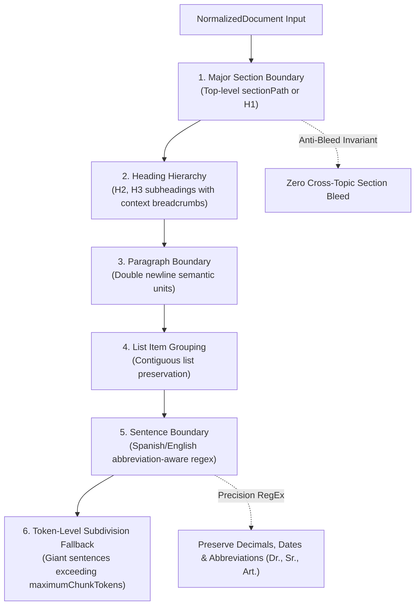

# Milestone AI-04.4 — Token-Aware Structure-Preserving Chunking Algorithm

## Executive Summary

Milestone **AI-04.4** introduces a deterministic, structure-aware document chunking engine designed for clinical, operational, and financial knowledge processing in the Kinergy Platform. Rather than segmenting documents with naive sliding character or token windows—which indiscriminately mutilate tables, decapitate section headers, and split sentences mid-thought—the architecture enforces a strict hierarchical boundary evaluation pipeline.

The chunking engine transforms immutable `NormalizedDocument` aggregates into an ordered, monotonically indexed sequence of `DocumentChunk` entities, preserving exact source provenance, section hierarchy context, markdown table headers, code fences, and bilingual metadata.

---

## 1. Architectural Boundary Prioritization

The chunking pipeline prioritizes boundary evaluation in the following strict hierarchical order:



### Boundary Hierarchy Rules

1. **Document Section Boundary (`sectionPath`):**
   - Chunks are never allowed to cross top-level section boundaries. When a major section transition occurs, pending chunk buffers are flushed immediately to prevent semantic contamination between unrelated topics (e.g. clinical rehabilitation protocols vs. administrative pricing policies).
2. **Heading Hierarchy Context:**
   - Headings are preserved at the start of their corresponding content chunks.
   - For deeply nested sections or multi-chunk sections, the full path hierarchy (e.g. `['Manual Clínico', '1. Evaluación', '1.1 Articular']`) is permanently embedded in `ChunkProvenance.sectionHierarchy` and surfaced as `metadata.sectionBreadcrumb`.
3. **Paragraph Boundary:**
   - Paragraphs are treated as cohesive narrative units. Multiple paragraphs within the same section are grouped into a single chunk up to `targetChunkTokens` (450 tokens).
4. **List Item Integrity:**
   - Ordered and unordered list items (`LIST_ITEM`) are grouped together within size limits. An individual list item is never broken unless that single item exceeds `maximumChunkTokens`.
5. **Sentence Boundary Splitting (Oversized Paragraphs):**
   - When a paragraph exceeds `maximumChunkTokens` (500 tokens), it is segmented into complete sentences.
   - The sentence boundary analyzer recognizes Spanish and English terminal punctuation (`.`, `!`, `?`) while guarding against:
     - Numerical decimals (e.g. `10.5 mg`, `3.14`).
     - Chilean currency formatting (e.g. `$45.000 CLP`).
     - Dates (e.g. `19/11/2026`, `19.11.2026`).
     - Clinical, academic, and legal abbreviations (`Dr.`, `Dra.`, `Sr.`, `Sra.`, `Lic.`, `Prof.`, `Art.`, `pág.`, `ej.`, `vs.`, `etc.`, `No.`).
6. **Token-Level Subdivision Fallback:**
   - Used exclusively as a safety valve when an individual, unpunctuated sentence exceeds `maximumChunkTokens`. In such rare cases, words are accumulated up to `targetChunkTokens`, guaranteeing that no emitted chunk ever exceeds the hard token limit.

---

## 2. Special Structure Preservation

### 2.1 Table Header Row Preservation

Markdown tables pose significant risk in standard RAG pipelines when partitioned naively into floating data rows devoid of column definitions.

**Invariant:** When a markdown table exceeds `maximumChunkTokens`, it is split by table rows, but **the column headers and separator line are prepended to every resulting sub-chunk**:

```markdown
<!-- Sub-chunk 1 -->

| Sesión | Procedimiento       | Observaciones               |
| ------ | ------------------- | --------------------------- |
| 1      | Evaluación inicial  | Rango articular disminuido  |
| 2      | Movilización pasiva | Tolera 45 grados de flexión |

<!-- Sub-chunk 2 (Header replicated automatically) -->

| Sesión | Procedimiento           | Observaciones                |
| ------ | ----------------------- | ---------------------------- |
| 3      | Terapia activa asistida | Rango incrementa a 60 grados |
| 4      | Crioterapia local       | Control de inflamación       |
```

Metadata tracks `isTableSplit: true` for downstream search rerankers.

### 2.2 Code Block Fence Preservation

When structured code, algorithm snippets, or clinical configuration JSON exceed chunk limits:

- Each split chunk preserves the opening language fence (e.g. ``typescript` ) and closing fence (`` `).
- Metadata records `isCodeSplit: true`.

---

## 3. Deterministic Overlap Implementation

To maintain narrative continuity across chunk boundaries without polluting independent topics:

- **Target Overlap:** 60 tokens (calibrated default).
- **Intra-Section Scope Only:** Overlap is strictly applied **only between contiguous chunks sharing the same top-level section hierarchy**. It is never carried across major section headers.
- **Sentence Alignment:** Overlap takes complete trailing sentences from chunk $N-1$ and prepends them as a contextual prefix to chunk $N$. Sentences are never sliced in half.
- **Headroom Cap:** To ensure chunk $N$ never exceeds `maximumChunkTokens`, the maximum allowed overlap is bounded dynamically by `maximumChunkTokens - currentChunkTokens`. If headroom is under 15 tokens, overlap is cleanly omitted.
- **Provenance & Metadata:** Chunks with overlap are explicitly flagged:
  ```typescript
  {
    hasOverlap: true,
    overlapTokens: 42,
    sectionBreadcrumb: "Evaluación Biomecánica > Articular"
  }
  ```

---

## 4. Tokenizer Calibration & Embedding Model Compatibility

### 4.1 Tokenizer Port (`ITokenizerPort`)

The chunking engine depends exclusively on the abstract outbound port `ITokenizerPort`:

```typescript
export interface ITokenizerPort {
  readonly modelName: string;
  readonly tokenizerVersion: string;
  readonly maxContextLimit: number;
  countTokens(text: string): number;
  encode(text: string): number[];
  decode(tokens: readonly number[]): string;
  truncateToMaxTokens(text: string, maxTokens: number): string;
}
```

### 4.2 Adapter Implementation (`DeterministicBpeTokenizerAdapter`)

- **Target Model Identity:** `bge-m3-calibrated-v1`
- **Implementation Version:** `1.0.0`
- **Max Context Limit:** `8,192` tokens (matching BGE-M3 architectural ceiling)
- **Engine:** Pure TypeScript in-process subword/BPE segmentation. Operates with zero network latency, zero Ollama daemon dependencies, and zero C++/Python native compilation bindings.
- **Calibration:** Calibrated against empirical SentencePiece distributions for Spanish, English, and clinical nomenclature:
  - Short words (1-4 characters): 1 token.
  - Medium words (5-8 characters): 1-2 subwords.
  - Long compound words (e.g. `musculoesquelético`, `contraindicaciones`): 3-4 subwords.
  - Average yield: ~1.3-1.5 tokens/word for Spanish and ~1.2-1.3 tokens/word for English.
- **Limitations & Disclosure:** While the production vector indexing pipeline in Ollama will run native `bge-m3` embeddings, this in-process tokenizer adapter provides guaranteed deterministic offline counts. As mandated by AI-04 architecture, token counts are presented as calibrated token counts for chunking boundaries rather than exact LLM generation tokens.

---

## 5. Chunk Identity & Provenance Verification

### 5.1 Deterministic RFC 4122 UUID Generation

To guarantee idempotency and eliminate duplicate vectors across re-indexing runs, `ChunkId` is derived deterministically from the SHA-256 digest of:
$$\text{payload} = \text{documentId} : \text{documentVersionId} : \text{sequence} : \text{configVersion} : \text{content}$$

The 64-character hex digest is formatted as a standard RFC 4122 v5 UUID:
`ChunkId.createDeterministic(docId, verId, seq, content, version)`

### 5.2 Quality Guards & Invariants

Every materialized `DocumentChunk` enforces:

- `content.trim().length > 0`: Zero empty chunks.
- `sequence`: Strictly monotonic 0-indexed integers ($0, 1, 2, \dots, N-1$).
- `tokenCount >= 1`: Positive integer counted via `ITokenizerPort`.
- `provenance.chunkIndex === chunk.sequence`: Strict 1:1 index alignment.
- `provenance.documentId === chunk.documentId`: Exact document lineage.
- `provenance.documentVersionId === chunk.documentVersionId`: Exact version immutability.
- `provenance.checksum`: SHA-256 digest of chunk content.
