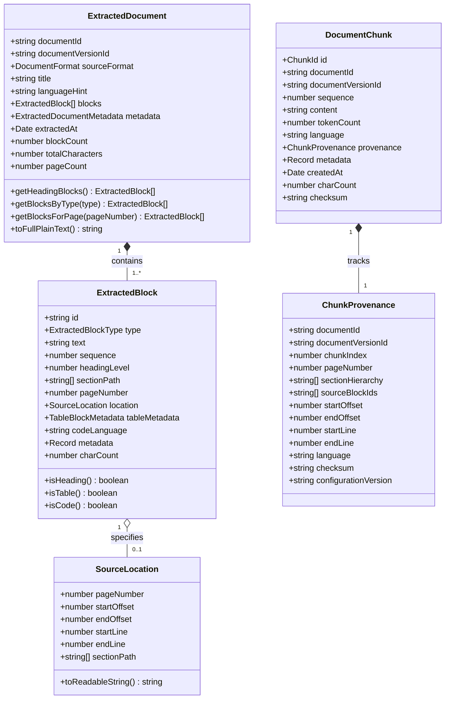
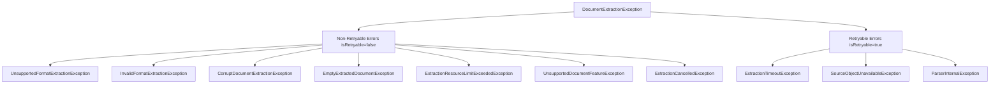

# AI-04.1 — Extraction Domain Model & Provenance Specification

- **Document Identifier:** `AI-04-EXTRACTION-MODEL`
- **Milestone:** AI-04.1 — Extraction Domain Model & Parser Contracts
- **Date:** 2026-11-19
- **Bounded Context:** AI / Document Extraction & Processing
- **Roles:** Principal RAG Domain Architect, Senior TypeScript Engineer, Senior QA Engineer
- **Status:** **APPROVED & FULLY IMPLEMENTED**
- **Quality Gate:** 100% Type-Safe (`tsc`), Browser Boundary Isolated (5/5), 39/39 Pure Unit Tests Passing

---

## 1. Executive Summary

Milestone **AI-04.1** establishes the framework-independent Domain Model for document extraction, structural block representation, provenance tracking, and chunk representation within `@kinergy-platform/core`.

In strict adherence to Clean Architecture and Hexagonal Architecture principles:

1. **Zero Framework & Parser SDK Coupling:** The domain layer contains 0 imports of NestJS, Prisma, Ollama, or third-party parser SDKs (e.g. `unpdf`, `mammoth`, `marked`).
2. **Immutable Version Association:** Every `ExtractedDocument` and `DocumentChunk` binds immutably to a single `documentId` and `documentVersionId`.
3. **Monotonic Source Sequencing:** Extracted blocks enforce strictly increasing sequence numbers ($S_0 < S_1 < S_2 < \dots$).
4. **Authentic Provenance:** No fabricated page numbers for unpaginated formats (Markdown, TXT). Paginated formats (PDF) preserve original 1-indexed page references.
5. **Classified Error Taxonomy:** Comprehensive error hierarchy distinguishing retryable (e.g. timeout, transient storage failure) from non-retryable failures (e.g. corrupt file, empty document, encrypted file).

---

## 2. Extraction & Provenance Class Diagram



---

## 3. Extraction Model Specification

### 3.1 `ExtractedDocument`

Representing the aggregate of an extracted document version:

| Property            | Type                        | Invariant / Validation Rule                                           |
| :------------------ | :-------------------------- | :-------------------------------------------------------------------- |
| `documentId`        | `string`                    | Non-empty string. Foreign key to `knowledge_documents.id`.            |
| `documentVersionId` | `string`                    | Non-empty string. Foreign key to `document_versions.id`.              |
| `sourceFormat`      | `DocumentFormat`            | Must be an approved format (`PDF`, `DOCX`, `MARKDOWN`, `TXT`).        |
| `title`             | `string \| null`            | Optional sanitized document title.                                    |
| `languageHint`      | `string`                    | Defaults to `'es'` or source version declared language.               |
| `blocks`            | `readonly ExtractedBlock[]` | Non-empty array. Must contain at least one non-whitespace text block. |
| `metadata`          | `ExtractedDocumentMetadata` | Contains `parserName`, `totalChars`, `pageCount`, execution warnings. |
| `extractedAt`       | `Date`                      | Timestamp of extraction execution.                                    |

#### Invariants Enforced at Creation:

- **Non-Empty Text:** Throws `EmptyExtractedDocumentException` if `blocks` is empty or all blocks are whitespace-only.
- **Strict Monotonic Sequencing:** Block sequences must satisfy $b[i].\text{sequence} < b[i+1].\text{sequence}$.
- **Unpaginated Format Defense:** If `sourceFormat` is `MARKDOWN` or `TXT`, every block's `pageNumber` must be strictly `null`. Throws `DocumentValidationException` if a fabricated page number is passed.

### 3.2 `ExtractedBlock` & Block Types

Represents discrete structural elements:

```typescript
export enum ExtractedBlockType {
  HEADING = 'HEADING',
  PARAGRAPH = 'PARAGRAPH',
  LIST_ITEM = 'LIST_ITEM',
  TABLE = 'TABLE',
  TABLE_ROW = 'TABLE_ROW',
  TABLE_CELL = 'TABLE_CELL',
  CODE_BLOCK = 'CODE_BLOCK',
  BLOCKQUOTE = 'BLOCKQUOTE',
  PAGE_BOUNDARY = 'PAGE_BOUNDARY',
  DIVIDER = 'DIVIDER',
  METADATA_BLOCK = 'METADATA_BLOCK',
}
```

#### Heading Validation:

- When `type === ExtractedBlockType.HEADING`: `headingLevel` is **required** and must be an integer between 1 and 6 ($1 \le L \le 6$).
- When `type !== ExtractedBlockType.HEADING`: `headingLevel` must be `null`. Specifying a level on non-headings throws `DocumentValidationException`.

---

## 4. Provenance Model Specification

### 4.1 Format-Aware Provenance (`SourceLocation`)

`SourceLocation` is an immutable Value Object capturing precise physical and logical coordinates:

- **PDF Documents:** Populates `pageNumber` ($P \ge 1$) and optional bounding box / character offsets.
- **Markdown & Plain Text:** Populates `startLine`, `endLine` ($L \ge 1$, $L_{\text{end}} \ge L_{\text{start}}$), and character offsets (`startOffset`, `endOffset`). Sets `pageNumber = null`.
- **Hierarchical Section Path:** Array of parent headings leading to the current block: e.g. `["Manual Operativo", "Protocolos de Higiene", "Esterilización"]`.

### 4.2 `ChunkProvenance` Contract

Future chunking operations in Milestone AI-04.4 generate chunks bound to a `ChunkProvenance` record:

```typescript
export interface ChunkProvenanceProps {
  documentId: string;
  documentVersionId: string;
  chunkIndex: number;
  pageNumber?: number | null;
  sectionHierarchy?: readonly string[];
  sourceBlockIds?: readonly string[];
  startOffset?: number | null;
  endOffset?: number | null;
  startLine?: number | null;
  endLine?: number | null;
  language?: string;
  checksum: DocumentChecksum | string; // SHA-256 (64 hex characters)
  configurationVersion: string; // e.g. 'chunker-v1-target450-overlap60'
}
```

---

## 5. Chunk Domain Contract (`DocumentChunk`)

`DocumentChunk` is the domain entity designed for downstream chunking and future vector embedding (Milestone AI-05):

| Field               | Type              | Description                                               |
| :------------------ | :---------------- | :-------------------------------------------------------- |
| `id`                | `ChunkId`         | Stable entity identifier (UUID v4 or deterministic hash). |
| `documentId`        | `string`          | Logical document reference.                               |
| `documentVersionId` | `string`          | Specific immutable version reference.                     |
| `sequence`          | `number`          | 0-indexed position within document chunk stream.          |
| `content`           | `string`          | Normalized text payload.                                  |
| `tokenCount`        | `number`          | Calculated token count ($T \ge 1$).                       |
| `language`          | `string`          | Detected language code (`'es'` or `'en'`).                |
| `provenance`        | `ChunkProvenance` | Immutable source coordinates and version linkage.         |
| `createdAt`         | `Date`            | Timestamp of chunk generation.                            |

#### Invariants Enforced:

- `provenance.documentId === chunk.documentId`
- `provenance.documentVersionId === chunk.documentVersionId`
- `provenance.chunkIndex === chunk.sequence`
- `chunk.tokenCount >= 1`
- `chunk.content.trim().length > 0`
- Entity is deeply frozen (`Object.freeze(this)`).

---

## 6. Error Taxonomy & Retryability Classification

All extraction failures inherit from `DocumentExtractionException`:



### Standard Error Classifier (`classifyExtractionError`)

Converts any unhandled runtime or third-party parser exception into the standard domain taxonomy:

- String containing `"timeout"` $\rightarrow$ `EXTRACTION_TIMEOUT` (`isRetryable: true`).
- String containing `"encrypted"` or `"password"` $\rightarrow$ `UNSUPPORTED_FEATURE` (`isRetryable: false`).
- String containing `"scanned"` or `"ocr"` $\rightarrow$ `UNSUPPORTED_FEATURE` (`isRetryable: false`).
- String containing `"corrupt"` or `"bad xref"` $\rightarrow$ `CORRUPT_DOCUMENT` (`isRetryable: false`).
- Default / unknown memory crash $\rightarrow$ `PARSER_INTERNAL_ERROR` (`isRetryable: true`).

---

## 7. Verification Evidence

All unit test suites for extraction domain models pass with 100% success rate:

```
PASS  packages/core/src/ai/domain/__tests__/source-provenance.vo.spec.ts (8 tests)
PASS  packages/core/src/ai/domain/__tests__/extracted-block.model.spec.ts (9 tests)
PASS  packages/core/src/ai/domain/__tests__/extracted-document.model.spec.ts (8 tests)
PASS  packages/core/src/ai/domain/__tests__/document-chunk.entity.spec.ts (8 tests)
PASS  packages/core/src/ai/domain/__tests__/document-extraction.exceptions.spec.ts (6 tests)
Total: 39 passed, 39 total (100% PASS)
```
