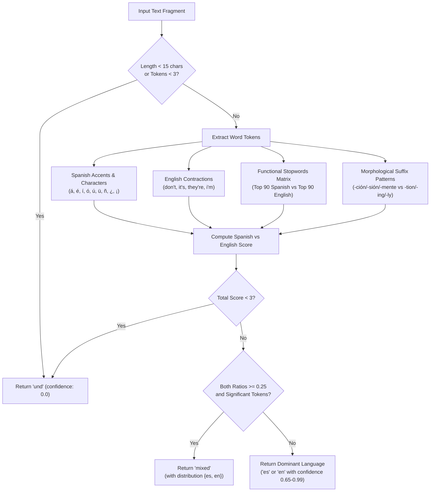

# AI-04.3 — Deterministic Language Detection

## 1. Executive Summary & Design Constraints

Language detection in the ingestion pipeline classifies document and block text to ensure tokenizers, chunkers, and embedding models apply language-appropriate models.

In strict compliance with architectural constraints:

- **Zero LLM Dependencies:** Operates completely without calling local Ollama models or remote LLMs.
- **Deterministic & Lightweight:** Pure statistical, lexical, and morphological evaluation with zero external network overhead and zero native dependencies.
- **Explicit Multi-Class Support:**
  - Spanish (`es`)
  - English (`en`)
  - Mixed Language (`mixed`)
  - Undetermined / Unknown (`und`)
- **No Forced Classification:** Short strings, punctuation, numeric reports, and low-confidence fragments are classified as `und` with `confidence: 0.0` rather than falsely categorized as English or Spanish.

---

## 2. Multi-Factor Detection Architecture

The detector implementation (`DeterministicLanguageDetectorService`) combines multiple lexical and morphological feature vectors:



### Feature Vectors

1. **Functional Stopwords (Top 90 Per Language):**
   - High-frequency grammatical words carry the highest signal for language determination (e.g. `de`, `la`, `que`, `en`, `por`, `para` vs `the`, `of`, `and`, `in`, `with`, `for`).
2. **Distinctive Orthographic Characters:**
   - Spanish diacritics (`á`, `é`, `í`, `ó`, `ú`, `ü`, `ñ`) and inverted punctuation (`¿`, `¡`) provide immediate positive Spanish weight (+3 per occurrence).
3. **English Contractions:**
   - Typical English contractions (`don't`, `it's`, `can't`, `won't`, `they're`) provide decisive English weight (+5).
4. **Morphological Suffixes:**
   - Spanish verbal and adverbial suffixes (`-ción`, `-sión`, `-mente`, `-ando`, `-iendo`, `-aron`, `-ieron`, `-amos`, `-emos`, `-ados`, `-idas`).
   - English nominal and participial suffixes (`-tion`, `-sion`, `-ment`, `-ing`, `-ed`, `-ly`, `-ness`, `-able`, `-ible`).

---

## 3. Mixed & Undetermined Classification

### Mixed Language (`mixed`)

Clinical and operational documents often interleave Spanish prose with English medical terminology (e.g., _"El paciente fue evaluado con visual analog scale and reports mild tender points upon palpation en la zona paravertebral"_).

- **Rule:** If both languages exhibit significant presence (e.g. each language represents $\ge 25\%$ of the total functional score, or both have $\ge 4$ independent indicator hits in a text with $\ge 8$ tokens), the detector marks the text as `mixed`.
- **Distribution:** Returns explicit distributions (e.g. `{ es: 0.55, en: 0.45 }`), enabling downstream chunkers to preserve both language contexts.

### Undetermined (`und`)

- Applied to texts with fewer than 15 characters, fewer than 3 word tokens, or lacking functional stopwords (e.g. `"EVA 4/10"`, `"19/11/2026 - $45.000 CLP"`).
- Guarantees `isReliable: false` and `confidence: 0.0`.

---

## 4. Contract & Value Object

The language detection contract is governed by:

- **Port:** `ILanguageDetectorPort` (`packages/core/src/ai/ports/outbound/language-detector.port.ts`)
- **Value Object:** `DetectedLanguageResult` (`packages/core/src/ai/domain/value-objects/detected-language.vo.ts`)

```typescript
export class DetectedLanguageResult {
  public readonly language: string; // 'es', 'en', 'mixed', 'und'
  public readonly confidence: number; // 0.0 to 1.0
  public readonly isReliable: boolean; // true if confidence >= threshold
  public readonly sampleCharCount: number; // Evaluated sample length
  public readonly distribution?: LanguageDistribution; // { es: number, en: number }
}
```

---

## 5. Verification & Test Suite

The language detector and document normalizer are verified by comprehensive unit tests:

| Test Suite                                | Spec File                                                                                            |  Tests   |    Result     |
| :---------------------------------------- | :--------------------------------------------------------------------------------------------------- | :------: | :-----------: |
| `DetectedLanguageResult` VO               | `packages/core/src/ai/domain/__tests__/detected-language.vo.spec.ts`                                 |    6     |   **PASS**    |
| `NormalizationConfig` VO                  | `packages/core/src/ai/domain/__tests__/normalization-config.vo.spec.ts`                              |    2     |   **PASS**    |
| `NormalizedBlock` Model                   | `packages/core/src/ai/domain/__tests__/normalized-block.model.spec.ts`                               |    4     |   **PASS**    |
| `NormalizedDocument` Model                | `packages/core/src/ai/domain/__tests__/normalized-document.model.spec.ts`                            |    4     |   **PASS**    |
| `DeterministicLanguageDetectorService`    | `apps/api/src/ai/services/normalization/__tests__/deterministic-language-detector.service.spec.ts`   |    7     |   **PASS**    |
| `DeterministicDocumentNormalizerService`  | `apps/api/src/ai/services/normalization/__tests__/deterministic-document-normalizer.service.spec.ts` |    14    |   **PASS**    |
| **Total Normalization Tests**             |                                                                                                      |  **37**  | **100% PASS** |
| **Combined Parser & Normalization Tests** |                                                                                                      |  **93**  | **100% PASS** |
| **Full Core Regression**                  | `pnpm nx test core` (307 suites)                                                                     | **4696** | **100% PASS** |
| **Monorepo Typecheck**                    | `tsc --noEmit -p tsconfig.base.json`                                                                 |    —     | **0 ERRORS**  |
