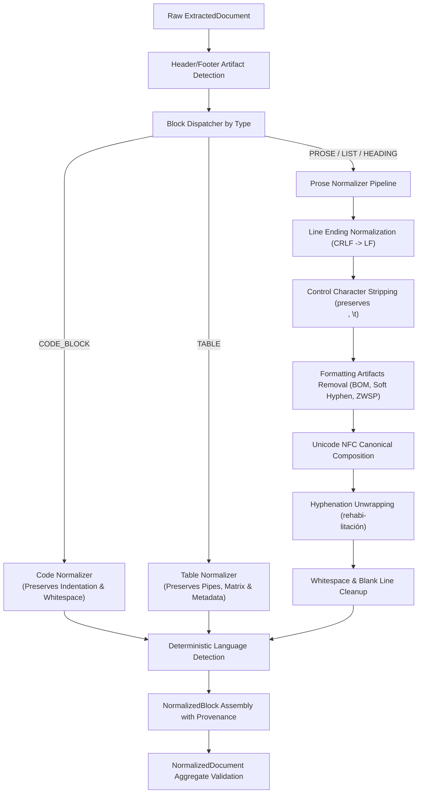

# AI-04.3 — Document Content Normalization & Structural Preservation

## 1. Executive Summary & Architectural Principles

The Document Normalization Pipeline transforms raw `ExtractedDocument` structures into sanitized, deterministic, and provenance-preserving `NormalizedDocument` aggregates.

Normalization operates under strict architectural guarantees:

- **Clean Architecture & Hexagonal Boundaries:** Core domain models (`NormalizedDocument`, `NormalizedBlock`, `NormalizationConfig`) reside within `@kinergy-platform/core`, completely decoupled from specific parsing engines or persistence layers.
- **Structural Integrity:** Never collapses or merges distinct structural elements. Headings, paragraph boundaries, bullet/numbered lists, table matrices, and code blocks retain their unique semantic identities.
- **Traceability & Provenance Preservation:** Every `NormalizedBlock` maintains an immutable reference to its originating `sourceBlockId` (`ExtractedBlock.id`), tracking its original length, normalized length, character delta, and sequence order.
- **Business Semantics Safeguards:** Preserves numbers, dates (`19/11/2026`), currency values (`$45.000 CLP`, `USD 25.50`), clinical/operational identifiers (`SOAP-102`, `RFC-4122`), and semantic punctuation (`¿?`, `¡!`, `-5 °C`, `95%`, `0.75 mg`).

---

## 2. Normalization Pipeline Stages



### Stage 1: Repetitive Header & Footer Artifact Detection

In multi-page documents (e.g. PDFs), running headers or footers such as `"Página 1 de 10"` or repetitive clinic names appear at page boundaries.

- **Rule:** Identifies single-line text blocks (< 80 characters) appearing at the top or bottom boundaries across 2 or more distinct pages.
- **Outcome:** The block is flagged with `isHeaderOrFooterArtifact: true` in `NormalizedBlock`, enabling downstream chunking and retrieval filters to exclude repetitive noise without destroying original extraction provenance.

### Stage 2: Type-Specific Normalization

#### A. Code Blocks (`ExtractedBlockType.CODE_BLOCK`)

- **Indentation Protection:** Code blocks **never** undergo horizontal whitespace collapsing. Tabs and multiple spaces are 100% preserved.
- **Sanitization:** Strips non-printable ASCII control characters (`\x00-\x08`, `\x0B`, `\x0C`, `\x0E-\x1F`, `\x7F`) and normalizes line endings (`\r\n` -> `\n`).

#### B. Tables (`ExtractedBlockType.TABLE`)

- **Structure Protection:** Retains markdown table syntax (`| col1 | col2 |`) and header separator rows (`| --- | --- |`).
- **Cell Normalization:** Normalizes internal whitespace within individual table cells while preserving column counts and `tableMetadata` (`rowCount`, `colCount`, `headers`).

#### C. Prose (Headings, Paragraphs, Lists, Blockquotes)

1. **Line Ending Normalization:** Converts `\r\n` and `\r` to standard Unix `\n`.
2. **Control Character Removal:** Strips ASCII control characters while preserving `\n` and `\t`.
3. **Invisible Formatting Artifacts Removal:**
   - Soft hyphens: `\u00AD` (typography line-wrap artifacts in PDFs/DOCX).
   - Zero-width space: `\u200B`.
   - Byte Order Mark (BOM): `\uFEFF`.
   - Zero-width joiner / non-joiner: `\u200C`, `\u200D`.
4. **Unicode Normalization:** Default policy uses **NFC** (Canonical Decomposition followed by Canonical Composition). NFC guarantees that combined diacritics (e.g. `e` + `´`) are composed into standard precomposed characters (`é`), without decomposing currency symbols, numeric fractions, or mathematical operators.
5. **Hyphenation Unwrapping:**
   - Unwraps line-broken words split across lines: `([a-záéíóúüñA-ZÁÉÍÓÚÜÑ]{2,})-\n([a-záéíóúüñ]{2,})` -> `$1$2` (e.g. `"rehabi-\nlitación"` becomes `"rehabilitación"`).
   - Preserves compound terms where the following token is capitalized, spaced, or independent (e.g. `"pre- y post-quirúrgicos"`, `"kine- deportiva"`).
6. **Whitespace & Blank Line Cleanup:**
   - Collapses multiple horizontal spaces/tabs into a single space (`[ \t]+` -> `' '`).
   - Trims leading and trailing spaces per line.
   - Collapses 3+ consecutive newlines into standard double-newlines (`\n\n`) representing paragraph boundaries.

---

## 3. Versioned Normalization Configuration

The pipeline configuration is governed by the immutable value object `NormalizationConfig` (`packages/core/src/ai/domain/value-objects/normalization-config.vo.ts`):

```typescript
export interface NormalizationConfigProps {
  readonly version?: string; // Default '1.0.0'
  readonly unicodePolicy?: 'NFC' | 'NFKC' | 'NONE'; // Default 'NFC'
  readonly collapseWhitespace?: boolean; // Default true
  readonly normalizeLineEndings?: boolean; // Default true
  readonly unwrapHyphenation?: boolean; // Default true
  readonly stripControlChars?: boolean; // Default true
  readonly removeFormattingArtifacts?: boolean; // Default true
  readonly detectLanguage?: boolean; // Default true
  readonly minLanguageDetectionChars?: number; // Default 20
  readonly cleanHeaderFooterArtifacts?: boolean; // Default true
}
```

This configuration version is stamped onto every `NormalizedDocument.metadata.normalizerVersion`, enabling safe, idempotent document reprocessing if normalization rules evolve.

---

## 4. Source Mapping & Provenance Tracking

Unlike lossy text sanitizers, `NormalizedDocument` guarantees complete traceability to source extractions:

- `sourceBlockId`: Links directly to `ExtractedBlock.id`.
- `originalLength`: Byte/character length prior to normalization.
- `normalizedLength`: Byte/character length after normalization.
- `sourceBlockCharDelta`: Net change in characters (`normalizedLength - originalLength`).
- `transformationsApplied`: Explicit audit log of every transformation applied to the block (e.g., `['UNICODE_NFC', 'COLLAPSE_WHITESPACE', 'UNWRAP_HYPHENATION']`).
- `location`: Preserves the physical or logical source location (`pageNumber`, `startLine`, `endLine`).
