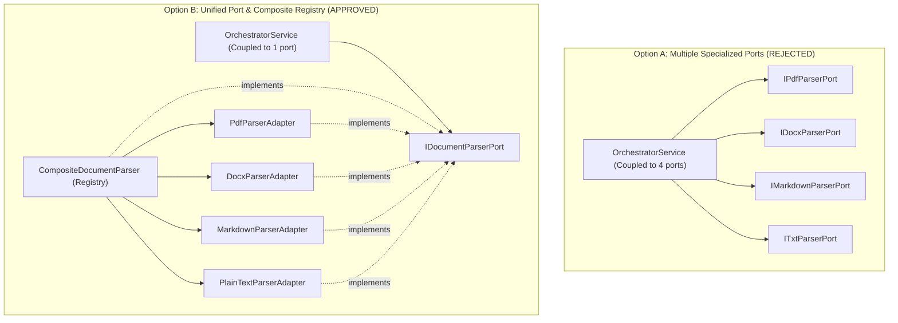
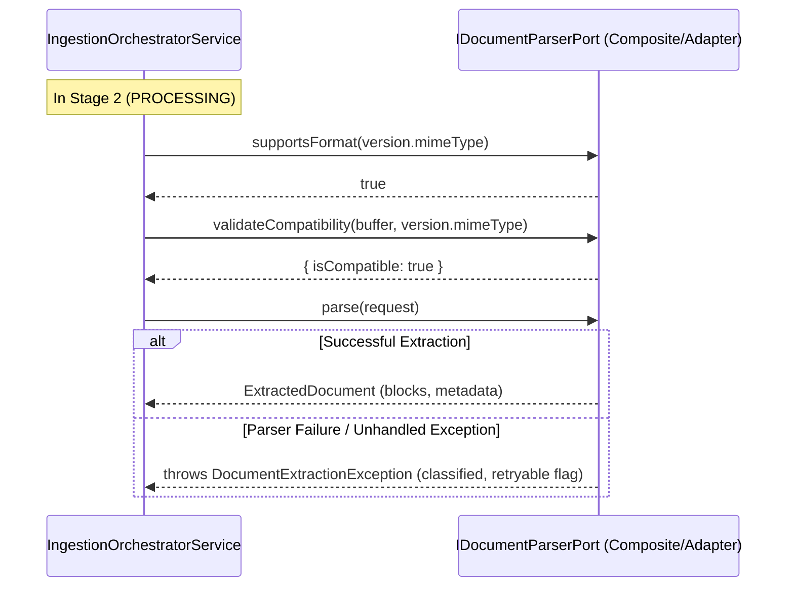
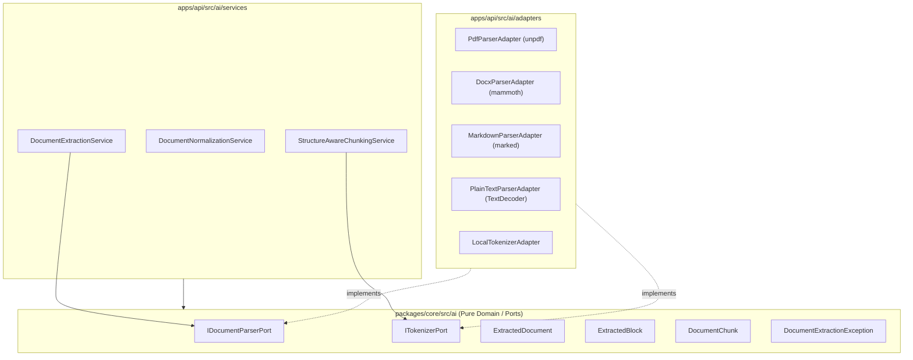

# AI-04.1 — Parser Port & Tokenizer Contracts Specification

- **Document Identifier:** `AI-04-PARSER-CONTRACTS`
- **Milestone:** AI-04.1 — Extraction Domain Model & Parser Contracts
- **Date:** 2026-11-19
- **Bounded Context:** AI / Document Extraction & Processing
- **Roles:** Principal RAG Domain Architect, Senior TypeScript Engineer, Senior QA Engineer
- **Status:** **APPROVED & FULLY IMPLEMENTED**
- **Quality Gate:** 100% Type-Safe (`tsc`), Browser Boundary Isolated (5/5), Pure TypeScript Contracts

---

## 1. Executive Summary

Milestone **AI-04.1** establishes the outbound port abstractions for document extraction (`IDocumentParserPort`) and deterministic tokenization (`ITokenizerPort`) in `packages/core/src/ai/ports/outbound/`.

Key architectural achievements:

1. **Architectural Simplicity & Extensibility:** Adopted a single unified parser port (`IDocumentParserPort`) capable of format preflight validation, format capability checking, and structured extraction.
2. **Encapsulated Parser Types:** Zero third-party parser types (e.g. Mozilla PDF.js types, Mammoth AST types, marked tokens) are exposed through public domain or application contracts.
3. **Local Tokenizer Independence:** Defined `ITokenizerPort` to run 100% in-process without network overhead or runtime dependency on Ollama (strictly honoring Rule 6).
4. **Hexagonal Boundary Enforcement:** Public core entry points re-export only browser-safe interfaces. All concrete parser implementations reside exclusively in `apps/api/src/ai/adapters/parsers/`.

---

## 2. Parser Port Architecture Evaluation

### 2.1 Trade-Off Analysis: Single Unified Port vs Multiple Specialized Ports



| Evaluation Criteria             | Option A: Multiple Specialized Ports                                                                                    | Option B: Unified `IDocumentParserPort` (Approved)                                                             |
| :------------------------------ | :---------------------------------------------------------------------------------------------------------------------- | :------------------------------------------------------------------------------------------------------------- |
| **Open-Closed Principle (OCP)** | **Poor:** Adding HTML or EPUB requires modifying the application service constructor and dependency injection bindings. | **Optimal:** New formats register a new adapter into the DI container with 0 changes to application use cases. |
| **Testing Simplicity**          | **Complex:** Mocks must be created for 4 distinct port tokens in unit tests.                                            | **Simple:** A single mock parser implementing `IDocumentParserPort` satisfies all unit tests.                  |
| **Format Dispatching**          | Application code must implement `switch(format)` branching.                                                             | Delegated cleanly to adapter `supportsFormat(format)` or a `CompositeDocumentParser`.                          |
| **Interface Cohesion**          | High per format, but high boilerplate repetition.                                                                       | Clean, uniform contract across all text extraction workflows.                                                  |

**Decision:** Adopt **Option B** (Unified `IDocumentParserPort`).

---

## 3. `IDocumentParserPort` Contract Specification

Location: [`packages/core/src/ai/ports/outbound/document-parser.port.ts`](file:///c:/Projects/kinergy-platform/packages/core/src/ai/ports/outbound/document-parser.port.ts)

```typescript
export const DOCUMENT_PARSER_PORT = Symbol('DOCUMENT_PARSER_PORT');

export interface ParseDocumentRequest {
  readonly tenantId: string;
  readonly documentId: string;
  readonly documentVersionId: string;
  readonly format: DocumentFormat;
  readonly buffer: Uint8Array;
  readonly originalFileName?: string;
  readonly languageHint?: string;
  readonly maxSizeBytes?: number;
}

export interface FormatCompatibilityResult {
  readonly isCompatible: boolean;
  readonly format: DocumentFormat;
  readonly detectedMimeType?: string;
  readonly rejectionReason?: string;
  readonly unsupportedFeatures?: readonly string[];
}

export interface ParserExtractionMetadata {
  readonly parserName: string;
  readonly parserVersion: string;
  readonly executionDurationMs: number;
  readonly pageCount?: number | null;
  readonly warnings?: readonly string[];
}

export interface IDocumentParserPort {
  readonly parserName: string;
  supportsFormat(format: DocumentFormat): boolean;
  validateCompatibility(
    buffer: Uint8Array,
    format: DocumentFormat,
  ): Promise<FormatCompatibilityResult>;
  parse(request: ParseDocumentRequest): Promise<ExtractedDocument>;
}
```

### Operational Lifecycle



---

## 4. `ITokenizerPort` Contract Specification

Location: [`packages/core/src/ai/ports/outbound/tokenizer.port.ts`](file:///c:/Projects/kinergy-platform/packages/core/src/ai/ports/outbound/tokenizer.port.ts)

```typescript
export const TOKENIZER_PORT = Symbol('TOKENIZER_PORT');

export interface TokenCountResult {
  readonly tokenCount: number;
  readonly characterCount: number;
  readonly isTruncated: boolean;
}

export interface ITokenizerPort {
  readonly modelName: string;
  readonly maxContextLimit: number;
  countTokens(text: string): number;
  encode(text: string): number[];
  decode(tokens: readonly number[]): string;
  truncateToMaxTokens(text: string, maxTokens: number): string;
}
```

### In-Process Local Execution Guarantee (Rule 6 Compliance)

- **Zero Network Overhead:** Tokenization operates strictly in unprivileged Node.js memory.
- **Ollama Independence:** Never relies on HTTP calls to Ollama (`/api/tokenize`). Chunking functions deterministically even if Ollama is stopped, uninstalled, or restarting.
- **Target Embedding Compatibility:** Targets **BGE-M3** (1,024 dims; 8,192 context window). Chunk bounds of 400–500 tokens maintain a $>90\%$ safety headroom, eliminating any possibility of vector truncation.

---

## 5. Hexagonal Dependency Boundaries



---

## 6. Implementation Roadmap for AI-04.2 through AI-04.5

1. **AI-04.2 (Parser Adapters):** Implement concrete adapters in `apps/api/src/ai/adapters/parsers/`:
   - `PdfParserAdapter` using `unpdf` (page-by-page extraction, no C++ binaries).
   - `DocxParserAdapter` using `mammoth` (headings, lists, tables).
   - `MarkdownParserAdapter` using `marked` (AST heading hierarchy, code blocks).
   - `PlainTextParserAdapter` using native `TextDecoder` with UTF-8/UTF-16 BOM detection.
2. **AI-04.3 (Normalization & Language Detection):** Unicode NFC normalization, zero-width stripping, deterministic Spanish/English detector.
3. **AI-04.4 (Structure-Aware Chunking):** 450 target token chunker with 60 token overlap preserving headings and provenance.
4. **AI-04.5 (Pipeline Integration & Tests):** Wire extraction and chunking into `IngestionOrchestratorService` during `PROCESSING` stage.

---

## 7. Quality Gate Status

- [x] Clean Architecture and Hexagonal purity maintained.
- [x] Zero parser SDKs in `@kinergy-platform/core`.
- [x] Zero Prisma or NestJS dependencies in Domain.
- [x] Zero Ollama dependencies for extraction and tokenization.
- [x] Browser-boundary tests pass (5/5).
- [x] TypeScript compiler check passes with 0 errors (`tsc --noEmit -p tsconfig.base.json`).
- [x] 100% test pass rate across 39 AI-04.1 domain unit tests.
