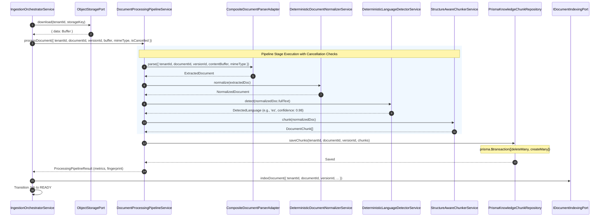

# AI-04.5: Document Processing Pipeline Integration & Provenance Architecture

## 1. Executive Summary

Milestone **AI-04.5** completes the end-to-end integration of the document processing pipeline within the `kinergy-platform` ingestion engine. It unites format-specific parsers (PDF, DOCX, Markdown, Text), deterministic Unicode/structural normalization, language detection, token-aware chunking, and relational chunk persistence under an immutable, deterministic, tenant-isolated orchestration lifecycle.

```
+-----------------------------------------------------------------------------------------------------------------------------+
|                                                  INGESTION PIPELINE FLOW                                                    |
+-----------------------------------------------------------------------------------------------------------------------------+
|                                                                                                                             |
|  +--------------------+        +--------------------+        +---------------------+        +--------------------+          |
|  |   DocumentVersion  | -----> |  Storage Retrieval | -----> | Multi-Format Parser | -----> | Structured Extract |          |
|  |     (Immutable)    |        | (S3/MinIO Buffer)  |        | (PDF/DOCX/MD/Text)  |        | (ExtractedDocument)|          |
|  +--------------------+        +--------------------+        +---------------------+        +--------------------+          |
|                                                                                                       |                     |
|                                                                                                       v                     |
|  +--------------------+        +--------------------+        +---------------------+        +--------------------+          |
|  | Relational Storage | <----- | Structure-Aware    | <----- | Tokenizer Port      | <----- | Normalization &    |          |
|  | (knowledge_chunks) |        | Chunking Engine    |        | (BPE / cl100k_base) |        | Language Detection |          |
|  +--------------------+        +--------------------+        +---------------------+        +--------------------+          |
|                                                                                                                             |
+-----------------------------------------------------------------------------------------------------------------------------+
```

---

## 2. Architectural Principles & Invariants

1. **Clean & Hexagonal Architecture:**
   - Domain models (`DocumentChunk`, `NormalizedDocument`, `ExtractedDocument`, `IngestionJob`) reside strictly in `@kinergy-platform/core`.
   - Outbound ports (`IDocumentParserPort`, `IDocumentNormalizerPort`, `ILanguageDetectorPort`, `ITokenizerPort`, `IDocumentChunkerPort`, `IKnowledgeChunkRepositoryPort`) define framework-agnostic interfaces.
   - Persistence (`PrismaKnowledgeChunkRepository`) and service orchestrators (`DocumentProcessingPipelineService`, `IngestionOrchestratorService`) reside in the infrastructure and application layers.
2. **Version Isolation:**
   - Every chunk is anchored permanently to an immutable `(tenantId, documentId, documentVersionId)`.
   - New version uploads create distinct document versions and isolated chunk sets. Past versions remain immutable and traceable for audits and temporal comparisons.
3. **Strict Zero Vector Contamination:**
   - In accordance with the AI-04 mandate, **zero** pgvector extensions, vector data types, or embedding columns exist in `prisma/schema.prisma` or migration files. Chunks store textual content, hierarchical structure, token lengths, and cryptographic provenance digests only.
4. **Tenant Isolation:**
   - All queries and mutations in `PrismaKnowledgeChunkRepository` require explicit compound scoping (`tenantId`, `documentId`, `documentVersionId`).
5. **Idempotent Atomic Replacement:**
   - If a document version is reprocessed or retried, existing chunks for that `documentVersionId` are purged and recreated within a single ACID transaction (`prisma.$transaction([deleteMany, createMany])`), preventing duplicate chunks or partial fragments.

---

## 3. Relational Schema: `knowledge_chunks`

```prisma
model KnowledgeChunk {
  id                  String   @id @default(uuid())
  tenantId            String   @map("tenant_id")
  documentId          String   @map("document_id")
  documentVersionId   String   @map("document_version_id")
  chunkIndex          Int      @map("chunk_index")
  content             String   @db.Text
  tokenCount          Int      @map("token_count")
  headingHierarchy    Json     @default("[]") @map("heading_hierarchy")
  sectionPath         String?  @map("section_path")
  primaryBlockType    String   @map("primary_block_type")
  pageNumberStart     Int?     @map("page_number_start")
  pageNumberEnd       Int?     @map("page_number_end")
  sourceBlockSequence Int      @map("source_block_sequence")
  provenanceDigest    String   @map("provenance_digest")
  metadata            Json     @default("{}")
  createdAt           DateTime @default(now()) @map("created_at")

  document        KnowledgeDocument @relation(fields: [documentId], references: [id], onDelete: Cascade)
  documentVersion DocumentVersion   @relation(fields: [documentVersionId], references: [id], onDelete: Cascade)

  @@unique([documentVersionId, chunkIndex])
  @@index([tenantId, documentId])
  @@index([tenantId, documentVersionId])
  @@map("knowledge_chunks")
}
```

---

## 4. Pipeline Execution Lifecycle



### 4.1 Cooperative Cancellation Checks

Between each pipeline phase (`Extraction` $\rightarrow$ `Normalization` $\rightarrow$ `Language Detection` $\rightarrow$ `Chunking` $\rightarrow$ `Persistence`), the pipeline invokes the injected `isCancelled()` predicate. If a cancellation signal or database status update (`CANCELLED`) is detected:

1. The pipeline immediately halts execution.
2. An `IngestionCancelledException` is thrown.
3. No corrupted or incomplete chunk sets are committed.
4. The orchestrator preserves the `CANCELLED` status and logs the cancellation cleanly.

---

## 5. Idempotency & Processing Fingerprint

To verify pipeline determinism and prevent redundant computations, the pipeline calculates a SHA-256 **Processing Fingerprint** combining:

- Document Version ID
- Parser Name & Adapter Identity
- Normalization Engine Version
- Tokenizer Identifier & Version
- Chunking Strategy Name & Configuration Version
- Chunk Count & Chunk Cryptographic Digests

$$\text{ProcessingFingerprint} = \text{SHA256}\left(\text{versionId} : \text{parserId} : \text{normVersion} : \text{chunkerId} : \text{chunkCount} : \sum \text{chunkDigest}_i\right)$$

Any change to the normalization rules, tokenizer version, or chunking parameters results in a distinct fingerprint, providing cryptographic lineage tracking.

---

## 6. Error Taxonomy & Retry Strategy

Exceptions are mapped deterministically into retryable and permanent categories via `IngestionRetryPolicy`:

| Pipeline Exception                         | Ingestion Error Code | Classification    | Action                                                        |
| :----------------------------------------- | :------------------- | :---------------- | :------------------------------------------------------------ |
| `ExtractionTimeoutException`               | `PROCESSING_TIMEOUT` | **Retryable**     | Exponential backoff retry ($t_{next} = 2^a \times 5\text{s}$) |
| `SourceObjectUnavailableException`         | `STORAGE_TIMEOUT`    | **Retryable**     | Exponential backoff retry                                     |
| `ParserInternalException` (transient)      | `PROCESSING_TIMEOUT` | **Retryable**     | Exponential backoff retry                                     |
| `InvalidFormatExtractionException`         | `UNSUPPORTED_FORMAT` | **Non-Retryable** | Immediate permanent failure; source preserved                 |
| `UnsupportedFormatExtractionException`     | `UNSUPPORTED_FORMAT` | **Non-Retryable** | Immediate permanent failure; source preserved                 |
| `UnsupportedDocumentFeatureException`      | `UNSUPPORTED_FORMAT` | **Non-Retryable** | Immediate permanent failure; source preserved                 |
| `CorruptDocumentExtractionException`       | `MALFORMED_CONTENT`  | **Non-Retryable** | Immediate permanent failure; source preserved                 |
| `EmptyExtractedDocumentException`          | `MALFORMED_CONTENT`  | **Non-Retryable** | Immediate permanent failure; source preserved                 |
| `ExtractionResourceLimitExceededException` | `MALFORMED_CONTENT`  | **Non-Retryable** | Immediate permanent failure; source preserved                 |
| `DocumentValidationException`              | `MALFORMED_CONTENT`  | **Non-Retryable** | Immediate permanent failure; source preserved                 |

**Non-Negotiable Invariant:** Source documents and their immutable versions in storage and the database are **never** deleted or mutated on ingestion failure.

---

## 7. Observability & Privacy Protections

In strict compliance with medical/clinical data privacy requirements:

- **No Document Content in Logs:** Document body text, normalized paragraphs, table rows, and chunk content strings are **never** emitted to stdout, stderr, or application log files.
- **Structured Metrics Only:** The pipeline logs purely operational metadata:
  ```json
  {
    "documentId": "doc-clinical-001",
    "versionNumber": 1,
    "durationMs": 34,
    "format": "application/pdf",
    "chunkCount": 8,
    "totalTokens": 3420,
    "avgTokens": 427,
    "maxTokens": 482,
    "detectedLanguage": "es",
    "fingerprint": "8f3b...e10a"
  }
  ```

---

## 8. Verification & Test Evidence

- **Monorepo Typecheck:** `pnpm typecheck` passed with 0 errors.
- **Core Package Tests:** 309 test suites passed (4,722 tests), including `knowledge-chunk-persistence.integration.spec.ts` (5/5 integration tests against real PostgreSQL).
- **API AI Module Tests:** 25 test suites passed (292 tests), including `document-processing-pipeline.service.spec.ts` (10/10 tests) and `ingestion-orchestrator.service.spec.ts` (14/14 tests).
