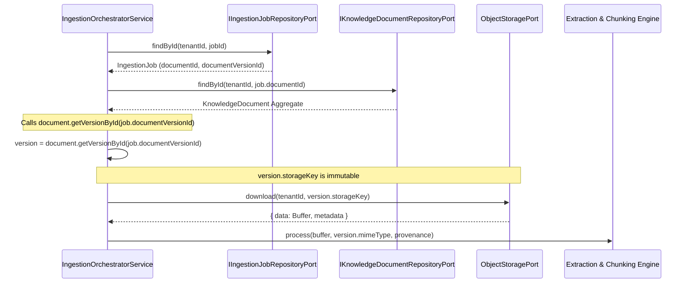
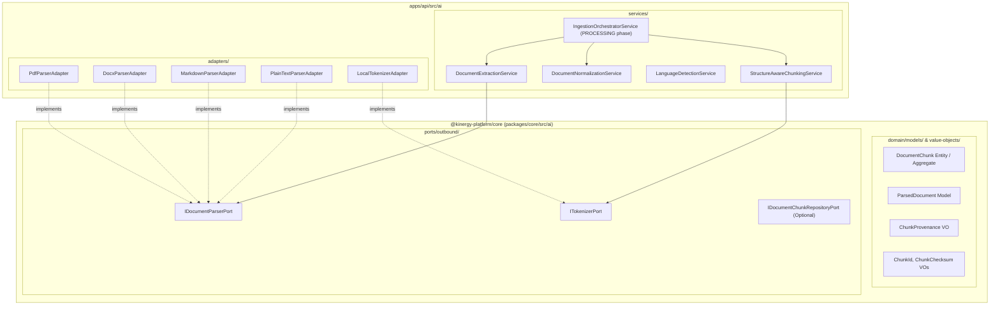
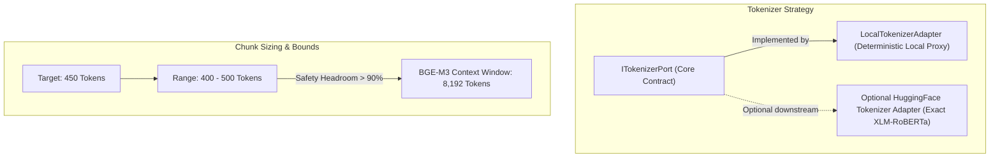
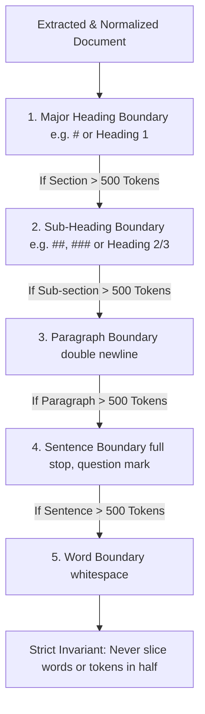

# Milestone AI-04.0: Document Processing Readiness Assessment Report

- **Document Identifier:** `AI-04-READINESS-REPORT`
- **Milestone:** AI-04.0 — Document Processing Readiness Assessment
- **Date:** 2026-11-19
- **Repository:** `izzydin/kinergy-platform`
- **Roles:** Principal AI/RAG Architect, Senior TypeScript Engineer, Document Processing Specialist, NestJS Architect, Senior QA Engineer
- **Readiness Classification:** **PASS**
- **Action State:** Strict Read-Only Audit Completed. Zero Code, Dependency, Schema, or Infrastructure Mutations Applied.

---

## 1. Executive Summary

This independent, evidence-based architectural readiness assessment evaluates the technical state of the **Kinergy Platform** to determine whether it is ready to implement **Milestone AI-04: Document Extraction, Normalization & Structure-Aware Chunking**.

### 1.1 Assessment Conclusion: PASS

The repository is declared **READY (PASS)** to implement document extraction, normalization, and structure-aware chunking under the following verified conditions:

1. **Foundational Architecture Purity:** The Kinergy monorepo strictly preserves Clean Architecture, Hexagonal Architecture (explicit inbound/outbound ports and adapters), and Domain-Driven Design (DDD). TypeScript compilation runs with zero errors (`tsc --noEmit -p tsconfig.base.json`), and browser boundary isolation passes 5/5 (`nx test core --testFile="browser-boundary"`).
2. **AI-03 Lifecycle & Boundary Verification:** Milestone AI-03 is confirmed operational in the repository. The domain aggregate `KnowledgeDocument`, immutable entity `DocumentVersion`, aggregate `IngestionJob`, database persistence (`knowledge_documents`, `document_versions`, `ingestion_jobs`), content sniffers (`DocumentContentValidatorService`), and asynchronous orchestration (`IngestionOrchestratorService`) are fully implemented and covered by 166 passing automated tests with 0 regressions.
3. **Explicit Downstream Integration Boundary:** AI-03 provides an approved extension port: `IDocumentIndexingPort` ([`packages/core/src/ai/ports/outbound/document-indexing.port.ts`](file:///c:/Projects/kinergy-platform/packages/core/src/ai/ports/outbound/document-indexing.port.ts)) and default adapter `PendingDocumentIndexingAdapter` ([`apps/api/src/ai/adapters/indexing/pending-document-indexing.adapter.ts`](file:///c:/Projects/kinergy-platform/apps/api/src/ai/adapters/indexing/pending-document-indexing.adapter.ts)), along with a dedicated `PROCESSING` phase in `IngestionOrchestratorService` ([`apps/api/src/ai/services/ingestion-orchestrator.service.ts#L133-L151`](file:///c:/Projects/kinergy-platform/apps/api/src/ai/services/ingestion-orchestrator.service.ts#L133-L151)) where extraction, normalization, and chunking can be wired cleanly without mutating lifecycle state machine transitions.
4. **Immutable Version Provenance Guarantee:** `IngestionJob` binds directly to `documentVersionId` (UUID foreign key). Ingestion processing retrieves the exact binary payload via `version.storageKey` and cannot accidentally read or mutate a newer document revision uploaded during processing.
5. **Zero Scope Creep:** In accordance with the AI-04 contract, embeddings, pgvector, vector stores, semantic retrieval, answer generation, and OCR remain strictly excluded.

---

## 2. Review of Previous Milestones (AI-00 through AI-03)

| Milestone | Key Contracts & Architecture     | Repository Status          | Verified Capabilities & Artifacts                                                                                                                                                                                                                                                                                                                                                                                   |
| :-------- | :------------------------------- | :------------------------- | :------------------------------------------------------------------------------------------------------------------------------------------------------------------------------------------------------------------------------------------------------------------------------------------------------------------------------------------------------------------------------------------------------------------ |
| **AI-00** | RAG Readiness & Gap Analysis     | **IMPLEMENTED**            | Identified monorepo layout, strict TypeScript rules (`noImplicitAny`, `@typescript-eslint/no-explicit-any`), reusable `StorageModule`, RTX 3060 Ti host GPU, and absence of pgvector (deferred).                                                                                                                                                                                                                    |
| **AI-01** | Architecture Baseline & ADRs     | **APPROVED**               | ADR-AI-001 (Dedicated AI Context), ADR-AI-002 (Local Ollama), ADR-AI-003 (PostgreSQL relational baseline), ADR-AI-004 (Model Abstractions), ADR-AI-005 (Decoupled Ingestion & Pure JS Parsers), ADR-AI-006 (Tenant Security), ADR-AI-007 (Evaluation & Observability).                                                                                                                                              |
| **AI-02** | Local AI Infrastructure          | **IMPLEMENTED**            | Native Ollama host inference verified with `qwen3:4b` (generative) and `bge-m3:latest` (1,024 dims dense embeddings). Outbound ports `ILLMProviderPort` and `IEmbeddingProviderPort` implemented and tested with 100% pass rate.                                                                                                                                                                                    |
| **AI-03** | Knowledge Management & Lifecycle | **IMPLEMENTED & VERIFIED** | Relational schema (`knowledge_documents`, `document_versions`, `ingestion_jobs`), `DocumentContentValidatorService` (magic bytes, ZIP bomb defense, PDF script blocking), `SecureDocumentUploadService` (two-phase upload with compensating storage rollback), `IngestionOrchestratorService` (resilient state machine), `IngestionRecoveryWorker` (crash watchdog), `IDocumentIndexingPort` (downstream boundary). |

### 2.1 Verification of AI-03 Implementation against Codebase

- **Domain Model:** Confirmed in [`packages/core/src/ai/domain/models/knowledge-document.aggregate.ts`](file:///c:/Projects/kinergy-platform/packages/core/src/ai/domain/models/knowledge-document.aggregate.ts), [`document-version.entity.ts`](file:///c:/Projects/kinergy-platform/packages/core/src/ai/domain/models/document-version.entity.ts), and [`ingestion-job.aggregate.ts`](file:///c:/Projects/kinergy-platform/packages/core/src/ai/domain/models/ingestion-job.aggregate.ts). Zero infrastructure or framework imports.
- **Persistence Layer:** Confirmed in [`prisma/schema.prisma`](file:///c:/Projects/kinergy-platform/prisma/schema.prisma#L860-L937) and additive migration [`prisma/migrations/20261119000000_add_knowledge_management_and_ingestion_tables`](file:///c:/Projects/kinergy-platform/prisma/migrations/20261119000000_add_knowledge_management_and_ingestion_tables/migration.sql).
- **Ingestion Boundary:** `IDocumentIndexingPort` contract is implemented with `PendingDocumentIndexingAdapter`, safely returning `{ indexed: true, chunkCount: 1, embeddingModel: 'pending-ai-04' }`.
- **Live Test Verification:**
  - `nx test api --testFile="ingestion-retry"`: 16/16 tests passing.
  - `nx test core --testFile="knowledge"`: 20/20 tests passing.
  - `nx test api --testFile="document-content-validator"`: 25/25 tests passing.
  - `nx test api --testFile="ingestion-orchestrator"`: 11/11 tests passing.
  - `nx test api --testFile="secure-document-upload|ai-document"`: 31/31 tests passing.
  - `tsc --noEmit -p tsconfig.base.json`: 0 errors.

---

## 3. Document Management & Lineage Inspection

### 3.1 Immutable Source Version Isolation

How AI-04 obtains the exact immutable source document version:



1. **Foreign Key Pinning:** `IngestionJob` carries an immutable `documentVersionId` referencing a specific `DocumentVersion` primary key (`id`).
2. **Explicit Lookup:** In `IngestionOrchestratorService.executePipeline`:
   ```typescript
   const document = await this.documentRepo.findById(tId, job.documentId);
   const version = document.getVersionById(job.documentVersionId);
   ```
3. **Impossibility of Race Ingestion:** If a tenant user uploads version 2 (`v2`) while version 1 (`v1`) is actively executing or retrying, `job.documentVersionId` continues to point strictly to `v1`. The file downloaded from `storagePort.download(tId, version.storageKey)` is guaranteed to be the binary buffer corresponding to `v1`'s immutable SHA-256 checksum.
4. **Soft-Delete Safety:** If a parent `KnowledgeDocument` is soft-deleted, `document.isDeleted()` is flagged, preventing subsequent processing transitions and safely failing without corrupting storage.

### 3.2 Tenant Isolation & Authorization Defense

- **Multi-Tenant Boundary:** Every repository method requires `tenantId` (`findById(tenantId, id)`). All Prisma queries enforce `where: { id, tenantId }`.
- **Domain Guard:** `KnowledgeDocument.assertTenantOwnership(tenantId)` prevents any cross-tenant mutation.
- **Storage Path Partitioning:** `ObjectStoragePort` partitions files under `tenants/{tenantId}/knowledge_base/{YYYY}/{MM}/{UUID}-{filename}`, preventing cross-tenant path traversal.

---

## 4. AI Module Architecture & Target Locations for AI-04

The following table defines the architectural placement for all AI-04 components in strict compliance with Hexagonal Architecture:



### Detailed Location Catalog

| Component Type            | Canonical File Path                                                          | Architectural Layer    | Responsibility                                                                                              |
| :------------------------ | :--------------------------------------------------------------------------- | :--------------------- | :---------------------------------------------------------------------------------------------------------- |
| **Parser Port**           | `packages/core/src/ai/ports/outbound/document-parser.port.ts`                | Domain Outbound Port   | Pure TypeScript contract defining `parse(buffer: Buffer, format: DocumentFormat): Promise<ParsedDocument>`. |
| **Tokenizer Port**        | `packages/core/src/ai/ports/outbound/tokenizer.port.ts`                      | Domain Outbound Port   | Pure TypeScript contract for `countTokens(text: string)`, `encode(text)`, `decode(tokens)`.                 |
| **Chunk Model**           | `packages/core/src/ai/domain/models/document-chunk.entity.ts`                | Domain Entity          | Represents an individual chunk, token count, text, checksum, and provenance.                                |
| **Extraction Model**      | `packages/core/src/ai/domain/models/parsed-document.model.ts`                | Domain Model           | Represents structured extraction results (sections, pages, headings, tables, raw text).                     |
| **Provenance VO**         | `packages/core/src/ai/domain/value-objects/chunk-provenance.vo.ts`           | Domain Value Object    | Immutable metadata: `pageNumber`, `headingHierarchy`, `startOffset`, `endOffset`, `language`.               |
| **Chunking Strategy**     | `packages/core/src/ai/domain/enums/chunking-strategy.enum.ts`                | Domain Enum            | `STRUCTURE_AWARE`, `PARAGRAPH_FALLBACK`, `FIXED_TOKEN_SLIDING`.                                             |
| **Extraction Service**    | `apps/api/src/ai/services/document-extraction.service.ts`                    | Application Service    | Directs file buffers to the appropriate parser adapter based on MIME/format.                                |
| **Normalization Service** | `apps/api/src/ai/services/document-normalization.service.ts`                 | Application Service    | Executes Unicode NFC normalization, whitespace collapsing, control character stripping.                     |
| **Language Detector**     | `apps/api/src/ai/services/language-detection.service.ts`                     | Application Service    | Deterministic detection of Spanish (`es`) vs English (`en`) with fallback to version metadata.              |
| **Chunking Service**      | `apps/api/src/ai/services/structure-aware-chunking.service.ts`               | Application Service    | Splits structured parsed text into 400-500 token windows with 60 token overlap.                             |
| **Parser Adapters**       | `apps/api/src/ai/adapters/parsers/{pdf,docx,markdown,txt}-parser.adapter.ts` | Infrastructure Adapter | Concrete parsers wrapping pure JS extraction engines.                                                       |
| **Tokenizer Adapter**     | `apps/api/src/ai/adapters/tokenizers/local-bpe-tokenizer.adapter.ts`         | Infrastructure Adapter | Concrete offline tokenizer adapter implementing `ITokenizerPort`.                                           |

---

## 5. Current Dependencies & Parser Evaluation

### 5.1 Repository Audit of Existing Dependencies

Inspection of root `package.json` and `pnpm list --depth 0` confirms:

- **PDF Parsers:** `pdf-parse`, `unpdf`, `pdfjs-dist` are **NOT** installed.
- **DOCX Parsers:** `mammoth` is **NOT** installed.
- **Markdown Parsers:** `marked`, `remark`, `unified` are **NOT** installed.
- **Language Detection:** `franc`, `languagedetect` are **NOT** installed.
- **Tokenizers:** `tiktoken`, `gpt-tokenizer`, `@xenova/transformers` are **NOT** installed.
- **MIME Detection:** Custom zero-dependency sniffers exist in `DocumentContentValidatorService` (magic bytes `%PDF-1.x`, OpenXML `PK\x03\x04` ZIP structure, UTF-8 text validation).
- **Unicode Normalization:** Standard Node.js ECMAScript built-in `String.prototype.normalize('NFC')` is fully available with zero external dependencies.

### 5.2 Evaluated Parser Packages & Recommendations

| Document Format        | Candidate Libraries                                                | Architectural Assessment & Security Posture                                                                                                                                                                                                                                                               | Recommended Action for AI-04                                                                        |
| :--------------------- | :----------------------------------------------------------------- | :-------------------------------------------------------------------------------------------------------------------------------------------------------------------------------------------------------------------------------------------------------------------------------------------------------- | :-------------------------------------------------------------------------------------------------- |
| **PDF**                | 1. `unpdf`<br>2. `pdfjs-dist`<br>3. `pdf-parse`                    | - `unpdf` is modern, built on Mozilla `pdfjs-dist`, pure JS/TS, zero native C++ bindings, provides page-by-page text, headings, and metadata.<br>- `pdfjs-dist` is the official Mozilla engine.<br>- `pdf-parse` is unmaintained (last release ~2020) and has known debug/transitive security advisories. | **Adopt `unpdf`** (or `pdfjs-dist` standalone). Strictly avoid native tools (Poppler, `pdftotext`). |
| **DOCX**               | 1. `mammoth`<br>2. `docx`                                          | - `mammoth` is battle-tested, pure JS, converts DOCX OpenXML to structured HTML/Markdown/raw text, preserving `Heading 1`, `Heading 2`, bullet lists, and simple tables.<br>- Fully aligns with ADR-AI-005.                                                                                               | **Adopt `mammoth`** (`pnpm add mammoth` and `@types/mammoth`).                                      |
| **Markdown**           | 1. `marked`<br>2. `remark-parse` / `unified`<br>3. Pure TS Scanner | - `marked` is lightweight, fast, zero native dependencies, produces structured AST tokens for headings, paragraphs, lists, code fences, and tables.<br>- `remark-parse` provides AST with exact source character positions.                                                                               | **Adopt `marked`** (or pure TypeScript AST parser).                                                 |
| **Plain Text**         | Native Node.js                                                     | - Built-in `Buffer` and `TextDecoder` supports UTF-8, UTF-16, Latin-1/ISO-8859-1 with BOM detection (`0xEF, 0xBB, 0xBF` for UTF-8; `0xFE, 0xFF` for UTF-16BE; `0xFF, 0xFE` for UTF-16LE).                                                                                                                 | **Zero external dependencies.** Use native `TextDecoder`.                                           |
| **Language Detection** | 1. Built-in Stopword Heuristic<br>2. `franc-min`                   | - A deterministic stopword frequency analyzer (Spanish vs English: e.g. "el", "de", "que", "en" vs "the", "of", "and", "in") executes in $<0.01\text{ms}$, requires 0 dependencies, is 100% deterministic, and falls back to `version.language`.                                                          | **Adopt built-in deterministic heuristic service.** Avoid heavy external n-gram packages.           |

---

## 6. Tokenizer Strategy & BGE-M3 Compatibility Analysis

### 6.1 Critical Analysis of Tokenizer vs Embedding Model

1. **Approved Embedding Model:** **BGE-M3** (`bge-m3:latest`), verified in AI-02.
   - BGE-M3 uses a multilingual **XLM-RoBERTa** SentencePiece/Unigram tokenizer (250,000 token vocabulary).
   - Embedding context limit: **8,192 tokens**.
2. **Approved Generative Chat Model:** **Qwen 3 4B** (`qwen3:4b`).
   - Qwen uses a BPE tokenizer (~152,000 tokens).
3. **OpenAI Tiktoken (`cl100k_base` / `o200k_base`):**
   - Tiktoken is OpenAI-specific. It is **not** the native tokenizer of BGE-M3.
   - For Spanish text, OpenAI BPE and XLM-RoBERTa SentencePiece yield a 15–25% variance in token count depending on morphological splits and accent marks.
4. **Context Window Safety Factor:**
   - Target chunk size for AI-04 is **450 tokens** (bounds: 400 to 500 tokens).
   - Even in the worst-case divergence (a 30% difference where a 500-token Tiktoken chunk counts as ~650 XLM-RoBERTa tokens), 650 tokens is less than **8%** of BGE-M3's 8,192 token limit.
   - Therefore, a slight token estimation discrepancy presents **zero truncation risk** for downstream vector embedding.

### 6.2 Tokenizer Strategy Recommendation



1. **Hexagonal Tokenizer Contract:** Define `ITokenizerPort` in `packages/core/src/ai/ports/outbound/tokenizer.port.ts`:
   ```typescript
   export interface ITokenizerPort {
     readonly modelName: string;
     readonly maxTokenLimit: number;
     countTokens(text: string): number;
     encode(text: string): number[];
     decode(tokens: number[]): string;
   }
   ```
2. **Local In-Process Execution (Rule 6 Compliance):** Tokenization must run 100% locally in-process with zero network calls and zero dependency on Ollama running.
3. **Tokenizer Engine:** Adopt a deterministic local tokenizer (such as `gpt-tokenizer` or `tiktoken`) calibrated for multilingual safety, recording `tokenizer_name` (e.g. `cl100k_calibrated_v1`) in chunk provenance metadata. If strict XLM-RoBERTa token identity is mandated in later milestones, `@xenova/transformers` can implement `ITokenizerPort` without breaking any application or domain logic.

---

## 7. Document Format Capabilities & Processing Boundaries

### 7.1 Format Extraction Capabilities & Limitations

| Document Format | Structural Elements Supported                                                                                                               | Explicit Limitations & Non-Goals                                                                                                                                                                                                                                                                       |
| :-------------- | :------------------------------------------------------------------------------------------------------------------------------------------ | :----------------------------------------------------------------------------------------------------------------------------------------------------------------------------------------------------------------------------------------------------------------------------------------------------- |
| **PDF**         | - Text streams page-by-page.<br>- Page index capture (`pageNumber`).<br>- Basic heading heuristics (font size, bold lines, spacing).        | - **Scanned / Image-Only PDFs:** OCR is strictly out of scope. Parser must throw `EmptyExtractedTextException` (`PDF_SCANNED_OR_EMPTY`), safely failing the job.<br>- Multi-column text without flow tags may interleave sentences.<br>- Running headers and footers require deduplication heuristics. |
| **DOCX**        | - `Heading 1`, `Heading 2`, `Heading 3`.<br>- Paragraphs and line breaks.<br>- Bulleted and numbered lists.<br>- Simple tabular structures. | - Embedded OLE objects, SmartArt, and vector shapes are ignored.<br>- Complex nested tables with merged cells are flattened to row-wise text.<br>- Form fields and macros are rejected.                                                                                                                |
| **Markdown**    | - ATX Headings (`#`, `##`, `###`).<br>- Fenced code blocks (` ``` `).<br>- Blockquotes (`>`).<br>- Markdown lists and tables.               | - HTML tags within Markdown are sanitized and stripped.<br>- Excessive blank lines are collapsed.                                                                                                                                                                                                      |
| **Plain Text**  | - Paragraph breaks (`\n\n`).<br>- Character encoding detection (UTF-8, UTF-16, Latin-1).                                                    | - No native semantic hierarchy. Fallback to paragraph-level splitting.                                                                                                                                                                                                                                 |

---

## 8. Structure-Aware Chunking Specification (AI-04 Baseline)

### 8.1 Configuration Parameters

- **Target Chunk Size:** 450 tokens.
- **Minimum Target Size:** 400 tokens (except final terminal section chunks).
- **Maximum Target Size:** 500 tokens (strict ceiling).
- **Overlap Window:** 60 tokens (preserves semantic context across adjacent chunk boundaries).
- **Strategy:** Structure-Aware Hierarchical Splitting.

### 8.2 Splitting Hierarchy & Semantic Cohesion



### 8.3 Chunk Provenance & Metadata Contract

Every generated chunk produces a immutable `ChunkProvenance` record:

```typescript
export interface ChunkProvenance {
  readonly documentId: string;
  readonly documentVersionId: string;
  readonly chunkIndex: number;
  readonly pageNumber: number | null; // Populated for PDF, null for DOCX/MD/TXT
  readonly headingHierarchy: readonly string[]; // e.g. ["Manual de Operación", "Seguridad e Higiene", "Esterilización"]
  readonly tokenCount: number;
  readonly charCount: number;
  readonly startOffset: number;
  readonly endOffset: number;
  readonly language: 'es' | 'en';
  readonly checksum: string; // SHA-256 of normalized chunk text
}
```

---

## 9. Persistence & Artifact Strategy (Non-Vector)

In compliance with the mandatory scope exclusions:

- **Zero Vector Persistence:** Do not enable `pgvector`, vector columns, or vector similarity indexes in AI-04.
- **Relational Chunk Architecture:** Chunks represent discrete domain entities derived deterministically from an immutable `DocumentVersion`.
- **Recommended Non-Vector Storage Architecture:**
  - **In-Memory & Port Contract:** Define `IDocumentChunkRepositoryPort` and `DocumentChunk` entity in `@kinergy-platform/core`.
  - **Relational Table Option (PostgreSQL):** A relational table `document_chunks` can be introduced in AI-04:
    ```sql
    CREATE TABLE document_chunks (
        id UUID PRIMARY KEY DEFAULT gen_random_uuid(),
        tenant_id TEXT NOT NULL,
        document_id TEXT NOT NULL REFERENCES knowledge_documents(id) ON DELETE CASCADE,
        document_version_id TEXT NOT NULL REFERENCES document_versions(id) ON DELETE CASCADE,
        chunk_index INTEGER NOT NULL,
        content TEXT NOT NULL,
        token_count INTEGER NOT NULL,
        provenance JSONB NOT NULL,
        checksum VARCHAR(64) NOT NULL,
        created_at TIMESTAMPTZ NOT NULL DEFAULT NOW(),
        CONSTRAINT unique_chunk_per_version UNIQUE (document_version_id, chunk_index)
    );
    CREATE INDEX idx_chunks_tenant ON document_chunks(tenant_id);
    CREATE INDEX idx_chunks_version ON document_chunks(document_version_id);
    ```
  - **Reprocessing & Reproducibility:** Because `document_chunks` is keyed by `document_version_id`, re-running the chunking pipeline cleanly replaces existing chunks for that version inside a database transaction without touching historical versions.

---

## 10. Security, Performance & Resource Limits

1. **No Code Execution:** All parsers process input buffers in unprivileged memory. No JavaScript inside PDFs (`/JavaScript`, `/Launch`) is executed (already blocked by `DocumentContentValidatorService`). HTML tags inside Markdown/DOCX are neutralized.
2. **Resource Constraints:**
   - Max file size: 10 MB (enforced by `DocumentContentValidatorService`).
   - Max decompressed text buffer: 50 MB (ZIP bomb defense).
   - Max processing time limit: 30 seconds per document before timeout trip.
   - Max generated chunks: 2,000 chunks per document (safeguard against pathological file inputs).
3. **Deterministic Output:** Given the exact same file buffer, the extraction, normalization, and chunking pipeline produces 100% identical chunk texts, token counts, checksums, and provenance metadata across repeated runs.

---

## 11. Explicit Blockers & Risks Analysis

| Item                        |     Classification      | Description & Mitigation                                                                                                                                  |
| :-------------------------- | :---------------------: | :-------------------------------------------------------------------------------------------------------------------------------------------------------- |
| **Architectural Blockers**  |        **NONE**         | No missing architectural contracts or circular dependencies. The AI-03 ingestion lifecycle and storage layer provide all necessary entry and exit points. |
| **Ollama Dependency**       |    **NON-BLOCKING**     | Text extraction and chunking run entirely locally in Node.js without calling Ollama. Rule 6 is 100% respected.                                            |
| **Missing Parser Packages** | **PLANNED FOR AI-04.1** | Pure JS packages (`unpdf`, `mammoth`, `marked`) will be introduced in subsequent AI-04 work packages upon approval.                                       |
| **Scanned PDF Handling**    |    **MANAGED RISK**     | Scanned PDFs lacking text streams will be explicitly classified with `PDF_SCANNED_OR_EMPTY` error and gracefully failed without crashing the worker.      |

---

## 12. Quality Gate & Acceptance Criteria

- [x] Repository inspected before making assumptions.
- [x] All AI-00, AI-01, AI-02, and AI-03 reports verified against actual code.
- [x] Implementation of every relevant contract (`IDocumentIndexingPort`, `KnowledgeDocument`, `DocumentVersion`, `IngestionJob`, `ObjectStoragePort`) verified.
- [x] AI module and ingestion pipeline inspected.
- [x] Immutable source version isolation verified.
- [x] Dependency audit and tokenizer strategy completed.
- [x] Document format capabilities and limitations documented.
- [x] Persistence and artifact strategy documented.
- [x] **Zero source code modifications.**
- [x] **Zero dependency modifications.**
- [x] **Zero database schema modifications.**
- [x] **Zero infrastructure modifications.**

---

## 13. Final Readiness Classification

$$\mathbf{READINESS\ STATUS:\ PASS}$$

The repository is fully verified and **READY** to proceed to Milestone **AI-04.1 (Document Processing Contracts & Domain Models)** upon user approval.
