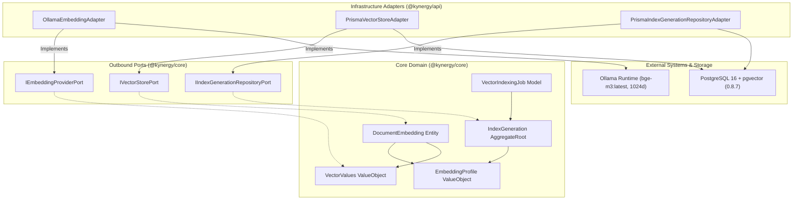

# AI-05: Embedding Generation & Vector Indexing Architecture

## 1. Executive Summary

Milestone **AI-05** defines the domain architecture, contracts, and lifecycle for dense vector embedding generation and vector search indexing in the Kynergy Platform. It establishes a resilient, provider-independent, and versioned foundation for semantic retrieval (AI-06) and RAG generation (AI-07).

### Key Architectural Tenets

1. **Hexagonal Architecture & Clean Separation**: Domain logic (`@kynergy/core`) remains completely pure. Zero dependencies on Prisma, PostgreSQL `pgvector`, or vendor SDKs (`ollama`).
2. **Immutable Embedding Profiles**: Mathematical vector spaces are uniquely fingerprinted by `EmbeddingProfile`. Changing a model, digest, dimensionality, normalization, or pooling produces an entirely new profile.
3. **Dedicated Vector Table vs Unsupported Column**: Rather than adding an `Unsupported("vector(1024)")` column to `knowledge_chunks`, vectors reside in a dedicated `document_embeddings` table bound to an `IndexGeneration`. This eliminates table locks on core chunks and enables zero-downtime re-indexing.
4. **Single Active Index Generation Invariant**: Vectors from incompatible models or dimensions are never mixed in active queries. Promotion of a new index generation is atomic and reversible.

---

## 2. Hexagonal System Architecture

---

## 3. Core Boundaries & Decoupling Guard

The architecture enforces strict decoupling boundaries verified by automated AST/grep unit tests:

- **No ORM Leaks**: `@prisma/client` cannot be imported in `domain/` or `ports/`.
- **No Vector Engine Leaks**: `pgvector` native types or SQL keywords cannot enter domain models.
- **No AI Provider Leaks**: Ollama request/response structures, HTTP endpoints, or CLI commands remain encapsulated in `packages/api/src/ai/infrastructure/adapters/`.
- **Strict TypeScript**: `noImplicitAny: true`, zero `any` annotations in vector indexing domain code.

---

## 4. Subsystem Interactions

### A. Embedding Generation & Ingestion Flow

1. Ingestion pipeline extracts and normalizes text blocks into `DocumentChunk` entities (AI-04).
2. Document indexing job batches chunks (`batchSize: 16-32`) and invokes `IEmbeddingProviderPort.generateBatchEmbeddings()`.
3. Provider returns validated, unit-normalized 1,024-dimensional vectors.
4. Core domain encapsulates vectors into `VectorValues` and builds `DocumentEmbedding` entities with chunk provenance and content SHA-256 fingerprints.
5. `IVectorStorePort.saveBatch()` persists vectors into the current target `IndexGeneration`.

### B. Index Generation Promotion Flow

1. Target generation transitions `DRAFT` $\rightarrow$ `BUILDING`.
2. As chunks are processed, `IndexGeneration.recordProgress(indexedDelta, failedDelta)` increments durable counts and domain version.
3. Once all chunks are indexed, the generation enters `VALIDATING`.
4. Upon passing validation checks (completeness, non-zero embeddings, dimensional integrity), the repository executes an atomic promotion (`promoteGeneration`):
   - The previously active generation is transitioned to `RETIRED`.
   - The new generation is transitioned to `ACTIVE`.
   - All subsequent similarity queries automatically target the new active generation.
