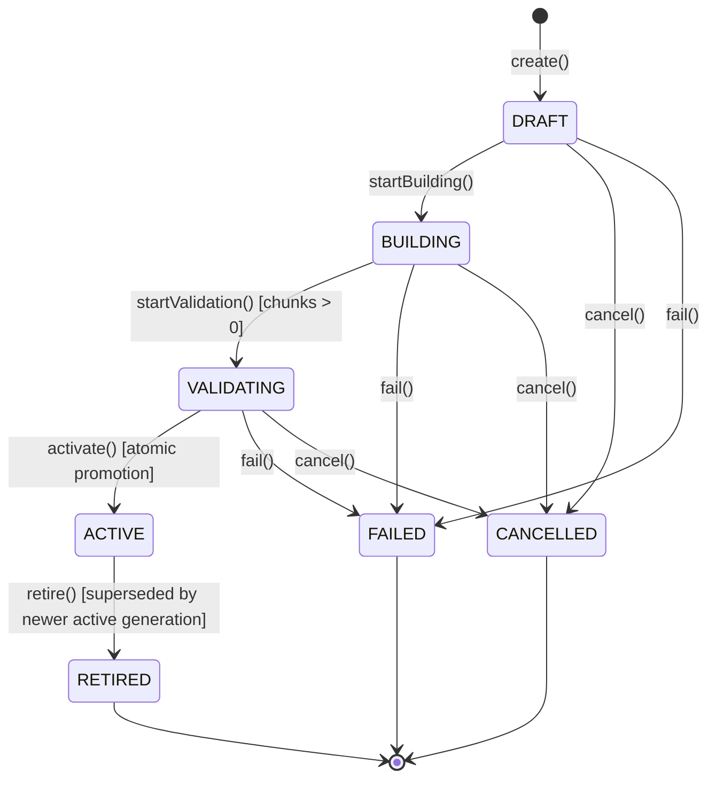

# AI-05: Index Generation Lifecycle & State Machine

## 1. Lifecycle Overview

An `IndexGeneration` aggregate represents a cohesive, versioned vector search index bound to a single tenant and an immutable `EmbeddingProfile`. To guarantee continuous availability, zero downtime during re-indexing, and zero contamination between incompatible models, all index modifications follow a strict finite state machine.

---

## 2. State Invariants & Transition Rules

| State            | Allowed Transitions                 | Invariants Enforced                                                                                                                                      |
| :--------------- | :---------------------------------- | :------------------------------------------------------------------------------------------------------------------------------------------------------- |
| **`DRAFT`**      | `BUILDING`, `CANCELLED`, `FAILED`   | Initial state. Aggregate version = 1. No chunks yet indexed.                                                                                             |
| **`BUILDING`**   | `VALIDATING`, `CANCELLED`, `FAILED` | Indexing workers persist embeddings. Chunks count incrementally recorded.                                                                                |
| **`VALIDATING`** | `ACTIVE`, `CANCELLED`, `FAILED`     | Enforces `indexedChunkCount > 0`. Runs health checks, dimension checks, and retrieval spot checks.                                                       |
| **`ACTIVE`**     | `RETIRED`                           | **Single active generation invariant**: At most one generation per tenant can be in `ACTIVE` state. Incoming search queries target only this generation. |
| **`RETIRED`**    | _Terminal_                          | Archived index superseded by a newer generation. Vectors can be pruned asynchronously after a retention window.                                          |
| **`FAILED`**     | _Terminal_                          | Non-recoverable error during building or validation. Contains `errorCode` and `failureReason`. Never promoted to `ACTIVE`.                               |
| **`CANCELLED`**  | _Terminal_                          | Explicitly aborted by user or system operator. Contains `cancellationReason`. Never promoted to `ACTIVE`.                                                |

---

## 3. Atomic Promotion Protocol

To prevent any search downtime or partial results while re-indexing large knowledge bases:

1. Generation $N+1$ is constructed and indexed entirely in the background (`BUILDING`).
2. The active search path continues serving queries against Generation $N$ (`ACTIVE`).
3. When Generation $N+1$ passes validation, the repository invokes `promoteGeneration(newGenId, tenantId)`.
4. In an atomic database transaction:
   - Generation $N$ is transitioned to `RETIRED`.
   - Generation $N+1$ is transitioned to `ACTIVE`.
5. If the transaction succeeds, all search queries immediately execute against Generation $N+1$.
6. If the transaction fails, Generation $N$ remains `ACTIVE` with zero interruption to end users.
