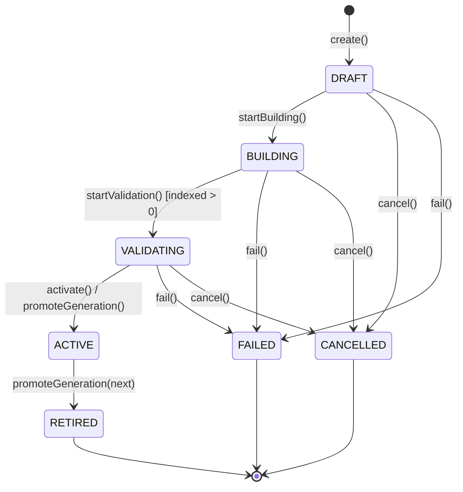

# AI-05.5 — Vector Indexing Orchestration Architecture

**Milestone:** AI-05.5 — Indexing Orchestration & Consistency  
**Role:** Principal Distributed Systems Architect, Principal Database Engineer, and Senior RAG Architect  
**Status:** COMPLETE & VERIFIED  
**Date:** 2026-11-20

---

## 1. Executive Summary

Milestone **AI-05.5** establishes the durable, idempotent, and fault-tolerant indexing orchestration system for the Kinergy Platform RAG pipeline. It unifies the domain models (AI-05.1), pgvector persistence layer (AI-05.2), verified BGE-M3 provider integration (AI-05.3), and bounded embedding generation pipeline (AI-05.4) into an end-to-end production workflow.

Key architectural properties enforced:

- **Zero-Downtime Index Evolution:** Versioned `IndexGeneration` state machine guarantees uninterrupted query service while new indexes are built and validated in the background.
- **Strict Transactional Decoupling:** Long-running model inference (Ollama BGE-M3) is executed completely outside relational database transactions to prevent connection pool exhaustion and lock starvation.
- **Lock-Free Concurrency & Idempotency:** Atomic conditional claims and cryptographic fingerprinting guarantee that duplicate job deliveries, concurrent workers, or network replays never produce duplicate or inconsistent vector rows.
- **Hexagonal Integration:** Seamlessly fulfills the outbound `IDocumentIndexingPort`, cleanly replacing the stub adapter and closing the ingestion loop from document upload (AI-03) through parsing and chunking (AI-04) to vector search indexing.

---

## 2. Index Generation Lifecycle & State Machine



### Lifecycle Invariants

1. **Single Active Generation Per Tenant:** At most one generation can be in `ACTIVE` status per tenant at any given time. This invariant is enforced at both domain level (`IndexGeneration` aggregate) and database level via the partial unique index:
   ```sql
   CREATE UNIQUE INDEX unique_active_index_generation_per_tenant
   ON index_generations(tenant_id) WHERE status = 'ACTIVE';
   ```
2. **Immutable Profile Binding:** A generation is permanently bound to a concrete, immutable `EmbeddingProfile`. Changing models, dimensions, or normalization policies requires provisioning a new generation.
3. **Protection of Terminal Generations:** Generations in `RETIRED`, `FAILED`, or `CANCELLED` status permanently reject receiving new vectors. Attempting to index chunks into them raises `IndexGenerationIneligibleException`.
4. **Atomic Promotion & Zero-Downtime Retirement:** Promotion from `VALIDATING` to `ACTIVE` executes in an atomic transaction (`PrismaIndexGenerationRepository.promoteGeneration`): the current active generation is transitioned to `RETIRED`, and the validated target generation is promoted to `ACTIVE`.

---

## 3. Indexing Jobs & Scopes

The `VectorIndexingJob` model coordinates bounded execution, progress tracking, and failure taxonomy across 4 distinct operational scopes:

| Scope              | Identifier          | Purpose                                                           | Typical Trigger                             |
| :----------------- | :------------------ | :---------------------------------------------------------------- | :------------------------------------------ |
| `DOCUMENT_VERSION` | `documentVersionId` | Incremental indexing of a newly processed document version        | Ingestion pipeline stage 3 (`INDEXING`)     |
| `DOCUMENT`         | `documentId`        | Reindexing all versions or current version of a specific document | Manual re-indexing or format re-chunking    |
| `INDEX_GENERATION` | `generationId`      | Building an entire new index generation for a tenant              | Model migration or embedding profile update |
| `REINDEX_ALL`      | `tenantId`          | Full tenant corpus re-index                                       | Platform-wide knowledge base refresh        |

### Progress and Attempt Tracking

- `batchSize`: Configured chunk slicing (default `16`).
- `totalChunks`: Total target chunks identified for this job scope.
- `processedChunks`: Number of successfully persisted chunk embeddings.
- `failedChunks`: Number of chunks that encountered permanent failure.
- `currentBatchNumber`: Monotonically incrementing batch index.
- `attemptCount`: Incremented on each atomic claim.
- `maxAttempts`: Maximum retry ceiling (default `3`).
- `lastErrorCode`, `lastErrorMessage`: Structured error classification for observability.

---

## 4. End-to-End Indexing Workflow

```
[Ingestion Pipeline / API Trigger]
               │
               ▼
   [1. Resolve IndexGeneration]
   - Existing ACTIVE generation OR
   - Provision new BUILDING generation
               │
               ▼
     [2. Acquire/Claim Job]
   - Atomic conditional update: PENDING -> RUNNING
   - Duplicate worker detection
               │
               ▼
   [3. Select & Filter Chunks]
   - Retrieve all chunks for version
   - Calculate expected fingerprints: sha256(chunk + profile)
   - Compare with existing DB embeddings
   - Filter out unchanged chunks (Idempotency Skip)
               │
               ▼
   [4. Generate Embeddings (OUTSIDE DB TX)]
   - Bounded batch call to Ollama (/api/embed)
   - BGE-M3 unit-normalized vectors (1024-d)
   - Partial failure isolation fallback
               │
               ▼
  [5. Transactional Batch Persistence (ACID)]
   - INSERT ... ON CONFLICT DO UPDATE on document_embeddings
   - Increment IndexGeneration.indexedChunkCount
   - Update VectorIndexingJob.processedChunks & status
               │
               ▼
   [6. Completeness Audit & Handshake]
   - Verify counts match
   - Return DocumentIndexingResult to Ingestion Pipeline
```

### Critical Architectural Rule: Database Decoupling

Network calls to Ollama BGE-M3 (`generateEmbeddings`) occur **strictly outside** any PostgreSQL transaction. Entering a transaction only occurs during Step 5 to write the batch of vectors, update generation progress, and commit job state in a sub-50ms window. This completely eliminates PostgreSQL transaction timeout errors (`idle-in-transaction`) and connection starvation.

---

## 5. Hexagonal Integration Boundary

`VectorIndexingOrchestratorService` implements `IDocumentIndexingPort`:

```typescript
@Injectable()
export class VectorIndexingOrchestratorService implements IDocumentIndexingPort {
  public async indexDocument(request: DocumentIndexingRequest): Promise<DocumentIndexingResult> {
    return this.indexDocumentVersion({
      tenantId: request.tenantId,
      documentId: request.documentId,
      versionId: request.versionId,
    });
  }
}
```

This seamlessly connects the ingestion pipeline:

1. `IngestionOrchestratorService` runs stages: `VALIDATING` -> `PROCESSING` (parsing & chunking via `DocumentProcessingPipelineService`).
2. When transitioning to stage 3 (`INDEXING`), it delegates to `DOCUMENT_INDEXING_PORT`.
3. `VectorIndexingOrchestratorService` executes the durable vector indexing workflow and returns `{ indexed: true, chunkCount: N, embeddingModel: 'bge-m3' }`.
4. `IngestionOrchestratorService` transitions the document to stage 4: `READY`.
