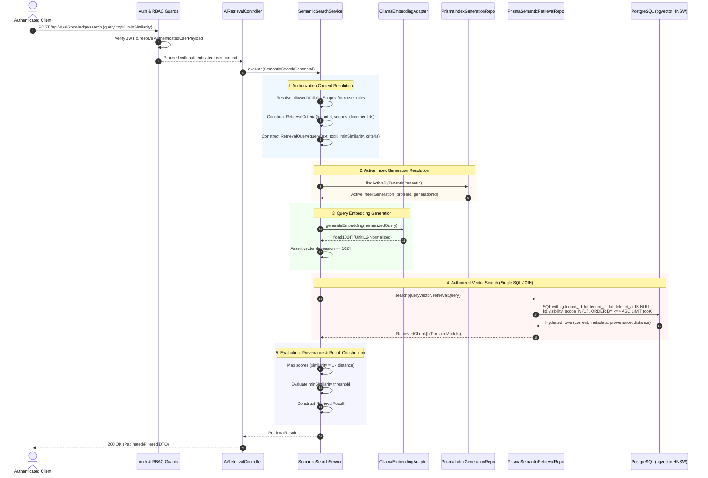

# AI-06: Semantic Retrieval Engine Architecture & Domain Design

- **Document Identifier:** `AI-06-ARCHITECTURE`
- **Date:** 2026-11-20
- **Repository:** `izzydin/kinergy-platform`
- **Milestone:** AI-06 — Semantic Retrieval Engine
- **Stage:** AI-06.1 — Architecture & Domain Design
- **Roles:** Principal Software Architect, Senior AI/ML Backend Engineer, RAG Security Specialist
- **Status:** **APPROVED & IMPLEMENTED (Domain Contracts & Architecture Specification)**

---

## 1. Architectural Overview & Context

Milestone **AI-06: Semantic Retrieval Engine** provides high-precision, sub-second semantic retrieval across ingested clinic documents, training protocols, and organizational knowledge for the Kynergy Platform.

AI-06 sits on top of the foundation established across previous milestones:

- **AI-01:** Clean Architecture, Hexagonal Port abstractions, and domain decoupling.
- **AI-02:** Local Ollama runtime integration hosting BAAI/BGE-M3.
- **AI-03:** Document ingestion lifecycle (`IngestionJob`), storage abstraction, and MIME validation.
- **AI-04:** Multi-format document parsing, Unicode NFKC normalization, BPE tokenization, and relational chunk storage (`knowledge_chunks`).
- **AI-05:** 1,024-dimensional dense vector embeddings (`document_embeddings`), PostgreSQL `pgvector 0.8.7` HNSW indexing, and multi-tenant index generation management (`IndexGeneration`).

---

## 2. Module Dependency & Layer Architecture

```mermaid
flowchart TD
    subgraph PresentationLayer ["1. Presentation Layer (apps/api/src/ai)"]
        Ctrl["AiRetrievalController"]
        DTOs["SemanticSearchRequestDto / ResponseDto"]
        Guards["AuthenticationGuard + AuthorizationGuard"]
    end

    subgraph ApplicationLayer ["2. Application Layer (apps/api/src/ai/services)"]
        SearchSvc["SemanticSearchService (ISemanticSearchUseCase)"]
        Telemetry["RetrievalTelemetry"]
    end

    subgraph DomainPorts ["3. Domain Ports Boundary (packages/core/src/ai/ports)"]
        InboundPort["ISemanticSearchUseCase (Inbound Port)"]
        EmbedPort["IEmbeddingProviderPort (Outbound Port)"]
        RetPort["ISemanticRetrievalPort (Outbound Port)"]
        GenPort["IIndexGenerationRepositoryPort (Outbound Port)"]
        DocPort["IKnowledgeDocumentRepositoryPort (Outbound Port)"]
    end

    subgraph DomainCore ["4. Pure Domain Core (packages/core/src/ai/domain)"]
        RetQuery["RetrievalQuery (VO)"]
        RetCriteria["RetrievalCriteria (VO)"]
        SimScore["SimilarityScore (VO)"]
        RetProv["RetrievalProvenance (VO)"]
        RetConfig["RetrievalConfiguration (VO)"]
        RetChunk["RetrievedChunk (Model)"]
        RetResult["RetrievalResult (Model)"]
        RetEx["RetrievalDomainException (Exceptions)"]
    end

    subgraph InfrastructureAdapters ["5. Infrastructure Adapters (apps/api & packages/core)"]
        PrismaRepo["PrismaSemanticRetrievalRepository (pgvector)"]
        OllamaAdapter["OllamaEmbeddingAdapter (BGE-M3)"]
        PrismaGen["PrismaIndexGenerationRepository"]
    end

    subgraph Persistence ["6. Database Engine (PostgreSQL 16)"]
        PG["PostgreSQL 16 + pgvector 0.8.7 (HNSW Index)"]
    end

    Guards --> Ctrl
    DTOs --> Ctrl
    Ctrl --> InboundPort
    SearchSvc ..|> InboundPort
    SearchSvc --> RetQuery
    SearchSvc --> RetCriteria
    SearchSvc --> EmbedPort
    SearchSvc --> RetPort
    SearchSvc --> GenPort

    RetPort -.-> PrismaRepo
    EmbedPort -.-> OllamaAdapter
    GenPort -.-> PrismaGen

    PrismaRepo --> PG
    PrismaRepo --> RetChunk
    PrismaRepo --> SimScore
    PrismaRepo --> RetProv
```

---

## 3. End-to-End Retrieval Pipeline Execution Flow



---

## 4. Domain Concepts & Type Invariants

### 4.1 Value Objects

| Value Object             | Location                                                                  | Responsibility & Invariants                                                                                                                                                                   |
| :----------------------- | :------------------------------------------------------------------------ | :-------------------------------------------------------------------------------------------------------------------------------------------------------------------------------------------- |
| `SimilarityScore`        | `packages/core/src/ai/domain/value-objects/similarity-score.vo.ts`        | Normalized float in $[0.0, 1.0]$. Rejects non-finite/NaN. Precision fixed to 6 decimal places. Translates cosine distance: $\text{similarity} = \max(0.0, \min(1.0, 1.0 - \text{distance}))$. |
| `RetrievalCriteria`      | `packages/core/src/ai/domain/value-objects/retrieval-criteria.vo.ts`      | Mandatory non-empty `tenantId`. Optional sanitized `documentIds`, `allowedVisibilityScopes`, `mimeTypes`, date boundaries, and `metadataFilter`. Applied _before_ vector ranking.             |
| `RetrievalProvenance`    | `packages/core/src/ai/domain/value-objects/retrieval-provenance.vo.ts`    | Exact citation lineage: `documentTitle`, `documentVersionNumber`, `originalFileName`, `mimeType`, `chunkSequence`, `pageNumber`, `startChar`, `endChar`, `headingPath`, and `language`.       |
| `RetrievalQuery`         | `packages/core/src/ai/domain/value-objects/retrieval-query.vo.ts`         | Bounded user query: non-empty, non-whitespace, Unicode NFKC normalized, $\le 1,000$ characters. $1 \le \text{topK} \le 50$. Validated `minSimilarity`. Immutable.                             |
| `RetrievalConfiguration` | `packages/core/src/ai/domain/value-objects/retrieval-configuration.vo.ts` | System and tenant runtime settings: `defaultTopK = 5`, `maxTopK = 50`, `similarityMetric = 'cosine'`, `dimensions = 1024`, `queryTimeoutMs = 10000`.                                          |

### 4.2 Domain Models

| Model             | Location                                                       | Responsibility                                                                                                                                                                                             |
| :---------------- | :------------------------------------------------------------- | :--------------------------------------------------------------------------------------------------------------------------------------------------------------------------------------------------------- |
| `RetrievedChunk`  | `packages/core/src/ai/domain/models/retrieved-chunk.model.ts`  | Hydrated chunk containing `chunkId`, `documentId`, `documentVersionId`, `indexGenerationId`, `content`, `tokenCount`, `similarity` (`SimilarityScore`), `distance`, `provenance`, and optional `metadata`. |
| `RetrievalResult` | `packages/core/src/ai/domain/models/retrieval-result.model.ts` | Immutable aggregate of retrieved chunks, query reference, execution duration, total matches, and `activeGenerationId`. Provides `filterByMinSimilarity()`.                                                 |

### 4.3 Domain Exceptions & Taxonomy

All retrieval exceptions inherit from `RetrievalDomainException` in `packages/core/src/ai/domain/exceptions/retrieval.exceptions.ts`:

- `EmptyRetrievalQueryException` (`EMPTY_QUERY`): Query is blank or whitespace.
- `InvalidRetrievalQueryException` (`QUERY_TOO_LONG` / `INVALID_TOP_K`): Query length $> 1,000$ or topK outside $[1, 50]$.
- `InvalidSimilarityScoreException` (`INVALID_SIMILARITY_SCORE`): Score non-finite or outside $[0.0, 1.0]$.
- `ActiveIndexGenerationNotFoundException` (`NO_ACTIVE_INDEX_GENERATION`): Tenant has no promoted `ACTIVE` index generation.
- `RetrievalProfileMismatchException` (`PROFILE_MISMATCH`): Loaded embedding model digest differs from index generation profile.
- `RetrievalDatabaseException` (`RETRIEVAL_PERSISTENCE_ERROR`): Database or connection error during search.
- `InvalidRetrievalConfigurationException` (`INVALID_RETRIEVAL_CONFIG`): Invalid startup or runtime configuration.

---

## 5. Search Semantics & Score Contracts

### 5.1 Mathematical Foundation

- **Vectors:** BAAI/BGE-M3 dense embeddings are unit L2-normalized: $\|u\|_2 = 1.0$.
- **Dot Product vs Cosine:** For unit vectors, cosine similarity equals inner product:
  $$S_C(u, v) = \frac{u \cdot v}{\|u\|_2 \|v\|_2} = u \cdot v$$
- **Cosine Distance:** PostgreSQL pgvector operator `<=>` calculates:
  $$D_C(u, v) = 1 - \frac{u \cdot v}{\|u\|_2 \|v\|_2} = 1 - S_C(u, v)$$
  Therefore:
  $$S_C(u, v) = 1 - D_C(u, v)$$
- **Score Contract:**
  1. The database computes $D_C = \text{embedding} \Leftrightarrow \$1\text{::vector}$.
  2. The database computes similarity $S_C = 1 - D_C$.
  3. The domain layer constructs `SimilarityScore` using `SimilarityScore.fromCosineDistance(distance)` which validates and clamps the value into $[0.0, 1.0]$ with 6 decimal places of precision.

### 5.2 Relevance Thresholding vs. Top-K

- **Top-K Selection:** Selects the top $K$ nearest neighbors ordered by $D_C$ ascending (`LIMIT $topK`).
- **Relevance Thresholding:** Filters out results where $S_C < \tau$.
- **SQL Pre-Filtering:** When $\tau > 0.0$, the condition is added directly to SQL `WHERE (1 - (embedding <=> $1::vector)) >= $tau`. This ensures only relevant documents consume top-K slots.

---

## 6. Multi-Tenant Security & Relational Join Strategy

### 6.1 Multi-Tenant SQL Isolation Query

To satisfy Mandatory Development Contract 6 ("Tenant and document restrictions must be applied BEFORE ranking and LIMIT"), the query executes as a single relational statement:

```sql
SELECT
    de.id AS embedding_id,
    de.chunk_id,
    de.document_id,
    de.document_version_id,
    de.index_generation_id,
    1 - (de.embedding <=> $1::vector) AS similarity,
    (de.embedding <=> $1::vector) AS distance,
    kc.content,
    kc.token_count,
    kc.sequence AS chunk_sequence,
    kc.provenance AS chunk_provenance,
    kc.metadata AS chunk_metadata,
    kd.title AS document_title,
    kd.visibility_scope,
    dv.version_number,
    dv.original_file_name,
    dv.mime_type,
    dv.language
FROM document_embeddings de
JOIN index_generations ig ON ig.id = de.index_generation_id
JOIN knowledge_documents kd ON kd.id = de.document_id
JOIN document_versions dv ON dv.id = de.document_version_id
JOIN knowledge_chunks kc ON kc.id = de.chunk_id
WHERE ig.tenant_id = $2
  AND kd.tenant_id = $2
  AND kd.deleted_at IS NULL
  AND de.index_generation_id = $3
  AND kd.visibility_scope = ANY($4::"VisibilityScope"[])
  AND (1 - (de.embedding <=> $1::vector)) >= $5
ORDER BY de.embedding <=> $1::vector ASC
LIMIT $6;
```

### 6.2 Pre-Filtering vs Post-Filtering Comparison

| Criterion                   | Post-Retrieval Memory Filtering           | SQL Relational Pre-Filtering (Approved)                    |
| :-------------------------- | :---------------------------------------- | :--------------------------------------------------------- |
| **Tenant Isolation**        | Fragile (relies on application code)      | **Authoritative (guaranteed by PostgreSQL engine)**        |
| **Result Count Stability**  | Variable / Starvation (can return 0 of 5) | **Guaranteed (returns exactly up to $K$ eligible chunks)** |
| **Database Roundtrips**     | N+1 (3 separate roundtrips)               | **1 Single Roundtrip**                                     |
| **Query Index Utilization** | Isolated HNSW vector scan                 | **HNSW Vector Scan filtered by foreign key joins**         |
| **Soft-Delete Safety**      | Prone to stale cache leakage              | **Immediate exclusion via `kd.deleted_at IS NULL`**        |

---

## 7. AI-06 Implementation Roadmap & File Map

```
packages/core/src/ai/
  ├── domain/
  │   ├── enums/
  │   │   ├── retrieval-search-mode.enum.ts             [IMPLEMENTED AI-06.1]
  │   │   └── retrieval-error-code.enum.ts              [IMPLEMENTED AI-06.1]
  │   ├── exceptions/
  │   │   └── retrieval.exceptions.ts                   [IMPLEMENTED AI-06.1]
  │   ├── value-objects/
  │   │   ├── similarity-score.vo.ts                    [IMPLEMENTED AI-06.1]
  │   │   ├── retrieval-criteria.vo.ts                  [IMPLEMENTED AI-06.1]
  │   │   ├── retrieval-provenance.vo.ts                [IMPLEMENTED AI-06.1]
  │   │   ├── retrieval-query.vo.ts                     [IMPLEMENTED AI-06.1]
  │   │   └── retrieval-configuration.vo.ts             [IMPLEMENTED AI-06.1]
  │   ├── models/
  │   │   ├── retrieved-chunk.model.ts                  [IMPLEMENTED AI-06.1]
  │   │   └── retrieval-result.model.ts                 [IMPLEMENTED AI-06.1]
  │   └── __tests__/
  │       ├── similarity-score.vo.spec.ts               [IMPLEMENTED AI-06.1]
  │       ├── retrieval-criteria.vo.spec.ts             [IMPLEMENTED AI-06.1]
  │       ├── retrieval-query.vo.spec.ts                [IMPLEMENTED AI-06.1]
  │       ├── retrieval-configuration.vo.spec.ts        [IMPLEMENTED AI-06.1]
  │       ├── retrieved-chunk.model.spec.ts             [IMPLEMENTED AI-06.1]
  │       ├── retrieval-result.model.spec.ts            [IMPLEMENTED AI-06.1]
  │       └── semantic-retrieval-boundaries.spec.ts     [IMPLEMENTED AI-06.1]
  └── ports/
      ├── outbound/
      │   └── semantic-retrieval.port.ts                [IMPLEMENTED AI-06.1]
      └── inbound/
          └── semantic-search.use-case.ts               [IMPLEMENTED AI-06.1]

packages/core/src/ai/infrastructure/persistence/prisma/repositories/
  ├── prisma-semantic-retrieval.repository.ts           [STAGE AI-06.2]
  └── __tests__/semantic-retrieval.integration.spec.ts   [STAGE AI-06.2]

apps/api/src/ai/
  ├── ai.tokens.ts                                      [STAGE AI-06.2]
  ├── ai.module.ts                                      [STAGE AI-06.2]
  ├── services/retrieval/
  │   ├── semantic-search.service.ts                   [STAGE AI-06.3]
  │   └── __tests__/semantic-search.service.spec.ts    [STAGE AI-06.3]
  └── controllers/
      ├── ai-retrieval.controller.ts                   [STAGE AI-06.4]
      ├── dtos/ai-retrieval.dto.ts                     [STAGE AI-06.4]
      └── __tests__/ai-retrieval.controller.spec.ts    [STAGE AI-06.4]
```

---

## 8. Summary of Approved ADRs

- [ADR-AI-06-001: Semantic Retrieval Architecture & Pure Domain Ports](file:///c:/Projects/kinergy-platform/docs/ai/AI-06-ADRS/ADR-AI-06-001-semantic-retrieval-architecture-and-ports.md)
- [ADR-AI-06-002: pgvector Cosine Search & Relational Join Strategy](file:///c:/Projects/kinergy-platform/docs/ai/AI-06-ADRS/ADR-AI-06-002-pgvector-cosine-search-and-relational-join-strategy.md)
- [ADR-AI-06-003: Tenant-Scoped Retrieval & Visibility Scope Filtering](file:///c:/Projects/kinergy-platform/docs/ai/AI-06-ADRS/ADR-AI-06-003-tenant-scoped-retrieval-and-visibility-filtering.md)
- [ADR-AI-06-004: Retrieval Configuration & Threshold Evaluation Strategy](file:///c:/Projects/kinergy-platform/docs/ai/AI-06-ADRS/ADR-AI-06-004-retrieval-configuration-and-threshold-evaluation.md)
