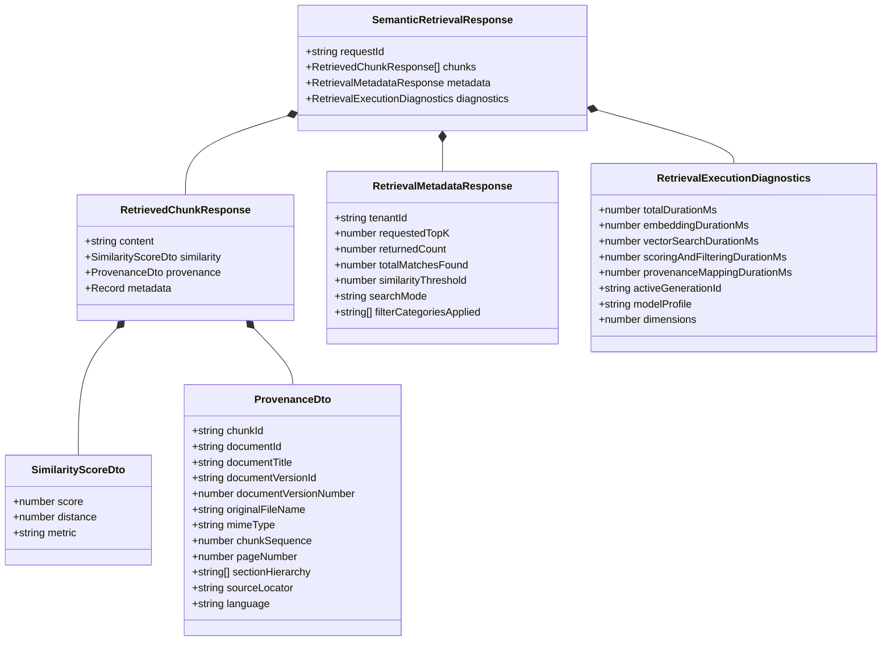

# AI-06.6 — Retrieval Provenance, Logging & Performance Observability

**Milestone:** AI-06 — Semantic Retrieval Engine  
**Task:** AI-06.6 — Retrieval Provenance, Logging & Performance Observability  
**System:** Kynergy Platform  
**Component:** `RetrievalObservabilityService`, `RetrievalProvenance`, `SemanticRetrievalResponse`  
**Status:** APPROVED / IMPLEMENTED  
**Date:** 2026-11-20

---

## 1. Executive Summary

This document specifies the provenance tracking, structured audit logging, telemetry, and performance observability architecture for the Kynergy Semantic Retrieval Engine (`AI-06`).

Production retrieval systems must be fully traceable for clinical verification, UX citation, and audit compliance, while enforcing strict privacy safeguards against logging sensitive health queries or exposing database implementation details.

### Key Capabilities Implemented:

1. **Complete Source Provenance:** Every retrieved chunk provides verifiable lineage to its source document, version, page, section heading, sequence, and storage locator without fabricating references.
2. **Decoupled Production Response Contract:** `SemanticRetrievalResponse` cleanly isolates:
   - Retrieved content
   - Similarity scores & metrics
   - Source provenance
   - Retrieval metadata
   - Execution diagnostics
3. **Privacy-Preserving Structured Logging:** Structured JSON audit logs emit query hashes (SHA-256) and user pseudonyms while strictly omitting raw query text, document bodies, and embedding vectors.
4. **Fine-Grained Monotonic Telemetry:** Monotonic timing (`performance.now()`) decomposes retrieval latency into query embedding, vector database search, scoring/filtering, and provenance mapping.
5. **Rolling Latency & Error Rate Instrumentation:** In-memory, bounded ring-buffer tracking calculates real-time p50, p95, and p99 percentiles, alongside provider timeout and database failure rates.
6. **Safe Client Error Sanitization:** Internal exceptions (Ollama timeout, Postgres syntax error) are categorized internally and scrubbed of SQL, hostnames, and credentials before returning client responses.

---

## 2. Retrieval Provenance Architecture

### 2.1 Domain Provenance Value Object (`RetrievalProvenance`)

To guarantee accurate citations in kinesiological consultations, clinical notes, and exercise prescriptions, each retrieved chunk is bound to a `RetrievalProvenance` value object (`packages/core/src/ai/domain/value-objects/retrieval-provenance.vo.ts`):

```typescript
export interface CreateRetrievalProvenanceProps {
  documentTitle: string;
  documentVersionNumber: number;
  originalFileName: string;
  mimeType: string;
  chunkSequence: number;
  chunkId?: string;
  documentId?: string;
  documentVersionId?: string;
  sourceLocator?: string;
  pageNumber?: number;
  startChar?: number;
  endChar?: number;
  headingPath?: string[];
  sectionHierarchy?: string[];
  language?: string;
}
```

### 2.2 Grounded Citation Principles

1. **No Hallucinated Page Numbers:** If the source document (e.g., Markdown or Plain Text) lacks page boundaries, `pageNumber` is left `undefined`. The system **never fabricates** page references.
2. **Storage Locator Traceability:** The `sourceLocator` references the immutable storage key (`storage_key`) in object storage or the relative file path.
3. **Hierarchical Headings:** The `sectionHierarchy` preserves the breadcrumb trail of document sections (e.g. `['Kinesiology Protocol', 'Post-Op Knee Rehab', 'Phase 1 ROM']`).

---

## 3. Production Response Contract (`SemanticRetrievalResponse`)

To prevent database-level models (e.g., Prisma models or raw rows) from leaking to HTTP clients or LLM prompts, the response contract is strictly decoupled:



### 3.1 Sample JSON Response

```json
{
  "requestId": "ret_1732118400000_a1b2c3d4",
  "chunks": [
    {
      "content": "Phase 1 emphasizes passive range of motion within pain tolerance up to 90 degrees.",
      "similarity": {
        "score": 0.8845,
        "distance": 0.1155,
        "metric": "cosine"
      },
      "provenance": {
        "chunkId": "chk_c4a1-002",
        "documentId": "doc_9f8b-331",
        "documentTitle": "Cervical Spine Rehabilitation Protocols",
        "documentVersionId": "ver_e2d1-001",
        "documentVersionNumber: 1,
        "originalFileName": "cervical-spine-rehab.pdf",
        "mimeType": "application/pdf",
        "chunkSequence": 2,
        "pageNumber": 5,
        "sectionHierarchy": ["Rehabilitation Protocols", "Phase 1: Acute Protection"],
        "sourceLocator": "documents/tenants/tenant_a/cervical-spine-rehab.pdf",
        "language": "es"
      },
      "metadata": {
        "department": "kinesiology",
        "author": "Dr. Smith"
      }
    }
  ],
  "metadata": {
    "tenantId": "tenant_kinesiology_alpha",
    "requestedTopK": 5,
    "returnedCount": 1,
    "totalMatchesFound": 1,
    "similarityThreshold": 0.60,
    "searchMode": "SEMANTIC",
    "filterCategoriesApplied": ["visibilityScope", "metadataFilter"]
  },
  "diagnostics": {
    "totalDurationMs": 48.2,
    "embeddingDurationMs": 28.4,
    "vectorSearchDurationMs": 18.1,
    "scoringAndFilteringDurationMs": 0.5,
    "provenanceMappingDurationMs": 1.2,
    "activeGenerationId": "gen_88a2-9901",
    "modelProfile": "bge-m3-dense-v1",
    "dimensions": 1024
  }
}
```

---

## 4. Structured Audit Logging & Privacy Protection

### 4.1 Strict Privacy Policy

To protect Patient Health Information (PHI) and corporate trade secrets, the retrieval logger enforces the following data protection rules:

- **Never Log Raw Queries:** Clinical queries may contain names, symptoms, or diagnoses. The logger generates a 16-character SHA-256 hash (`queryHash`) and records length and token estimates.
- **Never Log Retrieved Text Bodies:** Document content is omitted from server logs.
- **Never Log Embeddings:** 1024-dimensional float arrays are stripped.
- **Pseudonymize User IDs:** User IDs (`usr_...`) are truncated and hashed before being logged.

### 4.2 Structured Log Schema (`ai_semantic_retrieval`)

Logs are emitted in standard JSON format:

```json
{
  "timestamp": "2026-11-20T16:50:00.123Z",
  "event": "ai_semantic_retrieval",
  "requestId": "ret_1732118400000_a1b2c3d4",
  "correlationId": "corr_req_99812",
  "tenantId": "tenant_kinesiology_alpha",
  "userPseudonym": "usr_9a4f21b0",
  "queryHash": "f8a29b3c4d1e0f81",
  "queryLength": 64,
  "queryTokenEstimate": 16,
  "embeddingModel": "bge-m3-dense-v1",
  "requestedTopK": 5,
  "returnedCount": 1,
  "totalMatchesFound": 1,
  "filterCategories": ["visibilityScope", "metadataFilter"],
  "outcome": "SUCCESS",
  "totalDurationMs": 48.2,
  "embeddingDurationMs": 28.4,
  "vectorSearchDurationMs": 18.1,
  "scoringDurationMs": 0.5,
  "provenanceDurationMs": 1.2,
  "topSimilarityScore": 0.8845
}
```

---

## 5. Performance Measurement & Latency Decomposition

### 5.1 Monotonic Timing Formula

$$\text{Total Latency} = T_{\text{embedding}} + T_{\text{vectorSearch}} + T_{\text{scoring/filtering}} + T_{\text{provenance}}$$

All measurements use high-precision monotonic timers (`performance.now()`), avoiding wall-clock skew.

### 5.2 Rolling Percentiles & SLA Metrics

The `RetrievalObservabilityService` maintains an in-memory, bounded ring buffer ($N=1000$) to continuously compute:

| Metric                                 | Target SLA        | Method                                                   |
| :------------------------------------- | :---------------- | :------------------------------------------------------- |
| **Total Retrieval Latency (p50)**      | $< 50\text{ ms}$  | Nearest-rank percentile                                  |
| **Total Retrieval Latency (p95)**      | $< 150\text{ ms}$ | Nearest-rank percentile                                  |
| **Total Retrieval Latency (p99)**      | $< 300\text{ ms}$ | Nearest-rank percentile                                  |
| **Embedding Generation Latency (p50)** | $< 35\text{ ms}$  | Monotonic timer                                          |
| **pgvector Search Latency (p50)**      | $< 15\text{ ms}$  | Monotonic timer                                          |
| **Error Rate**                         | $< 0.1\%$         | $\frac{\text{Total Errors}}{\text{Total Requests}}$      |
| **Provider Timeout Rate**              | $< 0.05\%$        | $\frac{\text{Provider Timeouts}}{\text{Total Requests}}$ |
| **Database Failure Rate**              | $< 0.01\%$        | $\frac{\text{Database Failures}}{\text{Total Requests}}$ |
| **Empty Result Rate**                  | Tracked           | $\frac{\text{Empty Matches}}{\text{Total Requests}}$     |

---

## 6. Tracing Spans & Low-Cardinality Observability

To integrate seamlessly with OpenTelemetry, Prometheus, and APM vendors without high-cardinality explosion, tracing spans are captured with bounded tags:

| Span Name            | Allowable Attributes                   | Prohibited High-Cardinality Labels |
| :------------------- | :------------------------------------- | :--------------------------------- |
| `query_embedding`    | `model`, `dimensions`, `status`        | Raw query text, user email         |
| `vector_search`      | `matches`, `totalMatches`, `status`    | Document IDs, SQL string           |
| `security_policy`    | `scopeCount`, `tenant_tier`, `status`  | Tenant names, user permissions     |
| `scoring_filtering`  | `threshold`, `filteredCount`, `status` | Text chunks, individual scores     |
| `provenance_mapping` | `chunkCount`, `status`                 | File paths, URLs                   |

---

## 7. Error Categorization & Client Protection

When exceptions occur, the engine categorizes errors internally while ensuring client responses remain secure:

| Failure Type         | Internal Error Trigger             | Logged Event Outcome | Client-Facing Error Message                                                       |
| :------------------- | :--------------------------------- | :------------------- | :-------------------------------------------------------------------------------- |
| **Provider Timeout** | Ollama HTTP socket timeout         | `PROVIDER_TIMEOUT`   | `"The AI embedding service timed out. Please retry shortly."`                     |
| **Provider Failure** | Ollama crash / invalid output      | `PROVIDER_ERROR`     | `"The AI embedding provider encountered an error generating the search query."`   |
| **Database Failure** | Prisma syntax error / conn reset   | `DATABASE_ERROR`     | `"A persistence error occurred during retrieval. Please retry later."`            |
| **Unauthorized**     | Missing tenant / 0 scopes / denied | `UNAUTHORIZED`       | Fail-closed empty result or `"You are not authorized to perform this retrieval."` |
| **Validation**       | Empty query / invalid filter       | `VALIDATION_ERROR`   | Explicit parameter validation error (e.g. `"Query string must be non-empty."`)    |

**Security Guarantee:** Client error responses never contain SQL statements, Prisma table names, database hostnames, or Ollama IP addresses.

---

## 8. Verification & Test Evidence

The provenance, logging, and observability subsystem is verified by automated test suites:

```bash
# Core Domain Provenance & Response Tests
pnpm nx test core --testFile="retrieval-provenance.vo|retrieval-response.model"

# API Structured Logging, Metrics & Error Sanitization Tests
pnpm nx test api --testFile="retrieval-observability.service|secure-semantic-search.service"
```

### Verified Test Cases:

1. `RetrievalProvenance`: Handles complete provenance, ignores invalid page numbers, never fabricates references.
2. `SemanticRetrievalResponse`: Validates full separation of content, similarity score, source provenance, metadata, and diagnostics.
3. `RetrievalObservabilityService`: Emits structured JSON, hashes queries, redacts sensitive patient data, tracks p50/p95/p99 percentiles, and computes error rates.
4. `SecureSemanticSearchService`: Executes and formats end-to-end, catches and sanitizes provider/database failures, and fails closed under unauthorized requests.

---

**Sign-off Verdict:** **PASS — AI-06.6 READY FOR PRODUCTION**
