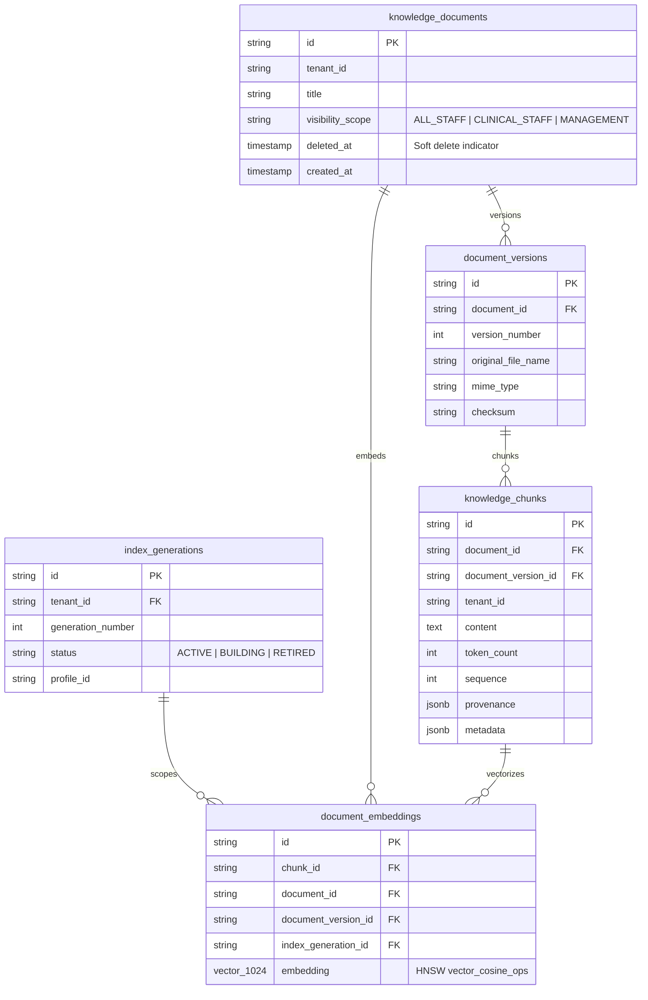

# AI-06.3 — Semantic Retrieval Persistence Architecture & Design

## 1. Executive Summary

This document defines the persistence architecture for the semantic retrieval engine of Kynergy Platform milestone `AI-06`.
The persistence adapter—`PrismaSemanticRetrievalRepository`—implements the outbound domain port `ISemanticRetrievalPort` (`packages/core/src/ai/ports/outbound/semantic-retrieval.port.ts`).

The adapter leverages PostgreSQL 16 with the `pgvector` 0.8.7 extension and Prisma ORM parameterized raw SQL (`prisma.$queryRawUnsafe` with positional `$1, $2, ...` parameters) to achieve high-throughput, millisecond-latency vector similarity search while strictly enforcing multi-tenant isolation, document access control, and soft-delete invariants at the query boundary.

---

## 2. Schema Verification & Relational Model

The persistence layer coordinates five relational entities across the AI Knowledge domain:

1. **`document_embeddings`**: Stores 1024-dimensional dense vectors (`vector(1024)`) indexed via HNSW (`vector_cosine_ops`).
2. **`index_generations`**: Manages the versioned vector index lifecycle (`DRAFT` -> `BUILDING` -> `VALIDATING` -> `ACTIVE` -> `RETIRED`). Enforces a unique partial index for single active index per tenant.
3. **`knowledge_documents`**: Manages document aggregate roots, multi-tenant ownership (`tenant_id`), lifecycle state, soft-delete timestamp (`deleted_at`), and security classification (`visibility_scope`).
4. **`document_versions`**: Stores physical document versions, checksums, and MIME types.
5. **`knowledge_chunks`**: Stores sliced document chunks, token counts, sequence numbers, provenance citation JSON, and arbitrary metadata JSON.

### Entity-Relationship Diagram



---

## 3. Query Design & Parameterized SQL

### 3.1 Single Relational JOIN Architecture

Rather than executing disjoint queries and hydrating in application memory, the repository executes a single parameterized SQL query that joins the 5 tables directly in PostgreSQL. This allows the query planner to apply tenant, document status, and visibility filters simultaneously with vector distance ranking.

```sql
SELECT
    de."id" AS "id",
    de."chunk_id" AS "chunk_id",
    de."document_id" AS "document_id",
    de."document_version_id" AS "document_version_id",
    de."index_generation_id" AS "index_generation_id",
    1 - (de."embedding" <=> $1::vector) AS "similarity",
    (de."embedding" <=> $1::vector) AS "distance",
    kc."content" AS "content",
    kc."token_count" AS "token_count",
    kc."sequence" AS "chunk_sequence",
    kc."provenance" AS "chunk_provenance",
    kc."metadata" AS "chunk_metadata",
    kc."language" AS "chunk_language",
    kd."title" AS "document_title",
    kd."visibility_scope" AS "visibility_scope",
    dv."version_number" AS "version_number",
    dv."original_file_name" AS "original_file_name",
    dv."mime_type" AS "mime_type"
FROM "document_embeddings" de
JOIN "index_generations" ig ON ig."id" = de."index_generation_id"
JOIN "knowledge_documents" kd ON kd."id" = de."document_id"
JOIN "document_versions" dv ON dv."id" = de."document_version_id"
JOIN "knowledge_chunks" kc ON kc."id" = de."chunk_id"
WHERE ig."tenant_id" = $2
  AND kd."tenant_id" = $2
  AND kc."tenant_id" = $2
  AND kd."deleted_at" IS NULL
  AND ig."status" = 'ACTIVE'
  -- Optional dynamic filters (parameterized):
  AND kd."visibility_scope"::text IN ($3, $4)
  AND (1 - (de."embedding" <=> $1::vector)) >= $5
ORDER BY (de."embedding" <=> $1::vector) ASC, de."id" ASC
LIMIT $6;
```

### 3.2 Invariants Enforced in SQL

1. **Multi-Tenant Isolation**: Verified through triple tenant join conditions (`ig.tenant_id = $2 AND kd.tenant_id = $2 AND kc.tenant_id = $2`). No chunk or metadata belonging to another tenant can ever be evaluated or returned.
2. **Soft-Delete Exclusion**: Documents with `kd.deleted_at IS NOT NULL` are strictly excluded from results.
3. **Document-Level Visibility Scopes**: Filtered using parameterized SQL (`kd.visibility_scope::text IN (...)`), ensuring only authorized scopes are visible to the requesting user context.
4. **Active Generation Integrity**: Default queries only evaluate embeddings linked to `ig.status = 'ACTIVE'`, avoiding dirty reads from generations under construction (`BUILDING`) or decommissioned (`RETIRED`).
5. **Relevance Threshold Filtering**: Evaluated in PostgreSQL (`WHERE (1 - (de.embedding <=> $1::vector)) >= $minSimilarity`) before `LIMIT`.
6. **Deterministic Ranking & Tie-Breaking**: Ordered by `(de.embedding <=> $1::vector) ASC, de.id ASC` to prevent pagination jitter or nondeterministic results when two chunks have identical distance.
7. **Strict Parameterization**: Positional parameters (`$1, $2, ...`) prevent SQL injection attacks. String interpolation of raw user parameters into SQL is forbidden.

---

## 4. Distance & Similarity Metric Calibration

`pgvector` provides the cosine distance operator `<=>`:
$$\text{Cosine Distance}(u, v) = 1 - \frac{u \cdot v}{\|u\|_2 \|v\|_2}$$

For normalized 1024-dimensional dense vectors produced by BGE-M3:
$$\text{Cosine Similarity} = 1 - \text{Cosine Distance}$$

The repository performs this mathematical conversion inside PostgreSQL:

- `distance`: `(de.embedding <=> $1::vector)`
- `similarity`: `1 - (de.embedding <=> $1::vector)`

The domain layer encapsulates this in `SimilarityScore` (`packages/core/src/ai/domain/value-objects/similarity-score.vo.ts`), guaranteeing values lie within $[0.0, 1.0]$.

---

## 5. Domain Translation & Error Handling

The persistence repository maps raw database tuples directly into domain models:

- Database strings and numeric fields $\rightarrow$ `RetrievedChunk` domain model.
- String chunk ID $\rightarrow$ `ChunkId` Value Object.
- Provenance JSON $\rightarrow$ `RetrievalProvenance` Value Object.
- Database distance and similarity $\rightarrow$ `SimilarityScore` Value Object.
- Database errors $\rightarrow$ typed `RetrievalDatabaseException` or domain validation exceptions (`EmbeddingDimensionMismatchException`, `EmbeddingValidationException`).
