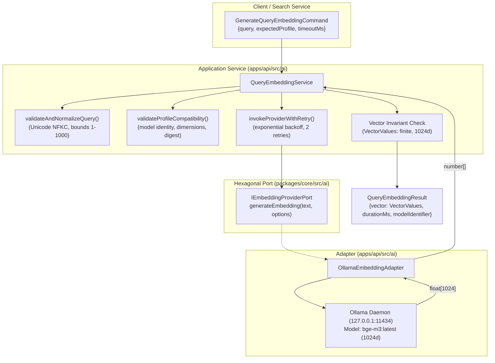

# AI-06.2: Query Embedding Generation Architecture & Compatibility

- **Document Identifier:** `AI-06-QUERY-EMBEDDING`
- **Date:** 2026-11-20
- **Repository:** `izzydin/kinergy-platform`
- **Milestone:** AI-06 — Semantic Retrieval Engine
- **Stage:** AI-06.2 — Query Embedding Generation
- **Roles:** Principal Software Architect, Senior AI/ML Backend Engineer
- **Status:** **IMPLEMENTED & VERIFIED**

---

## 1. Executive Summary

Milestone **AI-06.2** implements the `QueryEmbeddingService` application service fulfilling `IQueryEmbeddingUseCase`. The service converts arbitrary natural language search queries into high-dimensional dense vector embeddings that are geometrically and mathematically compatible with the document embeddings persisted during Milestone **AI-05**.

### Key Architectural Invariants

1. **Model Reuse:** Reuses the existing `IEmbeddingProviderPort` and `OllamaEmbeddingAdapter` hosting BAAI/BGE-M3 (1,024 dimensions, unit L2 norm, `CLS` pooling).
2. **Deterministic Preprocessing:** Normalizes input query text via Unicode NFKC matching the document chunk extraction pipeline in AI-04.
3. **No Silent Model Drift:** Strictly validates `expectedProfile` against the active provider; throws `RetrievalProfileMismatchException` if an attempt is made to search an index using an incompatible model.
4. **Finite Float Vector Invariant:** Enforces strict validation rejecting `NaN`, `Infinity`, empty arrays, and dimension mismatches.
5. **Separation of Latency Telemetry:** Measures query embedding generation latency independently from database retrieval and ranking.

---

## 2. Component Architecture

---

## 3. Preprocessing & Document Embedding Compatibility

To ensure cosine distance comparisons in PostgreSQL pgvector are mathematically sound, the query vector and document vectors must originate from an identical semantic representation space.

| Preprocessing Step        | AI-04 / AI-05 Document Chunks                                   | AI-06 Query Embedding                                |       Compatible?       |
| :------------------------ | :-------------------------------------------------------------- | :--------------------------------------------------- | :---------------------: |
| **Unicode Normalization** | NFKC normalization via `DeterministicDocumentNormalizerService` | NFKC normalization via `validateAndNormalizeQuery()` |   **YES (Identical)**   |
| **Whitespace Trimming**   | Leading/trailing trimmed; internal runs collapsed               | Leading/trailing trimmed                             |         **YES**         |
| **Max Character Bounds**  | 400–500 tokens ($\approx 1,800$ characters)                     | Bounded to 1,000 characters                          | **YES (Within window)** |
| **Embedding Model**       | BAAI/BGE-M3 dense representation                                | BAAI/BGE-M3 dense representation                     |   **YES (Identical)**   |
| **Vector Dimensionality** | Strictly 1,024 float32 values                                   | Strictly 1,024 float32 values                        |   **YES (Identical)**   |
| **Normalization Policy**  | Unit L2 ($\|v\|_2 \approx 1.0$)                                 | Unit L2 ($\|v\|_2 \approx 1.0$)                      |   **YES (Identical)**   |
| **Pooling Strategy**      | CLS / Dense default                                             | CLS / Dense default                                  |   **YES (Identical)**   |

---

## 4. Error Handling & Failure Matrix

| Scenario                    | Trigger Condition                                | Thrown Exception                        | Retry Policy                                 |
| :-------------------------- | :----------------------------------------------- | :-------------------------------------- | :------------------------------------------- |
| **Empty Query**             | `query == ""` or whitespace-only                 | `EmptyRetrievalQueryException`          | Fast-fail (No retry)                         |
| **Oversized Query**         | Length $> 1,000$ characters                      | `InvalidRetrievalQueryException`        | Fast-fail (No retry)                         |
| **Model Mismatch**          | `expectedProfile.modelName` $\ne$ provider model | `RetrievalProfileMismatchException`     | Fast-fail (No retry)                         |
| **Dimension Mismatch**      | Vector length $\ne 1,024$                        | `EmbeddingDimensionMismatchException`   | Fast-fail (No retry)                         |
| **Malformed Output**        | Vector contains `NaN` or `Infinity`              | `EmbeddingValidationException`          | Fast-fail (No retry)                         |
| **Empty Provider Response** | Vector has 0 elements                            | `EmbeddingValidationException`          | Fast-fail (No retry)                         |
| **Transient Network Error** | Network socket timeout / connection reset        | `EmbeddingProviderUnavailableException` | Retry up to 2 times with exponential backoff |
| **Request Timeout**         | Provider call exceeds configured timeout         | `ProviderTimeoutException`              | Retry up to 2 times                          |
| **Caller Cancellation**     | `AbortSignal.aborted === true`                   | `GenerationCancelledException`          | Fast-fail immediately                        |

---

## 5. Performance & Telemetry

- **Measured Provider Latency (`durationMs`):** Tracked with high-resolution timestamps from query receipt to validated `VectorValues` construction.
- **Latency Separation:** In Milestone AI-06.3, `SemanticSearchService` logs `embeddingDurationMs` and `vectorSearchDurationMs` as distinct telemetry metrics, enabling precise performance diagnostics between local Ollama inference and PostgreSQL pgvector query execution.
- **Caching Design:** In accordance with the prompt ("Do not add persistent query caching without an explicit security and invalidation design"), queries are evaluated live against the provider. No unvalidated persistent query caching is introduced.
