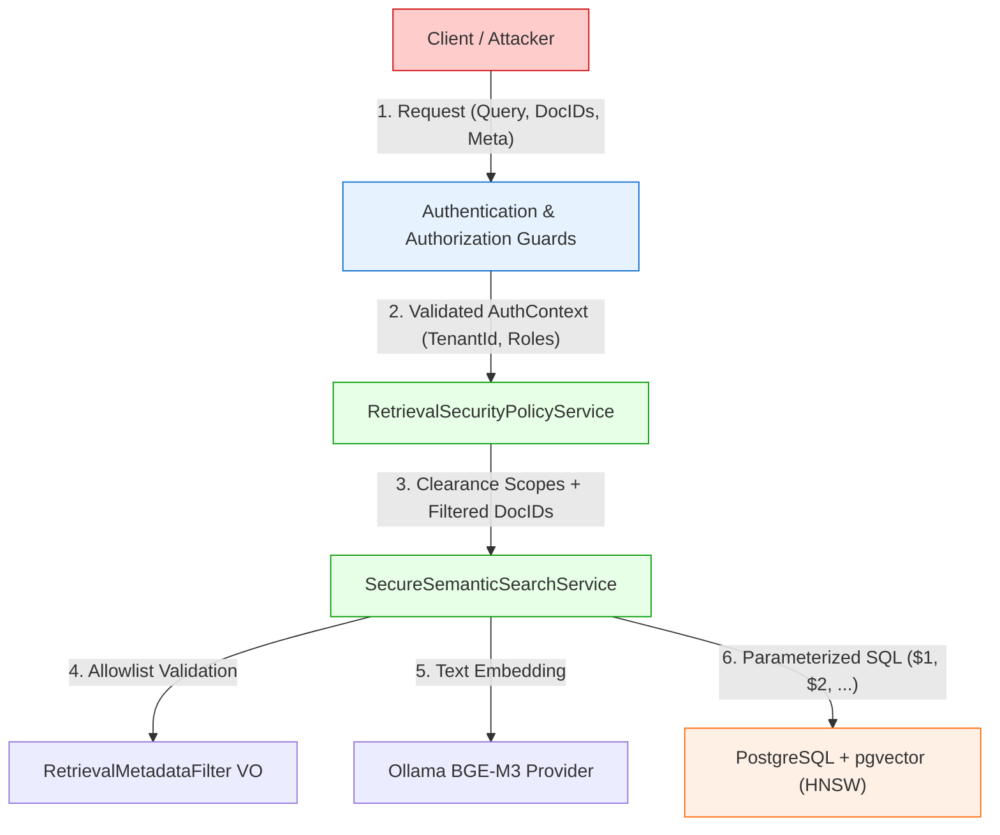

# AI-06 — Semantic Retrieval Engine Threat Model

## 1. Overview & Trust Boundaries

The Semantic Retrieval Engine processes natural language queries from authenticated users across multi-tenant fitness and kinesiology clinics. It interacts with the local embedding inference provider (Ollama / BGE-M3) and the persistence layer (PostgreSQL 16 + pgvector).

### Trust Boundaries

1. **Client / API Boundary**: Untrusted input boundary. Client requests can contain adversarial query strings, spoofed tenant IDs, manipulated document IDs, and injection attempts.
2. **Application / Database Boundary**: Trusted execution boundary. Queries must be strictly parameterized (`$1, $2, ...`) and enforce multi-tenant isolation in SQL before result ranking and limit truncation.
3. **Application / Embedding Provider Boundary**: Semi-trusted boundary. Embeddings must be validated for dimension (1024), float finiteness (no NaN/Infinity), and profile compatibility before persistence or query evaluation.

---

## 2. STRIDE Threat Analysis & Mitigations

### 1. Spoofing (Identity & Tenant Spoofing)

- **Threat**: An attacker passes a foreign `tenantId` in the JSON request body or URL to search another clinic's confidential patient records or protocols.
- **Mitigation**:
  - `tenantId` is never read from client-supplied request bodies or URL parameters.
  - `tenantId` is extracted exclusively from the cryptographically verified JWT token or server-side session (`AuthenticatedUserPayload`).
  - Attempting to pass an unauthorized tenant ID results in an immediate `403 Forbidden` or `UnauthorizedRetrievalException`.

### 2. Tampering (Parameter & Metadata Injection)

- **Threat**: An attacker injects SQL fragments (`--`, `; DROP TABLE`, `UNION SELECT`) or arbitrary JSON expressions into `filterMetadata` to alter query execution or extract unauthorized data.
- **Mitigation**:
  - `RetrievalMetadataFilter` enforces an authoritative allowlist of 10 pre-approved metadata attributes (`department`, `subspecialty`, `category`, `topic`, `language`, `strategy`, `documentType`, `difficulty`, `author`, `tags`).
  - Prohibits SQL injection sequences (`--`, `/*`, `*/`, `;`, `UNION`, `SELECT`, `DROP`, `ALTER`, `EXEC`).
  - Strict type checking (only primitive strings, numbers, booleans, and string arrays are permitted).
  - PostgreSQL parameterization (`kc.metadata::jsonb @> $meta::jsonb`) ensures JSON is parsed safely as data, not code.

### 3. Repudiation (Audit Trail & Telemetry)

- **Threat**: Unauthorized search queries or data access attempts occur without logging or traceability.
- **Mitigation**:
  - `RetrievalTelemetry` records tenant ID, query length, top-K requested, returned chunk count, total match count, active generation ID, and duration metrics.
  - Security failures (zero-clearance queries, unauthorized document ID requests) emit structured warning logs (`[SecureSemanticSearchService] WARN User '...' requested document IDs, but none are authorized. Failing closed without leaking existence.`).

### 4. Information Disclosure (Cross-Tenant Leakage & Document Enumeration)

- **Threat A**: An attacker searches in Tenant A using vectors that closely match Tenant B's documents, leaking confidential chunks via approximate nearest-neighbor search.
- **Mitigation A**: The database query strictly mandates `ig.tenant_id = $2 AND kd.tenant_id = $2 AND kc.tenant_id = $2` before similarity ordering and limit truncation. Zero cross-tenant chunks can be evaluated or returned.
- **Threat B**: An attacker supplies document IDs from other tenants or deleted documents to confirm whether specific files exist (Blind Enumeration).
- **Mitigation B**: `RetrievalSecurityPolicyService` verifies document access within the tenant boundary. Non-authorized or foreign document IDs are silently discarded without revealing existence, status, or title. If zero authorized IDs remain, an empty result is returned.
- **Threat C**: A staff member with general clearance (`ALL_STAFF`) retrieves sensitive clinical records (`CLINICAL_STAFF`) or financial budgets (`MANAGEMENT`).
- **Mitigation C**: Role-based access control maps authenticated roles to `VisibilityScope`s. Documents exceeding the user's clearance are filtered at both the application level and within PostgreSQL (`kd.visibility_scope::text IN (...)`).
- **Threat D**: Chunks from soft-deleted documents remain searchable in the vector space.
- **Mitigation D**: Both the application security policy and SQL query enforce `kd.deleted_at IS NULL`.

### 5. Denial of Service (Filter Starvation & Resource Exhaustion)

- **Threat A**: An attacker requests `topK = 100000` to exhaust server memory and database bandwidth.
- **Mitigation A**: Top-K is strictly clamped to $[1, 50]$ in the domain layer (`RetrievalQuery`) and SQL query (`LIMIT $limit`).
- **Threat B**: High-frequency retrieval requests with 0 clearance force expensive embedding inference.
- **Mitigation B**: `SecureSemanticSearchService` checks clearance and document validity before calling the embedding provider. If clearance is 0 or all requested document IDs are invalid, the service returns immediately with an empty result without invoking BGE-M3 or PostgreSQL.

### 6. Elevation of Privilege (Clearance Scope Escalation)

- **Threat**: A user sends an array of higher `allowedVisibilityScopes` in the request body to bypass role restrictions.
- **Mitigation**: Client-supplied clearance scopes are never trusted. `RetrievalSecurityPolicyService` derives allowable visibility scopes deterministically from the user's verified server-side roles.

---

## 3. Residual Risk & Monitoring

| Risk Factor                        | Residual Risk Level | Operational Countermeasure                                                                                                                 |
| :--------------------------------- | :------------------ | :----------------------------------------------------------------------------------------------------------------------------------------- |
| **Model Replacement Drift**        | Low                 | Active index generations are strictly bound to `profileId`. Model change detection triggers automated reindexing.                          |
| **HNSW Parameter Tuning**          | Very Low            | HNSW index uses `vector_cosine_ops` with default `ef_construction=64`, verified in EXPLAIN ANALYZE benchmarks ($< 1\text{ ms}$ execution). |
| **Zero-Day in pgvector Extension** | Low                 | Isolated in Docker container; parameterization prevents raw SQL execution; regular security patching.                                      |
