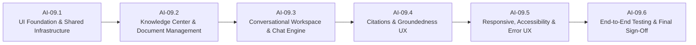

# AI-09 Execution Roadmap — Kynergy Intelligence Frontend Integration

**Milestone:** AI-09 Kynergy Intelligence Frontend Integration  
**Document ID:** `AI-09-execution-roadmap`  
**Phase:** 0 — Integration Audits  
**Role:** Principal Software Architect & Senior Frontend Engineer  
**Status:** Approved for Implementation  
**Date:** 2026-11-21  
**Target File:** `docs/ai/AI-09/AI-09-execution-roadmap.md`

---

## 1. Roadmap Overview & Phased Architecture

This roadmap organizes the implementation of Milestone AI-09 into six independently verifiable, non-overlapping milestones. Each phase delivers working software with isolated unit and integration tests, preserving established Kynergy conventions without introducing speculative backend changes.

---

## 2. Milestone Breakdown & Deliverables

### Milestone AI-09.1: UI Foundation, Routing & Shared Infrastructure

**Objective:** Establish module boundaries, shared API clients, routing, navigation entries, and base dependencies.

#### Key Tasks

1. Install verified frontend dependency: `react-markdown` (and `@tailwindcss/typography` if needed for markdown prose).
2. Create module root structure at `apps/web/src/modules/intelligence/` (`api/`, `components/`, `hooks/`, `routes/`, `schemas/`, `types/`).
3. Implement `api/intelligence-api.client.ts` and `api/query-keys.ts` wrapping shared `KynergyApiClient`.
4. Register routes in `AppRouter`:
   - `/intelligence/chat`
   - `/intelligence/chat/:conversationId`
   - `/intelligence/knowledge`
   - `/intelligence/knowledge/documents/:documentId`
5. Integrate "Kynergy Intelligence" navigation items into the main application sidebar with role guards (`SUPER_ADMIN`, `ADMIN`, `ENERGY_MANAGER`, `OPERATOR`, `COLLABORATOR`).
6. Implement `ai-health-pill.tsx` calling `GET /api/v1/ai/health` to indicate Ollama/pgvector readiness.

#### Acceptance Criteria

- Route navigation loads empty view skeletons without runtime errors.
- Sidebar reflects correct active state and role-based permissions.
- Health pill reflects live backend status (`healthy` / `degraded`).

---

### Milestone AI-09.2: Knowledge Center & Ingestion Lifecycle Management

**Objective:** Deliver the complete Document Management UI, drag-and-drop upload, version management, and 7-stage ingestion status stepper.

#### Key Tasks

1. Implement `api/knowledge.api.ts`:
   - `listDocuments()`, `getDocumentDetail()`, `uploadDocument()`, `deleteDocument()`, `getIngestionHistory()`, `retryIngestion()`, `cancelIngestion()`.
2. Build `components/knowledge/document-upload-modal.tsx`:
   - Drag-and-drop file dropzone accepting PDF, DOCX, MD, TXT (< 10 MB).
   - Client-side size and MIME validation before upload.
   - Multipart form submission with progress feedback.
3. Build `components/knowledge/document-library-table.tsx`:
   - Paginated data table (1-indexed) with search, visibility scope filter, and date sorting.
   - Document detail slide-over drawer with download link (`GET :id/content`).
   - Soft-delete confirmation dialog.
4. Build `components/knowledge/ingestion-stepper.tsx`:
   - 7-stage visual tracker: `UPLOADED` -> `VALIDATING` -> `PROCESSING` -> `INDEXING` -> `READY`.
   - Polling hook (`useIngestionPolling`) refreshing `GET :id/ingestion` every 2.0s while active.
   - Action buttons for "Reintentar" (`POST :id/retry`) on failure and "Cancelar" (`POST :id/cancel`).

#### Acceptance Criteria

- Documents upload successfully and trigger backend ingestion.
- UI table automatically updates status to `Listo para Consultas` (`READY`) upon worker completion without full page refresh.
- Soft-deleted documents immediately vanish from retrieval and table listings.

---

### Milestone AI-09.3: Conversational Workspace & Stateless Chat Engine

**Objective:** Deliver the conversational chat interface, message composer, multi-turn history, and client-side persistence store.

#### Key Tasks

1. Implement `types/chat.types.ts` defining `ClientConversation`, `ClientMessage`, and DTO mappings.
2. Implement `hooks/use-conversation-store.ts`:
   - Browser `localStorage` persistence partitioned by `kinergy_conv_${tenantId}_${userId}`.
   - Create, list, switch, and delete local conversation threads.
   - Thread title auto-generation from first user message.
3. Implement `hooks/use-chat.ts`:
   - Manages active thread turns, submission state, and loading indicators.
   - Dispatches `POST /api/v1/ai/knowledge/query` transmitting recent `conversationHistory` and omitting `conversationId`.
   - Handles `AbortController` cancellation for user "Detener Generación" action.
4. Build `components/chat/conversation-sidebar.tsx`:
   - Thread list sorted by `updatedAt` desc, "Nueva Conversación" button, search filter, and delete action.
   - Collapsible behavior saving preference to `localStorage`.
5. Build `components/chat/message-composer.tsx`:
   - Auto-expanding textarea (44px to 160px), Enter to submit, Shift+Enter for newlines.
   - Disabled state while generation is active.
   - "Detener" button active during submission.

#### Acceptance Criteria

- User can start a new chat, ask questions, and receive grounded answers.
- Refreshing the browser preserves active conversation and all historical turns.
- Multi-turn context is grounded without server-side 404 errors.

---

### Milestone AI-09.4: Citations, Groundedness UX & Source Previews

**Objective:** Implement rich Markdown rendering, interactive source citation badges, deterministic abstention alerts, and document previews.

#### Key Tasks

1. Build `components/chat/message-markdown.tsx`:
   - GitHub Flavored Markdown renderer (tables, lists, bold, inline code).
   - Code blocks with syntax highlighting and one-click "Copiar Código" button with copied toast feedback.
2. Build `components/chat/citation-chip.tsx`:
   - Authoritative source chips: `📄 [Título del Documento] • Pág. [X]`.
   - Tooltip displaying heading hierarchy breadcrumbs (`headingPath`).
   - Hover and focus states complying with WCAG 2.2 AA.
3. Build `components/chat/citation-drawer.tsx`:
   - Slide-over drawer when clicking a citation chip displaying document metadata and a direct download action.
4. Build `components/chat/groundedness-banner.tsx`:
   - Amber informational alert rendered when `grounded: false` or abstention occurs.
   - Explains that verified evidence was insufficient to guarantee an accurate answer without extrapolation.

#### Acceptance Criteria

- Citations render accurately with verified document titles and page numbers.
- Code blocks render syntax colors cleanly and support one-click copying.
- Abstention messages render clearly without hallucinated evidence.

---

### Milestone AI-09.5: Responsive Polish, Accessibility & Resilient Error UX

**Objective:** Guarantee WCAG 2.2 AA compliance, mobile responsive layout, and comprehensive error resilience.

#### Key Tasks

1. Responsive layout hardening:
   - Sidebar auto-collapses into a sliding drawer on screens `< 768px`.
   - Message viewport maintains fixed 100vh height without body scroll bouncing on iOS/Android.
2. Accessibility audit & remediation:
   - Keyboard navigation across sidebar, thread list, messages, and composer.
   - Screen reader announcements for incoming assistant messages (`aria-live="polite"`).
   - Verify contrast ratio of brand green `#68CE39` on dark and light surfaces (minimum 4.5:1).
3. Error boundary and resilience states:
   - RFC 7807 error translation banner for `503 Service Unavailable` (Ollama down) and `504 Gateway Timeout`.
   - In-line "Reintentar Consulta" action in failed assistant bubble.
   - Offline detection banner if browser loses internet connectivity.

#### Acceptance Criteria

- 100% keyboard navigable without mouse.
- Zero accessibility violations under automated axe-core scanning.
- Graceful error banners displayed when backend LLM is stopped.

---

### Milestone AI-09.6: End-to-End Integration, Automated Testing & Acceptance Sign-Off

**Objective:** Execute full end-to-end integration tests, regression test suites, and obtain final architectural sign-off.

#### Key Tasks

1. Author unit tests for all hooks (`useChat`, `useConversationStore`, `useDocumentLibrary`, `useIngestionPolling`).
2. Author component tests for `MessageComposer`, `CitationChip`, `IngestionStepper`, and `DocumentLibraryTable`.
3. Author Cypress / Playwright E2E integration test suite:
   - Test 1: Upload a PDF document -> Verify ingestion reaches `READY`.
   - Test 2: Ask a question about the uploaded document -> Verify grounded answer + citation chip.
   - Test 3: Ask a follow-up question -> Verify multi-turn conversational context.
   - Test 4: Reload browser -> Verify conversation thread and turns persist.
   - Test 5: Soft-delete document -> Verify document vanishes and subsequent queries abstain.
4. Produce final milestone report `docs/ai/AI-09/AI-09-completion-report.md`.

#### Acceptance Criteria

- All automated unit, component, and E2E tests pass with zero regressions.
- All 5 Final Acceptance Gates from `AI-09.0.08` are satisfied.

---

## 3. Implementation Schedule & Verification Matrix

| Milestone   | Target Deliverable             | Verifiable Artifacts                                      | Estimated Effort |
| :---------- | :----------------------------- | :-------------------------------------------------------- | :--------------: |
| **AI-09.1** | UI Foundation & Routes         | Routes registered, sidebar entries, health pill, client   |      2 Days      |
| **AI-09.2** | Knowledge Center UI            | Upload modal, document table, ingestion stepper           |      3 Days      |
| **AI-09.3** | Conversational Workspace       | Thread store, message composer, turn dispatch             |      3 Days      |
| **AI-09.4** | Citations & Groundedness       | Markdown viewer, citation chips, drawer, abstention alert |      2 Days      |
| **AI-09.5** | Accessibility & Error UX       | Mobile drawer, WCAG contrast, RFC 7807 error handling     |      2 Days      |
| **AI-09.6** | E2E Testing & Sign-Off         | Automated E2E test suite, QA matrix, completion report    |      2 Days      |
| **TOTAL**   | **Kynergy Intelligence Suite** | **Complete Production Frontend Integration**              |   **14 Days**    |
