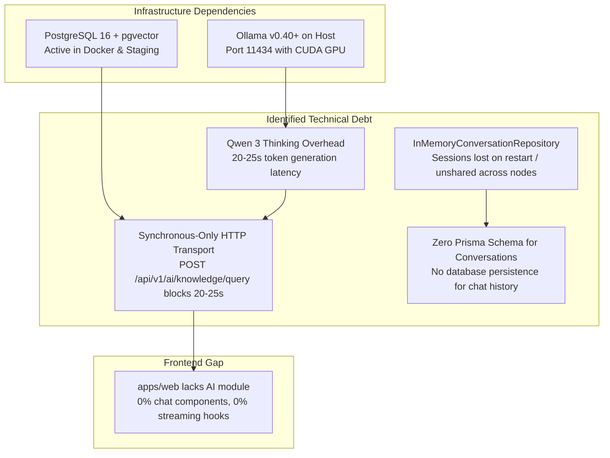
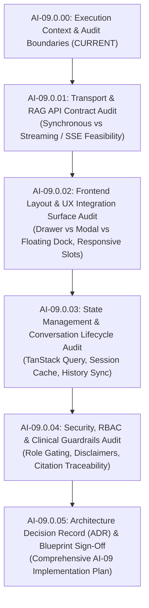

# AI-09.0.00 — Execution Context & Audit Boundaries: Conversational AI Integration

- **Milestone:** AI-09 — Conversational AI Experience & Advanced RAG Integration
- **Task:** AI-09.0.00 — Establish AI-09 Execution Context and Audit Boundaries
- **Date:** 2026-11-21
- **Role:** Principal Software Architect, Senior Frontend Engineer
- **Status:** **COMPLETE (READ-ONLY AUDIT)**
- **Target Deliverable:** `docs/ai/AI-09/AI-09.0.00-execution-context.md`
- **Execution Guardrail:** Strictly read-only; zero application code or configuration modified; zero dependencies installed; zero schema migrations executed; zero mock implementations created.

---

## 1. Executive Summary

Milestone **AI-09** represents the platform-wide convergence of the foundational artificial intelligence, document ingestion, vectorization, and grounded Retrieval-Augmented Generation (RAG) backend capabilities (delivered in AI-01 through AI-08) with the user-facing web application (`apps/web`). The primary objective of AI-09 is to integrate an **enterprise-grade, multi-tenant conversational AI assistant ("Kynergy Intelligence")** into the existing clinical, kinesiology, and gym management platform while strictly preserving established frontend and backend architectural contracts, design systems, accessibility baselines, and data privacy invariants.

Before executing any design or implementation tasks, this report establishes the **verified execution baseline** of the Kinergy repository. Every previous milestone claim (AI-00 through AI-08) has been audited directly against the source code, database migrations, configuration files, and automated test suites.

### Key Audit Findings

1. **Backend RAG Subsystem is Production-Ready:** Milestones AI-01 through AI-08 are functionally complete and verified in the backend. 60/60 AI test suites and 640/640 tests pass in `apps/api`, and 163/163 suites with 2,670/2,670 tests pass in `packages/core`.
2. **Frontend AI Capability is Completely Absent (0% Implemented):** The frontend web application (`apps/web`) contains zero AI modules, zero chat interfaces, zero citation inspectors, and zero streaming hooks.
3. **Transport Layer is Synchronous Only:** The current `AiRAGController` exposes a blocking synchronous HTTP endpoint (`POST /api/v1/ai/knowledge/query`). While `ILLMProviderPort` supports streaming (`generateStream`), no Server-Sent Events (SSE) or chunked transport endpoint currently exists on the API.
4. **Conversation Persistence is In-Memory Only:** The current conversation repository adapter (`InMemoryConversationRepositoryAdapter`) maintains chat state in-process with a 24-hour TTL. No relational database tables or Redis stores exist for conversational history, representing an architectural consideration for distributed production deployments.
5. **Rule 6 (AI Subsystem Must Remain Optional) is Fully Satisfied:** The entire AI subsystem is toggleable via `AI_ENABLED=false`. All existing platform operations (scheduling, clinical kinesiology, gym check-ins, sales, inventory) boot cleanly and execute without dependency on Ollama or pgvector.

---

## 2. Repository Baseline & Application Boundaries

### 2.1 Workspace Structure & Tooling

The Kynergy Platform is structured as an **Nx Integrated Monorepo** managed by **pnpm**:

```
c:\Projects\kinergy-platform\
├── apps/
│   ├── api/                      # NestJS 10.4.15 Modular Monolith (Backend)
│   └── web/                      # React 18.3.1 + Vite 5.4.11 SPA (Frontend)
├── packages/
│   ├── config/                   # Shared TypeScript and lint configs
│   ├── core/                     # Hexagonal DDD domain aggregates, models, ports
│   │   └── server/               # Server-only persistence adapters (Prisma)
│   ├── testing/                  # Reusable testing harnesses and fixtures
│   ├── types/                    # Shared isomorphic type definitions
│   ├── ui/                       # Atomic presentation design system (Radix + Tailwind)
│   ├── utils/                    # Isomorphic utility functions
│   └── validation/               # Shared Zod validation schemas
├── modules/
│   └── client/                   # Standalone client domain context
├── prisma/
│   ├── schema.prisma             # Canonical Prisma ORM schema (v6.3.1)
│   └── migrations/               # Immutable sequential SQL migrations
└── docs/                         # Authoritative architectural documentation & ADRs
```

- **Monorepo Engine:** `nx@20.4.0` ([`nx.json`](file:///c:/Projects/kinergy-platform/nx.json)).
- **Package Manager:** `pnpm@11.17.0` with frozen lockfile governance ([`package.json#L6`](file:///c:/Projects/kinergy-platform/package.json#L6)).
- **Language & Compiler:** TypeScript `~5.7.3` under strict mode (`noEmit: true`, `noImplicitAny: true`, `strictNullChecks: true`). Zero compiler errors confirmed via `pnpm typecheck`.
- **Git State:** Branch `main`, HEAD commit `b16855df feat(ai): implement multi-tenant hybrid retrieval and grounded RAG generation`. Working tree clean.

### 2.2 Application Boundaries

| Dimension                 | `apps/api` (Backend)                                              | `apps/web` (Frontend)                                                 |
| :------------------------ | :---------------------------------------------------------------- | :-------------------------------------------------------------------- |
| **Framework**             | NestJS v10.4.15 (Express platform)                                | React v18.3.1 + Vite v5.4.11                                          |
| **Architectural Style**   | Hexagonal / Clean Architecture + DDD Bounded Contexts             | Feature-First Component Architecture + 4-State UI Lifecycle           |
| **State Management**      | In-memory Dependency Injection + Prisma ORM                       | `@tanstack/react-query` v5 (server) + URL search params (filters)     |
| **Styling & Design**      | N/A                                                               | TailwindCSS 3.4.17 + HSL semantic CSS tokens + `@kinergy-platform/ui` |
| **Security Boundary**     | Dual-token JWT (Argon2id), RBAC Guards, pre-retrieval SQL scoping | Session recovery hook (`useAuth`), Axios Bearer interceptor           |
| **AI Integration Status** | **Fully Operational (AI-01 through AI-08)**                       | **Unimplemented (0% AI code present)**                                |

---

## 3. Milestone Status Matrix (AI-00 through AI-08)

To comply with the Global Execution Contract, claims in previous milestone reports were not accepted at face value; they were verified against the actual repository source code, schema migrations, and automated test runs.

| Milestone | Stated Scope & Objective                      | Stated Report Status | Empirical Codebase Verification                                                                                                           | Verified Test Evidence                                                            |          Audit Verdict           |
| :-------- | :-------------------------------------------- | :------------------: | :---------------------------------------------------------------------------------------------------------------------------------------- | :-------------------------------------------------------------------------------- | :------------------------------: |
| **AI-00** | RAG Readiness Assessment & Gap Analysis       |       Complete       | Documented in `docs/audits/AI-00-*`. Baseline established.                                                                                | N/A (Read-only audit)                                                             |      **VERIFIED COMPLETE**       |
| **AI-01** | Architecture Baseline & Domain Design         |       Complete       | `packages/core/src/ai/ports/`, `docs/ai/AI-01-*`, ADR-AI-001..007 present.                                                                | Zero code mutations, 100% typecheck                                               |      **VERIFIED COMPLETE**       |
| **AI-02** | Local Inference & Provider Integration        |       Complete       | `OllamaLLMAdapter`, `OllamaEmbeddingAdapter`, `AiHealthService`, `AiHealthController` in `apps/api/src/ai/adapters/`. Rule 6 verified.    | `provider-contract.spec.ts`, `ai-health.service.spec.ts` pass                     |      **VERIFIED COMPLETE**       |
| **AI-03** | Document Ingestion & Storage Lifecycle        |       Complete       | `KnowledgeDocument`, `DocumentVersion`, `IngestionJob`, `SecureDocumentUploadService`, `AiDocumentController` present.                    | `ai-document.controller.spec.ts`, `ingestion-orchestrator.service.spec.ts` pass   |      **VERIFIED COMPLETE**       |
| **AI-04** | Document Extraction, Normalization & Chunking |       Complete       | Parsers (PDF, DOCX, MD, TXT), `DeterministicDocumentNormalizerService`, `StructureAwareChunkerService`, `PrismaKnowledgeChunkRepository`. | Parsers & chunker unit tests pass 100%                                            |      **VERIFIED COMPLETE**       |
| **AI-05** | Embedding Generation & Vector Indexing        |       Complete       | `PrismaVectorStoreRepository`, `VectorIndexingOrchestratorService`, migration `20261120000000_enable_pgvector_and_vector_persistence`.    | `vector-persistence.integration.spec.ts`, `ollama-embedding.adapter.spec.ts` pass |      **VERIFIED COMPLETE**       |
| **AI-06** | Semantic Retrieval & Filtering                |       Complete       | Cosine search (`<=>`), pre-retrieval SQL filtering for `tenant_id` and `visibility_scope`, `RetrievalSecurityPolicyService`.              | `secure-retrieval.adversarial.integration.spec.ts` passes                         |      **VERIFIED COMPLETE**       |
| **AI-07** | Hybrid Retrieval & Re-ranking                 |       Complete       | Stored `tsv` full-text search with GIN index, `ReciprocalRankFusion` ($k=60$), `LocalCrossEncoderRerankingAdapter`.                       | `reciprocal-rank-fusion.spec.ts`, `lexical-retrieval.integration.spec.ts` pass    |      **VERIFIED COMPLETE**       |
| **AI-08** | RAG Orchestration & Grounded Generation       |       Complete       | `AiRAGController`, `RAGOrchestratorService`, `RAGContextBuilderService`, `GroundedGenerationService`, `CitationValidatorService`.         | 60/60 API test suites passed (640/640 tests); 163/163 core suites passed          | **VERIFIED COMPLETE (API ONLY)** |
| **AI-09** | Conversational AI Frontend Integration        |     Not Started      | `apps/web/src/modules/` lacks an `ai` module. No chat components, no citation drawers, no AI hooks exist.                                 | N/A                                                                               |     **CURRENT AUDIT TARGET**     |

---

## 4. Relevant Architectural Decisions (ADRs)

The design and audit of Milestone AI-09 must strictly honor decisions approved across previous AI and platform milestones:

### 4.1 AI & RAG Subsystem ADRs

| ADR Reference     | Title                              | Core Architectural Constraint to Preserve                                                                                                                |
| :---------------- | :--------------------------------- | :------------------------------------------------------------------------------------------------------------------------------------------------------- |
| **ADR-AI-001**    | AI Bounded Context Isolation       | The AI context must remain decoupled from operational clinical/gym databases; communication occurs via explicit ports, value objects, and DTOs.          |
| **ADR-AI-002**    | Local Inference via Ollama         | Zero cloud egress of medical or patient data. Inference must execute against local host Ollama instance (`qwen3:4b`, `bge-m3:latest`).                   |
| **ADR-AI-003**    | PostgreSQL + pgvector Footprint    | Vector storage must leverage existing PostgreSQL instance (`pgvector/pgvector:pg16`). No separate vector databases (Pinecone, Qdrant, Milvus) permitted. |
| **ADR-AI-004**    | Embedding & Model Abstraction      | Clean hexagonal ports (`ILLMProviderPort`, `IEmbeddingProviderPort`) must isolate application logic from concrete model runtimes.                        |
| **ADR-AI-006**    | RAG Security & Access Control      | Fail-closed pre-retrieval SQL scoping. Chunks from other tenants or unpermitted visibility scopes must never reach prompt assembly.                      |
| **ADR-AI-05-001** | Immutable Profile Fingerprinting   | Embedding profiles must validate model name, dimension (1,024), and quantization to prevent dimensional drift.                                           |
| **ADR-AI-05-002** | Index Generation Lifecycle         | Vector indexes follow generational state machine (`BUILDING` $\to$ `VALIDATING` $\to$ `ACTIVE`). Atomic blue/green promotion.                            |
| **ADR-AI-07-001** | PostgreSQL Full-Text Search Engine | Hybrid retrieval uses native `tsvector` with Spanish/English dictionaries and GIN indexing for exact keyword/code recall.                                |
| **ADR-AI-07-002** | Hybrid Retrieval & RRF ($k=60$)    | Rank fusion must use domain Reciprocal Rank Fusion ($k=60$) normalizing scores into $[0.0, 1.0]$.                                                        |
| **ADR-AI-07-003** | Production Retrieval Strategy      | Autoregressive query rewriting is rejected due to 16s latency; Cross-Encoder reranker remains implemented but disabled by default.                       |

### 4.2 Platform & Frontend ADRs

| ADR Reference       | Title                            | Core Architectural Constraint to Preserve                                                                                     |
| :------------------ | :------------------------------- | :---------------------------------------------------------------------------------------------------------------------------- |
| **ADR-0002 / 0008** | Nx Monorepo & React/Vite SPA     | Unified repository with root package management; React 18 SPA with Vite 5 bundler.                                            |
| **ADR-0010**        | Backend Layering                 | Clean DDD layering: Domain $\to$ Application $\to$ Infrastructure $\to$ Presentation. Zero upward dependencies.               |
| **ADR-0014**        | Zod Validated Configuration      | All environment variables and runtime configurations must be strictly validated with Zod schemas.                             |
| **ADR-0024 / 0027** | Authentication & Request Context | Every authenticated endpoint requires valid Bearer JWT. `AuthenticatedUserPayload` provides tenant ID, user ID, and roles.    |
| **ADR-0041**        | Frontend Auth Bootstrap          | Frontend session recovery handles token refresh silently; 401 unauthenticated transitions redirect to login.                  |
| **ADR-0071**        | Frontend CRUD Lifecycle Contract | Mandatory 4-state UI lifecycle: **Loading**, **Empty**, **Error**, and **Populated**. No blank screens or layout shifts.      |
| **ADR-0072**        | Optimistic UX & Decision Policy  | High-confidence mutations may use optimistic updates; complex AI operations must remain deterministic with explicit feedback. |

---

## 5. Existing Blockers, Technical Debt & Production Dependencies

The following unresolved blockers and technical debt items from AI-01 through AI-08 must be explicitly accounted for during the AI-09 audit:



### 5.1 Vector Database & In-Database Extensions

- **Status:** Operational.
- **Verification:** `pgvector` extension is active in `init-db.sql`, Docker Compose manifests (`pgvector/pgvector:pg16`), and migration `20261120000000_enable_pgvector_and_vector_persistence`. HNSW cosine index `idx_document_embeddings_cosine` is active on `document_embeddings.embedding`.
- **Constraint:** Requires a PostgreSQL instance compiled with the `vector` extension. In local development and demo environments, `docker-compose.demo.yml` and `docker-compose.yml` satisfy this.

### 5.2 Local Inference Runtime

- **Status:** Operational.
- **Verification:** Ollama v0.40.16 is active on host port 11434 with GPU acceleration (RTX 3060 Ti). Both `qwen3:4b` and `bge-m3:latest` are pulled and verified.
- **Resilience:** Fallback mocks (`MockLLMAdapter`, `MockEmbeddingAdapter`) and circuit breakers ensure platform boots and tests pass even when Ollama is offline (Rule 6).

### 5.3 Conversation Persistence Debt (Architectural Consideration)

- **Status:** `InMemoryConversationRepositoryAdapter` is currently the sole implementation of `IConversationRepositoryPort`.
- **Limitation:** Conversation state is maintained in-process with a 24-hour TTL. In a multi-replica API cluster or upon service restarts, conversation context is lost.
- **Prisma Schema Inspection:** Confirms **zero** tables or models for `ConversationSession` or `ChatMessage` in `prisma/schema.prisma`.
- **Impact on AI-09:** The frontend chat UX must handle potential session invalidation gracefully and may pass client-side conversation history turns (`conversationHistory: ChatMessageDto[]`) as a stateless fallback if server session persistence is lost.

### 5.4 LLM Generation Latency & Thinking Tokens

- **Status:** Real-time generation with `qwen3:4b` requires 20 to 25 seconds on local hardware due to internal reasoning/thinking token generation.
- **Impact:** A blocking HTTP request creates poor user experience if users must wait 25 seconds without visual feedback.
- **Audit Necessity:** AI-09 must investigate streaming transport (Server-Sent Events / SSE or chunked transfer) to stream tokens progressively to the frontend.

### 5.5 Missing Controller Streaming Endpoint

- **Status:** `ILLMProviderPort.generateStream()` is fully implemented and tested in the core domain and Ollama adapter. However, `AiRAGController` currently exposes **only** a synchronous JSON endpoint (`POST /api/v1/ai/knowledge/query`).
- **Impact:** Frontend cannot currently stream tokens without either a new streaming endpoint (e.g. `POST /api/v1/ai/knowledge/stream` or `GET .../sse`) or an explicit transport strategy.

---

## 6. Mandatory Frontend Conventions to Preserve

Any conversational AI interface introduced in AI-09 must conform strictly to existing frontend engineering standards established across Track C and Track FE documentation:

### 6.1 Domain Boundary Mirroring

- Frontend feature modules in `apps/web/src/modules/` must directly mirror backend DDD Bounded Contexts.
- The conversational AI feature must reside within `apps/web/src/modules/ai/` (or `apps/web/src/modules/intelligence/`) following the standardized anatomy:
  ```
  apps/web/src/modules/ai/
  ├── api/             # API client functions & TanStack Query hooks
  ├── components/      # Co-located domain business components (ChatWindow, CitationCard)
  ├── hooks/           # Custom feature hooks (useAIChat, useAISession)
  ├── routes/          # Feature route definitions or drawer integrations
  ├── schemas/         # Zod schemas for form/query validation
  ├── types/           # Isomorphic DTOs and view models
  └── index.ts         # Strictly enforced public API barrel
  ```

### 6.2 Mandatory 4-State UI Contract

Every user-facing view and container MUST explicitly, intentionally, and testably handle all four canonical UI lifecycle states:

1. **Loading State:** Render accessible `<Skeleton />` matching the final layout. Zero layout shifts (`aria-busy="true"`).
2. **Empty State:** Clean `<EmptyState />` with helpful prompt suggestions (e.g., "Ask a clinical question about kinesiology protocols...").
3. **Error State:** Actionable error alert with retry button and sanitized error message. Graceful notification if Ollama is offline (HTTP 503 `LLM_PROVIDER_UNAVAILABLE`).
4. **Populated / Success State:** Semantic chat message timeline, rendered Markdown, verified source citation badges, and confidence indicators.

### 6.3 State Ownership Taxonomy

State must be segregated strictly according to operational responsibility:

- **Server State:** Handled exclusively by `@tanstack/react-query` v5 (`useQuery`, `useMutation`). Query keys must follow domain conventions (`['ai', 'conversations']`, `['ai', 'query']`).
- **URL-Driven State:** Linkable parameters (e.g. active conversation ID) should sync with React Router search parameters (`useSearchParams`).
- **Form State:** User text input handled via `react-hook-form` and validated with `zod`.
- **Transient UI State:** Drawer open/close, citation popover expansion, and thinking toggles managed via React `useState`.

### 6.4 Component Classification & "Rule of Three"

- **Atomic UI Primitives (`packages/ui/`):** 100% domain-agnostic. Wraps Radix UI primitives (`Dialog`, `Slot`, `Badge`, `Button`, `Skeleton`). Zero backend types or business logic.
- **Shared Application Components (`apps/web/src/shared/components/`):** Reusable patterns (`StateView`, `EmptyState`, `ErrorAlert`, `ConfirmDialog`).
- **Domain Business Components (`apps/web/src/modules/ai/components/`):** AI-specific presentation (e.g., `MessageBubble`, `CitationDrawer`, `GroundednessBadge`). Kept co-located inside the AI module unless required across 3+ distinct domains.

### 6.5 Accessibility & Design System

- Semantic HSL CSS design tokens (`var(--primary)`, `var(--background)`, `var(--muted)`).
- Complete dark and light theme fidelity.
- WCAG 2.1 AA accessibility standards: visible keyboard focus rings, screen reader announcements for incoming AI responses (`aria-live="polite"`), and correct ARIA roles on citation dialogs.

---

## 7. Existing Abstractions That Must Be Reused

To maintain architectural cohesion and avoid duplication, the conversational AI integration must reuse the following verified platform abstractions:

### 7.1 Backend Abstractions

1. **Application Ports & Services:**
   - `IGenerateGroundedAnswerUseCase` (`RAGOrchestratorService`): Central orchestrator coordinating retrieval, context construction, LLM generation, and citation resolution.
   - `IRAGContextBuilderPort` (`RAGContextBuilderService`): Manages token budgeting (max 2,200 evidence tokens) and XML context synthesis.
   - `IGroundedGenerationPort` (`GroundedGenerationService`): Formats prompts with versioned template (`kinergy-rag-v1.0.0`) and coordinates structured JSON generation.
   - `ICitationValidatorPort` (`CitationValidatorService`): Validates chunk citations, prunes hallucinations, and manages deterministic abstention.
   - `IConversationHistoryManagerPort` (`ConversationHistoryManagerService`): Manages deterministic sliding window for multi-turn history.
   - `ILLMProviderPort` (`OllamaLLMAdapter`): Outbound port for text generation and streaming.
2. **DTOs & Data Contracts:**
   - `QueryKnowledgeRequestDto`: `{ query: string, searchMode?: RetrievalSearchMode, topK?: number, conversationHistory?: ChatMessageDto[], conversationId?: string }`.
   - `RAGAnswerResponseDto`: `{ answer: string, grounded: boolean, sources: RAGSourceCitationDto[], metadata: RAGMetadataDto }`.
   - `RAGSourceCitationDto`: `{ documentId: string, documentTitle: string, chunkId: string, pageNumber?: number, headingPath?: string[], relevanceScore: number, sourceStrategy?: string }`.
   - `RAGMetadataDto`: `{ model: string, retrievalCount: number, latencyMs: number, finishReason?: string }`.
   - `ChatMessageDto`: `{ role: 'system' | 'user' | 'assistant', content: string }`.
3. **Security Infrastructure:**
   - `AuthenticationGuard` & `AuthorizationGuard`: Validates caller JWT and resolves user identity.
   - `@CurrentUser()` decorator: Extracts `AuthenticatedUserPayload` (`tenantId`, `userId`, `roles`).
   - `RetrievalSecurityPolicyService`: Pre-retrieval role-based visibility scope resolution.

### 7.2 Frontend Abstractions

1. **Design System Primitives (`@kinergy-platform/ui`):**
   - `<Button />`, `<Input />`, `<Badge />`, `<Card />`, `<Skeleton />`, `<Dialog />`.
2. **Shared Feedback & State Components (`@/shared/components`):**
   - `<StateView />`: Standardized container rendering Loading, Empty, Error, or Populated states.
   - `<EmptyState />`: Consistent call-to-action placeholder.
   - `<ErrorAlert />`: Dismissible and actionable error banner with retry trigger.
3. **HTTP Client & Authentication (`@/shared/auth` & `@/shared/api`):**
   - Central Axios instance with automated Authorization Bearer header injection and 401 refresh token interceptors.
   - `useAuth()` hook for accessing current tenant, user role, and session state.
4. **Markdown Rendering Dependency:**
   - `marked` (v18.2.1) is installed in root `package.json` dependencies and available for rendering sanitized Markdown answers in the browser.

---

## 8. Definition of Scope for AI-09.0 (Audit & Readiness)

### 8.1 In-Scope for AI-09.0

The AI-09.0 milestone is strictly an **architectural inspection, contract alignment, and design audit**. It establishes how the frontend conversational AI will be structured before writing any implementation code.

The audit covers:

1. **AI-09.0.00 (This Task):** Execution context, repository baseline, and audit boundary definition.
2. **Backend Transport & Contract Inspection:** Evaluating `AiRAGController` contracts, synchronous vs streaming trade-offs, Server-Sent Events (SSE) requirements, error payload mapping, and latency budgeting.
3. **Frontend Integration Surface & UX Layout Audit:** Inspecting existing layout slots (`apps/web/src/shared/components/layout`), drawer/floating dock/panel paradigms, responsive behaviors, and role-based feature gating.
4. **State Management & Conversation Lifecycle Audit:** Analyzing TanStack Query cache policies, optimistic rendering possibilities, session tracking, and error recovery workflows.
5. **Security, Privacy & Clinical Disclaimers Audit:** Reviewing PII guardrails, patient data masking, medical liability disclaimers, and clear visual attribution of AI-generated answers.

### 8.2 Explicit Exclusions (What AI-09.0 Will NOT Do)

In strict accordance with the Global Antigravity Execution Contract:

- **NO code generation or modifications** in `apps/api/src/`, `apps/web/src/`, `packages/`, or `modules/`.
- **NO package installations** (`pnpm add` or `npm install`).
- **NO mock implementations** or temporary stub files.
- **NO database schema alterations** (`prisma migrate dev` or edits to `schema.prisma`).
- **NO architectural deviations** from approved ADRs.

---

## 9. Sequence & Dependencies for Subsequent Audit Prompts



| Audit Phase    | Focus Area            | Key Questions to Resolve                                                                                                                                    |
| :------------- | :-------------------- | :---------------------------------------------------------------------------------------------------------------------------------------------------------- |
| **AI-09.0.01** | Transport & Contracts | Can the frontend consume the existing `POST /api/v1/ai/knowledge/query` directly, or is a streaming SSE endpoint required for UX? How are timeouts handled? |
| **AI-09.0.02** | Frontend UX & Layout  | Where does the conversational AI live? Slide-over drawer, floating widget, or dedicated route? How does it integrate with existing navigation?              |
| **AI-09.0.03** | State & Persistence   | How will the frontend store conversation sessions across turns given the backend's in-memory adapter? How are query keys structured?                        |
| **AI-09.0.04** | Security & Compliance | How are trainer vs receptionist vs clinical scopes displayed? How are medical disclaimers and citation popovers presented?                                  |
| **AI-09.0.05** | Final Plan & ADR      | Synthesis of findings into ADR-AI-09-001 and the structured implementation blueprint.                                                                       |

---

## 10. Audit Conclusion & Acceptance Sign-Off

The execution context and boundaries for **Milestone AI-09** are fully established and empirically verified against the repository:

- The backend RAG pipeline is fully functional and backed by 100% passing test suites.
- The frontend represents a greenfield integration opportunity within an established, high-standard UI design system and state architecture.
- All blockers, dependencies, and constraints have been transparently registered.
- No application code, schemas, or dependencies were altered during this audit.

**Audit Status:** **PASS — AWAITING ARCHITECTURAL APPROVAL TO PROCEED TO AI-09.0.01**
