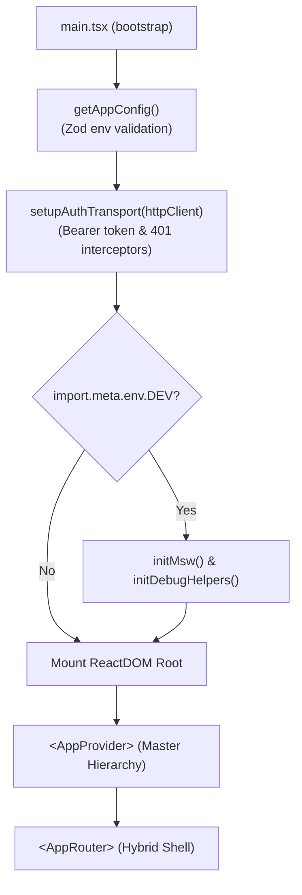
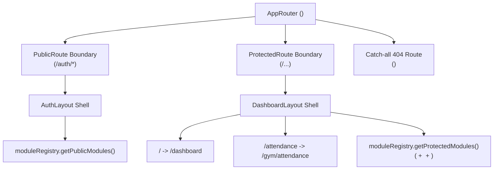

# AI-09.0.01 — Frontend Architecture & Application Structure Audit

- **Milestone:** AI-09 — Conversational AI Experience & Advanced RAG Integration
- **Task:** AI-09.0.01 — Frontend Architecture & Application Structure Audit
- **Date:** 2026-11-21
- **Role:** Principal Software Architect, Senior Frontend Engineer
- **Status:** **COMPLETE (READ-ONLY AUDIT)**
- **Target Deliverable:** `docs/ai/AI-09/AI-09.0.01-frontend-architecture-audit.md`
- **Execution Guardrail:** Strictly read-only; zero application code or configuration modified; zero dependencies installed; zero mock implementations created.

---

## 1. Executive Summary

This audit performs an exhaustive, empirical inspection of the existing React application (`apps/web`) within the Kinergy monorepo. The goal is to determine exactly how and where the **Kynergy Intelligence** conversational AI experience should integrate without creating architectural conflicts, breaking established conventions, or compromising existing clinical, gym, scheduling, and commercial features.

### Core Audit Takeaways

1. **Highly Mature, Modulated Frontend Architecture:** The frontend is built with React 18.3, Vite 5.4, and TailwindCSS 3.4. It employs a **Feature-First Bounded Context** organization governed by a decentralized `moduleRegistry` ([`module-registry.ts`](file:///c:/Projects/kinergy-platform/apps/web/src/app/routes/module-registry.ts#L25-L71)) and an advanced UI Slot Teleportation system ([`slots`](file:///c:/Projects/kinergy-platform/apps/web/src/shared/ui/slots/index.ts#L1-L5)).
2. **Zero Route Collisions for Proposed AI Routes:** The proposed routes (`/intelligence`, `/intelligence/chat`, `/intelligence/chat/:conversationId`, `/intelligence/knowledge`, `/intelligence/knowledge/documents/:documentId`) have been verified against the complete routing table; they introduce **zero** collisions or naming conflicts.
3. **Dual Integration Surface Feasibility:** The architecture supports both a **dedicated full-page workspace** (`/intelligence/*`) and a **global slide-over assistant drawer** injected via the `<SlotTarget name="header-actions" />` slot in [`Header`](file:///c:/Projects/kinergy-platform/apps/web/src/shared/components/header/header.tsx#L33-L39).
4. **Two Critical Transport Infrastructure Gaps:**
   - **No Multipart Upload Support:** The shared [`HttpClient`](file:///c:/Projects/kinergy-platform/apps/web/src/shared/api/http-client.ts#L85-L91) unconditionally executes `JSON.stringify(body)`. It cannot currently transmit `multipart/form-data` required for document upload to `/api/v1/ai/documents/upload`.
   - **No Streaming Transport Support:** `HttpClient` buffers the entire HTTP response body via `response.text()` and parses it as JSON ([`http-client.ts#L206-L215`](file:///c:/Projects/kinergy-platform/apps/web/src/shared/api/http-client.ts#L206-L215)). There are no Server-Sent Events (SSE) or `ReadableStream` chunked reader utilities in `apps/web`.

---

## 2. Existing Frontend Architecture & Application Structure

### 2.1 Application Entry Point & Bootstrap

The application entry point is [`apps/web/src/main.tsx`](file:///c:/Projects/kinergy-platform/apps/web/src/main.tsx#L1-L40):



1. **Typed Configuration Validation:** `getAppConfig()` ([`app-config.ts`](file:///c:/Projects/kinergy-platform/apps/web/src/app/config/app-config.ts#L1-L55)) evaluates environment variables against a strict Zod schema (`env.schema.ts`), guaranteeing type-safe API base URLs and feature flags before mounting.
2. **Authentication Transport Wiring:** `setupAuthTransport(httpClient)` ([`auth-transport.ts`](file:///c:/Projects/kinergy-platform/apps/web/src/shared/auth/auth-transport.ts#L1-L45)) binds in-memory token retrieval and silent refresh handlers onto the shared network client.
3. **Dead-Code Elimination:** Mock Service Worker (MSW) and debug utilities are conditionally dynamic-imported only in development (`import.meta.env.DEV`), ensuring zero bundle pollution in production.

### 2.2 Master Provider Hierarchy

The master provider composition root is defined in [`apps/web/src/app/providers/app-provider.tsx#L24-L71`](file:///c:/Projects/kinergy-platform/apps/web/src/app/providers/app-provider.tsx#L24-L71). The order of providers is strictly governed:

|  Hierarchy Level   | Provider Component          | Concern & Operational Boundary                                                                                             |
| :----------------: | :-------------------------- | :------------------------------------------------------------------------------------------------------------------------- |
| **1 (Outermost)**  | `RootErrorBoundaryProvider` | Catches unhandled React runtime exceptions; renders full-page recovery UI.                                                 |
|       **2**        | `QueryProvider`             | Initializes TanStack `QueryClient` (`shared/query/query-client.factory.ts`), cache reset boundary, and ReactQueryDevtools. |
|       **3**        | `ThemeProvider`             | Manages visual HSL theme tokens and dark/light mode `class` bindings.                                                      |
|       **4**        | `SlotProvider`              | UI Portal Context; enables teleportation of components into layout slot targets.                                           |
|       **5**        | `NotificationProvider`      | Manages ephemeral alerts and toast notifications via Radix UI toast primitives.                                            |
|       **6**        | `AuthProvider`              | Manages user identity, canonical `AuthStatus` state machine, and silent refresh cycles.                                    |
|       **7**        | `LocaleProvider`            | Multi-language localization and translation context (`useTranslation()`).                                                  |
|       **8**        | `FeatureFlagProvider`       | SaaS runtime feature flags evaluation.                                                                                     |
|       **9**        | `RouterProvider`            | HTML5 Browser navigation history context (`BrowserRouter`).                                                                |
|       **10**       | `NavigationProvider`        | Dynamic navigation registry and menu builder.                                                                              |
| **11 (Innermost)** | `BreadcrumbProvider`        | Automatic route-hierarchy and metadata breadcrumb context.                                                                 |

### 2.3 Layout Architecture & Slot Teleportation

The application uses two master layout components:

- **`AuthLayout`** ([`auth-layout.tsx`](file:///c:/Projects/kinergy-platform/apps/web/src/app/layouts/auth-layout.tsx)): Centered, brand-focused container for unauthenticated views (`/auth/*`).
- **`DashboardLayout`** ([`dashboard-layout.tsx#L33-L67`](file:///c:/Projects/kinergy-platform/apps/web/src/app/layouts/dashboard-layout.tsx#L33-L67)): Enterprise authenticated application shell consisting of:
  - Accessible, collapsible `<Sidebar />` ([`sidebar.tsx#L45-L60`](file:///c:/Projects/kinergy-platform/apps/web/src/shared/components/sidebar/sidebar.tsx#L45-L60)).
  - Sticky glassmorphic `<Header />` ([`header.tsx#L17-L41`](file:///c:/Projects/kinergy-platform/apps/web/src/shared/components/header/header.tsx#L17-L41)).
  - Contextual `<SlotTarget />` insertion points:

```
┌────────────────────────────────────────────────────────────────────────────────┐
│ DashboardLayout Shell                                                          │
├───────────────┬────────────────────────────────────────────────────────────────┤
│               │ Header [<SlotTarget name="header-breadcrumbs" />]              │
│               │        [<SlotTarget name="header-actions" />] [UserMenu]       │
│               ├────────────────────────────────────────────────────────────────┤
│ Sidebar       │ [<SlotTarget name="page-status" />]                            │
│ (Collapsible) │ [<SlotTarget name="page-toolbar" />]                           │
│               │ [<SlotTarget name="page-tabs" />]                              │
│               ├────────────────────────────────────────────────────────────────┤
│               │                                                                │
│               │ Main Content Area (<Outlet />)                                 │
│               │ (Domain Feature Page Views)                                    │
│               │                                                                │
│ [<SlotTarget  ├────────────────────────────────────────────────────────────────┤
│  sidebar-     │ Footer [<SlotTarget name="footer-actions" />]                  │
│  footer" />]  │                                                                │
└───────────────┴────────────────────────────────────────────────────────────────┘
```

This slot architecture is critical for AI integration: feature modules can project widgets (such as an AI chat trigger or floating toggle) into `header-actions` or `sidebar-footer` declaratively via `<SlotInject target="header-actions">` without coupling to layout code.

### 2.4 Feature / Module Organization

Feature modules reside in `apps/web/src/modules/<domain>/` and adhere to a strict DDD bounded context anatomy:

```
apps/web/src/modules/<domain>/
├── api/             # Typed API clients calling NestJS endpoints & TanStack Query key factories
├── components/      # Co-located domain business components
├── hooks/           # Domain hooks bridging queries, mutations, and local state
├── routes/          # Feature sub-routers and page views
├── schemas/         # Zod validation schemas for forms and mutations
├── types/           # Isomorphic domain models, DTOs, and view models
└── index.ts         # Strictly enforced public API barrel
```

Representative implementations inspected:

- **Kinesiology:** [`kinesiology-api.ts`](file:///c:/Projects/kinergy-platform/apps/web/src/modules/kinesiology/api/kinesiology-api.ts#L21-L60), [`use-treatment-session.ts`](file:///c:/Projects/kinergy-platform/apps/web/src/modules/kinesiology/hooks/use-treatment-session.ts#L11-L48), [`soap-notes-form.tsx`](file:///c:/Projects/kinergy-platform/apps/web/src/modules/kinesiology/components/soap-notes-form.tsx#L36-L75).
- **Gym Attendance:** [`attendance-api.ts`](file:///c:/Projects/kinergy-platform/apps/web/src/modules/gym/attendance/api/attendance-api.ts#L1-L60), [`gym.router.tsx`](file:///c:/Projects/kinergy-platform/apps/web/src/modules/gym/routes/gym.router.tsx#L24-L50).
- **Sales & Billing:** [`sales.router.tsx`](file:///c:/Projects/kinergy-platform/apps/web/src/modules/sales/routes/sales.router.tsx#L1-L60), [`sales-queries.ts`](file:///c:/Projects/kinergy-platform/apps/web/src/modules/sales/api/sales-queries.ts#L1-L60).

### 2.5 State Management Taxonomy

State management in the frontend is explicitly segregated by operational lifecycle:

1. **Server Cache State:** Managed exclusively by **`@tanstack/react-query` v5**. Every module maintains a structured query-key factory (e.g. `kinesiologyQueryKeys.session(id)`), ensuring predictable cache invalidation and zero stale state bugs.
2. **URL / Filter State:** List filters, sorting, and pagination use browser query parameters (`useSearchParams`) via `useTableUrlState`. Deep-links and bookmarks are first-class citizens.
3. **Form State:** Managed via **`react-hook-form`** with `@hookform/resolvers/zod`. Dirty state tracking is guarded by `useDirtyGuard` and `<ConfirmDiscardDialog />`.
4. **Local / Modal State:** Pure React `useState` for dialog disclosure and tab activation.
5. **Global State:** The application intentionally contains **zero monolithic global stores** (no Redux, no Zustand). Shared state is confined to scoped React contexts (`AuthProvider`, `SlotProvider`, `NotificationProvider`).

### 2.6 Error Boundaries & Notification Infrastructure

- **Root Error Boundary:** [`RootErrorBoundaryProvider`](file:///c:/Projects/kinergy-platform/apps/web/src/app/providers/root-error-boundary-provider.tsx) catches top-level rendering failures.
- **Route-Level Error Boundaries:** Every protected module in [`AppRouter`](file:///c:/Projects/kinergy-platform/apps/web/src/app/routes/app-router.tsx#L423-L428) is wrapped in an individual `<ErrorBoundary name={module.title}>`, preventing a failure in one feature from crashing the entire application.
- **Notification Infrastructure:** [`NotificationProvider`](file:///c:/Projects/kinergy-platform/apps/web/src/app/providers/notification-provider.tsx#L1-L60) provides `useNotification()`, supporting typed `success`, `error`, `warning`, and `info` toasts. `formatNotificationError()` safely sanitizes API errors to ensure internal server exceptions or stack traces are never shown to end users.

### 2.7 Loading & Error Handling Conventions: 4-State UI Contract

Every feature screen strictly honors the **4-State UI Contract** ([ADR-0071]):

1. **Loading:** Matches layout with `<Skeleton />` or `<Spinner />` (`aria-busy="true"`). Zero cumulative layout shift (CLS).
2. **Empty:** Renders `<EmptyState />` with contextual call-to-action.
3. **Error:** Renders `<ErrorAlert />` with an actionable retry button (`refetch`).
4. **Populated:** Renders interactive data grids, cards, or workspace editors.
   Implemented uniformly via [`StateView`](file:///c:/Projects/kinergy-platform/packages/ui/src/components/feedback/state-view.tsx).

---

## 3. Routing & Navigation Inventory

### 3.1 Routing Architecture

Routing is orchestrated by the **Hybrid Feature Application Router** ([`app-router.tsx`](file:///c:/Projects/kinergy-platform/apps/web/src/app/routes/app-router.tsx#L405-L487)) using `react-router-dom` v6:



### 3.2 Existing Route Inventory

| Path Prefix    | Module ID         | Protected | Required Permissions            | Registered Sub-Routes                                                 |
| :------------- | :---------------- | :-------: | :------------------------------ | :-------------------------------------------------------------------- |
| `/auth`        | `auth`            |    No     | None                            | `login`, `reset-password`, `unauthorized`, `unauthenticated`          |
| `/dashboard`   | `dashboard`       |    Yes    | Authenticated                   | `index` (overview operational dashboard)                              |
| `/clients`     | `client`          |    Yes    | `client:read`                   | `/`, `new`, `:clientId`, `:clientId/timeline`, `:clientId/treatments` |
| `/kinesiology` | `kinesiology`     |    Yes    | `kinesiology.sessions.read`     | `sessions/:sessionId`, `clients/:clientId/history`                    |
| `/gym`         | `gym`             |    Yes    | `memberships.read`              | `memberships/*`, `plans/*`, `attendance/*`, `trainer-dashboard/*`     |
| `/sales`       | `sales`           |    Yes    | `sales.read`                    | `overview`, `list`, `new`, `:id`, `:id/payments`, `:id/receipts`      |
| `/resources`   | `resources`       |    Yes    | `inventory.read`, `assets.read` | `overview`, `valuation`, `inventory/*`, `assets/*`                    |
| `/scheduling`  | `scheduling`      |    Yes    | `appointments.read`             | `appointments/*`, `calendar`                                          |
| `/rooms`       | `rooms`           |    Yes    | `settings.read`                 | `/`, `new`, `:id`                                                     |
| `/admin/users` | `user-management` |    Yes    | `manage:users`                  | `/`, `new`, `:id/edit`                                                |
| `/settings`    | `settings`        |    Yes    | Authenticated                   | `profile`, `preferences`, `system`                                    |

### 3.3 Proposed AI Route Integration Analysis

The user request proposes evaluating the following route tree:

- `/intelligence`
- `/intelligence/chat`
- `/intelligence/chat/:conversationId`
- `/intelligence/knowledge`
- `/intelligence/knowledge/documents/:documentId`

#### Collision & Conflict Evaluation:

1. **Prefix Uniqueness:** `/intelligence` does not exist in any current module, navigation item, or redirect table. Zero prefix collisions exist.
2. **Module Registry Alignment:** An AI module can register cleanly via `moduleRegistry.register()` without touching central router files:
   ```tsx
   // apps/web/src/modules/ai/routes/ai.router.tsx
   moduleRegistry.register({
     id: 'intelligence',
     prefix: '/intelligence',
     title: 'Kynergy Intelligence',
     isProtected: true,
     requiredPermissions: ['ai.chat.read'],
     component: IntelligenceSubRouter,
   });
   ```
3. **Sub-Route Layout Compatibility:** The proposed sub-routes match standard Kinergy RESTful and workspace routing conventions:
   - `/intelligence` $\to$ Redirects to `/intelligence/chat` or renders an intelligence hub dashboard.
   - `/intelligence/chat` $\to$ New conversation workspace (empty state with suggested prompts).
   - `/intelligence/chat/:conversationId` $\to$ Active multi-turn conversation session.
   - `/intelligence/knowledge` $\to$ Knowledge base document explorer and upload manager.
   - `/intelligence/knowledge/documents/:documentId` $\to$ Document chunk inspector, indexing status, and citation provenance viewer.
4. **Navigation Integration:** Fits cleanly under `navigation.config.ts` in section `'core'` (e.g. order 28, between Sales and Resources) with an icon from `lucide-react` (e.g., `Bot`, `Sparkles`, or `Brain`).
5. **Breadcrumb Compatibility:** The `BreadcrumbGenerator` automatically parses `/intelligence/chat/:conversationId` into:
   `Dashboard > Intelligence > Chat > #conv-id` without requiring manual breadcrumb wiring.

---

## 4. Frontend Architectural Boundaries for AI Integration

```mermaid
graph TD
    subgraph UI Shell & Navigation
        NAV[NavigationRegistry / Sidebar]
        HEADER[Header / SlotTarget: header-actions]
        LAYOUT[DashboardLayout]
    end

    subgraph AI Module [apps/web/src/modules/ai/]
        ROUTER[IntelligenceSubRouter]
        DRAWER[AssistantSlideOverDrawer]
        CHAT_VIEW[ChatWorkspaceView]
        DOC_VIEW[KnowledgeExplorerView]
        HOOKS[useAIChat / useAISession / useKnowledgeDocs]
        API[aiApi / aiQueryKeys]
    end

    subgraph Shared Infrastructure
        HTTP[HttpClient / Fetch Transport]
        QUERY[TanStack QueryClient]
        AUTH[useAuth / Session Context]
        UI_PRIMS[@kinergy-platform/ui / Radix Primitives]
        SLOT_INJECT[SlotInject target: header-actions]
    end

    NAV -.-> ROUTER
    HEADER -.-> SLOT_INJECT
    SLOT_INJECT --> DRAWER
    ROUTER --> CHAT_VIEW
    ROUTER --> DOC_VIEW
    CHAT_VIEW --> HOOKS
    DOC_VIEW --> HOOKS
    HOOKS --> API
    API --> HTTP
    API --> QUERY
    HOOKS --> AUTH
    CHAT_VIEW --> UI_PRIMS
    DRAWER --> UI_PRIMS
```

### 4.1 Interaction with Shared Infrastructure

- **Slot System (`@/shared/ui/slots`):** The AI module can export an `<AIAssistantHeaderTrigger />` that injects directly into `header-actions`, opening a persistent conversational slide-over drawer accessible from any platform screen.
- **UI Primitives (`@kinergy-platform/ui`):** Reuses atomic primitives (`Button`, `Card`, `Badge`, `Skeleton`, `Dialog`, `Input`, `Textarea`, `Tabs`).
- **Notification Provider (`useNotification`):** Dispatches error toasts on model timeout (HTTP 504), provider offline (HTTP 503), or upload failure (HTTP 400).

### 4.2 Interaction with Existing Domain Modules

- **Strict Boundary Decoupling:** Domain modules (`kinesiology`, `gym`, `scheduling`, `sales`) must **not** import internal components from `src/modules/ai`.
- **Contextual Inquiry Integration:** If a physiotherapist in `TreatmentSessionWorkspacePage` wishes to query AI regarding an exercise protocol, the kinesiology view can trigger the global AI assistant drawer passing an initial contextual query (e.g., `openAssistant({ contextPrompt: "Contraindications for ..." })`) or deep-link to `/intelligence/chat?q=...`.
- **Anti-Corruption Invariant:** Domain business logic (e.g., SOAP note state transitions, membership check-ins) remains completely isolated from RAG reasoning.

### 4.3 Interaction with Authentication & Permissions

- **Session Context:** Consumes `useAuth()` to retrieve current user roles, tenant ID, and user pseudonym.
- **Role-Based Feature Gating:**
  - `ai.chat.read`: Allows access to `/intelligence/chat` and assistant drawer.
  - `ai.knowledge.manage`: Allows access to `/intelligence/knowledge` (uploading, deleting, reindexing clinical manuals).
- **Tenant Header Injection:** The existing `setupAuthTransport` automatically injects `Authorization: Bearer <token>` and `X-Tenant-ID: <tenantId>` on all API requests.

---

## 5. Technical Constraints & Infrastructure Gaps

### 5.1 Environment & Build Tooling Specifications

- **React Version:** `18.3.1` (Supports Concurrent Mode, `Suspense`, `useTransition`, `createPortal`).
- **TypeScript Version:** `~5.7.3` (Strict mode enforced, zero `any` allowed).
- **Bundler:** Vite `5.4.11` + `@vitejs/plugin-react` `4.3.4`. Code-splitting verified via dynamic `import()` and `lazyWithRetry()`.
- **Styling:** Tailwind CSS `3.4.17` with HSL CSS variables (`bg-background`, `text-foreground`, `border-border`).

### 5.2 Streaming Transport Deficiency (Critical Finding)

- **Current Status:** Neither `@microsoft/fetch-event-source` nor any custom streaming hook is present in the repository.
- **Network Client Limitation:** `HttpClient.request()` ([`http-client.ts#L206-L215`](file:///c:/Projects/kinergy-platform/apps/web/src/shared/api/http-client.ts#L206-L215)) buffers the full HTTP response body into memory via `await response.text()` and attempts `JSON.parse()`.
- **Native Browser Feasibility:** Modern browsers support streaming via native `fetch()` and `response.body.getReader()` (ReadableStream).
- **Limitation of Native `EventSource`:** Native `EventSource` does **not** allow custom request headers (such as `Authorization: Bearer <jwt>`). Passing tokens in URL query params creates token leakage risks in server logs.
- **Recommendation:** Implement an authenticated streaming utility using native `fetch` + `ReadableStream` with `TextDecoderStream` inside the AI module's API client.

### 5.3 File Upload Infrastructure Deficiency (Critical Finding)

- **Current Status:** Zero file upload components exist in `apps/web/src/` or `packages/ui/`.
- **Network Client Limitation:** `HttpClient.post()` ([`http-client.ts#L85-L90`](file:///c:/Projects/kinergy-platform/apps/web/src/shared/api/http-client.ts#L85-L90)) runs `JSON.stringify(body)`. Passing a `FormData` object results in `"{}"`.
- **Recommendation:** The AI module's document upload service must execute multipart uploads either via native `fetch()` or by adding a dedicated `postMultipart<T>(path, formData, options)` method to `HttpClient`.

---

## 6. Architectural Strengths, Weaknesses, and Recommendations

### 6.1 Architectural Strengths

1. **Decentralized Route Registration:** `moduleRegistry` enables complete isolation of feature routes, eliminating merge conflicts in central files.
2. **Layout Slot Teleportation:** `<SlotTarget />` and `<SlotInject />` allow contextual AI widgets to appear in top headers and sidebars without touching core layout components.
3. **Strict 4-State UI Contract:** Standardized `<StateView />` ensures zero layout flickering or unhandled error screens.
4. **Resilient Lazy Loading:** `lazyWithRetry()` automatically recovers from transient network glitches during chunk loading.
5. **Zero Monolithic State Pollution:** TanStack Query cleanly isolates server cache from UI component lifecycles.

### 6.2 Architectural Weaknesses & Gaps for AI

1. **Blocking Synchronous RAG Latency:** Waiting 20–25s for local Qwen 3 thinking tokens over standard HTTP POST results in unacceptable UX without streaming feedback.
2. **In-Memory Server Session Volatility:** Because the backend uses `InMemoryConversationRepositoryAdapter`, client sessions can become invalid on API restart. The frontend must be resilient to HTTP 404 on session queries.
3. **Absence of Markdown Rendering Component in Web:** While `marked` (v18.2.1) is installed in root `package.json`, there is no sanitized React Markdown rendering component in `packages/ui` or `apps/web`. Raw markdown would display as unparsed syntax.

---

## 7. Proposed AI Module Boundaries & Directory Layout

To preserve clean architecture, the conversational AI capability should be structured as an autonomous bounded context module:

```
apps/web/src/modules/ai/
├── api/
│   ├── ai-api.ts                  # Typed fetchers for query, stream, documents, health
│   ├── ai-query-keys.ts           # Hierarchical TanStack Query key factory
│   └── ai-stream-client.ts        # Native fetch ReadableStream reader for token streaming
├── components/
│   ├── chat/
│   │   ├── chat-message-bubble.tsx   # User / Assistant turn presentation
│   │   ├── chat-input-bar.tsx        # Auto-resizing textarea with submit controls
│   │   ├── citation-badge.tsx        # Clickable source citation pill
│   │   ├── citation-drawer.tsx       # Slide-over panel showing chunk text & metadata
│   │   └── groundedness-indicator.tsx# Visual verification badge (Grounded vs Abstention)
│   ├── knowledge/
│   │   ├── document-upload-dropzone.tsx # Drag-and-drop file upload zone
│   │   ├── document-list-table.tsx      # Knowledge document inventory with status
│   │   └── chunk-inspector-modal.tsx    # Chunk and vector inspection dialog
│   └── shared/
│       ├── markdown-renderer.tsx     # Sanitized marked renderer with syntax highlighting
│       └── assistant-header-trigger.tsx # SlotInject component for top header bar
├── hooks/
│   ├── use-ai-chat.ts             # Orchestrates message turns, streaming state, and history
│   ├── use-ai-session.ts          # Active conversation session loader
│   ├── use-knowledge-documents.ts # Document listing, upload, and deletion queries
│   └── use-ai-health.ts           # Background probe monitoring LLM operational status
├── routes/
│   ├── ai.router.tsx              # Sub-router registering /intelligence/* with moduleRegistry
│   ├── chat-workspace-page.tsx    # Full-screen conversational AI workspace
│   ├── knowledge-explorer-page.tsx# Knowledge base management view
│   └── document-detail-page.tsx   # Document version and chunk inspector view
├── schemas/
│   ├── chat-query.schema.ts       # Zod validation schema for chat input
│   └── document-upload.schema.ts  # Zod validation schema for file types and metadata
├── types/
│   ├── chat.types.ts              # UI view models for messages, streaming events, citations
│   └── knowledge.types.ts         # Document and chunk view models matching backend DTOs
└── index.ts                       # Enforced public module barrel
```

---

## 8. Audit Conclusion & Next Steps

- **Frontend Readiness:** The React application's modularity, layout slot architecture, and routing design are **100% capable** of hosting Kynergy Intelligence cleanly.
- **Proposed Routes Approved for Design:** The `/intelligence/*` route hierarchy is validated, collision-free, and adheres to all existing routing patterns.
- **Infrastructure Upgrades Identified:** Document upload requires multipart transport support; streaming chat requires a `ReadableStream` client.

**Audit Status:** **PASS — AWAITING ARCHITECTURAL APPROVAL TO PROCEED TO AI-09.0.02**
