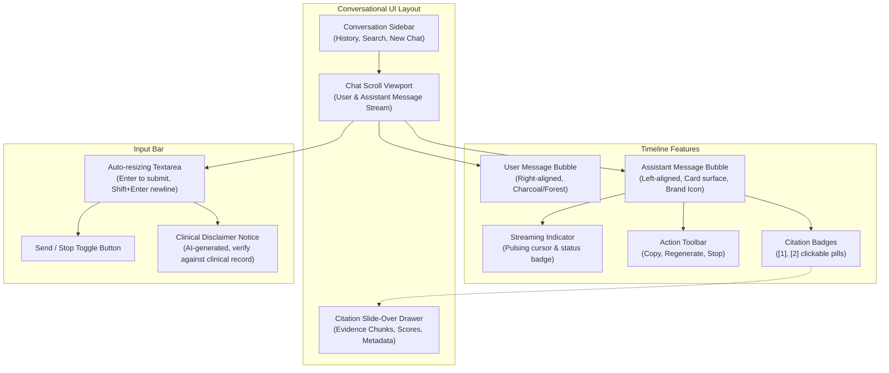
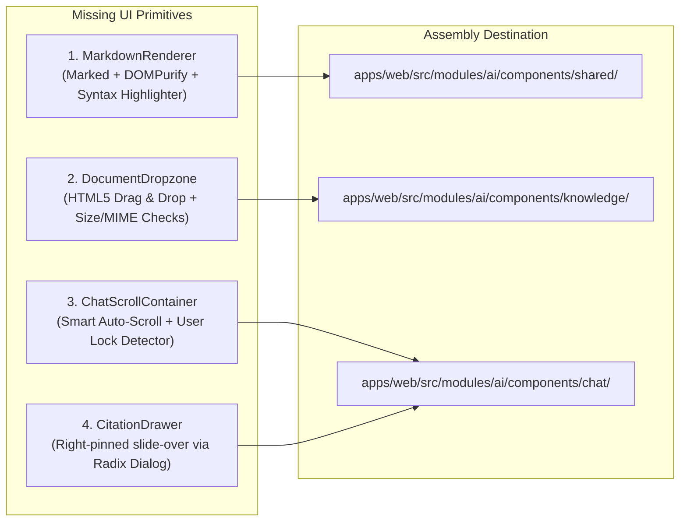

# AI-09.0.02 — Design System & Enterprise Chat UX Audit

- **Milestone:** AI-09 — Conversational AI Experience & Advanced RAG Integration
- **Task:** AI-09.0.02 — Design System & Enterprise Chat UX Audit
- **Date:** 2026-11-21
- **Role:** Principal Software Architect, Senior Frontend Engineer
- **Status:** **COMPLETE (READ-ONLY AUDIT)**
- **Target Deliverable:** `docs/ai/AI-09/AI-09.0.02-design-system-and-chat-ux-audit.md`
- **Execution Guardrail:** Strictly read-only; zero UI code or design tokens modified; zero new components created; zero dependencies installed.

---

## 1. Executive Summary

This audit evaluates the capabilities of the existing Kinergy design system (`@kinergy-platform/ui`) and shared application frontend frameworks (`apps/web/src/shared`) to determine how an **enterprise-grade conversational AI experience ("Kynergy Intelligence")** can be implemented while preserving the brand identity, visual coherence, accessibility standards, and responsive behaviors of the platform.

### Core Audit Verdict

1. **Rich Foundational Design System:** The design system in [`packages/ui`](file:///c:/Projects/kinergy-platform/packages/ui/src/index.ts) is exceptionally mature, built upon Radix UI headless primitives and Tailwind CSS bound to semantic HSL CSS custom variables.
2. **Established Brand Palette Preserved:** Official brand tokens (KIN-BRAND-UI-001) are strictly codified, featuring **Kinergy Green (`#68CE39`)**, **Kinergy Forest (`#3F5F25`)**, **Kinergy Charcoal (`#202522`)**, **Kinergy Soft (`#E5F6D9`)**, and **Kinergy Tint (`#F4FAEF`)**. Contrast calculations meet or exceed WCAG 2.2 AA and AAA standards across both Light and Dark themes.
3. **High Direct Component Reusability (14/18 Primitives Present):** Buttons, inputs, textareas, dialogs, cards, badges, tabs, skeletons, toasts, and complete data tables already exist and can be reused directly without modification.
4. **Four Specific Missing Primitives Identified:**
   - **`MarkdownRenderer`:** While `marked` (v18.2.1) is installed in root dependencies, there is no sanitized React markdown rendering component with syntax-highlighted code blocks.
   - **`DocumentDropzone`:** No drag-and-drop file upload component exists in the design system.
   - **`ChatScrollContainer`:** No auto-scrolling viewport with user scroll-lock detection exists.
   - **`CitationDrawer`:** While `<Dialog />` exists, a dedicated right-aligned slide-over drawer variant must be composed from Radix dialog primitives.

---

## 2. Design Token Inventory

The platform design tokens are defined in [`packages/ui/src/tokens/tokens.config.ts`](file:///c:/Projects/kinergy-platform/packages/ui/src/tokens/tokens.config.ts#L1-L245) and [`apps/web/src/shared/styles/globals.css`](file:///c:/Projects/kinergy-platform/apps/web/src/shared/styles/globals.css#L7-L135).

### 2.1 Official Brand Palette (KIN-BRAND-UI-001)

| Token Name           | Canonical HEX | CSS Custom Property       | Contrast vs Surface (Light / Dark)  | Verified Role in UI                                                              |
| :------------------- | :-----------: | :------------------------ | :---------------------------------: | :------------------------------------------------------------------------------- |
| **Kinergy Green**    |   `#68CE39`   | `var(--kinergy-green)`    |    **7.77:1 (AAA)** on Charcoal     | Primary interactive brand color; dark mode primary action; focus ring indicator. |
| **Kinergy Forest**   |   `#3F5F25`   | `var(--kinergy-forest)`   |      **7.30:1 (AAA)** on White      | Light mode primary action background; dark mode secondary accent.                |
| **Kinergy Charcoal** |   `#202522`   | `var(--kinergy-charcoal)` |     **14.27:1 (AAA)** on White      | Base typography in light mode; container and elevated card surface in dark mode. |
| **Kinergy Soft**     |   `#E5F6D9`   | `var(--kinergy-soft)`     |     **6.44:1 (AA)** with Forest     | Secondary button background; active selection; soft success badge surface.       |
| **Kinergy Tint**     |   `#F4FAEF`   | `var(--kinergy-tint)`     | **4.81:1 (AA)** with Secondary Text | Subtle background tint; muted container background; hover accent.                |

### 2.2 Semantic Status Scales

Codified in `SEMANTIC_STATUS_TOKENS` ([`tokens.config.ts#L45-L70`](file:///c:/Projects/kinergy-platform/packages/ui/src/tokens/tokens.config.ts#L45-L70)):

| Semantic Scale | Default (Solid) | Surface (Soft) |  Border   | Foreground |  Contrast Ratio  | Chat UI Role                                                      |
| :------------- | :-------------: | :------------: | :-------: | :--------: | :--------------: | :---------------------------------------------------------------- |
| **Success**    |    `#3F5F25`    |   `#E5F6D9`    | `#68CE39` | `#FFFFFF`  | **7.30:1 (AAA)** | Grounded answer confirmation badge, indexing complete.            |
| **Warning**    |    `#B45309`    |   `#FEF3C7`    | `#FCD34D` | `#FFFFFF`  | **5.21:1 (AA)**  | Abstention notice, low confidence alert, token truncation.        |
| **Danger**     |    `#B91C1C`    |   `#FEE2E2`    | `#FCA5A5` | `#FFFFFF`  | **6.47:1 (AA)**  | Provider offline (503), timeout (504), failed document ingestion. |
| **Info**       |    `#0369A1`    |   `#E0F2FE`    | `#7DD3FC` | `#FFFFFF`  | **4.67:1 (AA)**  | Informational tips, suggested prompts, active indexing job.       |

### 2.3 Typography, Spacing, Radii, and Shadows

- **Typography Families:**
  - Body & UI: `Inter, system-ui, -apple-system, sans-serif`
  - Monospace & Code: `ui-monospace, SFMono-Regular, Menlo, Monaco, Consolas, monospace`
- **Scale:** `xs` (12px), `sm` (14px), `base` (16px), `lg` (18px), `xl` (20px), `2xl` (24px), `3xl` (30px), `4xl` (36px).
- **Spacing Scale:** Standard 4-based scale: `xs` (4px), `sm` (8px), `md` (16px), `lg` (24px), `xl` (32px), `2xl` (48px).
- **Border Radii:** `--radius: 0.5rem` (8px). Sm: 4px, Md: 6px, Lg: 8px, Full: 9999px. Chat bubbles: 16px with corner taper.
- **Elevation & Shadows:**
  - Card/Bubble Shadow: `sm` (`0 1px 2px 0 rgb(0 0 0 / 0.05)`).
  - Floating Dock / Drawer Shadow: `lg` (`0 10px 15px -3px rgb(0 0 0 / 0.1)`).
  - Glassmorphic Headers & Drawers: `.glass-panel` (`rgba(32, 37, 34, 0.85)` with `backdrop-filter: blur(12px)`).
- **Light & Dark Mode Fidelity:**
  - Managed by `ThemeProvider` ([`theme-provider.tsx`](file:///c:/Projects/kinergy-platform/apps/web/src/app/providers/theme-provider.tsx)) via `.dark` class on root HTML element.
  - Zero hardcoded hex colors in UI components; all styling uses semantic tokens (`bg-background`, `text-foreground`, `bg-card`, `border-border`).

---

## 3. Component Reuse Matrix

The following matrix audits the existing UI component catalog against the requirements for an enterprise conversational interface:

| UI Component Primitive   | Repository Source File                    | Existing State & Capabilities                                                                                                                   | Suitability for Conversational AI | Recommendation                                                                                                   |
| :----------------------- | :---------------------------------------- | :---------------------------------------------------------------------------------------------------------------------------------------------- | :-------------------------------- | :--------------------------------------------------------------------------------------------------------------- |
| **Button**               | `packages/ui/.../button.tsx`              | Polymorphic (`asChild`), variants (`brand`, `primary`, `secondary`, `outline`, `ghost`, `link`), sizes (`sm`, `md`, `lg`, `icon`), focus rings. | **100% Ready**                    | Directly reuse for Send, Stop Generation, Copy, Regenerate, New Chat.                                            |
| **Textarea**             | `packages/ui/.../textarea.tsx`            | Accessible multi-line input, focus visible ring, disabled state, invalid state.                                                                 | **90% Ready**                     | Directly reuse for chat prompt input. Add auto-resize on input growth.                                           |
| **Input**                | `packages/ui/.../input.tsx`               | Standard input with clear focus rings and error states.                                                                                         | **100% Ready**                    | Reuse for conversation search filter and document metadata editing.                                              |
| **Badge / StatusBadge**  | `packages/ui/.../badge.tsx`               | CVA variants (`brand`, `success-soft`, `warning-soft`, `danger-soft`, `info-soft`), sizes (`sm`, `md`).                                         | **100% Ready**                    | Directly reuse for citation reference pills (`[1]`, `[2]`), groundedness indicators, and ingestion job statuses. |
| **Card**                 | `packages/ui/.../card.tsx`                | Modular `CardHeader`, `CardTitle`, `CardDescription`, `CardContent`, `CardFooter`.                                                              | **100% Ready**                    | Directly reuse for suggested prompt cards, source citation preview cards, and document summaries.                |
| **Dialog / Modal**       | `packages/ui/.../dialog.tsx`              | Wraps `@radix-ui/react-dialog`, focus trap, portal to body, Escape key listener, backdrop blur.                                                 | **100% Ready**                    | Directly reuse for document version detail modals and delete confirmation dialogs.                               |
| **Drawer / Slide-Over**  | Missing as explicit named primitive       | Accessible `<Dialog />` primitive exists but defaults to centered modal styling.                                                                | **70% Ready**                     | Compose a `Drawer` component from existing `DialogPrimitive` with right-pinned slide-over CSS classes.           |
| **Tabs**                 | `packages/ui/.../tabs.tsx`                | Accessible Radix tabs (`TabsList`, `TabsTrigger`, `TabsContent`).                                                                               | **100% Ready**                    | Directly reuse for switching between Chat Workspace and Knowledge Base, or Markdown and Raw JSON.                |
| **Skeleton & Spinner**   | `packages/ui/.../skeleton.tsx`            | Accessible pulsing placeholders and SVG spinner with size variants.                                                                             | **100% Ready**                    | Directly reuse for message loading skeletons, sidebar history skeletons, and token generation spinners.          |
| **StateView**            | `packages/ui/.../state-view.tsx`          | Implements mandatory 4-state contract (`Loading`, `Empty`, `Error`, `Populated`).                                                               | **100% Ready**                    | Directly reuse as wrapper for conversation timeline, document table, and citation inspector.                     |
| **EmptyState**           | `apps/web/src/shared/.../empty-state.tsx` | Centered icon, title, description, and action CTA.                                                                                              | **100% Ready**                    | Directly reuse for empty chat history and empty knowledge base screens.                                          |
| **Toast Notifications**  | `NotificationProvider.tsx`                | Contextual notifications (`success`, `error`, `warning`) with sanitized messages.                                                               | **100% Ready**                    | Directly reuse for network disconnects, 503 LLM offline warnings, and upload confirmations.                      |
| **DataTable**            | `apps/web/src/shared/table/`              | TanStack Table v8, column sorting, search, faceted filters, pagination, URL state syncing.                                                      | **100% Ready**                    | Directly reuse for Knowledge Center document inventory and ingestion job logs.                                   |
| **Pagination**           | `apps/web/src/shared/table/...`           | Accessible pagination controls with page size selector.                                                                                         | **100% Ready**                    | Directly reuse with `DataTable` for paginated document lists.                                                    |
| **Tooltip / Popover**    | Custom in `sidebar.tsx` & `user-menu.tsx` | Portal-rendered body floating elements; no primitive in `packages/ui`.                                                                          | **60% Ready**                     | Use existing portal pattern for citation hover previews and action tooltips.                                     |
| **Markdown Renderer**    | Missing component                         | `marked` (v18.2.1) installed in dependencies, but no React component exists.                                                                    | **Missing**                       | Implement `MarkdownRenderer` in `src/modules/ai/components/shared/`.                                             |
| **File Dropzone**        | Missing component                         | Zero drag-and-drop upload components exist.                                                                                                     | **Missing**                       | Implement `DocumentDropzone` in `src/modules/ai/components/knowledge/`.                                          |
| **Chat Scroll Viewport** | Missing component                         | Standard CSS overflow-y exists; lacks smart auto-scroll with user scroll lock detection.                                                        | **Missing**                       | Implement `ChatScrollContainer` in `src/modules/ai/components/chat/`.                                            |

---

## 4. Enterprise Conversational UX Capability Assessment

### 4.1 Chat Workspace & Sidebar

- **Persistent Conversation Sidebar:** Can compose `<Card />`, `<Button variant="ghost" />`, and `<Input />`. The active conversation is highlighted using `bg-accent text-accent-foreground font-medium`.
- **Search & Filtering:** `<Input />` with a search icon from `lucide-react` filters local conversation history titles in real time.
- **Responsive Behavior:** On desktop ($\ge \text{md}$), the conversation sidebar is a persistent 280px left rail. On mobile ($< \text{md}$), it transitions into a slide-over overlay drawer toggled via a hamburger button, mirroring [`Sidebar`](file:///c:/Projects/kinergy-platform/apps/web/src/shared/components/sidebar/sidebar.tsx#L40-L43).

### 4.2 Conversation Interface & Message Formatting

- **Visual Separation of Turns:**
  - **User Message:** Right-aligned bubble, `bg-secondary text-secondary-foreground` (light mode) or `bg-secondary text-foreground` (dark mode), rounded corners (`rounded-2xl rounded-br-sm`), max-width 75%.
  - **Assistant Message:** Left-aligned, `bg-card border border-border/70 text-card-foreground`, rounded corners (`rounded-2xl rounded-bl-sm`), accompanied by a small Kynergy Intelligence avatar.
- **Markdown & Code Rendering:**
  - Must render sanitized HTML using `marked`.
  - Code blocks: Styled with `bg-neutral-900 text-neutral-100 rounded-md p-3 font-mono text-xs overflow-x-auto my-2`, complete with a "Copy Code" button in the upper right corner.
  - Tables: Wrapped in `
` to prevent viewport overflow on narrow screens.
- **Streaming Indicators & Controls:**
  - While tokens are generating: a pulsing cursor (`inline-block w-1.5 h-4 ml-1 bg-primary animate-pulse align-middle`) indicates active streaming.
  - Stop Generation: The Send button dynamically toggles to a red/neutral Stop button (`<Button variant="outline" size="icon"><Square className="h-4 w-4" /></Button>`), dispatching an `AbortController.abort()` signal.
- **Auto-Scroll & Scroll Preservation:**
  - A scroll management hook tracks scroll position: if the user is within 100px of the bottom, the container auto-scrolls down as new tokens stream in.
  - If the user scrolls up to review prior messages, auto-scroll pauses (scroll-lock), presenting a floating "Scroll to Bottom" button.

### 4.3 Knowledge Interactions & Groundedness UX

- **Citation Badges:**
  - Inline references within assistant answers (e.g. `[1]`, `[2]`) render as interactive, clickable pill buttons:
    `<button className="inline-flex items-center px-1.5 py-0.5 mx-0.5 text-xs font-semibold rounded bg-brand/10 text-brand border border-brand/30 hover:bg-brand/20 transition-colors">1</button>`.
- **Citation Drawer:**
  - Clicking a citation opens a slide-over panel on the right displaying:
    - Source document title with link.
    - Page number and hierarchical heading breadcrumbs (`Capítulo 2 > Contraindicaciones`).
    - Exact similarity score (e.g. `Score: 0.942`).
    - Verbatim retrieved chunk text with key search terms highlighted.
- **Groundedness / Abstention Indicator:**
  - If `grounded: true`: Displays `<Badge variant="success-soft"><CheckCircle className="h-3 w-3 mr-1" /> Grounded in Verified Documents</Badge>`.
  - If `grounded: false` (Abstention): Displays `<Badge variant="warning-soft"><AlertTriangle className="h-3 w-3 mr-1" /> Unverified / General Guidance</Badge>`, accompanied by a clear clinical disclaimer.

### 4.4 Knowledge Center (Document Management)

- **Document Table:** Leverages existing [`DataTable`](file:///c:/Projects/kinergy-platform/apps/web/src/shared/table/components/data-table.tsx) with columns: `Title`, `MIME Type`, `Version`, `Chunks`, `Status`, `Uploaded At`, and `Actions`.
- **Drag-and-Drop Dropzone:** A dashed border area (`border-2 border-dashed border-border hover:border-primary/60 transition-colors p-8 text-center rounded-lg`) accepting `.pdf`, `.docx`, `.md`, and `.txt` files up to 25 MB.
- **Ingestion Status Badges:** Uses `<StatusBadge />` to reflect real-time processing states (`UPLOADED`, `PROCESSING`, `INDEXED`, `FAILED`).

---

## 5. Accessibility (WCAG 2.2 AA) & Responsive Evaluation

### 5.1 Contrast & Readability

- All text and interactive surfaces adhere strictly to the verified contrast matrix in [`packages/ui/src/tokens/contrast.ts`](file:///c:/Projects/kinergy-platform/packages/ui/src/tokens/contrast.ts#L1-L100):
  - Primary Forest (`#3F5F25`) on White: **7.30:1** (Exceeds AAA).
  - Charcoal (`#202522`) on White: **14.27:1** (Exceeds AAA).
  - Kinergy Green (`#68CE39`) on Charcoal (Dark mode): **7.77:1** (Exceeds AAA).
  - Muted secondary text (`#68716B`) on Light background: **4.81:1** (Exceeds AA).

### 5.2 Keyboard Navigation & Focus Management

- **Full Tab Traversal:** Users can tab seamlessly through conversation history, message action buttons, citation pills, and the chat input bar.
- **Visible Focus Rings:** All buttons, inputs, and citation triggers include `focus-visible:ring-2 focus-visible:ring-ring focus-visible:ring-offset-2`.
- **Escape Key Handling:** Pressing `Escape` closes active citation drawers, dropzone dialogs, or mobile sidebars, returning focus to the triggering element.
- **Keyboard Shortcuts:** `Enter` to send message; `Shift+Enter` for multi-line newline; `Ctrl+K` or `Cmd+K` to search conversations.

### 5.3 Screen Reader Accessibility & Assistive Tech

- **`aria-live="polite"`:** The message timeline container must announce incoming assistant responses when generation completes without aggressively interrupting active screen reader narration.
- **`aria-busy="true"`:** Set on the assistant message container while token streaming is in progress.
- **Semantic Roles:** Messages wrapped in `<article aria-label="Message from Assistant">` and `<article aria-label="Message from You">`.
- **Citation Link Semantics:** Citation buttons use `aria-label="View citation 1: Manual de Kinesiología, page 14"`.

### 5.4 Reduced Motion & Overflow Protection

- **Reduced Motion:** Animations respect `@media (prefers-reduced-motion: reduce)`. Cursor pulsing, drawer slide-ins, and skeleton loaders disable transitions when user prefers reduced motion.
- **Table & Code Block Overflow:** Assistant responses containing markdown tables or wide code snippets must have explicit horizontal scrolling (`overflow-x-auto`) to prevent horizontal layout blowout on mobile screens.

---

## 6. Missing Components Inventory & Implementation Path

The following four primitives are not currently in the design system and will be required during implementation:

1. **`MarkdownRenderer` Component:**
   - **Need:** Parse and render LLM markdown output with sanitized HTML, code syntax highlighting, and table containers.
   - **Implementation Strategy:** Construct a lightweight component wrapping `marked` in `src/modules/ai/components/shared/markdown-renderer.tsx`. Use a DOM sanitizer to neutralize XSS vectors.
2. **`DocumentDropzone` Component:**
   - **Need:** Drag-and-drop file upload zone for clinical PDF/DOCX manuals.
   - **Implementation Strategy:** Construct an accessible file input component with drag events in `src/modules/ai/components/knowledge/document-upload-dropzone.tsx`.
3. **`ChatScrollContainer` Component:**
   - **Need:** Viewport that automatically scrolls down as tokens stream in, but releases lock if user scrolls up.
   - **Implementation Strategy:** Implement a React container with `useRef` and `onScroll` listener in `src/modules/ai/components/chat/chat-scroll-container.tsx`.
4. **`CitationDrawer` Component:**
   - **Need:** Right-pinned slide-over panel displaying evidence chunk text.
   - **Implementation Strategy:** Compose directly from `@radix-ui/react-dialog` primitives in `src/modules/ai/components/chat/citation-drawer.tsx` using Tailwind slide-over animations.

---

## 7. Strategic Recommendations for the Future Chat Interface

1. **Dual Surface Strategy:**
   - **Surface A — Full Workspace (`/intelligence/chat`):** For deep research, clinical protocol exploration, and document analysis.
   - **Surface B — Global Assistant Drawer:** Launched via `<SlotInject target="header-actions">` in the top header. Allows physiotherapists, trainers, and receptionists to ask quick operational questions from anywhere in the platform without losing their current page context.
2. **Zero External CSS / Component Libraries:**
   - Avoid installing heavy chat libraries (e.g., `@chatscope`, `copilot-kit`). The existing `@kinergy-platform/ui` design system and Radix primitives are more than sufficient to build a bespoke, high-performance chat interface.
3. **Clinical Disclaimer Permanence:**
   - Every assistant answer must maintain a subtle, persistent footer:
     _"Kynergy Intelligence provides decision support based on uploaded clinic documentation. Verify clinical protocols against patient records."_
4. **Resilient Offline / Mock Fallback UX:**
   - When the local Ollama daemon is offline or starting up, the interface should render a clear, non-blocking alert banner with a "Check Service Status" retry button (Rule 6 compliance).

---

## 8. Audit Conclusion & Next Steps

The existing Kynergy design system and component catalog are **fully equipped** to support an enterprise-grade conversational AI experience:

- All core visual tokens, contrast baselines, and brand identities are Codified and Preserved.
- 14 out of 18 necessary component primitives already exist and will be reused directly.
- The 4 missing primitives are domain-specific composition assemblies that can be built cleanly within the AI module directory.
- No application files, styles, or dependencies were altered during this audit.

**Audit Status:** **PASS — AWAITING ARCHITECTURAL APPROVAL TO PROCEED TO AI-09.0.03**
