# AI-09.0.04 — AI Backend Architecture & API Inventory

**Milestone:** AI-09 Kynergy Intelligence Frontend Integration  
**Document ID:** `AI-09.0.04`  
**Phase:** 0 — Integration Audits  
**Role:** Principal Software Architect & Senior Frontend Engineer  
**Status:** Complete  
**Date:** 2026-11-21  
**Target File:** `docs/ai/AI-09/AI-09.0.04-ai-backend-api-inventory.md`

---

## 1. Executive Summary

This audit establishes the concrete backend capabilities, endpoints, data transfer objects (DTOs), ports, domain services, persistence layers, and architectural boundaries available to the frontend within the Kynergy platform.

### Key Audit Findings

1. **Implemented Backend Capabilities:**
   - **Document Knowledge Base:** Complete document lifecycle management (`POST /api/v1/ai/knowledge/documents`, `GET`, `PATCH`, `DELETE`), versioning (`/versions`), raw content binary streaming (`/content`), and asynchronous ingestion job management (`/ingestion`, `/retry`, `/cancel`).
   - **Hybrid Retrieval Pipeline:** Dense vector search (`pgvector` HNSW with 1024-dimension BGE-M3 embeddings) combined with full-text search (`tsvector` with Spanish & English dictionaries) fused via Reciprocal Rank Fusion ($k=60$).
   - **RAG Synthesis Orchestration:** Fully grounded response generation via local Ollama LLM (`qwen3:4b`), multi-turn contextual refinement, and source citation extraction with strict confidence scoring.
   - **Health Monitoring:** Granular subsystem health checks (`GET /api/v1/ai/health`) inspecting Ollama LLM/Embedding connectivity, PostgreSQL database connectivity, and pgvector extension readiness.
2. **Partially Implemented & Missing Frontend Capabilities:**
   - **Conversation Management:** While `ConversationHistoryManagerService` and domain session entities exist, persistence is in-memory only (`InMemoryConversationRepositoryAdapter`). No dedicated `AiConversationController` exists to list, fetch, or delete past user conversation threads.
   - **Streaming Transport:** `ILLMProviderPort.generateStream()` is fully supported at the port and adapter level (`OllamaLLMAdapter`), but `AiRAGController` currently exposes only a blocking synchronous HTTP `POST` returning a monolithic `RAGAnswerResponseDto`.
   - **Granular RBAC Permissions:** `AiRAGController` relies exclusively on authenticated JWT sessions (`AuthenticationGuard` + `AuthorizationGuard`) without `@RequirePermissions` annotations, resolving access visibility dynamically via user role mapping (`UserRole.SUPER_ADMIN` down to `UserRole.COLLABORATOR`).

---

## 2. AI Backend Architecture Diagram

The backend follows Hexagonal / Clean Architecture conventions within NestJS (`apps/api/src/ai/`), consuming the domain and application use cases from `@kynergy/core` (`packages/core/src/ai/`).

```mermaid
flowchart TD
    subgraph Client["Frontend Client (React SPA)"]
        UI["Kynergy Intelligence UI"]
    end

    subgraph API["NestJS API Layer (apps/api/src/ai)"]
        GlobalGuard["Global Guards: ThrottlerGuard, AuthenticationGuard, AuthorizationGuard"]

        subgraph Controllers["REST Controllers (/api/v1/ai)"]
            HealthCtrl["AiHealthController\nGET /health"]
            DocCtrl["AiDocumentController\n/knowledge/documents (CRUD, Versions, Ingestion)"]
            RAGCtrl["AiRAGController\nPOST /knowledge/query (Grounded Synthesis)"]
        end

        subgraph Adapters["Infrastructure Adapters"]
            DocStorage["LocalDocumentStorageAdapter\n(FileSystemStorageAdapter)"]
            DocRepo["PrismaKnowledgeDocumentRepository"]
            ChunkRepo["PrismaKnowledgeChunkRepository"]
            IngestRepo["PrismaIngestionJobRepository"]
            OllamaLLM["OllamaLLMAdapter\n(qwen3:4b)"]
            OllamaEmbed["OllamaEmbeddingAdapter\n(bge-m3:1024)"]
            InMemoryConv["InMemoryConversationRepositoryAdapter"]
        end
    end

    subgraph Core["Core Application & Domain (packages/core/src/ai)"]
        subgraph UseCases["Application Use Cases & Orchestrators"]
            DocUpload["SecureDocumentUploadService"]
            IngestOrch["IngestionOrchestratorService"]
            RAGOrch["RAGOrchestratorService"]
            CtxBuilder["RAGContextBuilderService"]
            GroundGen["GroundedGenerationService"]
            ConvMgr["ConversationHistoryManagerService"]
        end

        subgraph Ports["Domain Ports (Interfaces)"]
            ILLM["ILLMProviderPort"]
            IEmbed["IEmbeddingProviderPort"]
            IDocStore["IDocumentStoragePort"]
            IKnowledgeRepo["IKnowledgeDocumentRepositoryPort"]
            IChunkRepo["IKnowledgeChunkRepositoryPort"]
            IIngestRepo["IIngestionJobRepositoryPort"]
            IConvRepo["IConversationRepositoryPort"]
        end
    end

    subgraph Persistence["Persistence & External Services"]
        PG[("PostgreSQL\n- knowledge_documents\n- knowledge_chunks (pgvector 1024)\n- ingestion_jobs")]
        OllamaEngine["Ollama Runtime (Local / Container)\n- LLM: qwen3:4b\n- Embed: bge-m3"]
        DiskStorage[("Local File Storage / Uploads")]
    end

    %% Flows
    UI -->|Bearer JWT + HTTP/JSON| GlobalGuard
    GlobalGuard --> Controllers
    HealthCtrl --> OllamaLLM
    HealthCtrl --> OllamaEmbed
    HealthCtrl --> PG

    DocCtrl --> DocUpload
    DocCtrl --> IngestOrch
    DocCtrl --> DocRepo
    DocCtrl --> IngestRepo

    RAGCtrl --> RAGOrch
    RAGOrch --> ConvMgr
    RAGOrch --> CtxBuilder
    RAGOrch --> ChunkRepo
    RAGOrch --> GroundGen

    DocUpload --> IDocStore
    DocUpload --> IKnowledgeRepo
    IngestOrch --> IChunkRepo
    IngestOrch --> IEmbed
    GroundGen --> ILLM

    IDocStore -.-> DocStorage -.-> DiskStorage
    IKnowledgeRepo -.-> DocRepo -.-> PG
    IChunkRepo -.-> ChunkRepo -.-> PG
    IIngestRepo -.-> IngestRepo -.-> PG
    ILLM -.-> OllamaLLM -.-> OllamaEngine
    IEmbed -.-> OllamaEmbed -.-> OllamaEngine
    IConvRepo -.-> InMemoryConv
```



---

## 3. Module & Service Inventory

### 3.1 NestJS Module Boundaries (`apps/api/src/ai/ai.module.ts`)

| Component Type    | Identifier / Class     | Responsibility                                                                                              | Lifecycle Scope |
| :---------------- | :--------------------- | :---------------------------------------------------------------------------------------------------------- | :-------------- |
| **Module**        | `AiModule`             | Root AI feature module importing `PrismaModule`, configuring controllers, and wiring infrastructure tokens. | Singleton       |
| **Controller**    | `AiHealthController`   | Exposes liveness, readiness, and deep dependency health metrics for Ollama and pgvector.                    | Singleton       |
| **Controller**    | `AiDocumentController` | Exposes REST endpoints for document upload, metadata updates, versioning, downloads, and ingestion jobs.    | Singleton       |
| **Controller**    | `AiRAGController`      | Exposes grounded RAG synthesis query endpoint, mapping incoming requests to `RAGOrchestratorService`.       | Singleton       |
| **Configuration** | `aiConfig`             | Validates environment variables (`AI_LLM_PROVIDER`, `AI_OLLAMA_BASE_URL`, `AI_EMBEDDING_PROVIDER`, etc.).   | Singleton       |

### 3.2 Injection Tokens & Provider Bindings (`apps/api/src/ai/ai.tokens.ts`)

The API decouples domain use cases from concrete drivers through explicit NestJS injection tokens:

| Injection Token Symbol                   | Bound Class / Implementation             | Port Interface                     | Description                                                                |
| :--------------------------------------- | :--------------------------------------- | :--------------------------------- | :------------------------------------------------------------------------- |
| `AI_LLM_PROVIDER_TOKEN`                  | `OllamaLLMAdapter` (or `MockLLMAdapter`) | `ILLMProviderPort`                 | Dispatches completion and streaming requests to Ollama API.                |
| `AI_EMBEDDING_PROVIDER_TOKEN`            | `OllamaEmbeddingAdapter`                 | `IEmbeddingProviderPort`           | Generates 1024-dimension float vectors using BGE-M3.                       |
| `AI_DOCUMENT_STORAGE_PORT_TOKEN`         | `FileSystemStorageAdapter`               | `IDocumentStoragePort`             | Persists original binary files (PDF/DOCX/MD) on storage.                   |
| `AI_KNOWLEDGE_DOCUMENT_REPOSITORY_TOKEN` | `PrismaKnowledgeDocumentRepository`      | `IKnowledgeDocumentRepositoryPort` | CRUD on `knowledge_documents` and `document_versions`.                     |
| `AI_KNOWLEDGE_CHUNK_REPOSITORY_TOKEN`    | `PrismaKnowledgeChunkRepository`         | `IKnowledgeChunkRepositoryPort`    | Stores chunk text, metadata, and manages `vector(1024)` pgvector indexing. |
| `AI_INGESTION_JOB_REPOSITORY_TOKEN`      | `PrismaIngestionJobRepository`           | `IIngestionJobRepositoryPort`      | State tracking, step logging, and retry counts on `ingestion_jobs`.        |
| `AI_CONVERSATION_REPOSITORY_TOKEN`       | `InMemoryConversationRepositoryAdapter`  | `IConversationRepositoryPort`      | Ephemeral session state store (pending persistent database adapter).       |

---

## 4. Full Endpoint Inventory

All endpoints are prefixed with the global API prefix: `/api/v1`.

### 4.1 Subsystem Health Endpoints (`AiHealthController`)

#### `GET /api/v1/ai/health`

- **Method:** `GET`
- **Controller:** `AiHealthController.getHealth()`
- **Authentication:** Public / Internal (`@SkipThrottle()`)
- **Required Permissions:** None
- **Request Parameters / Body:** None
- **Response DTO:** `AiSubsystemHealth`
  ```typescript
  interface AiSubsystemHealth {
    status: 'healthy' | 'degraded' | 'unhealthy';
    timestamp: string;
    subsystems: {
      llm: {
        status: 'healthy' | 'unhealthy';
        provider: string;
        model: string;
        latencyMs?: number;
        error?: string;
      };
      embedding: {
        status: 'healthy' | 'unhealthy';
        provider: string;
        model: string;
        dimensions: number;
        latencyMs?: number;
        error?: string;
      };
      vectorDatabase: {
        status: 'healthy' | 'unhealthy';
        provider: 'pgvector';
        table: string;
        extensionAvailable?: boolean;
        error?: string;
      };
    };
  }
  ```
- **HTTP Status Codes:** `200 OK` (subsystem may be `degraded` or `unhealthy` within the body).

---

### 4.2 Grounded RAG Query Endpoints (`AiRAGController`)

#### `POST /api/v1/ai/knowledge/query`

- **Alternative Route Aliases:** `/api/v1/ai/rag/query`, `/api/v1/ai/query`
- **Method:** `POST`
- **Controller:** `AiRAGController.queryKnowledge()`
- **Authentication:** Required (`AuthenticationGuard`, `AuthorizationGuard` — Bearer JWT)
- **Required Permissions:** None registered (`@RequirePermissions` absent). Access is governed by caller tenant ID (`req.user.tenantId`) and caller role-to-visibility scope resolution.
- **Request Headers:**
  - `Authorization: Bearer <access_token>`
  - `Content-Type: application/json`
- **Request DTO (`QueryKnowledgeRequestDto`):**
  | Field                 | Type      | Validation Rules                                                      | Description                                                 |
  | :-------------------- | :-------- | :-------------------------------------------------------------------- | :---------------------------------------------------------- |
  | `query`               | `string`  | `@IsString()`, `@IsNotEmpty()`, `@MinLength(3)`, `@MaxLength(2000)`   | User's conversational query or prompt.                      |
  | `searchMode`          | `enum`    | `@IsOptional()`, `@IsEnum(SearchMode)` (`dense` \| `fts` \| `hybrid`) | Default: `hybrid`.                                          |
  | `topK`                | `number`  | `@IsOptional()`, `@IsInt()`, `@Min(1)`, `@Max(50)`                    | Default: `10` candidate chunks.                             |
  | `similarityThreshold` | `number`  | `@IsOptional()`, `@IsNumber()`, `@Min(0.0)`, `@Max(1.0)`              | Default: `0.65`.                                            |
  | `conversationId`      | `string`  | `@IsOptional()`, `@IsUUID()`                                          | Correlates query to conversation history.                   |
  | `conversationHistory` | `array`   | `@IsOptional()`, `@IsArray()`, `@ValidateNested({ each: true })`      | Array of `ConversationTurnDto` objects (`role`, `content`). |
  | `includeCitations`    | `boolean` | `@IsOptional()`, `@IsBoolean()`                                       | Default: `true`.                                            |
- **Response DTO (`RAGAnswerResponseDto`):**
  ```typescript
  interface RAGAnswerResponseDto {
    answer: string;
    grounded: boolean;
    confidenceScore: number;
    searchModeUsed: 'dense' | 'fts' | 'hybrid';
    chunksRetrieved: number;
    sources: Array<{
      documentId: string;
      documentTitle: string;
      chunkId: string;
      chunkIndex: number;
      similarityScore: number;
      snippet: string;
      versionNumber: number;
      mimeType: string;
      metadata: Record<string, unknown>;
    }>;
    metadata: {
      retrievalDurationMs: number;
      generationDurationMs: number;
      totalDurationMs: number;
      tokensGenerated?: number;
      modelUsed: string;
      evaluationReport?: {
        isGrounded: boolean;
        hallucinationScore: number;
        coverageScore: number;
        unsupportedClaims: string[];
      };
    };
  }
  ```
- **Error Responses & Status Codes:**
  - `400 Bad Request`: Validation failure on request body.
  - `401 Unauthorized`: Missing, invalid, or expired JWT.
  - `403 Forbidden`: Cross-tenant boundary violation or invalid tenant context.
  - `503 Service Unavailable`: Local Ollama LLM / embedding engine offline or unreachable.
  - `504 Gateway Timeout`: Generation pipeline exceeded configured timeout (`AI_LLM_TIMEOUT_MS`).

---

### 4.3 Knowledge Base Document Endpoints (`AiDocumentController`)

All document endpoints are mounted at `/api/v1/ai/knowledge/documents` (with legacy fallback alias `/api/v1/ai/documents`).

#### 1. `POST /api/v1/ai/knowledge/documents` (Upload Document)

- **Method:** `POST`
- **Content-Type:** `multipart/form-data`
- **File Interceptor:** `FileInterceptor('file')` (`maxFileSize: 52428800` = 50 MB)
- **Allowed MIME Types:** `application/pdf`, `application/vnd.openxmlformats-officedocument.wordprocessingml.document`, `text/markdown`, `text/plain`.
- **Form Body (`UploadDocumentRequestDto`):**
  - `title`: `string` (`@IsNotEmpty()`, `@MaxLength(255)`)
  - `description`: `string` (`@IsOptional()`, `@MaxLength(1000)`)
  - `visibilityScope`: `string` (`@IsEnum(VisibilityScope)`: `GLOBAL` | `ORGANIZATION` | `DEPARTMENT` | `PRIVATE`)
  - `mimeType`: `string` (`@IsEnum(AllowedMimeTypes)`)
- **Response DTO:** `UploadDocumentResponseDto` (`201 Created`)
  ```typescript
  interface UploadDocumentResponseDto {
    documentId: string;
    versionId: string;
    versionNumber: number;
    status: 'ACTIVE' | 'ARCHIVED' | 'PROCESSING';
    ingestionJobId: string;
    createdAt: string;
  }
  ```

#### 2. `GET /api/v1/ai/knowledge/documents` (List Documents)

- **Method:** `GET`
- **Query Parameters (`ListDocumentsQueryDto`):**
  - `page`: `number` (Default: `1`, `@Min(1)`)
  - `limit`: `number` (Default: `20`, `@Min(1)`, `@Max(100)`)
  - `search`: `string` (Optional substring match on title/description)
  - `visibilityScope`: `enum` (`GLOBAL`, `ORGANIZATION`, `DEPARTMENT`, `PRIVATE`)
  - `mimeType`: `string` (Optional)
  - `uploadedBy`: `string` (Optional UUID)
  - `createdFrom`: `ISO date string` (Optional)
  - `createdTo`: `ISO date string` (Optional)
  - `orderBy`: `string` (`createdAt` | `title` | `updatedAt`)
  - `orderDirection`: `string` (`ASC` | `DESC`)
- **Response DTO:** `PaginatedDocumentsResponseDto` (`200 OK`)
  ```typescript
  interface PaginatedDocumentsResponseDto {
    items: Array<{
      id: string;
      tenantId: string;
      title: string;
      description?: string;
      mimeType: string;
      status: 'ACTIVE' | 'ARCHIVED' | 'PROCESSING';
      visibilityScope: 'GLOBAL' | 'ORGANIZATION' | 'DEPARTMENT' | 'PRIVATE';
      currentVersionNumber: number;
      latestIngestionStatus:
        | 'PENDING'
        | 'PARSING'
        | 'CHUNKING'
        | 'EMBEDDING'
        | 'INDEXING'
        | 'COMPLETED'
        | 'FAILED'
        | 'CANCELLED';
      totalChunks: number;
      createdAt: string;
      updatedAt: string;
    }>;
    total: number;
    page: number;
    limit: number;
    totalPages: number;
  }
  ```

#### 3. `GET /api/v1/ai/knowledge/documents/:id` (Get Document Detail)

- **Method:** `GET`
- **Params:** `id: UUID`
- **Response DTO:** `DocumentDetailResponseDto` (`200 OK`, `404 Not Found`)
  Returns document record, metadata, version history list, and active ingestion job summary.

#### 4. `PATCH /api/v1/ai/knowledge/documents/:id` (Update Document Metadata)

- **Method:** `PATCH`
- **Params:** `id: UUID`
- **Request Body (`UpdateDocumentMetadataRequestDto`):**
  - `title`: `string` (`@IsOptional()`, `@MaxLength(255)`)
  - `description`: `string` (`@IsOptional()`, `@MaxLength(1000)`)
  - `visibilityScope`: `string` (`@IsOptional()`, `@IsEnum(VisibilityScope)`)
- **Response DTO:** `DocumentDetailResponseDto` (`200 OK`)

#### 5. `DELETE /api/v1/ai/knowledge/documents/:id` (Soft Delete Document)

- **Method:** `DELETE`
- **Params:** `id: UUID`
- **Response:** `204 No Content` (Marks document as `ARCHIVED` and removes vector index entries).

#### 6. `GET /api/v1/ai/knowledge/documents/:id/versions` (List Versions)

- **Method:** `GET`
- **Response:** `DocumentVersionResponseDto[]` (`200 OK`)

#### 7. `GET /api/v1/ai/knowledge/documents/:id/versions/:versionId` (Get Version Detail)

- **Method:** `GET`
- **Response:** `DocumentVersionResponseDto` (`200 OK`, `404 Not Found`)

#### 8. `POST /api/v1/ai/knowledge/documents/:id/versions` (Create Version)

- **Method:** `POST`
- **Content-Type:** `multipart/form-data` (file: Binary buffer)
- **Response:** `DocumentVersionResponseDto` (`201 Created`)

#### 9. `GET /api/v1/ai/knowledge/documents/:id/content` (Download Raw Binary)

- **Method:** `GET`
- **Response:** Streamed binary payload (`Content-Type: <mime>`, `Content-Disposition: attachment; filename="..."`).

#### 10. `GET /api/v1/ai/knowledge/documents/:id/versions/:versionId/content` (Download Version Binary)

- **Method:** `GET`
- **Response:** Streamed binary payload for specific version.

#### 11. `GET /api/v1/ai/knowledge/documents/:id/ingestion` (List Ingestion Jobs)

- **Method:** `GET`
- **Response:** `IngestionJobResponseDto[]` (`200 OK`)
  Contains step-level logs, status (`PARSING`, `CHUNKING`, `EMBEDDING`, `INDEXING`, `COMPLETED`, `FAILED`), and chunk count.

#### 12. `POST /api/v1/ai/knowledge/documents/:id/ingestion/retry` (Retry Ingestion)

- **Method:** `POST`
- **Response:** `IngestionJobResponseDto` (`200 OK`)

#### 13. `POST /api/v1/ai/knowledge/documents/:id/ingestion/cancel` (Cancel Ingestion)

- **Method:** `POST`
- **Request Body (`CancelIngestionJobRequestDto`):**
  - `reason`: `string` (`@IsNotEmpty()`)
- **Response:** `IngestionJobResponseDto` (`200 OK`)

---

## 5. Capability Implementation Matrix

| AI Capability               | Status                  | Backend Component / Technology                                    | Frontend Readiness & Availability                      |
| :-------------------------- | :---------------------- | :---------------------------------------------------------------- | :----------------------------------------------------- |
| **AI Provider Abstraction** | `IMPLEMENTED`           | `ILLMProviderPort`, `IEmbeddingProviderPort`                      | Fully decoupled via DI tokens                          |
| **LLM Integration**         | `IMPLEMENTED`           | `OllamaLLMAdapter` (`qwen3:4b`)                                   | Accessible via `POST /ai/knowledge/query`              |
| **Embedding Provider**      | `IMPLEMENTED`           | `OllamaEmbeddingAdapter` (`bge-m3:1024`)                          | Executed internally during ingestion/search            |
| **Document Ingestion**      | `IMPLEMENTED`           | `SecureDocumentUploadService`, `IngestionOrchestratorService`     | Full REST API on `AiDocumentController`                |
| **Document Parsing**        | `IMPLEMENTED`           | PDF (`pdf-parse`), DOCX (`mammoth`), Text/MD (`utf-8`)            | Handled internally in ingestion worker                 |
| **Text Normalization**      | `IMPLEMENTED`           | `DeterministicDocumentNormalizerService` (Unicode NFKC, Language) | Handled internally in pipeline                         |
| **Chunking Engine**         | `IMPLEMENTED`           | `StructureAwareChunkerService` (512 tokens, 64 overlap)           | Handled internally in pipeline                         |
| **Chunk Persistence**       | `IMPLEMENTED`           | `PrismaKnowledgeChunkRepository` (`knowledge_chunks` table)       | Handled via Prisma PostgreSQL                          |
| **Embedding Generation**    | `IMPLEMENTED`           | `EmbeddingGenerationPipelineService`                              | Batched generation (32 chunks/batch)                   |
| **Vector Persistence**      | `IMPLEMENTED`           | PostgreSQL `pgvector` (`vector(1024)`, HNSW cosine index)         | Handled via PostgreSQL `pgvector`                      |
| **Hybrid Retrieval**        | `IMPLEMENTED`           | Dense HNSW + Full-Text Search (`tsvector`) + RRF ($k=60$)         | Fully operational in `RAGOrchestratorService`          |
| **RAG Orchestration**       | `IMPLEMENTED`           | `RAGOrchestratorService`, `RAGContextBuilderService`              | Accessible via `POST /ai/knowledge/query`              |
| **Answer Generation**       | `IMPLEMENTED`           | `GroundedGenerationService` (`qwen3:4b`)                          | Grounded answer returned in JSON response              |
| **Citation Generation**     | `IMPLEMENTED`           | `CitationValidatorService` (Source attribution extraction)        | Returned in `RAGAnswerResponseDto.sources`             |
| **Conversation Management** | `PARTIALLY IMPLEMENTED` | `ConversationHistoryManagerService`, `ConversationSession`        | In-memory session tracking only; **no REST endpoints** |
| **Message Persistence**     | `PARTIALLY IMPLEMENTED` | `InMemoryConversationRepositoryAdapter`                           | Not persisted across server restarts                   |
| **Streaming Responses**     | `PLANNED`               | `ILLMProviderPort.generateStream()` (SSE / ReadableStream)        | **Blocked** at controller layer (HTTP blocking only)   |
| **Rate Limiting**           | `PARTIALLY IMPLEMENTED` | Global `ThrottlerGuard` active, `@Throttle()` omitted on AI       | Vulnerable to resource exhaustion during high load     |

---

## 6. Error-Handling Conventions & Status Codes

All backend controllers inherit the global exception handling pipeline defined in `GlobalExceptionFilter` (`apps/api/src/common/filters/global-exception.filter.ts`).

### 6.1 Standard Error Envelope Format (RFC 7807 Compliant)

```json
{
  "type": "https://api.kynergy.com/errors/RESOURCE_NOT_FOUND",
  "title": "Document Not Found",
  "status": 404,
  "detail": "Document with id 6b4f74d0-9d0b-4171-8051-cc8097b8a74e does not exist or has been deleted.",
  "instance": "/api/v1/ai/knowledge/documents/6b4f74d0-9d0b-4171-8051-cc8097b8a74e",
  "timestamp": "2026-11-21T15:30:00.000Z",
  "traceId": "req-a7f439b1",
  "errors": []
}
```

### 6.2 Domain Exception to HTTP Status Mapping

| Domain Exception (from `@kynergy/core`) | NestJS HTTP Exception         | HTTP Status Code          | Frontend Handling Strategy                         |
| :-------------------------------------- | :---------------------------- | :------------------------ | :------------------------------------------------- |
| `DocumentNotFoundException`             | `NotFoundException`           | `404 Not Found`           | Redirect to Document List / Display NotFound state |
| `UnsupportedMimeTypeException`          | `BadRequestException`         | `400 Bad Request`         | Display file format error toast in upload dialog   |
| `DocumentPayloadTooLargeException`      | `PayloadTooLargeException`    | `413 Payload Too Large`   | Display size limit warning (Max 50 MB)             |
| `UnauthorizedDocumentAccessException`   | `ForbiddenException`          | `403 Forbidden`           | Display authorization banner / access denied       |
| `LLMProviderUnavailableException`       | `ServiceUnavailableException` | `503 Service Unavailable` | Display retry banner with AI offline status        |
| `LLMTimeoutException`                   | `GatewayTimeoutException`     | `504 Gateway Timeout`     | Offer "Retry Generation" action to user            |
| `ValidationPipe` Error                  | `BadRequestException`         | `400 Bad Request`         | Highlight invalid form fields                      |

---

## 7. Backend vs Frontend Separation of Responsibilities

To avoid architectural leakage and preserve clean boundaries, responsibilities must be segregated as follows:

| Functional Responsibility | Frontend Role (`apps/web`)                                            | Backend API Role (`apps/api`)                                            | AI Core / Workers (`packages/core`)                    |
| :------------------------ | :-------------------------------------------------------------------- | :----------------------------------------------------------------------- | :----------------------------------------------------- |
| **Conversational State**  | Local session store, active conversation ID, draft prompt management. | Context aggregation, multi-turn history injection.                       | Prompt templating and context window token pruning.    |
| **Document Upload**       | Client-side MIME validation, drag-and-drop UI, upload progress bar.   | Multipart parsing, storage dispatch, initial version creation.           | Asynchronous parsing, chunking, embedding generation.  |
| **Access Control**        | UI visibility gating, disabled actions based on JWT claims.           | Multi-tenant tenant ID enforcement, SQL isolation, visibility filtering. | Tenant-scoped similarity queries on pgvector.          |
| **Citation Attribution**  | Interactive citation chips, snippet popover modals, source badges.    | Citation extraction, relevance confidence calculation.                   | Grounded claim verification and hallucination scoring. |
| **Retry & Error States**  | Optimistic UI rollback, retry buttons, error banners.                 | Transaction rollback, failed job status persistence.                     | Exponential backoff for Ollama API dispatches.         |

---

## 8. Missing Backend Capabilities & Integration Recommendations

To deliver a production-grade enterprise conversational experience in Phase 1 (`AI-09.1+`), the following backend enhancements should be scheduled:

### 1. Missing Conversation Management REST API (`AiConversationController`)

Currently, conversational turns must be supplied manually in `QueryKnowledgeRequestDto.conversationHistory` on every single request.

- **Recommended Endpoints:**
  - `GET /api/v1/ai/conversations`: List user conversation threads with pagination and search.
  - `GET /api/v1/ai/conversations/:id`: Retrieve historical turns and messages for a thread.
  - `DELETE /api/v1/ai/conversations/:id`: Delete or archive a conversation.
- **Frontend Mitigation:** Until backend conversation persistence is deployed, the frontend must persist active conversation turns in client-side state (`localStorage` or `sessionStorage`) and transmit the recent turn window in `conversationHistory`.

### 2. Streaming Transport Support (SSE)

- Currently, users must wait 2.0 to 8.0 seconds for the entire LLM generation to complete before receiving a response.
- **Recommended Endpoint:** `GET /api/v1/ai/knowledge/query/stream?query=...` or `POST /api/v1/ai/knowledge/query/stream` using Server-Sent Events (`text/event-stream`).
- **Frontend Mitigation:** The frontend chat UX must present a deterministic loading skeleton and progress state while awaiting the synchronous JSON response.

### 3. Formal RBAC Permission Constants

- The backend permissions catalog (`PERMISSIONS` enum) does not currently declare `ai.chat.query` or `ai.knowledge.manage`.
- **Frontend Mitigation:** Rely on user role-to-visibility mappings (`SUPER_ADMIN`, `ADMIN`, `ENERGY_MANAGER`, `OPERATOR`, `COLLABORATOR`) as verified in audit `AI-09.0.03`.

---

## 9. Conclusion & Audit Sign-Off

The Kynergy backend provides an exceptionally solid, secure, and production-ready foundation for Document Knowledge Base management and hybrid RAG querying. All core capabilities required to build the Knowledge Center UI and conversational RAG interface are fully implemented and functional over clean REST/JSON interfaces.

The frontend integration can proceed into design and execution planning with clear knowledge of available DTOs, endpoint signatures, error codes, and client-side responsibilities.
