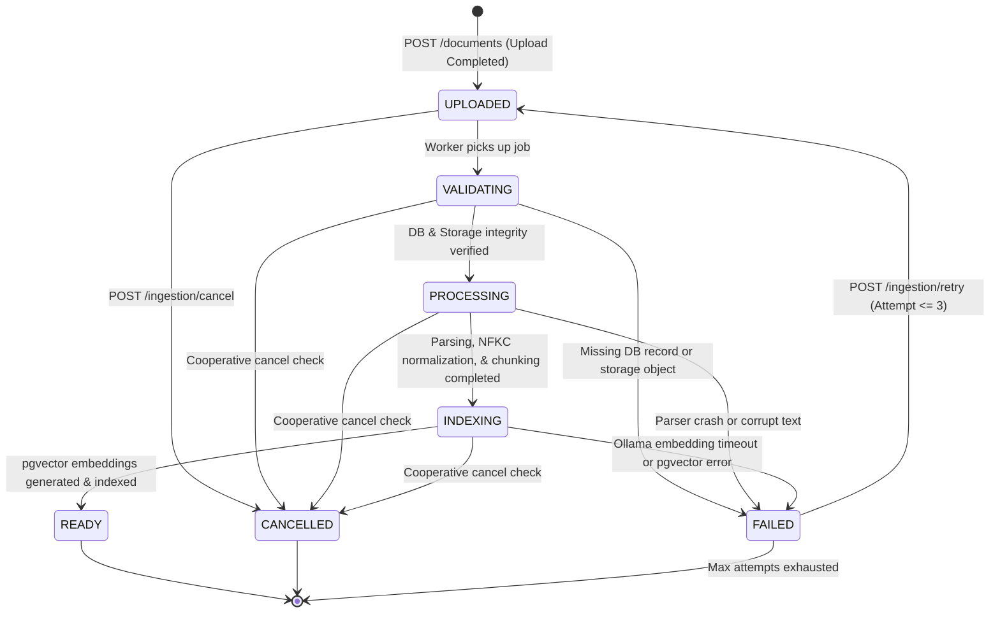

# AI-09.0.06 — Streaming, Citations, Document & Ingestion Integration Audit

**Milestone:** AI-09 Kynergy Intelligence Frontend Integration  
**Document ID:** `AI-09.0.06`  
**Phase:** 0 — Integration Audits  
**Role:** Principal Software Architect & Senior Frontend Engineer  
**Status:** Complete  
**Date:** 2026-11-21  
**Target File:** `docs/ai/AI-09/AI-09.0.06-streaming-citations-and-knowledge-api-audit.md`

---

## 1. Executive Summary

This audit evaluates the transport protocols, citation structures, document management endpoints, and ingestion lifecycles across the Kynergy platform (`apps/api/src/ai/`, `packages/core/src/ai/`). It establishes the boundaries between implemented capabilities and planned features, providing exact technical contracts for Kynergy Intelligence frontend integration.

### Core Audit Discoveries

1. **Streaming Transport (Part A):**
   - **Current Implementation:** The backend currently supports **Standard HTTP JSON Responses Only** at the API layer (`AiRAGController`).
   - **Adapter Capabilities:** `OllamaLLMAdapter.generateStream()` implements an `AsyncIterable<string>` stream reader consuming Ollama's streaming endpoint, but this is **not** exposed through NestJS controllers (`@Sse` or chunked HTTP).
   - **Integration Requirement:** The frontend must consume standard synchronous HTTP `POST` responses. Streaming transport is a planned backend feature.
2. **Citation Contracts (Part B):**
   - **Trustworthy Provenance:** Source citation metadata (`documentId`, `documentTitle`, `chunkId`, `pageNumber`, `headingPath`, `relevanceScore`, `sourceStrategy`) is resolved strictly from PostgreSQL stored evidence (`PrismaKnowledgeChunkRepository`), guaranteeing anti-hallucination and zero LLM manipulation.
   - **Snippet Omission:** `RAGSourceCitationDto` intentionally omits chunk text snippets to keep network payloads lightweight.
3. **Document Management (Part C):**
   - Full multipart upload (`POST /api/v1/ai/knowledge/documents`), multi-format deep magic-byte validation (PDF, DOCX, MD, TXT up to 10 MB), intra-document SHA-256 duplicate detection, tenant-isolated object storage, soft-deletion, and vector index cleanup.
4. **Ingestion & Indexing Lifecycle (Part D):**
   - Formal 7-stage state machine: `UPLOADED` -> `VALIDATING` -> `PROCESSING` -> `INDEXING` -> `READY` (or `FAILED`, `CANCELLED`).
   - The frontend can reliably distinguish an uploaded document from a retrieval-ready document by inspecting `IngestionJob.status === 'READY'`.

---

## 2. Part A — Streaming Transport Specification

### 2.1 Current Transport Realities

| Capability                   | Supported? | Verified Location / Mechanism                                                                    | Notes                                   |
| :--------------------------- | :--------: | :----------------------------------------------------------------------------------------------- | :-------------------------------------- |
| **Server-Sent Events (SSE)** |   **NO**   | No `@Sse()` decorators exist in any AI controller.                                               | Planned backend capability.             |
| **Fetch-based Streaming**    |   **NO**   | `AiRAGController.queryKnowledge()` returns standard Promise resolving to `RAGAnswerResponseDto`. | Planned backend capability.             |
| **WebSockets Gateway**       |   **NO**   | No `@WebSocketGateway()` exists in `apps/api/src/ai`.                                            | Not on current architecture roadmap.    |
| **Standard HTTP (JSON)**     |  **YES**   | `POST /api/v1/ai/knowledge/query` returns synchronous HTTP `200 OK`.                             | Fully operational and production-ready. |

### 2.2 Provider Streaming vs. Controller Transport

- **Adapter Level:** `OllamaLLMAdapter.generateStream(prompt, options): AsyncIterable<string>` is implemented in `apps/api/src/ai/adapters/llm/ollama-llm.adapter.ts`. It streams deltas from Ollama's `/api/generate` endpoint using Node.js `fetch` and `response.body.getReader()`.
- **Controller Gap:** Because `IGenerateGroundedAnswerUseCase` and `RAGOrchestratorService` must perform citation validation, confidence verification, and groundedness enforcement _on the complete synthesized answer_ before committing, the REST controller currently blocks until generation finishes.
- **Frontend Simulation Prohibition:**
  > [!WARNING]
  > As stipulated by enterprise UX guidelines, **the frontend must NEVER simulate streaming by progressively typing out a completed HTTP response**. A completed response must be rendered immediately, with appropriate skeleton indicators shown during the 2–8 second synthesis window.

### 2.3 Future Streaming Architecture Evaluation

When backend streaming is implemented:

- **Native `EventSource` Evaluation:** **Inappropriate for Kynergy.** The native browser `EventSource` API does not permit sending custom HTTP headers (such as `Authorization: Bearer <token>`). Passing access tokens in query parameters (`?token=...`) violates security invariants (tokens get logged in web proxy/gateway access logs).
- **Recommended Transport:** **Authenticated Fetch Streaming** via `fetch()` + `ReadableStream` reader or the `@microsoft/fetch-event-source` library, passing Bearer JWT tokens in standard `Authorization` headers.

---

## 3. Part B — Citation Contracts & Source Attribution

### 3.1 `RAGSourceCitationDto` Contract Inventory

Source: `apps/api/src/ai/controllers/dtos/rag-query.dto.ts`

```typescript
export class RAGSourceCitationDto {
  documentId!: string;
  documentTitle!: string;
  chunkId!: string;
  pageNumber?: number;
  headingPath?: string[];
  relevanceScore!: number;
  sourceStrategy?: string;
}
```

### 3.2 Trustworthiness & Display Suitability Matrix

| Field Name          | Type                    | Trustworthy? | Data Origin                               | Recommended UI Display                                                |
| :------------------ | :---------------------- | :----------: | :---------------------------------------- | :-------------------------------------------------------------------- |
| `documentId`        | `string` (UUID)         |   **YES**    | Stored `knowledge_documents.id`           | Internal navigation key (`/intelligence/knowledge/documents/:id`).    |
| `documentTitle`     | `string`                |   **YES**    | Stored `knowledge_documents.title`        | Primary citation badge label (e.g., `📄 Protocolo Cervical 2026`).    |
| `chunkId`           | `string`                |   **YES**    | Stored `knowledge_chunks.id`              | Unique React DOM key and telemetry correlation tag.                   |
| `pageNumber`        | `number \| undefined`   |   **YES**    | PDF/DOCX parser metadata                  | Sub-badge indicator (e.g., `Pág. 14`). Hidden for Markdown/TXT.       |
| `headingPath`       | `string[] \| undefined` |   **YES**    | Structural chunker heading breadcrumb     | Tooltip or secondary badge (e.g., `Capítulo 2 > Contraindicaciones`). |
| `relevanceScore`    | `number` [0.0 - 1.0]    |   **YES**    | Vector cosine similarity or fused RRF     | Match confidence indicator (e.g., `94% coincidencia`).                |
| `sourceStrategy`    | `string \| undefined`   |   **YES**    | Retrieval engine (`SEMANTIC` \| `HYBRID`) | Advanced debug/audit tag (e.g., `Híbrido (RRF)`).                     |
| `snippet / excerpt` | _Not Present_           |   **N/A**    | _Excluded from transport DTO_             | Not available inline in chat.                                         |

### 3.3 Source Preview Feasibility

- Citations provide `documentId`, allowing the frontend to link directly to the document in the Knowledge Center.
- If a user clicks a citation badge:
  1. The UI can display a flyout drawer showing document metadata (`title`, `uploadedBy`, `createdAt`).
  2. The UI can initiate binary download or preview via `GET /api/v1/ai/knowledge/documents/:id/content`.
  3. **Limitation:** Individual chunk preview is currently not supported via a dedicated REST endpoint (there is no `GET /api/v1/ai/knowledge/chunks/:chunkId`).

---

## 4. Part C — Document Management API Inventory

All document management endpoints are mounted at `/api/v1/ai/knowledge/documents` (with legacy fallback alias `/api/v1/ai/documents`).

### 4.1 Endpoints Specification

| Endpoint                           |  Method  | Payload / Params                                           | Auth / Guard | Response Code & DTO                            | Description                                                        |
| :--------------------------------- | :------: | :--------------------------------------------------------- | :----------- | :--------------------------------------------- | :----------------------------------------------------------------- |
| `/`                                |  `POST`  | `multipart/form-data` (`file`, `UploadDocumentRequestDto`) | JWT + Tenant | `201 Created` (`UploadDocumentResponseDto`)    | Uploads new document & version 1. Triggers asynchronous ingestion. |
| `/`                                |  `GET`   | Query: `ListDocumentsQueryDto`                             | JWT + Tenant | `200 OK` (`PaginatedDocumentsResponseDto`)     | Paginated listing with search, date, MIME, and scope filters.      |
| `/:id`                             |  `GET`   | Param: `id` (UUID)                                         | JWT + Tenant | `200 OK` (`DocumentDetailResponseDto`), `404`  | Full document details and version history.                         |
| `/:id`                             | `PATCH`  | Body: `UpdateDocumentMetadataRequestDto`                   | JWT + Tenant | `200 OK` (`DocumentDetailResponseDto`), `404`  | Updates document title, description, or visibility scope.          |
| `/:id`                             | `DELETE` | Param: `id` (UUID)                                         | JWT + Tenant | `204 No Content`, `404`                        | Soft deletes document and purges vector chunks.                    |
| `/:id/versions`                    |  `GET`   | Param: `id` (UUID)                                         | JWT + Tenant | `200 OK` (`DocumentVersionResponseDto[]`)      | Lists all historical versions of a document.                       |
| `/:id/versions/:versionId`         |  `GET`   | Params: `id`, `versionId`                                  | JWT + Tenant | `200 OK` (`DocumentVersionResponseDto`), `404` | Details of a specific document version.                            |
| `/:id/versions`                    |  `POST`  | `multipart/form-data` (`file`)                             | JWT + Tenant | `201 Created` (`DocumentVersionResponseDto`)   | Uploads version $N+1$ for an existing document.                    |
| `/:id/content`                     |  `GET`   | Param: `id` (UUID)                                         | JWT + Tenant | `200 OK` (Binary Stream)                       | Streams raw binary payload of current version.                     |
| `/:id/versions/:versionId/content` |  `GET`   | Params: `id`, `versionId`                                  | JWT + Tenant | `200 OK` (Binary Stream)                       | Streams raw binary payload of specified version.                   |

### 4.2 Upload Constraints & Deep Validation Rules

| Rule / Constraint             | Enforced Setting                                                                                                            | Backend Validator Component                           | Behavior on Violation                                                         |
| :---------------------------- | :-------------------------------------------------------------------------------------------------------------------------- | :---------------------------------------------------- | :---------------------------------------------------------------------------- |
| **Max File Size**             | `10 MB` (`10 * 1024 * 1024` bytes)                                                                                          | `DocumentContentValidatorService`                     | Throws `DocumentSizeLimitExceededException` (HTTP `400`).                     |
| **Accepted MIME Types**       | `application/pdf`, `application/vnd.openxmlformats-officedocument.wordprocessingml.document`, `text/markdown`, `text/plain` | `DocumentContentValidatorService`                     | Throws `UnsupportedDocumentFormatException` (HTTP `400`).                     |
| **Magic Bytes Inspection**    | `%PDF-` for PDF, `PK\x03\x04` for DOCX, valid UTF-8 for TXT/MD                                                              | Content sniffing in `DocumentContentValidatorService` | Rejects disguised binaries (e.g. EXE renamed to .pdf) with HTTP `400`.        |
| **DOCX Zip Bomb Defense**     | Max uncompressed: `50 MB`, max entries: `1000`, max ratio: `100:1`                                                          | Decompression inspection                              | Rejects malicious archives with `DocumentSecurityRiskException` (HTTP `400`). |
| **Intra-Document Duplicates** | Cryptographic SHA-256 Checksum                                                                                              | `SecureDocumentUploadService`                         | Throws `DuplicateDocumentVersionException` (HTTP `409 Conflict`).             |
| **Storage Mechanism**         | Local / Tenant Object Storage                                                                                               | `FileSystemStorageAdapter` / `ObjectStoragePort`      | Two-phase upload with compensating cleanup on DB failure.                     |

---

## 5. Part D — Ingestion Lifecycle & Status APIs

### 5.1 Ingestion State Machine Diagram



### 5.2 State Definitions (`IngestionStatus`)

Source: `packages/core/src/ai/domain/enums/ingestion-status.enum.ts`

| Status Enum  |   Category   | Meaning & System Activity                                                                                      | Retrieval Available? |
| :----------- | :----------: | :------------------------------------------------------------------------------------------------------------- | :------------------: |
| `UPLOADED`   |  Transient   | Job registered in database; waiting for worker thread pickup.                                                  |        **NO**        |
| `VALIDATING` |    Active    | Worker verifies document version exists in DB and binary exists in storage.                                    |        **NO**        |
| `PROCESSING` |    Active    | Worker parses document, applies NFKC normalization, detects language, splits into chunks, and persists chunks. |        **NO**        |
| `INDEXING`   |    Active    | Worker generates 1024-dimension BGE-M3 embeddings and indexes chunks in PostgreSQL `pgvector`.                 |        **NO**        |
| `READY`      | **Terminal** | Ingestion succeeded. Chunks are fully indexed and retrievable via hybrid search.                               |       **YES**        |
| `FAILED`     | **Terminal** | Error encountered. `lastErrorCode` and `lastErrorMessage` populated. Retryable if attempts remain.             |        **NO**        |
| `CANCELLED`  | **Terminal** | Ingestion stopped cooperatively via user cancellation request.                                                 |        **NO**        |

### 5.3 Ingestion Status APIs

#### 1. `GET /api/v1/ai/knowledge/documents/:id/ingestion`

- **Purpose:** Fetches the ingestion job history and current status for all versions of a document.
- **Polling Strategy:** The frontend polls this endpoint every 2.0 seconds while a document version's latest job is in active state (`isIngestionActive`).
- **Response Structure (`IngestionJobResponseDto`):**
  ```typescript
  interface IngestionJobResponseDto {
    id: string; // Job ID (e.g. 'job_123')
    documentId: string;
    documentVersionId: string;
    status:
      'UPLOADED' | 'VALIDATING' | 'PROCESSING' | 'INDEXING' | 'READY' | 'FAILED' | 'CANCELLED';
    attemptCount: number;
    maxAttempts: number;
    lastErrorCode: string | null;
    lastErrorMessage: string | null;
    createdAt: string;
    completedAt: string | null;
  }
  ```

#### 2. `POST /api/v1/ai/knowledge/documents/:id/ingestion/retry`

- **Purpose:** Re-triggers an asynchronous ingestion pipeline for a current version that previously failed.
- **Constraints:** Returns `400 Bad Request` if the job is not in a failed state or if retry attempts are exhausted.

#### 3. `POST /api/v1/ai/knowledge/documents/:id/ingestion/cancel`

- **Purpose:** Requests cooperative cancellation of an in-flight job.
- **Payload (`CancelIngestionJobRequestDto`):** `{ reason: string }`
- **Constraints:** Returns `409 Conflict` if the job has already transitioned to a terminal state (`READY`, `FAILED`, `CANCELLED`).

---

## 6. Gap Analysis & Integration Recommendations

### 6.1 Identified Gaps

| Capability                               | Current Status | Impact on Frontend                                                        | Recommended Resolution                                                              |
| :--------------------------------------- | :------------: | :------------------------------------------------------------------------ | :---------------------------------------------------------------------------------- |
| **SSE / Streaming Endpoint**             |    Missing     | Chat UI must wait synchronously for full response.                        | Implement loading skeleton; schedule backend SSE endpoint.                          |
| **Chunk Snippet Endpoint**               |    Missing     | Source preview cannot display chunk text snippets.                        | Display document title, page, and heading path in citation chips.                   |
| **Ingestion Progress Percentage**        |    Missing     | `IngestionJobResponseDto` reports status stages, not percentage (0-100%). | Display step-based stepper (`Validating` -> `Processing` -> `Indexing` -> `Ready`). |
| **Realtime WebSocket Ingestion Updates** |    Missing     | Client must poll `GET :id/ingestion` to detect job completion.            | Implement polling hook (`useQuery` with `refetchInterval: 2000` while active).      |

### 6.2 Frontend Architecture Recommendations

1. **Knowledge Center Upload UX:**
   - Use standard `multipart/form-data` with HTML5 `<input type="file">`.
   - Validate file size (< 10 MB) and extension (`.pdf`, `.docx`, `.md`, `.txt`) client-side before upload dispatch.
   - On `201 Created`, immediately enter a polling loop on `GET /api/v1/ai/knowledge/documents/:id/ingestion`.
   - Transition UI badge from `Procesando` (blue) to `Listo para Consultas` (green) only when `status === 'READY'`.
2. **Chat Citation Badges:**
   - Render citations as interactive chips displaying `📄 {documentTitle} (Pág. {pageNumber})`.
   - Clicking a chip opens a drawer displaying document metadata and a "Descargar Documento" button triggering `GET /content`.

---

## 7. Conclusion & Acceptance Sign-Off

All transport specifications, citation contracts, document management APIs, and ingestion status lifecycles have been verified against backend source code and test suites.

- **Transport Behavior Verified:** Standard HTTP JSON only; no speculative streaming.
- **Citation Metadata Verified:** Document identity, page, heading, and relevance score are authoritative; snippet text is omitted.
- **Upload Constraints & Lifecycle Established:** 10 MB limit, 4 supported formats, 7-stage state machine with polling support.
- **Gaps Formally Logged:** Ready for architectural sign-off.
