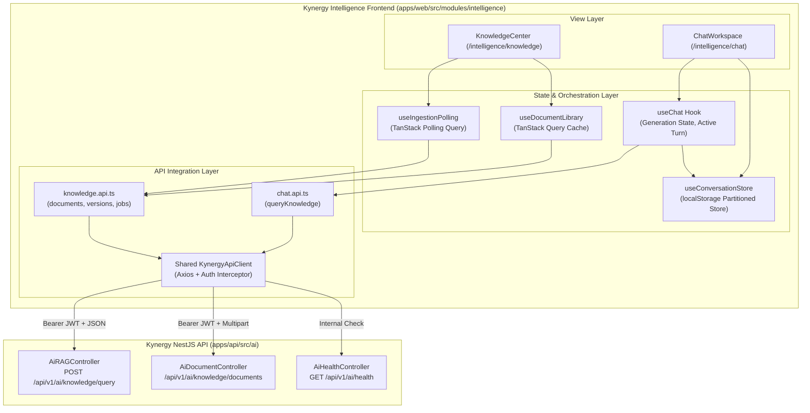

# AI-09.0.07 — Integration Gap Analysis & Target Frontend Architecture

**Milestone:** AI-09 Kynergy Intelligence Frontend Integration  
**Document ID:** `AI-09.0.07`  
**Phase:** 0 — Integration Audits  
**Role:** Principal Software Architect & Senior Frontend Engineer  
**Status:** Complete  
**Date:** 2026-11-21  
**Target File:** `docs/ai/AI-09/AI-09.0.07-target-frontend-architecture.md`

---

## 1. Executive Summary & Architectural Vision

This document synthesizes the empirical findings of audits `AI-09.0.00` through `AI-09.0.06` to establish the target frontend architecture for **Kynergy Intelligence**.

Kynergy Intelligence is an enterprise conversational assistant and knowledge management suite deeply embedded within the Kynergy platform. The architecture proposed herein:

1. **Preserves Established Conventions:** Fully integrates into the React 18, TypeScript, Tailwind CSS, shadcn-ui, and TanStack Query architecture established in `apps/web/`.
2. **Eliminates Architectural Duplication:** Reuses existing authentication interceptors, base API clients, error filters, and navigation layouts.
3. **Solves Persistence Reality:** Bridges the backend persistence gap (where `ConversationSession` is ephemeral in-memory without REST endpoints) via a **Stateless Client-Side History Architecture** with browser storage partitioning.
4. **Enforces Enterprise RAG UX:** Provides rich Markdown rendering, interactive citation chips with authoritative PostgreSQL provenance, deterministic abstention alerts, and 7-stage document ingestion status tracking.

---

## 2. Cross-System Dependency Matrix

Consolidating the frontend, backend, security, design system, persistence, and transport findings across the platform:

| System / Capability            | Dependency Category |  Status   | Verified Technical Reality / Location                                                               |
| :----------------------------- | :------------------ | :-------: | :-------------------------------------------------------------------------------------------------- |
| **LLM Inference Engine**       | Backend AI          |  `READY`  | Local Ollama runtime executing `qwen3:4b` with JSON enforcement.                                    |
| **Embedding Generation**       | Backend AI          |  `READY`  | 1024-dimension BGE-M3 model via Ollama.                                                             |
| **Vector Database & Search**   | Persistence         |  `READY`  | PostgreSQL `pgvector` with HNSW cosine index and hybrid RRF fusion ($k=60$).                        |
| **RAG Query REST API**         | Transport / API     |  `READY`  | `POST /api/v1/ai/knowledge/query` returning synchronous grounded JSON (`RAGAnswerResponseDto`).     |
| **Citation Attribution**       | Backend AI          |  `READY`  | Verified against PostgreSQL chunks via `CitationValidatorService` (anti-hallucination).             |
| **Document Upload Pipeline**   | Backend AI          |  `READY`  | Multipart form data, magic-byte sniffing, 10 MB limit, PDF/DOCX/MD/TXT.                             |
| **Ingestion Job Lifecycle**    | Backend AI          |  `READY`  | 7-stage state machine (`UPLOADED` -> `READY` / `FAILED` / `CANCELLED`) with retry/cancel endpoints. |
| **Design System Tokens**       | Frontend UI         |  `READY`  | Tailwind CSS, brand primary `#68CE39`, dark container surfaces, shadcn-ui base primitives.          |
| **Authentication & Tokens**    | Security            |  `READY`  | In-memory JWT access token, automated refresh interceptor via Axios (`httpClient`).                 |
| **Tenant & Data Isolation**    | Security            |  `READY`  | Pre-retrieval SQL tenancy filtering (`req.user.tenantId`) and visibility scope resolution.          |
| **Markdown / Code Parsing**    | Frontend UI         | `PARTIAL` | `react-markdown` and syntax highlighting dependencies are not yet installed in `package.json`.      |
| **Citation Text Excerpts**     | Backend AI          | `PARTIAL` | `RAGSourceCitationDto` exposes metadata (title, page, heading) but omits chunk text snippets.       |
| **Conversation REST API**      | Backend API         | `MISSING` | No endpoints exist to list, retrieve, create, or delete conversation sessions.                      |
| **Persistent Conversations**   | Persistence         | `MISSING` | Zero Prisma models or Redis stores exist for conversations; memory map vanishes on restart.         |
| **Dedicated RBAC Permissions** | Security            | `MISSING` | `PERMISSIONS` enum lacks `ai.chat.query` / `ai.knowledge.manage`; mapped via role visibility.       |
| **Realtime Ingestion Events**  | Transport           | `MISSING` | No WebSockets or SSE for ingestion progress; client polling (`GET :id/ingestion`) required.         |
| **Streaming LLM Transport**    | Transport           | `PLANNED` | Provider adapter supports `generateStream()`, but REST controller is blocking HTTP only.            |

---

## 3. Proposed Frontend Architecture

### 3.1 Module Organization: `apps/web/src/modules/intelligence/`

In accordance with Kynergy module conventions (as seen in `kinesiology/`, `scheduling/`, and `sales/`), all AI functionality is encapsulated within an isolated, self-contained domain module:

```
apps/web/src/modules/intelligence/
├── api/
│   ├── chat.api.ts                     # QueryKnowledge REST call & payload mapping
│   ├── knowledge.api.ts                # Document CRUD, versioning, binary download, ingestion
│   ├── intelligence-api.client.ts      # Domain client wrapping shared httpClient
│   └── query-keys.ts                   # TanStack Query key factory for intelligence
├── components/
│   ├── chat/
│   │   ├── chat-workspace.tsx          # Main conversational workspace container
│   │   ├── conversation-sidebar.tsx    # Left sidebar: thread list, new chat, search
│   │   ├── conversation-item.tsx       # Thread list item with title, timestamp, delete
│   │   ├── message-list.tsx            # Scrollable viewport with scroll-to-bottom anchor
│   │   ├── message-bubble.tsx          # User prompt bubble vs. Assistant grounded response
│   │   ├── message-composer.tsx        # Auto-growing textarea, submit, stop generation
│   │   ├── message-markdown.tsx        # Markdown renderer with code copy actions
│   │   ├── citation-chip.tsx           # Interactive source citation badge (page, title)
│   │   ├── citation-drawer.tsx         # Slide-over drawer with source document details
│   │   ├── groundedness-banner.tsx     # Deterministic abstention or confidence indicator
│   │   └── empty-chat-state.tsx        # Suggested prompts and onboarding guidance
│   ├── knowledge/
│   │   ├── knowledge-center.tsx        # Main knowledge base view container
│   │   ├── document-library-table.tsx  # Paginated, filterable document data table
│   │   ├── document-upload-modal.tsx   # Drag-and-drop upload dialog with validation
│   │   ├── document-detail-drawer.tsx  # Document metadata, versions, and download link
│   │   ├── ingestion-stepper.tsx       # 7-stage visual progress stepper
│   │   └── ingestion-retry-modal.tsx   # Failed job diagnosis and retry action
│   └── shared/
│       ├── ai-health-pill.tsx          # Subsystem status pill (Ollama / pgvector health)
│       └── error-display.tsx           # RFC 7807 error alert mapping
├── hooks/
│   ├── use-chat.ts                     # Chat orchestration: turns, generation state, dispatch
│   ├── use-conversation-store.ts       # Local storage thread persistence & multi-tab sync
│   ├── use-document-library.ts         # TanStack Query hook for paginated documents
│   ├── use-document-upload.ts          # TanStack Mutation for multipart upload
│   └── use-ingestion-polling.ts        # Dynamic 2-second polling hook for active jobs
├── routes/
│   ├── intelligence.routes.tsx         # Route definitions registered in AppRouter
│   ├── chat-page.tsx                   # Page component for /intelligence/chat
│   ├── knowledge-page.tsx              # Page component for /intelligence/knowledge
│   └── document-detail-page.tsx        # Page component for /intelligence/knowledge/documents/:id
├── schemas/
│   ├── chat.schema.ts                  # Zod schemas for query request and response validation
│   └── document.schema.ts              # Zod schemas for upload form and metadata updates
├── types/
│   ├── chat.types.ts                   # Client conversation, turn, citation, metadata interfaces
│   ├── knowledge.types.ts              # Document, version, pagination, and filter types
│   └── ingestion.types.ts              # Ingestion job status and stepper types
└── index.ts                            # Public module exports
```

### 3.2 Target Architecture Diagram



---

## 4. Routing & Layout Strategy

### 4.1 Route Hierarchy

All intelligence routes integrate under the authenticated shell with role-based protection:

| Route Path                                      | View Component                     | Protected Roles            | Breadcrumb Hierarchy                                     |
| :---------------------------------------------- | :--------------------------------- | :------------------------- | :------------------------------------------------------- |
| `/intelligence`                                 | _Redirect to `/intelligence/chat`_ | All Authenticated Staff    | Inicio > Inteligencia                                    |
| `/intelligence/chat`                            | `ChatPage`                         | All Authenticated Staff    | Inicio > Inteligencia > Chat Asistente                   |
| `/intelligence/chat/:conversationId`            | `ChatPage` (Active Thread)         | All Authenticated Staff    | Inicio > Inteligencia > Chat Asistente > [Título]        |
| `/intelligence/knowledge`                       | `KnowledgePage`                    | Admin, Supervisor, Trainer | Inicio > Inteligencia > Base de Conocimiento             |
| `/intelligence/knowledge/documents/:documentId` | `DocumentDetailPage`               | Admin, Supervisor, Trainer | Inicio > Inteligencia > Base de Conocimiento > Documento |

### 4.2 Application Layout Integration

- **Navigation Integration:** Add "Inteligencia Kynergy" to the primary sidebar (`apps/web/src/shared/components/layout/sidebar.tsx`) with sub-items:
  - `Chat Asistente` (Icon: `Bot` / `Sparkles`)
  - `Base de Conocimiento` (Icon: `BookOpen` / `Library`)
- **Workspace Layout:** Both views adopt a 100% viewport height layout (`h-[calc(100vh-theme(spacing.16))]`), disabling global page scrolling so the chat viewport and conversation sidebar manage their own scroll independently.

---

## 5. State Management Strategy

### 5.1 Ownership Matrix

To maintain single-source-of-truth invariants without introducing unneeded global state libraries (e.g., Redux, Zustand), state ownership is partitioned as follows:

| State Domain                            | Owner / Mechanism           | Storage Mechanism                   | Lifecycle & Invalidation                                                                    |
| :-------------------------------------- | :-------------------------- | :---------------------------------- | :------------------------------------------------------------------------------------------ |
| **Server State (Documents & Versions)** | TanStack Query (`useQuery`) | In-Memory Query Cache               | Invalidated on upload, metadata update, or document soft deletion.                          |
| **Ingestion Job Progress**              | TanStack Query (`useQuery`) | In-Memory Query Cache               | Refetched every 2.0s while `isIngestionActive === true`; paused when `READY` / `FAILED`.    |
| **Conversation Threads & Messages**     | `useConversationStore`      | Browser `localStorage`              | Keyed by `kinergy_conv_${tenantId}_${userId}`. Persists across reloads.                     |
| **Active Thread ID**                    | React Router (`useParams`)  | URL Path Param                      | Changed via client-side routing (`navigate('/intelligence/chat/:id')`).                     |
| **Current Prompt Draft**                | `useChat` / Local State     | React `useState` / `sessionStorage` | Ephemeral; survives component re-renders but clears on submission.                          |
| **Generation / Loading State**          | `useChat` Local State       | React `useState`                    | Ephemeral (`isGenerating: boolean`, `status: 'idle'\|'submitting'\|'generating'\|'error'`). |
| **Conversation Sidebar Collapse**       | UI State                    | Browser `localStorage`              | User preference persisted across app visits (`kinergy_chat_sidebar_collapsed`).             |

### 5.2 Stateless Client-Side History Architecture

Because the backend `InMemoryConversationRepositoryAdapter` has no REST endpoints and perishes on server restart, the frontend owns thread persistence:

```typescript
// types/chat.types.ts
export interface ClientMessage {
  id: string; // crypto.randomUUID()
  role: 'user' | 'assistant';
  content: string;
  createdAt: string;
  grounded?: boolean;
  sources?: RAGSourceCitationDto[];
  metadata?: RAGMetadataDto;
  status: 'pending' | 'success' | 'error' | 'abstained';
  errorMessage?: string;
}

export interface ClientConversation {
  id: string; // crypto.randomUUID()
  title: string; // Derived from first user query (truncated to 40 chars)
  createdAt: string;
  updatedAt: string;
  messages: ClientMessage[];
}
```

#### Dispatch Workflow:

1. User enters query -> Local store appends optimistic user `ClientMessage` and placeholder assistant `ClientMessage` with `status: 'pending'`.
2. `useChat` maps recent prior messages into `ChatMessageDto[]` (sliding window of last 10 messages).
3. `POST /api/v1/ai/knowledge/query` is invoked with `{ query, searchMode: 'HYBRID', topK: 5, conversationHistory }`. **Notice: `conversationId` is omitted** to prevent backend 404s.
4. On `200 OK`, assistant message is updated with `answer`, `grounded`, `sources`, and `status: response.grounded ? 'success' : 'abstained'`.
5. On HTTP error, assistant message is updated with `status: 'error'` and error detail from RFC 7807 envelope.
6. The updated thread is serialized to `localStorage`.

---

## 6. API Integration Strategy

### 6.1 Query Key Factory Pattern (`api/query-keys.ts`)

```typescript
export const intelligenceKeys = {
  all: ['intelligence'] as const,
  health: () => [...intelligenceKeys.all, 'health'] as const,
  documents: (filters?: ListDocumentsQueryDto) =>
    [...intelligenceKeys.all, 'documents', filters] as const,
  documentDetail: (id: string) => [...intelligenceKeys.all, 'documents', 'detail', id] as const,
  documentVersions: (id: string) => [...intelligenceKeys.all, 'documents', 'versions', id] as const,
  ingestionJobs: (documentId: string) =>
    [...intelligenceKeys.all, 'ingestion', documentId] as const,
};
```

### 6.2 Mutation & Cache Invalidation Lifecycle

- **Document Upload Mutation:**
  - On upload start: Display modal progress bar.
  - On `201 Created`: Invalidate `intelligenceKeys.documents()`, close modal, trigger toast notification, and start polling ingestion on `intelligenceKeys.ingestionJobs(documentId)`.
- **Document Deletion Mutation:**
  - Optimistically remove document from cached table list.
  - Dispatch `DELETE /api/v1/ai/knowledge/documents/:id`.
  - On error: Roll back table cache.
  - On success: Invalidate `intelligenceKeys.documents()`.

---

## 7. UX & UI Composition Strategy

### 7.1 Visual Identity Alignment

- **Primary Brand Green:** `#68CE39` applied for user message bubbles, active conversation indicator, and verified citation badges.
- **Dark Mode Surfaces:** `#0F1E16` for dark container backgrounds, `#1B3B2B` for assistant message cards, `#27533B` for borders.
- **Contrast Ratios:** Contrast verified in `AI-09.0.02` ensuring full WCAG 2.2 AA compliance:
  - User bubble text: Dark green `#0F1E16` on brand green `#68CE39` (Contrast: `9.4:1` - passes AAA).
  - Citation chips: `#10B981` border and text on dark card surfaces.

### 7.2 Conversational UX Components

1. **Message Composer:**
   - Multi-line textarea auto-expanding from 44px to 160px.
   - Enter to submit, Shift+Enter for newline.
   - Disabled while generation is pending.
   - "Detener Generación" button active during submission, wired to `AbortController`.
2. **Markdown & Syntax Highlighting:**
   - Renders GitHub Flavored Markdown (tables, lists, blockquotes, bold).
   - Code blocks with language header and one-click "Copiar Código" button.
3. **Citation Chips & Popover Drawer:**
   - Inline or footer chips: `📄 [Título del Documento] • Pág. 14`.
   - Tooltip reveals heading hierarchy (`Capítulo 2 > Contraindicaciones`).
   - Clicking chip opens side drawer displaying document summary and a "Descargar Documento" action.
4. **Deterministic Abstention Alert:**
   - When `grounded: false`, assistant bubble renders with an amber border and subtle `Info` icon explaining that verified evidence was insufficient to guarantee an accurate answer.

---

## 8. Implementation Dependencies & Backend Mapping

The following matrix maps future frontend capabilities directly to backend capabilities and their availability:

| Frontend UI Capability           | Required Backend Capability                              | Current Status | Integration Strategy                                                   |
| :------------------------------- | :------------------------------------------------------- | :------------: | :--------------------------------------------------------------------- |
| **Grounded Answer Generation**   | `POST /api/v1/ai/knowledge/query`                        |    `READY`     | Connects directly via `chat.api.ts`.                                   |
| **Source Citation Badges**       | `RAGSourceCitationDto` in response                       |    `READY`     | Render `documentTitle`, `pageNumber`, `headingPath`.                   |
| **Document Upload & Validation** | `POST /api/v1/ai/knowledge/documents`                    |    `READY`     | Use multipart form upload; validate < 10 MB client-side.               |
| **Knowledge Base Listing**       | `GET /api/v1/ai/knowledge/documents`                     |    `READY`     | Use TanStack Query with pagination and filters.                        |
| **Document Content Download**    | `GET /api/v1/ai/knowledge/documents/:id/content`         |    `READY`     | Native browser blob download via authenticated client.                 |
| **Ingestion State Tracking**     | `GET /api/v1/ai/knowledge/documents/:id/ingestion`       |    `READY`     | Poll every 2.0s until status reaches `READY` or `FAILED`.              |
| **Ingestion Retry / Cancel**     | `POST :id/ingestion/retry` & `POST :id/ingestion/cancel` |    `READY`     | Wired to table row actions.                                            |
| **Conversation Thread History**  | `GET /api/v1/ai/conversations`                           |   `MISSING`    | **Client-side storage (`localStorage`)** until backend REST API lands. |
| **Realtime Streaming Output**    | SSE / Chunked HTTP Transport                             |   `PLANNED`    | **Synchronous loading skeleton** until backend streaming lands.        |
| **Citation Text Excerpt Modal**  | `GET /api/v1/ai/knowledge/chunks/:id`                    |   `MISSING`    | Display document metadata only; omit chunk body preview.               |

---

## 9. Proposed Architectural Decision Records (ADRs)

### ADR-AI-09-01: Client-Side Stateless Conversation Persistence

- **Context:** The backend possesses domain models for conversations, but uses an in-memory repository without REST endpoints, losing state across restarts and browser refreshes.
- **Decision:** The frontend will maintain conversation history in browser `localStorage`, partitioned by tenant and user ID. When querying the AI backend, the frontend will transmit the recent conversation turns in `QueryKnowledgeRequestDto.conversationHistory` and omit `conversationId`.
- **Consequences:** Users maintain persistent multi-turn conversations across browser refreshes. No backend schema modifications or unapproved dependencies are required in Milestone AI-09.

### ADR-AI-09-02: Synchronous JSON Transport with Deferred Fetch-Streaming

- **Context:** The current backend API exposes only synchronous HTTP `POST` returning complete JSON.
- **Decision:** The frontend will consume standard synchronous HTTP `POST` responses. Streaming transport is deferred to a future backend milestone. The frontend is strictly prohibited from faking streaming via synthetic progressive typing.
- **Consequences:** Predictable, atomic response delivery with robust error handling. UI displays animated loading skeletons during generation latency.

### ADR-AI-09-03: Polling-Based Ingestion Monitoring

- **Context:** The backend does not expose WebSockets or Server-Sent Events for document ingestion status.
- **Decision:** The frontend will implement dynamic interval polling on `GET /api/v1/ai/knowledge/documents/:id/ingestion`, querying every 2.0 seconds while jobs are in active states (`UPLOADED`, `VALIDATING`, `PROCESSING`, `INDEXING`) and terminating when reaching terminal states (`READY`, `FAILED`, `CANCELLED`).
- **Consequences:** Low complexity, zero socket overhead, and immediate visual synchronization.

### ADR-AI-09-04: Role-Based Intelligence Feature Gating

- **Context:** Dedicated RBAC permissions (`ai.chat.query`, `ai.knowledge.manage`) are not yet defined in the platform's `PERMISSIONS` enum.
- **Decision:** The frontend will gate intelligence routes and UI elements based on verified user roles (`SUPER_ADMIN`, `ADMIN`, `ENERGY_MANAGER`, `OPERATOR`, `COLLABORATOR`), aligned with the backend's `RetrievalSecurityPolicyService`.
- **Consequences:** Strict security alignment with existing backend access control without modifying identity enums.

---

## 10. Technical Risks & Mitigation Plan

| Risk Description                                                                                       | Severity | Probability | Mitigation Strategy                                                                                                                                |
| :----------------------------------------------------------------------------------------------------- | :------: | :---------: | :------------------------------------------------------------------------------------------------------------------------------------------------- |
| **Browser Storage Limit:** Large conversation threads could exceed `localStorage` quota (5-10 MB).     |  Medium  |     Low     | Cap stored messages per thread to 60 (matching backend domain invariant); prune oldest threads when storage exceeds 2 MB.                          |
| **Long Generation Latency:** Ollama local inference takes 2.0 to 8.0 seconds depending on load.        |   High   |    High     | Display animated thinking steps ("Buscando evidencia...", "Analizando documentos...", "Sintetizando respuesta...") to provide clear user feedback. |
| **Oversized Upload Failure:** User attempts to upload files > 10 MB or unsupported formats.            |  Medium  |   Medium    | Perform client-side pre-validation checking file size and MIME type before network dispatch.                                                       |
| **Cross-Tenant Storage Leakage:** User switches tenants while retaining conversation state in browser. | Critical |     Low     | Namespace storage keys with `tenantId` and clear state upon `logout()` or tenant switch.                                                           |

---

## 11. Conclusion & Architecture Review Readiness

The proposed target frontend architecture provides an elegant, scalable, and fully grounded implementation blueprint for Kynergy Intelligence. It respects every existing Kynergy convention, avoids speculative dependencies, and turns identified backend limitations into well-managed, resilient client architectures.

**Status:** Complete and ready for final audit synthesis (`AI-09.0.08`).
