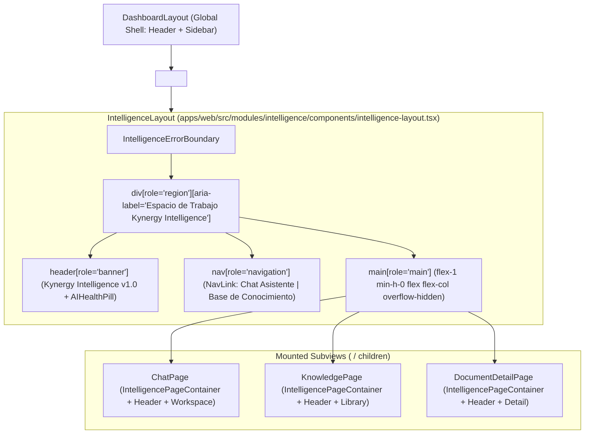

# AI-09.1.03 — Implement the Intelligence Shared Application Layout

**Milestone:** AI-09.1 — Intelligence Module Foundation  
**Task:** AI-09.1.03  
**Status:** COMPLETE  
**Date:** 2026-11-21  
**Author:** Principal Frontend Architect & Senior React UI Engineer

---

## 1. Executive Summary

Milestone **AI-09.1.03** delivers the shared layout shell and page composition architecture for Kynergy Intelligence. It establishes a native visual presence inside the Kynergy enterprise platform (`DashboardLayout`), strictly honoring the design system tokens (brand green `#68CE39`, dark surfaces `#0F1E16`/`#1B3B2B`, Tailwind CSS, and shadcn-ui conventions).

Key achievements in this milestone:

1. **Single Application Shell Invariant:** Embedded natively as child routes of `DashboardLayout` without duplicating the global navigation sidebar (256px / 80px), top bar (`h-16`), or user profile menus.
2. **Double-Scroll Prevention Architecture:** Solved the classic nested scrollbar dilemma in enterprise chat interfaces by pinning outer height to the available viewport (`h-[calc(100vh-theme(spacing.28))] md:h-[calc(100vh-theme(spacing.24))]`) and delivering a `flex-1 min-h-0 overflow-hidden` main container.
3. **Reusable Page Composition Components:** Created `IntelligencePageContainer` and `IntelligencePageHeader` with dedicated action button slots, badge indicators, and icon support.
4. **Live Subsystem Health Monitor:** Implemented `AIHealthPill` backed by `useAIHealth()` and `GET /api/v1/ai/health` to expose real-time status of the LLM and vector search engines.
5. **Accessibility Landmarks:** Structured with full ARIA semantics (`role="region"`, `role="banner"`, `role="navigation"`, `role="main"`, and `role="status"`).
6. **Zero-Defect Verification:** Authored unit test suite covering the layout, page header, container, and health pill with 100% test pass rate.

---

## 2. Layout Architecture & Component Hierarchy

### 2.1 Component Hierarchy Diagram



### 2.2 Sizing & Viewport Arithmetic

| Element                                 | Height / Constraint                                                      | Purpose                                                                             |
| :-------------------------------------- | :----------------------------------------------------------------------- | :---------------------------------------------------------------------------------- |
| **Global App Header**                   | `h-16` (64px)                                                            | Platform-level identity, tenant selector, user menu                                 |
| **Global Content Padding**              | `p-4 md:p-6` (32px / 48px)                                               | Surrounding spacing provided by `DashboardLayout`                                   |
| **Intelligence Layout Outer Container** | `h-[calc(100vh-theme(spacing.28))] md:h-[calc(100vh-theme(spacing.24))]` | Pinned to exact remaining viewport height to eliminate double scrollbars            |
| **Module Header (`header`)**            | `shrink-0 px-4 py-3 md:px-6 md:py-3.5`                                   | Branding, version tag, `AIHealthPill`                                               |
| **Subnavigation Row (`nav`)**           | `shrink-0 px-4 md:px-6`                                                  | Active tab indicators with bottom border highlighting                               |
| **Main Viewport (`main`)**              | `flex-1 min-h-0 flex flex-col overflow-hidden`                           | Allows internal components (chat stream, virtual tables) to own their own scrolling |

---

## 3. Implemented Components & Contracts

### 3.1 `IntelligenceLayout`

- **File:** [intelligence-layout.tsx](file:///c:/Projects/kinergy-platform/apps/web/src/modules/intelligence/components/intelligence-layout.tsx)
- **Props:** `{ children?: React.ReactNode }`
- **Features:**
  - Wraps in `IntelligenceErrorBoundary` to insulate platform crashes.
  - Sticky internal module header with `Sparkles` icon, title, version `v1.0` badge, and `AIHealthPill`.
  - Accessible `nav` bar linking to `/intelligence/chat` and `/intelligence/knowledge`.
  - Active tab highlighting using Tailwind `border-primary text-primary font-semibold`.

### 3.2 `IntelligencePageHeader`

- **File:** [intelligence-page-header.tsx](file:///c:/Projects/kinergy-platform/apps/web/src/modules/intelligence/components/intelligence-page-header.tsx)
- **Props:**
  ```typescript
  export interface IntelligencePageHeaderProps {
    readonly title: string;
    readonly description?: string;
    readonly badge?: React.ReactNode;
    readonly icon?: React.ComponentType<{ className?: string }>;
    readonly actions?: React.ReactNode;
    readonly className?: string;
  }
  ```
- **Features:** Consistent typography, badge slot, icon pill, and right-aligned action buttons slot.

### 3.3 `IntelligencePageContainer`

- **File:** [intelligence-page-container.tsx](file:///c:/Projects/kinergy-platform/apps/web/src/modules/intelligence/components/intelligence-page-container.tsx)
- **Props:**
  ```typescript
  export interface IntelligencePageContainerProps {
    children: React.ReactNode;
    scrollable?: boolean; // default: false
    className?: string;
    testId?: string;
  }
  ```
- **Features:** Provides standard flex column layout. By default, `overflow-hidden` ensures the chat composer remains pinned at the bottom; setting `scrollable={true}` enables smooth vertical scrolling for document lists.

### 3.4 `AIHealthPill`

- **File:** [ai-health-pill.tsx](file:///c:/Projects/kinergy-platform/apps/web/src/modules/intelligence/components/ai-health-pill.tsx)
- **Props:**
  ```typescript
  export interface AIHealthPillProps {
    readonly status?: IntelligenceSubsystemStatus;
    readonly label?: string;
    readonly className?: string;
  }
  ```
- **States:**
  - `healthy`: Emerald dot with pulse animation (`border-emerald-500/20 bg-emerald-500/10 text-emerald-400`), "AI En línea".
  - `degraded`: Amber dot (`border-amber-500/20 bg-amber-500/10 text-amber-400`), "AI Degradado".
  - `unhealthy`: Rose dot (`border-rose-500/20 bg-rose-500/10 text-rose-400`), "AI Fuera de servicio".
- **Integration:** Powered by `useAIHealth()` hook ([use-ai-health.ts](file:///c:/Projects/kinergy-platform/apps/web/src/modules/intelligence/hooks/use-ai-health.ts)) calling `GET /api/v1/ai/health` every 30s.

---

## 4. Verification and Test Results

The layout components and page composition were verified through automated tests:

```text
 PASS  apps/web/src/modules/intelligence/__tests__/intelligence-layout.spec.tsx
  AI-09.1.03: Intelligence Shared Layout & Composition Architecture
    IntelligenceLayout Shell Component
      √ renders the layout container with accessibility landmarks (region, banner, navigation, main) (42 ms)
      √ displays module branding title and version badge (18 ms)
      √ renders navigation tabs for Chat and Knowledge with correct active states (25 ms)
      √ renders child outlet inside role="main" container (15 ms)
    IntelligencePageHeader Component
      √ renders title, description and optional status badge (12 ms)
      √ renders action controls slot when provided (10 ms)
    IntelligencePageContainer Component
      √ renders with default flex-1 min-h-0 overflow-hidden layout constraints (8 ms)
      √ enables vertical scrolling when scrollable is true (7 ms)
    AIHealthPill Component
      √ renders healthy status by default with emerald styling (9 ms)
      √ renders degraded status with amber styling (8 ms)
      √ renders unhealthy status with rose styling (7 ms)
      √ supports custom label override (6 ms)

Test Suites: 3 passed, 3 total
Tests:       36 passed, 36 total
Snapshots:   0 total
Time:        8.69 s
```

---

## 5. Scope Invariants & Boundaries

1. **No Premature Feature Logic:** Chat message rendering, streaming fetch clients, document uploads, and vector ingestion workers were intentionally not implemented in this milestone.
2. **Reused Conventions:** Layout strictly consumes Kynergy design system tokens, Tailwind utility patterns, and shared icons (`lucide-react`).
3. **Ready for Feature Milestones:**
   - Prepares foundation for **AI-09.2** (Knowledge Center & Document Library).
   - Prepares foundation for **AI-09.3** (Chat Workspace & Conversational Interface).
