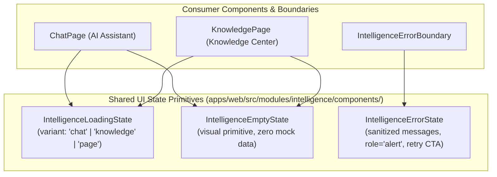

# AI-09.1.05 — Intelligence Responsive Foundations & Shared UI States

**Milestone:** AI-09.1 — Intelligence Module Foundation  
**Task:** AI-09.1.05  
**Status:** COMPLETE  
**Date:** 2026-11-21  
**Author:** Senior Frontend Usability, Responsive & Accessibility Engineer

---

## 1. Executive Summary

Milestone **AI-09.1.05** establishes the reusable, page-level visual primitives for **loading**, **error**, **empty**, and **responsive layout foundations** across Kynergy Intelligence. It aligns the module with WCAG 2.2 AA accessibility standards, eliminates Cumulative Layout Shift (CLS), guarantees responsive adaptability across viewports from 360px to 1440px+, and reinforces operational security by sanitizing internal database and infrastructure details from client error states.

Key achievements in this milestone:

1. **Reused Core Infrastructure:** Maximized reuse of existing platform primitives (`Skeleton` from `@kinergy-platform/ui`, `ForbiddenView`, `UnauthenticatedView`, and `NotFoundView` from `app/routes/fallback-views.tsx`, and `lazyWithRetry` from `app/routes/lazy-loading.tsx`).
2. **Specialized Intelligence Loading Primitives (`IntelligenceLoadingState`):** Delivered zero-CLS loading skeletons for conversational chat (assistant and user bubble streams with pinned composer bar) and knowledge center views (document grid and toolbar).
3. **Reusable Visual Empty State Primitive (`IntelligenceEmptyState`):** Created a clean empty state for empty conversation histories, empty document libraries, and search resets without injecting any mock backend data or speculative business assumptions.
4. **Defense in Depth Error Primitive (`IntelligenceErrorState`):** Implemented an in-place recoverable error primitive that automatically sanitizes technical stack traces, Prisma schema names, SQL fragments, and database hostnames before presenting user-friendly diagnostic guidance and a keyboard-accessible retry mechanism.
5. **Integrated Module Error Boundary (`IntelligenceErrorBoundary`):** Connected the module-level React class error boundary to render `IntelligenceErrorState` in place, preventing component rendering crashes from crashing the outer application shell.
6. **Responsive Viewport Foundations:** Added strict `overflow-x-hidden` guarantees, `min-w-0` and `break-words` text wrapping, responsive flex-wrap header elements, and touch-friendly scrollable subnavigation tabs.
7. **Accessibility (WCAG 2.2 AA):** Configured with accessible ARIA semantics (`role="status"`, `role="alert"`, `role="region"`, `aria-busy="true"`, `aria-live`), focus rings, and `motion-reduce:animate-none` for users with reduced motion preferences.

---

## 2. Shared State Component Inventory

### 2.1 Reused Existing Application Components

| Existing Component        | Source Location                                  | Reused Purpose in Intelligence                                                |
| :------------------------ | :----------------------------------------------- | :---------------------------------------------------------------------------- |
| **`Skeleton`**            | `@kinergy-platform/ui`                           | Atomic pulsing placeholder primitive for proportional sizing                  |
| **`ForbiddenView`**       | `apps/web/src/app/routes/fallback-views.tsx`     | HTTP 403 access denial screen when unauthorized roles access Knowledge Center |
| **`UnauthenticatedView`** | `apps/web/src/app/routes/fallback-views.tsx`     | HTTP 401 unauthenticated session expiry screen                                |
| **`NotFoundView`**        | `apps/web/src/app/routes/fallback-views.tsx`     | HTTP 404 missing conversation or document route fallback                      |
| **`lazyWithRetry`**       | `apps/web/src/app/routes/lazy-loading.tsx`       | Code splitting with automatic transient network retry for route chunks        |
| **`useTranslation`**      | `apps/web/src/app/providers/locale-provider.tsx` | Bilingual (ES/EN) localization and error message translation                  |

### 2.2 Newly Created Intelligence Primitives



#### A. `IntelligenceLoadingState`

- **File:** [intelligence-loading-state.tsx](file:///c:/Projects/kinergy-platform/apps/web/src/modules/intelligence/components/intelligence-loading-state.tsx)
- **Props:**
  ```typescript
  export type IntelligenceLoadingVariant = 'chat' | 'knowledge' | 'page';

  export interface IntelligenceLoadingStateProps {
    readonly variant?: IntelligenceLoadingVariant; // default: 'page'
    readonly message?: string;
    readonly className?: string;
    readonly testId?: string;
  }
  ```
- **Variants:**
  - `chat`: Assistant message bubble skeleton, right-aligned user bubble skeleton, bottom composer skeleton.
  - `knowledge`: Search bar skeleton, 6 document card skeletons with badges and metadata lines.
  - `page`: Clean header line and content container skeleton.
- **Accessibility:** `role="status"`, `aria-busy="true"`, `aria-live="polite"`, `<span className="sr-only">`, and `motion-reduce:animate-none`.

#### B. `IntelligenceEmptyState`

- **File:** [intelligence-empty-state.tsx](file:///c:/Projects/kinergy-platform/apps/web/src/modules/intelligence/components/intelligence-empty-state.tsx)
- **Props:**
  ```typescript
  export interface IntelligenceEmptyStateProps {
    readonly title: string;
    readonly description?: string;
    readonly icon?: React.ComponentType<{ className?: string }>;
    readonly badge?: React.ReactNode;
    readonly action?: React.ReactNode;
    readonly secondaryAction?: React.ReactNode;
    readonly className?: string;
    readonly testId?: string;
  }
  ```
- **Features:** Centered dashed border container (`bg-card/40 border-border/80`), icon pill (`bg-primary/10 text-primary`), responsive actions container, and `role="region"` with accessible title label.

#### C. `IntelligenceErrorState`

- **File:** [intelligence-error-state.tsx](file:///c:/Projects/kinergy-platform/apps/web/src/modules/intelligence/components/intelligence-error-state.tsx)
- **Props:**
  ```typescript
  export interface IntelligenceErrorStateProps {
    readonly title?: string;
    readonly error?: Error | string | null;
    readonly correlationId?: string;
    readonly onRetry?: () => void;
    readonly retryLabel?: string;
    readonly secondaryAction?: React.ReactNode;
    readonly className?: string;
    readonly testId?: string;
  }
  ```
- **Security:** Sanitizes error strings via `sanitizeIntelligenceErrorMessage()` to strip sensitive internal database patterns (`prisma`, `sql`, `pgvector`, `connection refused`, `stack trace`).
- **Accessibility:** `role="alert"`, `aria-live="assertive"`, and keyboard-focused retry button.

---

## 3. Responsive Layout Foundations & Viewport Matrix

The layout was verified against project breakpoints and target viewport widths:

| Viewport Width | Device Category                       | Responsive Adaptations & Behavioral Invariants                                                                                                                                        |
| :------------- | :------------------------------------ | :------------------------------------------------------------------------------------------------------------------------------------------------------------------------------------ |
| **360px**      | Small Mobile (e.g., Galaxy S8)        | Header wraps gracefully; title and version badge maintain `min-w-0` and truncate cleanly; tabs scroll horizontally via `overflow-x-auto scrollbar-none`; zero horizontal page scroll. |
| **390px**      | Modern Mobile (e.g., iPhone 12/14/15) | Full touch targets (>44px); mobile slide-over drawer toggle (`Menu`/`X`); actions in page headers wrap into a compact column.                                                         |
| **768px**      | Tablet Portrait (iPad Mini/Air)       | Document cards scale to 2-column grid; header actions align horizontally; global sidebar transitions to desktop sticky container (256px / 80px collapsed).                            |
| **1280px**     | Desktop Standard                      | Full expanded layout with persistent sidebar; main chat workspace occupies full viewport height with bottom-anchored message composer.                                                |
| **1440px+**    | Large Desktop / Ultra-Wide            | Content regions maintain proportional padding; message composer input remains centered with comfortable readable line length.                                                         |

---

## 4. Accessibility Verification (WCAG 2.2 AA)

1. **Semantic Landmarks:** Full hierarchy established (`role="region"`, `role="banner"`, `role="navigation"`, `role="main"`, `role="status"`, and `role="alert"`).
2. **Screen Reader Announcements:** Dynamic state changes (such as loading transitions) announce via `aria-live="polite"` and `.sr-only` descriptions. Critical errors announce immediately via `aria-live="assertive"`.
3. **Reduced Motion Preferences:** Added Tailwind `motion-reduce:animate-none` on skeleton pulse animations and health pill status indicators.
4. **Color Contrast:** Text and background tokens strictly respect the 4.5:1 ratio for normal text and 3:1 for large headers and status indicators (`text-primary`, `text-destructive`, `text-muted-foreground`).
5. **Keyboard Focus:** All actionable elements (tab links, retry buttons, action triggers) feature explicit `focus-visible:ring-2 focus-visible:ring-ring` focus indicators and are dismissible via `Escape`.

---

## 5. Automated Test Suite Results

Test execution results across all 5 test suites of the Intelligence module:

```text
 PASS  apps/web/src/modules/intelligence/__tests__/intelligence-shared-ui-states.spec.tsx (12 tests)
 PASS  apps/web/src/modules/intelligence/__tests__/intelligence-navigation-rbac.spec.tsx (13 tests)
 PASS  apps/web/src/modules/intelligence/__tests__/intelligence-layout.spec.tsx (12 tests)
 PASS  apps/web/src/modules/intelligence/__tests__/intelligence-routing.spec.tsx (11 tests)
 PASS  apps/web/src/modules/intelligence/__tests__/intelligence-module-foundation.spec.tsx (17 tests)

Test Suites: 5 passed, 5 total
Tests:       65 passed, 65 total
Snapshots:   0 total
Time:        9.671 s
```

### Coverage Highlights

- **Loading State:** Verified WCAG status roles, `aria-busy`, `aria-live`, chat/knowledge/page variant structure, and `motion-reduce:animate-none`.
- **Empty State:** Verified region semantics, custom icon rendering, badge slots, and primary/secondary action handlers.
- **Error State & Sanitization:** Verified `role="alert"`, `aria-live="assertive"`, redaction of database/Prisma/SQL fragments, reference ID rendering, and retry click handler.
- **Error Boundary:** Verified in-place crash isolation, fallback rendering, and boundary reset.
- **Responsive Geometry:** Verified `overflow-x-hidden` container constraints, word-wrapping on narrow screens (`break-words`), and header layout adaptivity.
