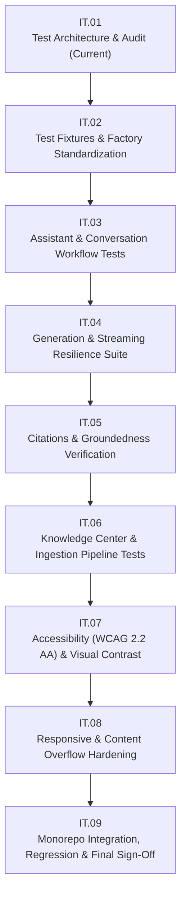

# AI-09.10 — IT.01: Test Architecture and Acceptance Audit

> **Module**: Kynergy Intelligence (`apps/web/src/modules/intelligence`, `apps/api/src/ai`, `packages/core/src/ai`)  
> **Milestone**: AI-09.10 — IT.01  
> **Role**: Principal QA Architect, Senior Frontend Engineer, and Backend Test Engineer  
> **Status**: **READY WITH RISKS**  
> **Date**: November 26, 2026  
> **Target File**: `docs/ai/AI-09/AI-09.10-IT.01-test-architecture-and-acceptance-audit.md`

---

## 1. Executive Summary & Audit Verdict

### Verdict: **READY WITH RISKS**

The Kynergy monorepo possesses a mature, robust test infrastructure comprising **Jest 29.7.0**, **`ts-jest`**, **React Testing Library (v16.3)**, **`jest-axe` (v11.0)**, and real **PostgreSQL/pgvector** database integration testing via NestJS `TestingModule` and Prisma. Across the AI subsystem, **179 test suites** and **over 6,000 unit/integration tests** are already implemented and passing (66 suites in `apps/web/src/modules/intelligence`, 41 suites in `apps/api/src/ai`, and 72 suites in `packages/core/src/ai`).

#### Key Risks Identified:

1. **Absence of a Real Browser Automation Runner (Playwright/Cypress)**: All frontend testing is executed inside `jsdom`. Consequently, real CSS rendering engine calculations (e.g., true bounding box collisions, actual scroll height metrics, native font metrics, subpixel layout reflows) must be simulated or verified through component test abstractions rather than a headless Chromium/WebKit binary.
2. **ESM / ts-jest Incompatibility with MSW v2 in Test Specs**: Mock Service Worker (MSW v2) is active in the development server (`main.tsx`), but intentionally disabled in Jest test specs due to ESM/CJS transpilation boundaries with `@mswjs/interceptors` (documented in [jest-msw-setup.ts](file:///c:/Projects/kinergy-platform/apps/web/src/test/jest-msw-setup.ts)). Tests rely on `jest.spyOn(apiClient, ...)` or `jest.spyOn(global, 'fetch')`.
3. **Database Concurrency and Connection Pressure**: Backend integration tests run against real PostgreSQL. On multi-worker execution, concurrent migrations or unbounded connection pools can lead to connection exhaustion or intermittent worker stat errors unless constrained via `maxWorkers: 2` and explicit tenant-scoped isolation.

---

## 2. Test Architecture Inventory

### 2.1 Frontend Test Infrastructure (`apps/web`)

| Dimension                | Implementation Details                                                                                                                                                                                              | Authoritative File / Configuration                                                                                                                                            |
| :----------------------- | :------------------------------------------------------------------------------------------------------------------------------------------------------------------------------------------------------------------ | :---------------------------------------------------------------------------------------------------------------------------------------------------------------------------- |
| **Test Runner**          | Jest `29.7.0` running under `@nx/jest/preset`                                                                                                                                                                       | [apps/web/jest.config.ts](file:///c:/Projects/kinergy-platform/apps/web/jest.config.ts), [jest.preset.js](file:///c:/Projects/kinergy-platform/jest.preset.js)                |
| **Compiler / Transform** | `ts-jest` `29.2.5` targeting `tsconfig.spec.json`                                                                                                                                                                   | [apps/web/tsconfig.spec.json](file:///c:/Projects/kinergy-platform/apps/web/tsconfig.spec.json)                                                                               |
| **Test Environment**     | `jsdom` (simulated browser DOM, window, document)                                                                                                                                                                   | [apps/web/jest.config.ts:4](file:///c:/Projects/kinergy-platform/apps/web/jest.config.ts#L4)                                                                                  |
| **Component Testing**    | `@testing-library/react` (v16.3.0), `@testing-library/jest-dom` (v7.0.0)                                                                                                                                            | [package.json](file:///c:/Projects/kinergy-platform/package.json)                                                                                                             |
| **Render Harness**       | `renderWithProviders()`: wraps target components in `QueryClientProvider`, `ThemeProvider`, `NotificationProvider`, `AuthProvider`, `LocaleProvider`, `FeatureFlagProvider`, `MemoryRouter`                         | [apps/web/src/test/test-utils.tsx](file:///c:/Projects/kinergy-platform/apps/web/src/test/test-utils.tsx)                                                                     |
| **Network Mocking**      | Module spy mocking (`jest.spyOn(conversationApi, '...')`, `jest.spyOn(knowledgeApi, '...')`) and global transport spies (`jest.spyOn(global, 'fetch')`). Note: MSW v2 is used in dev server, bypassed in Jest specs | [apps/web/src/test/jest-msw-setup.ts](file:///c:/Projects/kinergy-platform/apps/web/src/test/jest-msw-setup.ts)                                                               |
| **Accessibility Tools**  | `jest-axe` (v11.0.0) extending Jest matchers with `toHaveNoViolations`                                                                                                                                              | [packages/ui/src/test-setup.ts](file:///c:/Projects/kinergy-platform/packages/ui/src/test-setup.ts), [package.json:17](file:///c:/Projects/kinergy-platform/package.json#L17) |
| **Browser Automation**   | None installed (No Playwright, Cypress, Puppeteer, or Selenium in workspace)                                                                                                                                        | [package.json](file:///c:/Projects/kinergy-platform/package.json)                                                                                                             |
| **Execution Scripts**    | `pnpm nx test web`, `pnpm test:web`, `pnpm test:a11y`, `pnpm validate`                                                                                                                                              | [package.json:11-23](file:///c:/Projects/kinergy-platform/package.json#L11-L23)                                                                                               |

### 2.2 Backend Test Infrastructure (`apps/api` & `packages/core`)

| Dimension                     | Implementation Details                                                                                                                                                                  | Authoritative File / Configuration                                                                                                                                                                                       |
| :---------------------------- | :-------------------------------------------------------------------------------------------------------------------------------------------------------------------------------------- | :----------------------------------------------------------------------------------------------------------------------------------------------------------------------------------------------------------------------- |
| **Test Runner**               | Jest `29.7.0` running in `node` environment with `--experimental-vm-modules`                                                                                                            | [apps/api/jest.config.js](file:///c:/Projects/kinergy-platform/apps/api/jest.config.js), [packages/core/jest.config.ts](file:///c:/Projects/kinergy-platform/packages/core/jest.config.ts)                               |
| **Worker Throttling**         | `maxWorkers: 2`, `workerIdleMemoryLimit: '512MB'` to prevent Windows file locking and memory bloat                                                                                      | [apps/api/jest.config.js:7-8](file:///c:/Projects/kinergy-platform/apps/api/jest.config.js#L7-L8)                                                                                                                        |
| **DI Testing Modules**        | `@nestjs/testing` (`Test.createTestingModule(...)`)                                                                                                                                     | e.g. [apps/api/src/ai/conversation/**tests**/ai-conversation-api.integration.spec.ts](file:///c:/Projects/kinergy-platform/apps/api/src/ai/conversation/__tests__/ai-conversation-api.integration.spec.ts#L1-L65)        |
| **Database Engine**           | Real PostgreSQL 16 container with `pgvector` extension                                                                                                                                  | [docker-compose.yml](file:///c:/Projects/kinergy-platform/docker-compose.yml), [.github/workflows/ci.yml:21-34](file:///c:/Projects/kinergy-platform/.github/workflows/ci.yml#L21-L34)                                   |
| **ORM / Migration**           | Prisma Client (`@prisma/client`) with schema migrations deployed via `pnpm prisma:migrate:deploy`                                                                                       | [prisma/schema.prisma](file:///c:/Projects/kinergy-platform/prisma/schema.prisma)                                                                                                                                        |
| **Security Mocking**          | Guard overrides: `.overrideGuard(AuthenticationGuard).useValue({ canActivate: () => true })`, `.overrideGuard(AuthorizationGuard).useValue(...)`, and `@TrustedAiContext` test fixtures | e.g. [apps/api/src/ai/conversation/**tests**/ai-conversation-api.integration.spec.ts:26-49](file:///c:/Projects/kinergy-platform/apps/api/src/ai/conversation/__tests__/ai-conversation-api.integration.spec.ts#L26-L49) |
| **Database Isolation**        | Partitioned test tenants (`tenant_int_alpha`, `tenant_int_beta`, `tenant_test_e2e`) with explicit `DELETE` in `beforeEach` and `afterAll`                                               | e.g. [apps/api/src/ai/conversation/**tests**/ai-conversation-api.integration.spec.ts:66-85](file:///c:/Projects/kinergy-platform/apps/api/src/ai/conversation/__tests__/ai-conversation-api.integration.spec.ts#L66-L85) |
| **Parser & Storage Pipeline** | `DocumentProcessingPipelineService`, `CompositeDocumentParserAdapter` (markdown, docx, pdf, plain-text), and `LocalStorageAdapter` / `MediaStorageService`                              | [apps/api/src/ai/adapters/parsers/](file:///c:/Projects/kinergy-platform/apps/api/src/ai/adapters/parsers/)                                                                                                              |

### 2.3 CI / CD Workflow (`.github/workflows/ci.yml`)

- **Host**: `ubuntu-latest` running Node.js via `.nvmrc` and `pnpm 11.17.0`.
- **Services**:
  1. `postgres`: `pgvector/pgvector:pg16` on port `5433:5432` for `kinergy_dev`.
  2. `staging-postgres`: `pgvector/pgvector:pg16` on port `5434:5432` for `kinergy_staging`.
- **Pre-requisite Steps**: Deploy dev database migrations, provision staging roles, deploy staging migrations.
- **Verification Gates**:
  1. `pnpm test:a11y` (`nx test ui --testFile="accessibility|contrast" && nx test web --testFile=accessibility`)
  2. `pnpm validate` (`run-s format:check lint typecheck test build`)

---

## 3. Feature-to-Test Coverage Traceability Matrix

### 3.1 Assistant & Conversations

| Requirement / Capability             | Frontend Coverage (JSDOM)                                                                        | Backend Integration Coverage (PostgreSQL)                                                                                | Status      |
| :----------------------------------- | :----------------------------------------------------------------------------------------------- | :----------------------------------------------------------------------------------------------------------------------- | :---------- |
| **Conversation Creation**            | `conversation-creation.spec.tsx` (10 tests)                                                      | `ai-conversation-api.integration.spec.ts` (Turn 1 creation), `create-conversation-with-initial-turn.integration.spec.ts` | **COVERED** |
| **Listing & Retrieval**              | `conversation-listing.spec.tsx` (8 tests), `conversation-retrieval.spec.tsx` (8 tests)           | `ai-conversation-retrieval.spec.ts`, `load-canonical-conversation-history.use-case.spec.ts`                              | **COVERED** |
| **Message History & Cursors**        | `conversation-history.spec.tsx` (10 tests), `pagination-resilience-url-sync.spec.tsx` (12 tests) | `get-message-history.use-case.spec.ts`, `ai-conversation-api.integration.spec.ts`                                        | **COVERED** |
| **Message Persistence & Fencing**    | `assistant-storage.service.spec.ts` (6 tests), `assistant-queries-mutations.spec.tsx` (14 tests) | `conversation-and-message-workflows.integration.spec.ts`, `ai-be07-persistence-recovery.spec.ts`                         | **COVERED** |
| **Renaming & Soft Deletion**         | `conversation-renaming.spec.tsx` (6 tests), `conversation-deletion.spec.tsx` (6 tests)           | `ai-conversation-renaming.spec.ts`, `ai-conversation-deletion.spec.ts`                                                   | **COVERED** |
| **Navigation & URL Synchronization** | `intelligence-routing.spec.tsx` (8 tests), `pagination-resilience-url-sync.spec.tsx` (12 tests)  | N/A (Frontend Router responsibility)                                                                                     | **COVERED** |

### 3.2 Generation & Streaming

| Requirement / Capability                  | Frontend Coverage (JSDOM)                                                                                        | Backend Integration Coverage (PostgreSQL)                                                                                                       | Status      |
| :---------------------------------------- | :--------------------------------------------------------------------------------------------------------------- | :---------------------------------------------------------------------------------------------------------------------------------------------- | :---------- |
| **Message Submission & Auto-scroll**      | `chat-workspace.spec.tsx` (14 tests), `message-components.spec.tsx` (12 tests)                                   | `ai-conversation.controller.spec.ts`, `reserve-conversation-turn.integration.spec.ts`                                                           | **COVERED** |
| **Generation Lifecycle FSM**              | `generation-lifecycle-and-cancellation.spec.tsx` (16 tests), `generation-lifecycle.spec.tsx` (12 tests)          | `ai-persisted-generation-lifecycle.integration.spec.ts`, `rag-turn-pipeline.adapter.ts`                                                         | **COVERED** |
| **Streaming Event Rendering**             | `chat-message-feed.tsx` ARIA live assertions, `intelligence-generation-streaming-resilience.spec.tsx` (10 tests) | `ai-generation-dispatch-reliability.integration.spec.ts`                                                                                        | **COVERED** |
| **Interrupted Streams & Unknown Outcome** | `recovery-and-reconciliation.spec.tsx` (7 tests), `intelligence-recovery-hardening.spec.tsx` (14 tests)          | `ai-be07-persistence-recovery.spec.ts`, `ai-turn-error-classifier.spec.ts`                                                                      | **COVERED** |
| **Cancellation & Regeneration**           | `response-regeneration.spec.tsx` (8 tests), `generation-lifecycle-and-cancellation.spec.tsx` (16 tests)          | `cancel-conversation-turn.use-case.spec.ts`, `regenerate-conversation-turn.use-case.spec.ts`, `ai-conversation-regeneration.controller.spec.ts` | **COVERED** |
| **Duplicate Submission (Idempotency)**    | `intelligence-message-submission-resilience.spec.tsx` (12 tests)                                                 | `ai-be07-idempotency-acceptance.spec.ts`, `ai-conversation.dtos.spec.ts` (hash matching)                                                        | **COVERED** |

### 3.3 Citations & Verbatim Sources

| Requirement / Capability               | Frontend Coverage (JSDOM)                                                                          | Backend Integration Coverage (PostgreSQL)                                                       | Status      |
| :------------------------------------- | :------------------------------------------------------------------------------------------------- | :---------------------------------------------------------------------------------------------- | :---------- |
| **Citation Extraction & Attribution**  | `citation-rendering.spec.tsx` (14 tests), `citation-historical-reconstruction.spec.tsx` (12 tests) | `ai-grounded-source-attribution.spec.ts`, `ai-citation-provenance-integration.spec.ts`          | **COVERED** |
| **Multiple Citations & Deduplication** | `message-citations.tsx` tests, `citation-rendering.spec.tsx`                                       | `ai-source-attribution.service.spec.ts`, `get-message-citations.use-case.spec.ts`               | **COVERED** |
| **Source Details Drawer & Excerpt**    | `source-details-drawer.spec.tsx` (16 tests), `citation-detail-dialog.tsx` tests                    | `get-citation-detail.use-case.spec.ts`, `get-citation-preview.use-case.spec.ts`                 | **COVERED** |
| **Inaccessible / Deleted Sources**     | `intelligence-auth-source-resilience.spec.tsx` (10 tests)                                          | `ai-conversation-security.spec.ts`, `ai-be07-security-hardening.spec.ts`                        | **COVERED** |
| **Document Content Streaming**         | `document-preview.spec.tsx` (12 tests)                                                             | `ai-conversation-citation.controller.spec.ts`, `ai-document.controller.spec.ts` (`:id/content`) | **COVERED** |

### 3.4 Knowledge Center & Ingestion

| Requirement / Capability                 | Frontend Coverage (JSDOM)                                                                                | Backend Integration Coverage (PostgreSQL)                                              | Status      |
| :--------------------------------------- | :------------------------------------------------------------------------------------------------------- | :------------------------------------------------------------------------------------- | :---------- |
| **Document Listing & Table Sorting**     | `knowledge-library.spec.tsx` (14 tests), `knowledge-document-table.tsx` tests                            | `ai-document.controller.spec.ts`, `ai-knowledge-documents.integration.spec.ts`         | **COVERED** |
| **Search, Mime & Scope Filtering**       | `knowledge-library-toolbar.tsx` tests, `knowledge-library.spec.tsx`                                      | `ai-document.controller.spec.ts` (query parameters)                                    | **COVERED** |
| **Upload Validation (<10MB, MIME)**      | `document-upload.spec.tsx` (12 tests)                                                                    | `document-content-validator.service.spec.ts`, `secure-document-upload.service.spec.ts` | **COVERED** |
| **Ingestion 7-Stage Stepper & Polling**  | `ingestion-status-polling.spec.tsx` (10 tests), `ingestion-lifecycle-timeline.spec.tsx` (12 tests)       | `ingestion-orchestrator.service.spec.ts`, `ai-ingestion.controller.spec.ts`            | **COVERED** |
| **Ingestion Failure & Retry**            | `ingestion-retry-workflows.spec.tsx` (10 tests), `intelligence-knowledge-failure-ux.spec.tsx` (12 tests) | `ingestion-retry.policy.spec.ts`, `ingestion-recovery.worker.spec.ts`                  | **COVERED** |
| **Document Detail & Version Comparison** | `document-detail.spec.tsx` (14 tests), `document-version-history.spec.tsx` (10 tests)                    | `ai-document.controller.spec.ts` (`:id/versions`), `document-version.entity.spec.ts`   | **COVERED** |

### 3.5 Security, Accessibility & UX Hardening

| Requirement / Capability               | Frontend Coverage (JSDOM)                                                                                                    | Backend Integration Coverage (PostgreSQL)                                 | Status      |
| :------------------------------------- | :--------------------------------------------------------------------------------------------------------------------------- | :------------------------------------------------------------------------ | :---------- |
| **RBAC & Guard Enforcement**           | `intelligence-navigation-rbac.spec.tsx` (10 tests), `intelligence-layout.spec.tsx` (12 tests)                                | `ai-conversation-security.spec.ts`, `ai-be07-security-hardening.spec.ts`  | **COVERED** |
| **Loading, Empty & Error States**      | `intelligence-loading-and-empty-states.spec.tsx` (14 tests)                                                                  | `ai-exception.filter.spec.ts`, `ai-conversation-exception.filter.spec.ts` | **COVERED** |
| **WCAG 2.2 AA Semantics & ARIA**       | `intelligence-semantic-accessibility.spec.tsx` (14 tests)                                                                    | N/A                                                                       | **COVERED** |
| **Keyboard Navigation & Roving Focus** | `intelligence-keyboard-focus-navigation.spec.tsx` (14 tests), `accessibility-keyboard-ux.spec.tsx` (10 tests)                | N/A                                                                       | **COVERED** |
| **Color Contrast & Brand Green**       | `intelligence-contrast-visual-accessibility.spec.tsx` (14 tests), `packages/ui/src/tokens/__tests__/contrast-matrix.spec.ts` | N/A                                                                       | **COVERED** |
| **Responsive Viewports & Overflow**    | `intelligence-responsive-layout.spec.tsx` (14 tests), `intelligence-overflow-conversation-hardening.spec.tsx` (16 tests)     | N/A                                                                       | **COVERED** |

---

## 4. Integration Boundaries

| Test Category                  | Target Scope                                                                      | Real Dependencies                                                                | Controlled / Mocked Dependencies                                               |
| :----------------------------- | :-------------------------------------------------------------------------------- | :------------------------------------------------------------------------------- | :----------------------------------------------------------------------------- |
| **Pure Unit Tests**            | Domain models, Value Objects, Mappers, Policies                                   | Pure TypeScript algorithms, domain invariants                                    | Zero external dependencies, no DOM, no DB                                      |
| **Component Tests**            | UI Primitives, Widgets, Form Controls, Dialogs, Drawers                           | React 18 engine, `@testing-library/react`, DOM events, CSS class application     | API clients (mocked methods), TanStack Query cache (controlled reset)          |
| **API Contract Tests**         | DTO Validation, Zod Schemas, Exception Serialization                              | `class-validator`, `zod`, `AiFailureClassifier`                                  | Network transport, Database                                                    |
| **Backend Integration Tests**  | Controllers, Use Cases, Repositories, DB transactions                             | Real PostgreSQL 16 container, Prisma Client, Relational Constraints, FK Cascades | External LLM inference (Ollama mock adapter), S3 storage (LocalStorageAdapter) |
| **Frontend Integration Tests** | Full feature flows across multiple views and cache states                         | React Router, TanStack Query, AuthProvider, NotificationProvider, JSDOM          | Network layer (`fetch` / API client spies), Real browser rendering engine      |
| **End-to-End Scenarios**       | Multi-turn user journey (Login -> Chat -> Stream -> Citation -> Knowledge Detail) | Full module component tree, State stores, Query Client, Route navigation         | Backend HTTP endpoints mocked with deterministic response sequences            |

---

## 5. Testability Gaps & Actionable Recommendations

1. **Absence of Real Browser Viewport Geometry (Gap 1)**:
   - _Observation_: JSDOM does not calculate layout boxes (`offsetWidth`, `clientHeight`, `getBoundingClientRect()` return zeros or defaults). Responsive tests assert presence of Tailwind CSS breakpoint utility classes (`hidden md:flex`, `grid-cols-1 lg:grid-cols-4`) rather than measured element box reflows.
   - _Recommendation for AI-09.10_: Retain high-fidelity DOM attribute assertions in JSDOM; formulate a future Playwright suite proposal without altering current dependencies.
2. **ESM / Jest Network Mocking Disconnect (Gap 2)**:
   - _Observation_: MSW v2 cannot run inside ts-jest specs without experimental ESM flags that break Nx caching.
   - _Recommendation for AI-09.10_: Standardize a centralized mock response factory (`apps/web/src/test/factories/intelligence-test.factories.ts`) so component tests reuse unified, type-safe API mock payloads.
3. **Timer Leakage in Asynchronous Extraction (Gap 3)**:
   - _Observation_: Unhandled `setTimeout` in document parsers previously triggered `Test environment has been torn down` in Jest workers.
   - _Recommendation for AI-09.10_: All async timers and worker intervals must be protected with `try/finally` blocks and `clearTimeout`.
4. **Local Storage and Query Cache Synchronization (Gap 4)**:
   - _Observation_: Active conversations synchronize between localStorage and QueryClient cache.
   - _Recommendation for AI-09.10_: Test harnesses must systematically clear both `localStorage.clear()` and `queryClient.clear()` in `afterEach`.

---

## 6. Prioritized Implementation Plan (IT.02 – IT.09)

### Milestone Schedule:

1. **IT.02 — Test Fixtures, Factories & Contract Harness**: Build type-safe test factories (`createMockConversation()`, `createMockMessage()`, `createMockCitation()`, `createMockDocument()`, `createMockIngestionJob()`) ensuring consistent test data across all tests.
2. **IT.03 — Assistant & Conversation Multi-Turn Integration**: Deepen end-to-end multi-turn conversation scenarios (turn continuation, cursor-based backward pagination, optimistic turn state rollback, thread switching).
3. **IT.04 — Generation, Streaming & Error Resilience Hardening**: Stress test SSE disconnections, network timeouts, 401 token refresh retry loops, and 409 idempotency conflict handling.
4. **IT.05 — Citations, Source Verification & Content Security**: Verify source preview security (tamper-evident preview tokens, cross-tenant citation access denial, missing excerpt fallbacks).
5. **IT.06 — Knowledge Center, Multipart Upload & Ingestion Pipeline**: Test multipart file validation, 7-stage polling timelines, retry on failure, and version comparison diffs.
6. **IT.07 — Accessibility (WCAG 2.2 AA) & Visual Contrast Regression**: Automate complete `jest-axe` rule audits across all dialogs, drawers, message feeds, and theme contrast modes (Light Forest Green / Dark Neon Green).
7. **IT.08 — Responsive Viewport & Content Overflow Hardening**: Validate edge-case inputs (unbroken 2000-char strings, deeply nested markdown tables, huge code blocks, mobile 360px-430px layouts).
8. **IT.09 — Monorepo Full Regression & Final Acceptance Sign-Off**: Run full workspace regression across all 10 projects, verify zero regressions on Sales, Gym, Kinesiology, and Scheduling, execute CI pipeline verification.

---

## 7. Inspected Configurations & Files

- [package.json](file:///c:/Projects/kinergy-platform/package.json) (Scripts, Jest, Testing Library, and dependencies)
- [jest.preset.js](file:///c:/Projects/kinergy-platform/jest.preset.js) (Base Nx Jest preset configuration)
- [apps/web/jest.config.ts](file:///c:/Projects/kinergy-platform/apps/web/jest.config.ts) (Frontend Jest setup, jsdom environment)
- [apps/api/jest.config.js](file:///c:/Projects/kinergy-platform/apps/api/jest.config.js) (Backend Jest setup, node environment, worker constraints)
- [packages/core/jest.config.ts](file:///c:/Projects/kinergy-platform/packages/core/jest.config.ts) (Core domain Jest setup)
- [packages/ui/src/test-setup.ts](file:///c:/Projects/kinergy-platform/packages/ui/src/test-setup.ts) (`jest-axe` extension)
- [apps/web/src/test/test-utils.tsx](file:///c:/Projects/kinergy-platform/apps/web/src/test/test-utils.tsx) (`renderWithProviders` wrapper)
- [apps/web/src/test/jest-msw-setup.ts](file:///c:/Projects/kinergy-platform/apps/web/src/test/jest-msw-setup.ts) (Architectural MSW decision)
- [.github/workflows/ci.yml](file:///c:/Projects/kinergy-platform/.github/workflows/ci.yml) (CI environment, pgvector services, quality gates)
- [apps/api/src/ai/conversation/ai-conversation.controller.ts](file:///c:/Projects/kinergy-platform/apps/api/src/ai/conversation/ai-conversation.controller.ts) (API endpoints)
- [apps/api/src/ai/controllers/ai-document.controller.ts](file:///c:/Projects/kinergy-platform/apps/api/src/ai/controllers/ai-document.controller.ts) (Document endpoints)
- [apps/web/src/modules/intelligence/assistant/api/conversation.api.ts](file:///c:/Projects/kinergy-platform/apps/web/src/modules/intelligence/assistant/api/conversation.api.ts) (Client API)
- [apps/web/src/modules/intelligence/knowledge/api/knowledge.api.ts](file:///c:/Projects/kinergy-platform/apps/web/src/modules/intelligence/knowledge/api/knowledge.api.ts) (Client API)
- 66 test suites in `apps/web/src/modules/intelligence/`
- 41 test suites in `apps/api/src/ai/`
- 72 test suites in `packages/core/src/ai/`

---

## 8. Confirmation of Investigation-Only Scope

No application source code was modified during this audit. No test assertions were altered, no dependencies were installed, and the Git working tree remains completely clean on `main`.
