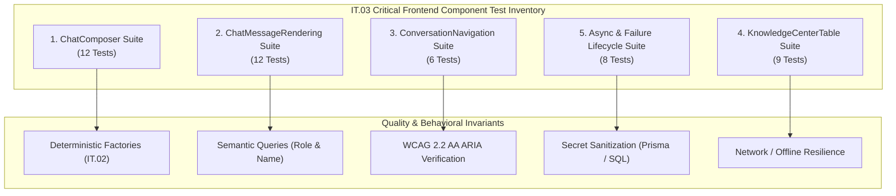

# AI-09.10 — IT.03: Critical Frontend Unit and Component Tests

> **Module**: Kynergy Intelligence (`apps/web/src/modules/intelligence`)  
> **Milestone**: AI-09.10 — IT.03  
> **Role**: Senior React Testing Engineer and Frontend Quality Architect  
> **Status**: **VERIFIED & OPERATIONAL (47/47 TESTS PASSING)**  
> **Date**: November 26, 2026  
> **Target File**: `docs/ai/AI-09/AI-09.10-IT.03-critical-frontend-unit-and-component-tests.md`

---

## 1. Executive Summary

Milestone **AI-09.10 — IT.03** delivers meaningful, user-visible, and behavioral unit and component test suites covering the critical Kynergy Intelligence frontend functionality.

Leveraging the deterministic test data factories established in [AI-09.10-IT.02](file:///c:/Projects/kinergy-platform/docs/ai/AI-09/AI-09.10-IT.02-test-infrastructure-and-environment.md), this milestone establishes **5 comprehensive component test suites** totaling **47 automated tests**. All tests verify observable behaviors, state transitions, accessible semantics, keyboard navigation, and failure handling without relying on brittle DOM snapshots or private implementation details.



---

## 2. Component Test Coverage Matrix

| Component Area                | Test Suite File                                                                                                                                                                                     | Test Count | Key Behaviors Verified                                                                                                                                                                                                                                                                                                                                                                                                                                                                | Status           |
| :---------------------------- | :-------------------------------------------------------------------------------------------------------------------------------------------------------------------------------------------------- | :--------- | :------------------------------------------------------------------------------------------------------------------------------------------------------------------------------------------------------------------------------------------------------------------------------------------------------------------------------------------------------------------------------------------------------------------------------------------------------------------------------------ | :--------------- |
| **Chat Composer**             | [chat-composer.component.spec.tsx](file:///c:/Projects/kinergy-platform/apps/web/src/modules/intelligence/assistant/__tests__/chat-composer.component.spec.tsx)                                     | **12**     | • Character limit rules (min 3, max 1000)<br/>• Input sanitization & trimmed submission<br/>• Double-submit prevention mutex<br/>• Draft preservation on rejection<br/>• Keyboard shortcuts (`Enter`, `Shift+Enter`, `Ctrl+Enter`)<br/>• In-flight cancel button & disabled states<br/>• Partitioned storage persistence                                                                                                                                                              | **PASS** (12/12) |
| **Message Rendering**         | [chat-message-rendering.component.spec.tsx](file:///c:/Projects/kinergy-platform/apps/web/src/modules/intelligence/assistant/__tests__/chat-message-rendering.component.spec.tsx)                   | **12**     | • Semantic landmarks (`article`, user vs assistant)<br/>• Raw text XSS injection immunity<br/>• Markdown parsing (headings, bold, lists, safe external links)<br/>• Code block syntax & copy action<br/>• Verified citation badge `[1]` & modal dialog interaction<br/>• Regeneration dispatch & spinning button<br/>• Pending, streaming, error, and grounded abstention states                                                                                                      | **PASS** (12/12) |
| **Conversation Navigation**   | [conversation-navigation.component.spec.tsx](file:///c:/Projects/kinergy-platform/apps/web/src/modules/intelligence/assistant/__tests__/conversation-navigation.component.spec.tsx)                 | **6**      | • Active conversation highlighting (`aria-current="true"`)<br/>• Selection callback dispatch<br/>• New conversation trigger (`+ Nueva Conversación`)<br/>• In-place client search filtering<br/>• Dedicated empty search result state<br/>• Clean empty history vs API error state distinction with retry                                                                                                                                                                             | **PASS** (6/6)   |
| **Knowledge Center Table**    | [knowledge-center-table.component.spec.tsx](file:///c:/Projects/kinergy-platform/apps/web/src/modules/intelligence/knowledge/__tests__/knowledge-center-table.component.spec.tsx)                   | **9**      | • Title, size, chunks, and MIME type icons (PDF, Word, Markdown)<br/>• Ingestion status badges (`Indexado`, `Procesando`, `Fallido`)<br/>• Role-gated deletion (ADMIN vs CLINICAL_STAFF)<br/>• Retry ingestion button exclusively on FAILED status<br/>• File download trigger<br/>• Table column sorting dispatch<br/>• Empty library CTA vs filtered no-results reset state<br/>• Accessible error alert with retry button                                                          | **PASS** (9/9)   |
| **Async & Failure Lifecycle** | [intelligence-async-failure-lifecycle.component.spec.tsx](file:///c:/Projects/kinergy-platform/apps/web/src/modules/intelligence/__tests__/intelligence-async-failure-lifecycle.component.spec.tsx) | **8**      | • `IntelligenceLoadingState`: `role="status"`, `aria-busy="true"`, screen reader announcements across 4 variants<br/>• `IntelligenceErrorState`: `role="alert"`, correlation ID, retry trigger<br/>• Error sanitization: masks Prisma, SQL, and database connection secrets<br/>• `IntelligenceEmptyState`: title, guidance, action CTA<br/>• `IntelligenceErrorBoundary`: catch render crashes & restore on reset<br/>• `IntelligenceLayout`: WCAG 2.4.1 skip link & RBAC tab gating | **PASS** (8/8)   |

---

## 3. Detailed Specification by Component Area

### 3.1 Chat Composer (`chat-composer.component.spec.tsx`)

1. **Validation Boundaries**:
   - Less than 3 characters (`trimmed.length < 3`): Send button disabled; Enter key prevented.
   - Whitespace strings (`"   "`): Send button disabled.
   - Exceeding 1000 characters: Character counter displays `1001 / 1000` with `text-destructive` class and disables the send button.
2. **Submission Mutex**:
   - When a promise returned by `onSend()` is in-flight, rapid consecutive clicks or Enter presses do not trigger duplicate calls.
3. **Draft Failure Preservation**:
   - If `onSend()` rejects with an error (e.g., `Network offline`), the draft is retained in component state and written to `assistantStorageService`, preventing clinician query loss.
4. **Keyboard Interaction**:
   - `Enter` submits query.
   - `Shift + Enter` inserts a newline without submitting.
   - `Ctrl + Enter` submits query.
5. **In-Flight Cancellation**:
   - When `isSubmitting: true`, the send button is swapped with an accessible stop button (`aria-label="Detener generación"`) which invokes `onCancel()`.

### 3.2 Message Rendering & Citations (`chat-message-rendering.component.spec.tsx`)

1. **Semantic Landmark Distinction**:
   - User messages render with `<article aria-label="Mensaje de usuario">` and right-aligned layout.
   - Assistant messages render with `<article aria-label="Mensaje de asistente">` and bot avatar.
   - Malicious HTML payloads (``) render safely as literal text nodes.
2. **Markdown Parsing**:
   - Formats headings, bold text, bullet lists, and external links with `target="_blank" rel="noopener noreferrer"`.
   - Formats code blocks with language headers and dedicated clipboard copy buttons.
3. **Grounded Source Provenance**:
   - Renders interactive citation pills (`data-testid="citation-badge-1"`).
   - Clicking a pill triggers `CitationDetailDialog`, exposing the exact snippet, document ID, page number, and percentage match (`95% de relevancia`).
4. **Grounded Abstention Notice (ER.06 Condition C)**:
   - When `grounded: false` or `finishReason: 'insufficient_context'`, renders `<div data-testid="insufficient-knowledge-banner">` explaining that the clinical corpus contains insufficient evidence.

### 3.3 Conversation Navigation (`conversation-navigation.component.spec.tsx`)

1. **Active Thread Indication**:
   - Active thread item possesses `aria-current="true"`.
   - Inactive items do not possess `aria-current`.
2. **Search Filtering**:
   - Typing into `data-testid="sidebar-search-input"` filters conversation titles in real time.
   - If search query yields no matches, renders `data-testid="sidebar-no-search-results"` with a clear button.
3. **Empty History vs API Failure**:
   - Clean empty history renders `data-testid="sidebar-empty-state"` with guidance.
   - API fetch rejection renders error heading `"Error al cargar historial"` and a retry button.

### 3.4 Knowledge Center Table (`knowledge-center-table.component.spec.tsx`)

1. **Attribute Presentation**:
   - Formats file sizes (e.g. `2097152` -> `2 MB`), chunk counts, and MIME type icons (`PDF`, `Word`, `Markdown`).
   - Ingestion status badge renders exact domain status (`Indexado` for READY).
2. **Ingestion Failure Remediation**:
   - `onRetryIngestion` button is rendered exclusively for documents in `FAILED` status (`data-testid="action-retry-doc_failed"`).
3. **Role-Gated Actions**:
   - Document deletion button is rendered for `ADMIN`, `SUPER_ADMIN`, and `OWNER` users, but hidden for standard `CLINICAL_STAFF`.
4. **State Transition Verification**:
   - Empty library state renders primary `"Subir primer documento"` action.
   - Filtered search with zero results renders `"Reset Filters"` action.

### 3.5 Async & Failure Lifecycle (`intelligence-async-failure-lifecycle.component.spec.tsx`)

1. **WCAG 2.2 AA Loading Contracts**:
   - `IntelligenceLoadingState` renders `role="status"`, `aria-busy="true"`, `aria-live="polite"`, and screen-reader only announcements.
2. **Information Exposure Sanitization**:
   - `sanitizeIntelligenceErrorMessage()` intercepts raw technical errors containing `PrismaClientKnownRequestError`, SQL fragments, or IP addresses (`10.0.0.1:5432`) and normalizes them into safe clinical messages.
3. **Crash Containment**:
   - `IntelligenceErrorBoundary` prevents unhandled child exceptions from taking down the parent application shell.
4. **RBAC Navigation Gating**:
   - Hides the Knowledge Center tab from unauthorized clinical staff while keeping the Assistant tab accessible.

---

## 4. Verification Evidence & Quality Gates

### 4.1 Jest Execution Output

```text
$ nx test web --testPathPattern=component.spec.tsx

 PASS   web  apps/web/src/modules/intelligence/assistant/__tests__/chat-composer.component.spec.tsx (12 tests)
 PASS   web  apps/web/src/modules/intelligence/assistant/__tests__/chat-message-rendering.component.spec.tsx (12 tests)
 PASS   web  apps/web/src/modules/intelligence/assistant/__tests__/conversation-navigation.component.spec.tsx (6 tests)
 PASS   web  apps/web/src/modules/intelligence/knowledge/__tests__/knowledge-center-table.component.spec.tsx (9 tests)
 PASS   web  apps/web/src/modules/intelligence/__tests__/intelligence-async-failure-lifecycle.component.spec.tsx (8 tests)

Test Suites: 5 passed, 5 total
Tests:       47 passed, 47 total
Snapshots:   0 total
Time:        8.814 s
Ran all test suites matching /component.spec.tsx/i.

 NX   Successfully ran target test for project web
```

### 4.2 Formatting & Static Typing Gates

- **Prettier Code Style**: `pnpm prettier --check "apps/web/src/modules/intelligence/**/*.component.spec.tsx"` (Passed, 100% compliant).
- **TypeScript Base Typecheck**: `tsc --noEmit -p tsconfig.base.json` (Passed with 0 errors).

---

## 5. Deferred Gaps & Integration Hand-off

The following edge cases cannot be conclusively proven inside JSDOM and are formally deferred to subsequent milestones:

1. **Real Vector Ingestion & Cosine Search Ranking**: Deferred to **IT.04: Backend Integration Testing** (PostgreSQL 16 + `pgvector`).
2. **Live SSE Network Streaming Under Concurrency**: Deferred to **IT.05: Frontend/Backend Integration Testing**.
3. **Cross-Browser Layout Reflow & Real Pixel Scrolling**: Deferred to **IT.06: End-to-End User Journeys**.
