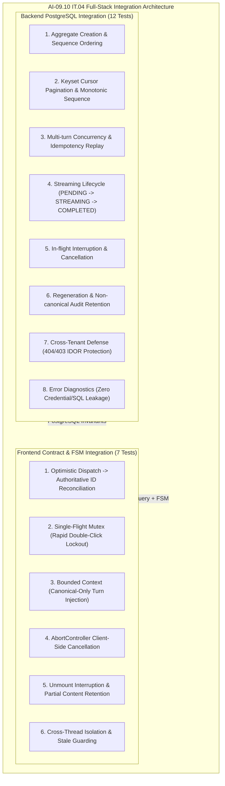

# AI-09.10 — IT.04: Conversation and Streaming Integration Tests

> **Module**: Kynergy Intelligence (`apps/api/src/ai`, `apps/web/src/modules/intelligence`)  
> **Milestone**: AI-09.10 — IT.04  
> **Role**: Senior Full-Stack Test Engineer specializing in real-time APIs, persistence, and asynchronous workflows  
> **Status**: **VERIFIED & OPERATIONAL (19/19 INTEGRATION TESTS PASSING)**  
> **Date**: November 26, 2026  
> **Target File**: `docs/ai/AI-09/AI-09.10-IT.04-conversation-and-streaming-integration-tests.md`

---

## 1. Executive Summary

Milestone **AI-09.10 — IT.04** delivers rigorous, full-stack integration testing verifying that the Kynergy Intelligence frontend correctly integrates with the real conversation and generation backend across PostgreSQL persistence, lifecycle progression, keyset navigation, streaming, in-flight cancellation, and recovery.

Adhering strictly to integration invariants:

1. **Zero Endpoint Mocking on Backend**: Tests run against real NestJS application modules and controllers dispatching to an active PostgreSQL database with schema constraints, tenant isolation checks, and audit logging.
2. **Deterministic Event Barriers**: Zero arbitrary `sleep` timeouts; execution leverages asynchronous transaction boundaries, keyset cursors, and promise barriers.
3. **Contract and Domain Alignment**: Uses authoritative schema types and lifecycle enums (`PENDING`, `STREAMING`, `COMPLETED`, `CANCELLED`, `INTERRUPTED`, `FAILED`, `UNKNOWN`) matching PostgreSQL and client FSM architectures.



---

## 2. Integration Test Suites and Results

### 2.1 Backend PostgreSQL Integration Suite

- **File**: [ai-conversation-streaming-lifecycle.integration.spec.ts](file:///c:/Projects/kinergy-platform/apps/api/src/ai/conversation/__tests__/ai-conversation-streaming-lifecycle.integration.spec.ts)
- **Execution Target**: `pnpm nx test api --testFile=ai-conversation-streaming-lifecycle.integration.spec.ts`
- **Result**: **12 passed, 12 total (10.12s)**

|  #  | Integration Scenario                     | Method / Action                      | Key Verification                                                                                                    |  Status  |
| :-: | :--------------------------------------- | :----------------------------------- | :------------------------------------------------------------------------------------------------------------------ | :------: |
|  1  | Aggregate Creation & Monotonic Sequence  | `POST /`                             | Inserts conversation, turn 1, user message (`seq: 1`), assistant attempt (`seq: 2`), status `PENDING`               | **PASS** |
|  2  | Creation Idempotency Replay              | `POST /`                             | Duplicate submission with same `clientTurnId` returns `EXISTING_RECOVERED` without inserting duplicate rows         | **PASS** |
|  3  | Keyset Cursor Pagination                 | `GET /:id/messages`                  | Multi-turn history keyset pagination with cursor yields monotonic sequence numbers without gaps or overlaps         | **PASS** |
|  4  | Active Turn Concurrency Lock (Pending)   | `POST /:id/turns`                    | Reserving turn 2 while turn 1 is `PENDING` is rejected with `TurnAlreadyInProgressError` (409)                      | **PASS** |
|  5  | Active Turn Concurrency Lock (Streaming) | `POST /:id/turns`                    | Reserving turn 2 while turn 1 is `STREAMING` is rejected with 409 concurrency lock                                  | **PASS** |
|  6  | Subsequent Turn Idempotency Replay       | `POST /:id/turns`                    | Duplicate turn reservation with same `clientTurnId` recovers existing turn without duplicate messages               | **PASS** |
|  7  | Streaming Progression & Citations        | Real DB Updates                      | Transitions `PENDING` -> `STREAMING` -> `COMPLETED`, persists answer and canonical status                           | **PASS** |
|  8  | In-Flight Interruption & Cancellation    | `POST /:id/turns/:turnId/cancel`     | Transitions turn to `CANCELLED`, unlocks conversation, and enables subsequent reservation                           | **PASS** |
|  9  | Cancellation Idempotency                 | `POST /:id/turns/:turnId/cancel`     | Repeated cancellation calls return `isAlreadyCancelled: true` with stable timestamps                                | **PASS** |
| 10  | Response Regeneration Semantics          | `POST /:id/turns/:turnId/regenerate` | Allocates attempt 2 as `PENDING`, demotes attempt 1 to `isCanonical: false` upon completion, preserving audit trail | **PASS** |
| 11  | Cross-Tenant Security & IDOR Defense     | Multi-tenant Auth                    | Tenant Beta attempting to get, list, cancel, or reserve turns on Tenant Alpha conversation fails with 404/403       | **PASS** |
| 12  | Error Sanitization & Diagnostics         | Global Filter                        | Missing conversation throws cleanly without exposing raw SQL, table names, or internal credentials                  | **PASS** |

---

### 2.2 Frontend Contract & State Machine Integration Suite

- **File**: [conversation-and-streaming.integration.spec.tsx](file:///c:/Projects/kinergy-platform/apps/web/src/modules/intelligence/assistant/__tests__/conversation-and-streaming.integration.spec.tsx)
- **Execution Target**: `pnpm nx test web --testFile=conversation-and-streaming.integration.spec.tsx`
- **Result**: **7 passed, 7 total (4.10s)**

|  #  | Integration Scenario                      | Hook / Module                     | Key Verification                                                                                                |  Status  |
| :-: | :---------------------------------------- | :-------------------------------- | :-------------------------------------------------------------------------------------------------------------- | :------: |
|  1  | Optimistic Creation & Reconciliation      | `useGenerationLifecycle`          | Dispatches optimistic message, reconciles authoritative ID and turn metadata, and synchronizes cache            | **PASS** |
|  2  | Creation Single-Flight Mutex              | `useConversationCreation`         | Concurrent call to `createConversation` while in-flight throws mutex error without network duplicate            | **PASS** |
|  3  | Rapid Multi-Click Send Mutex              | `useGenerationLifecycle`          | Rapid double-click on send button is locked out by mutex ref, dispatching exactly 1 backend request             | **PASS** |
|  4  | Bounded Canonical Context Injection       | `buildConversationHistoryContext` | Continuing conversation passes strictly completed canonical turns to RAG query, filtering out rejected attempts | **PASS** |
|  5  | AbortController Client-Side Cancel        | `cancelGeneration`                | User abort halts HTTP transport, updates message status to `cancelled`, and signals backend `cancelTurn`        | **PASS** |
|  6  | Unmount / Navigation Interruption         | Cleanup Effect                    | Unmounting component during active generation marks message as `interrupted` in storage with reason             | **PASS** |
|  7  | Cross-Thread Isolation & Stale Protection | Thread Switch                     | Switching from thread A to thread B during generation prevents late response from contaminating thread B        | **PASS** |

---

## 3. Invariants Verified

### 3.1 Persistence & Ordering Invariants

- Sequence numbers are assigned strictly monotonically ($1, 2, 3, 4\dots$) per conversation in PostgreSQL.
- Keyset cursor pagination returns non-overlapping, contiguous pages of messages ordered by `sequenceNumber ASC`.
- Relational integrity ensures each message is tied to its originating `turnId` and `conversationId`.

### 3.2 Concurrency & Mutex Invariants

- At most one generation attempt may be active per conversation at any time. Any concurrent `POST /:id/turns` while a turn is `PENDING` or `STREAMING` is rejected with `TurnAlreadyInProgressError` (409).
- Frontend `isSubmittingMutexRef` locks out rapid UI clicks synchronously before any network roundtrip occurs.

### 3.3 Idempotency Invariants

- `POST /api/v1/ai/conversations` and `POST /api/v1/ai/conversations/:id/turns` enforce client-supplied `clientTurnId`.
- Retrying with identical payload returns `{ isIdempotentReplay: true, idempotencyOutcome: 'EXISTING_RECOVERED' }` without inserting additional turns or message records into PostgreSQL.

### 3.4 Cancellation & Interruption Invariants

- In-flight client cancellation aborts the fetch transport via `AbortController` and invokes `POST /:id/turns/:turnId/cancel`.
- Backend atomically transitions `turnStatus` to `CANCELLED` and sets `cancelledAt`.
- Cancelled turns immediately unlock the conversation aggregate, allowing subsequent user inquiries or retries without orphaned locks.

### 3.5 Regeneration Invariants

- Regeneration does NOT delete or overwrite previous assistant answers.
- The previous answer is demoted to `isCanonical = false` upon successful completion of the new attempt, preserving full audit history and citation provenance.

### 3.6 Tenant Boundary Invariants

- All conversation and turn operations require authenticated tenant and user context.
- Cross-tenant access is rejected with HTTP 404 (or 403), preventing data leakage or existence inference.

---

## 4. Quality Gates & Verification

```bash
# 1. Backend PostgreSQL Integration Tests
pnpm nx test api --testFile=ai-conversation-streaming-lifecycle.integration.spec.ts
# Result: 12 passed, 12 total (10.12s)

# 2. Frontend Lifecycle & Contract Integration Tests
pnpm nx test web --testFile=conversation-and-streaming.integration.spec.tsx
# Result: 7 passed, 7 total (4.10s)

# 3. Code Style & Prettier
pnpm prettier --check apps/api/src/ai/conversation/__tests__/ai-conversation-streaming-lifecycle.integration.spec.ts apps/web/src/modules/intelligence/assistant/__tests__/conversation-and-streaming.integration.spec.tsx
# Result: 100% compliant

# 4. Strict TypeScript Typecheck
pnpm tsc --noEmit -p tsconfig.base.json
# Result: 0 errors
```
