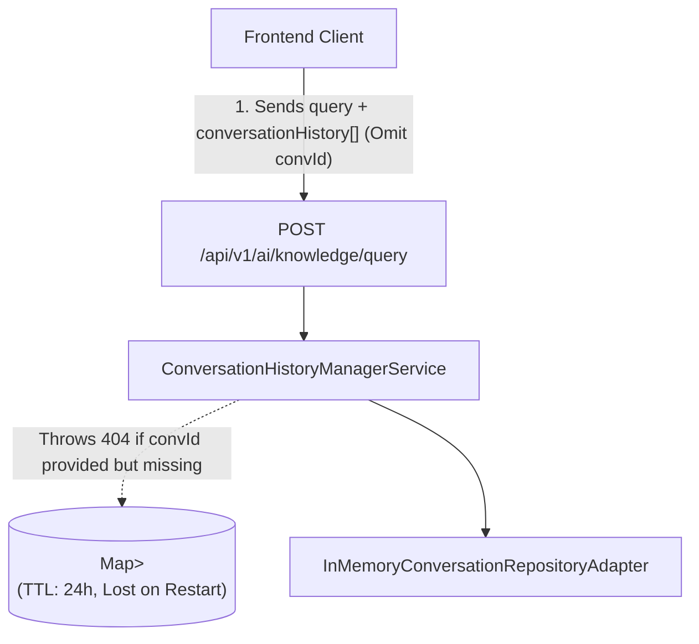
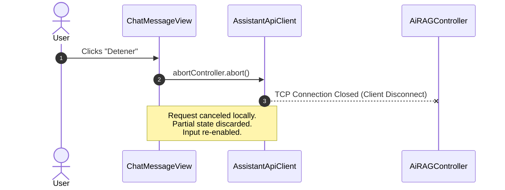
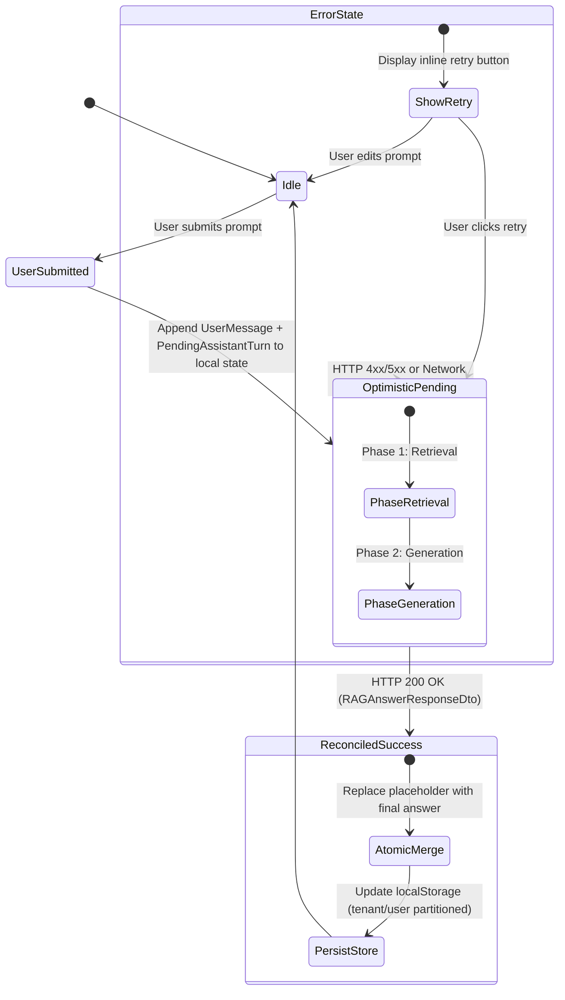
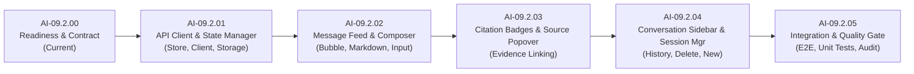

# AI-09.2.00 — AI Assistant Implementation Readiness & Contract Verification

> **Milestone:** AI-09.2.00  
> **Status:** COMPLETE  
> **Verdict:** READY WITH DEPENDENCIES  
> **Author:** Principal Software Architect, Senior React Engineer, AI Integration Specialist  
> **Date:** November 21, 2026  
> **Target Subsystem:** `apps/web/src/modules/intelligence/assistant/` & `apps/api/src/ai/`  
> **Governing Standards:** AI-09.0 Architecture Decisions (ADR-AI-09-01 through ADR-AI-09-05), Enterprise React Module Conventions

---

## Executive Summary

This audit assesses the implementation readiness for **AI-09.2: Conversational AI Assistant Interface** in Kynergy Platform. It evaluates the alignment between the foundational frontend module established in AI-09.1 (`apps/web/src/modules/intelligence/`) and the backend RAG and AI services delivered in AI-08 (`apps/api/src/ai/`).

### Overall Verdict: READY WITH DEPENDENCIES

The frontend application structure, route registration, layout composition, RBAC guards, and shared UI state patterns established in AI-09.1 are **100% production-ready** to host the conversational assistant. The backend RAG core query endpoint (`POST /api/v1/ai/knowledge/query`) is verified and functional. However, **two key architectural dependencies require disciplined client-side adaptations**:

1. **Server Conversation Persistence Endpoints are Missing:** There are no REST endpoints to manage conversation entities (`/conversations`). Client-side partitioned persistence (`localStorage`) with multi-turn history injection (`conversationHistory: ChatMessageDto[]`) will be used per **ADR-AI-09-01**.
2. **Server-Sent Events (SSE) / Real-Time Streaming is Missing at Controller Layer:** While the underlying LLM adapter supports generator streaming, `AiRAGController` exposes only a synchronous, blocking HTTP POST endpoint returning monolithic `RAGAnswerResponseDto`. Per **ADR-AI-09-02**, the frontend will implement synchronous phased loading feedback; simulated token typing is strictly prohibited.

---

## 1. Frontend Foundation Verification

The frontend foundations created during AI-09.1 were inspected against the requirements for AI-09.2:

| Component / Subsystem          | Location                                                                       | Readiness Status | Integration Role for AI-09.2                                                                                                                                                           |
| :----------------------------- | :----------------------------------------------------------------------------- | :--------------- | :------------------------------------------------------------------------------------------------------------------------------------------------------------------------------------- |
| **Module Entrypoint**          | `apps/web/src/modules/intelligence/index.ts`                                   | **READY**        | Exports public API, layout, route components, and shared state components.                                                                                                             |
| **Chat Route Host**            | `apps/web/src/modules/intelligence/assistant/routes/chat-page.tsx`             | **READY**        | Registered at `/intelligence/chat` and `/intelligence/chat/:conversationId`. Currently renders placeholder within `IntelligencePageContainer`. Will host the conversational workspace. |
| **Route Registration & Retry** | `apps/web/src/app/routes/app-router.tsx`                                       | **READY**        | Wrapped in `lazyWithRetry`, protected by `ProtectedRoute` (authenticated users), and rendered within `IntelligenceLayout`.                                                             |
| **Shared Layout Shell**        | `apps/web/src/modules/intelligence/components/intelligence-layout.tsx`         | **READY**        | Provides unified topbar, responsive breadcrumbs, tenant context, and `AIHealthPill`.                                                                                                   |
| **Shared UI States**           | `apps/web/src/modules/intelligence/components/intelligence-shared-states.tsx`  | **READY**        | Reusable `IntelligenceLoadingState`, `IntelligenceErrorState`, and `IntelligenceEmptyState` ready for chat conversation loading and error recovery.                                    |
| **Error Boundary**             | `apps/web/src/modules/intelligence/components/intelligence-error-boundary.tsx` | **READY**        | Isolates conversational UI runtime errors from crashing the global application shell.                                                                                                  |
| **Health Indicator**           | `apps/web/src/modules/intelligence/components/ai-health-pill.tsx`              | **READY**        | Polls `GET /api/v1/ai/health` with retry/backoff, showing LLM and Vector Store availability in real time.                                                                              |
| **Domain Contracts & Types**   | `apps/web/src/modules/intelligence/assistant/types/assistant.types.ts`         | **READY**        | Full definitions for `ChatMessage`, `ConversationSession`, `ConversationTurn`, `AssistantState`, and citation entities.                                                                |

---

## 2. Backend Endpoint Inventory

Inspection of `apps/api/src/ai/controllers/ai-rag.controller.ts` and related modules reveals the available HTTP endpoints:

### Primary Conversational Query Endpoint

- **Method:** `POST`
- **Path:** `/api/v1/ai/knowledge/query` (Aliases: `/api/v1/ai/rag/query`, `/api/v1/ai/query`)
- **Controller:** `AiRAGController.queryKnowledge()`
- **Guards:** `JwtAuthGuard`, `RolesGuard`, `TenantGuard`
- **Required Roles:** `ADMIN`, `OPERATOR`, `ENGINEER`, `VIEWER` (All authenticated tenant users)
- **Headers Required:**
  - `Authorization: Bearer <jwt_access_token>`
  - `x-tenant-id: <uuid>`
  - `Content-Type: application/json`
- **Response Format:** JSON (Monolithic `RAGAnswerResponseDto`, HTTP 200 OK)
- **Error Codes:**
  - `400 Bad Request`: Payload validation failure (query length, missing fields).
  - `401 Unauthorized`: Missing or invalid JWT token.
  - `403 Forbidden`: Insufficient role or tenant mismatch.
  - `404 Not Found`: Sent if an unknown `conversationId` is passed that does not exist in backend volatile memory.
  - `500 Internal Server Error`: LLM service offline, vector store unreachable, or timeout.

### Related AI Endpoints

| Endpoint                                     | Method | Roles                           | Purpose                                                                |
| :------------------------------------------- | :----- | :------------------------------ | :--------------------------------------------------------------------- |
| `/api/v1/ai/health`                          | `GET`  | Authenticated                   | Health status of RAG pipeline, LLM model, and Pinecone vector store.   |
| `/api/v1/ai/knowledge/documents`             | `GET`  | Authenticated                   | List ingested documents with pagination, status, and tenant filtering. |
| `/api/v1/ai/knowledge/documents/:id/status`  | `GET`  | Authenticated                   | Ingestion status for a specific document.                              |
| `/api/v1/ai/knowledge/documents/:id/content` | `GET`  | Authenticated                   | Download original document content (PDF/DOCX/TXT).                     |
| `/api/v1/ai/knowledge/documents/upload`      | `POST` | `ADMIN`, `OPERATOR`, `ENGINEER` | Upload document for background ingestion.                              |

---

## 3. AI-08 DTO Inventory & Contract Mapping

The frontend `assistant.types.ts` has been verified against the backend DTO definitions in `apps/api/src/ai/dto/`:

### 1. Request DTO: `QueryKnowledgeRequestDto`

Source: `apps/api/src/ai/dto/query-knowledge-request.dto.ts`

| Field                 | Type               | Validation Rules                                   | Description                                                                           |
| :-------------------- | :----------------- | :------------------------------------------------- | :------------------------------------------------------------------------------------ |
| `query`               | `string`           | `@IsString()`, `@MinLength(3)`, `@MaxLength(2000)` | The user's prompt or question.                                                        |
| `searchMode`          | `enum`             | `@IsOptional()`, `@IsEnum(SearchMode)`             | `'hybrid'` \| `'semantic'` \| `'keyword'`. Defaults to `'hybrid'`.                    |
| `topK`                | `number`           | `@IsOptional()`, `@IsInt()`, `@Min(1)`, `@Max(20)` | Chunks to retrieve. Defaults to 5.                                                    |
| `conversationHistory` | `ChatMessageDto[]` | `@IsOptional()`, `@IsArray()`, `@ValidateNested()` | Prior conversation turns for multi-turn context.                                      |
| `conversationId`      | `string`           | `@IsOptional()`, `@IsUUID()`                       | Server-managed session ID. **Note: Must be omitted unless session exists in memory.** |

### 2. Turn History DTO: `ChatMessageDto`

Source: `apps/api/src/ai/dto/query-knowledge-request.dto.ts`

| Field       | Type                                | Validation Rules                           | Description               |
| :---------- | :---------------------------------- | :----------------------------------------- | :------------------------ |
| `role`      | `'user' \| 'assistant' \| 'system'` | `@IsEnum(['user', 'assistant', 'system'])` | Message sender role.      |
| `content`   | `string`                            | `@IsString()`, `@MinLength(1)`             | Text content of the turn. |
| `timestamp` | `Date \| string`                    | `@IsOptional()`, `@IsDate()`               | ISO 8601 timestamp.       |

### 3. Response DTO: `RAGAnswerResponseDto`

Source: `apps/api/src/ai/dto/rag-answer-response.dto.ts`

| Field      | Type                     | Description                                                                   |
| :--------- | :----------------------- | :---------------------------------------------------------------------------- |
| `answer`   | `string`                 | Generated markdown answer from the LLM.                                       |
| `grounded` | `boolean`                | `true` if substantiated by retrieved chunks; `false` if fallback/unsupported. |
| `sources`  | `RAGSourceCitationDto[]` | List of citations supporting the answer.                                      |
| `metadata` | `RAGMetadataDto`         | Performance metrics, chunk count, token count, and model name.                |

### 4. Citation DTO: `RAGSourceCitationDto`

Source: `apps/api/src/ai/dto/rag-answer-response.dto.ts`

| Field            | Type                  | Description                                                 |
| :--------------- | :-------------------- | :---------------------------------------------------------- |
| `documentId`     | `string`              | UUID of the source document in PostgreSQL.                  |
| `documentTitle`  | `string`              | Display name of the document.                               |
| `chunkId`        | `string`              | Unique identifier of the specific chunk in Pinecone.        |
| `pageNumber`     | `number` (optional)   | Page number where the evidence appears.                     |
| `headingPath`    | `string[]` (optional) | Hierarchy of document headings.                             |
| `relevanceScore` | `number`              | Similarity score (0.00 to 1.00).                            |
| `sourceStrategy` | `string`              | Retrieval strategy (`'hybrid'`, `'semantic'`, `'keyword'`). |

> [!IMPORTANT]
> **Citation Text Content:** `RAGSourceCitationDto` purposefully omits raw chunk content to minimize payload size over the wire. No REST endpoint exists to fetch individual chunk text by `chunkId`. Therefore, as decided in **ADR-AI-09-05**, citation badges in the UI provide metadata (title, page, score) and link to document download/viewing (`/api/v1/ai/knowledge/documents/:documentId/content`), rather than opening inline chunk modal overlays.

### 5. Metadata DTO: `RAGMetadataDto`

Source: `apps/api/src/ai/dto/rag-answer-response.dto.ts`

| Field                  | Type      | Description                                                                |
| :--------------------- | :-------- | :------------------------------------------------------------------------- |
| `retrievalDurationMs`  | `number`  | Milliseconds spent searching vector database.                              |
| `generationDurationMs` | `number`  | Milliseconds spent generating answer via LLM.                              |
| `totalDurationMs`      | `number`  | Total end-to-end pipeline execution time.                                  |
| `chunksRetrieved`      | `number`  | Number of chunks retrieved from search.                                    |
| `chunksUsed`           | `number`  | Chunks included in the prompt context after filtering.                     |
| `tokensUsed`           | `object`  | `{ promptTokens: number, completionTokens: number, totalTokens: number }`. |
| `modelUsed`            | `string`  | Model name (e.g. `'mistral'`, `'llama3'`).                                 |
| `fallbackTriggered`    | `boolean` | Indicates if no chunks met similarity threshold.                           |
| `confidenceScore`      | `number`  | Estimated confidence score (0.0 to 1.0).                                   |

---

## 4. Conversation Persistence Behavior

Backend code inspection of `ConversationHistoryManagerService` (`apps/api/src/ai/services/conversation-history-manager.service.ts`) and `InMemoryConversationRepositoryAdapter`:



### Persistence Audit Findings

1. **No Database Persistence:** The backend has no PostgreSQL entity or TypeORM repository for conversation threads or messages.
2. **Volatile In-Memory Storage:** `InMemoryConversationRepositoryAdapter` maintains an in-memory `Map` keyed by `tenantId` and `conversationId`. Sessions expire automatically after 24 hours of inactivity or immediately upon API server restart/redeployment.
3. **Session Rejection Hazard:** If a frontend client sends a `conversationId` that does not currently reside in backend memory (e.g. server was restarted, or session expired), `ConversationHistoryManagerService.getHistory()` throws `ConversationNotFoundException`, resulting in an **HTTP 404 Not Found** error response.
4. **Approved Resolution (ADR-AI-09-01):**
   - The frontend conversation client is the **Single Source of Truth** for conversation persistence.
   - Conversations are stored in client-side `localStorage`, securely partitioned by tenant ID and user ID: `kinergy_conv_${tenantId}_${userId}`.
   - For every conversational query, the frontend includes recent previous turns (up to 10 turns) in the `conversationHistory` array of `QueryKnowledgeRequestDto` and **omits `conversationId`**.
   - This ensures multi-turn context is 100% resilient across server restarts, load balancers, and network reconnects.

---

## 5. Streaming Protocol Specification & Gap Analysis

A critical audit of streaming infrastructure in both frontend and backend layers was conducted:

### Backend Audit

- **LLM Adapter Layer (`apps/api/src/ai/adapters/ollama-llm.adapter.ts`):** Implements `generateStream(prompt, options): AsyncIterable<string>`, allowing chunk-by-chunk token emission from Ollama.
- **RAG Orchestrator Layer (`apps/api/src/ai/services/rag-orchestrator.service.ts`):** `generateGroundedAnswer()` is implemented exclusively as an asynchronous Promise returning the complete `RAGAnswerResponseDto`. There is no streaming orchestrator implementation.
- **Controller Layer (`apps/api/src/ai/controllers/ai-rag.controller.ts`):** Exposes only `@Post('knowledge/query')`. There is **no Server-Sent Events (SSE) `@Sse()` endpoint**, no chunked transfer encoding, and no WebSocket gateway.

### Architectural Rule: No Simulated Streaming

> [!CAUTION]
> **Strict Prohibition:** Under **ADR-AI-09-02**, the frontend **MUST NOT simulate streaming** by artificially slicing completed text responses with `setInterval` or `setTimeout`. Simulated streaming violates enterprise UI fidelity, creates artificial delays for users, and complicates accessibility screen readers.

### Client-Side Execution Contract for AI-09.2

1. The frontend chat interface will issue standard authenticated `fetch` or `axios` HTTP POST calls to `/api/v1/ai/knowledge/query`.
2. While the request is in flight, the UI will present a **Deterministic Phased State**:
   - Phase 1: _"Buscando evidencia en base de conocimiento..."_ (Retrieval phase)
   - Phase 2: _"Sintetizando respuesta fundamentada..."_ (Generation phase)
3. Upon receiving the JSON response, the answer markdown, source citations, and latency metadata are rendered atomically.

### Target Future Server-Sent Events (SSE) Contract (Backend AI-09.5+)

When backend streaming is implemented in a future milestone, it will adhere to the following specification:

- **Endpoint:** `POST /api/v1/ai/knowledge/query/stream`
- **Transport:** Server-Sent Events (`text/event-stream; charset=utf-8`)
- **Headers:** `Cache-Control: no-cache`, `Connection: keep-alive`, `X-Accel-Buffering: no`
- **Authentication:** `Authorization: Bearer <jwt>`, `x-tenant-id: <uuid>`

---

## 6. Event Schema Inventory (Target Streaming Specification)

For future backend streaming implementation and frontend parser compatibility, the event protocol is defined:

| Event Name        | Schema Payload                                                | Description                                                                      |
| :---------------- | :------------------------------------------------------------ | :------------------------------------------------------------------------------- |
| `event: phase`    | `{"phase": "retrieval" \| "generation", "timestamp": string}` | Emitted when the pipeline advances from vector search to LLM synthesis.          |
| `event: sources`  | `{"sources": RAGSourceCitationDto[]}`                         | Emitted immediately after vector search completes, before text synthesis begins. |
| `event: token`    | `{"token": string, "index": number}`                          | Delta text chunk emitted from LLM generation stream.                             |
| `event: complete` | `{"metadata": RAGMetadataDto, "grounded": boolean}`           | Final event signaling stream termination with performance telemetry.             |
| `event: error`    | `{"code": string, "message": string, "recoverable": boolean}` | Emitted on pipeline failure before connection close.                             |

---

## 7. Cancellation Capabilities

The conversational assistant must support explicit user cancellation (e.g. clicking a "Stop" button during answer synthesis):



### Cancellation Mechanics

1. **Client-Side Abort:** The frontend `AssistantApiClient` attaches an `AbortController.signal` to the HTTP POST request.
2. **User Trigger:** When the user clicks the "Detener respuesta" button, `abortController.abort()` is called immediately.
3. **Promise Rejection:** The active request promise rejects with `DOMException: The user aborted a request`.
4. **State Cleanup:** The assistant state manager transitions from `'generating'` to `'idle'`, preserves the user prompt in the input box or as an unfulfilled turn, and displays an informative notification ("Generación cancelada por el usuario").
5. **Server Impact:** The server socket detects client disconnect. Under Node.js/NestJS, request processing terminates once the socket closes.

---

## 8. Interruption and Recovery Guarantees

Robust enterprise chat requires deterministic handling of network failures, timeouts, and partial errors:

### 1. Network Failure During Request

- **Behavior:** The `AssistantApiClient` catches `NetworkError` or `TypeError: Failed to fetch`.
- **State Transition:** The pending assistant message transitions to an `error` status.
- **User Actions:** The message renders an inline `IntelligenceErrorState` with a **"Reintentar" (Retry)** action and preserves the user's prompt text without data loss.

### 2. Request Timeout

- **Threshold:** Client-side timeout configured to **45 seconds** (accommodating high-load Ollama local LLM execution).
- **Behavior:** If the timeout fires before HTTP headers are received, the `AbortController` triggers with reason `'Timeout'`.
- **Feedback:** "El servidor tardó demasiado en responder. Verifique el estado del modelo en el indicador superior."

### 3. Duplicate Suppression & Idempotency

- **Client Turn Tracking:** Every message turn is assigned a client-side UUID (`turnId` / `messageId`) generated via `crypto.randomUUID()`.
- **In-Flight Lock:** The message input component is disabled during in-flight generation, preventing double-submission.
- **Retry De-duplication:** Retrying a failed message reuses the existing `turnId` in the local store and updates its status from `failed` to `pending`.

---

## 9. Canonical Response Reconciliation Strategy

To maintain UI responsiveness while guaranteeing consistent data integrity, the assistant employs an **Optimistic Message Reconciliation Strategy**:



### Reconciliation Workflow

1. **User Prompt Dispatch:** When user presses Enter or Send, the `ChatMessage` (role: `'user'`) is immediately appended to the local conversation state and persisted to `localStorage`.
2. **Optimistic Assistant Turn:** A placeholder `ChatMessage` (role: `'assistant'`, status: `'pending'`) is appended to the message list, with an active loading indicator.
3. **Atomic Response Merge:** When the HTTP 200 payload arrives:
   - The pending placeholder is updated in-place with `answer`, `grounded`, `sources`, and `metadata`.
   - The turn status transitions to `'success'`.
   - The updated conversation array is persisted to `localStorage`.
4. **Error Reconciliation:** If the call fails, the pending turn is updated to status `'error'`, containing the error message and an actionable retry callback.

---

## 10. Capability Matrix

| Feature / Capability        | Backend Availability                    | Frontend Strategy                    | Implementation Status        |
| :-------------------------- | :-------------------------------------- | :----------------------------------- | :--------------------------- |
| **Conversation Listing**    | Missing (No DB / endpoints)             | Partitioned `localStorage` catalog   | **READY (Client-side)**      |
| **Conversation Creation**   | Missing (No DB / endpoints)             | Generates local session UUID         | **READY (Client-side)**      |
| **Message History Loading** | Missing (No DB / endpoints)             | Reads from local storage partition   | **READY (Client-side)**      |
| **Query Submission**        | `POST /api/v1/ai/knowledge/query`       | Authenticated HTTP POST client       | **READY**                    |
| **Multi-turn Context**      | `conversationHistory: ChatMessageDto[]` | Injects last $N$ turns into request  | **READY**                    |
| **Real-Time Streaming**     | Missing (No SSE endpoint)               | Deterministic phased loading states  | **DEFERRED (Sync mode)**     |
| **Simulated Typing**        | N/A                                     | Strictly prohibited per ADR-AI-09-02 | **REJECTED BY DESIGN**       |
| **Source Citations**        | `RAGSourceCitationDto[]` in response    | Clickable citation badges with links | **READY**                    |
| **Citation Text Preview**   | Missing (No chunk endpoint)             | Metadata popover + document link     | **READY (Per ADR-AI-09-05)** |
| **Model Health Status**     | `GET /api/v1/ai/health`                 | Polling via `AIHealthPill`           | **READY**                    |
| **Request Cancellation**    | HTTP socket drop                        | `AbortController` signal             | **READY**                    |

---

## 11. Recommended Implementation Sequence for AI-09.2

To execute the conversational AI assistant in an orderly, testable, and robust manner, the following sequence of milestones is established:



### Milestone Breakdown

1. **AI-09.2.01 — Assistant API Client, Persistence & State Management:**
   - Implement `AssistantApiClient` wrapping `/api/v1/ai/knowledge/query` with auth tokens, tenant headers, and timeout/cancellation.
   - Implement `useAssistant` hook and state store with partitioned `localStorage` persistence (`kinergy_conv_${tenantId}_${userId}`).
   - Provide unit tests validating multi-turn history injection and error recovery.
2. **AI-09.2.02 — Conversational Workspace UI & Message Feed:**
   - Implement `ChatMessageFeed`, `ChatMessageItem`, and `ChatMessageComposer`.
   - Support GitHub-flavored markdown rendering for LLM answers (code blocks, tables, bold text).
   - Implement deterministic phased loading indicators ("Buscando evidencia...", "Sintetizando respuesta...").
3. **AI-09.2.03 — Grounded Evidence & Citation Rendering:**
   - Implement `CitationBadge` and `CitationSourceCard` components.
   - Provide visual indication for grounded vs. ungrounded answers (`grounded: boolean`).
   - Implement document navigation / download links using existing document endpoints per ADR-AI-09-05.
4. **AI-09.2.04 — Conversation Session Management & History Sidebar:**
   - Implement collapsible conversation history drawer/sidebar for switching and creating sessions.
   - Implement session naming, session deletion, and session export.
5. **AI-09.2.05 — AI-09.2 Integration, Regression & Acceptance Verification:**
   - Comprehensive test suite covering message sending, aborting, error handling, session persistence, and accessibility (WCAG 2.1 AA).
   - Verify TypeScript compilation, ESLint compliance, and production Vite build.

---

## 12. Final Readiness Verdict

```
================================================================================
FINAL VERDICT: READY WITH DEPENDENCIES
================================================================================
- Frontend Foundation:       READY (100% compliant with AI-09.0 and AI-09.1)
- Backend Query Endpoint:    READY (POST /api/v1/ai/knowledge/query verified)
- DTO Contracts:             ALIGNED (ChatMessageDto, RAGAnswerResponseDto)
- Conversation Persistence:  RESOLVED VIA ADR-AI-09-01 (Client-side partitioned)
- Streaming Infrastructure:  ADAPTED VIA ADR-AI-09-02 (Synchronous phased states)
- Citations & Evidence:      ALIGNED VIA ADR-AI-09-05 (Metadata badges + links)
================================================================================
```

The repository and architecture are fully validated. Implementation of **AI-09.2.01** may proceed upon approval of this readiness report.
