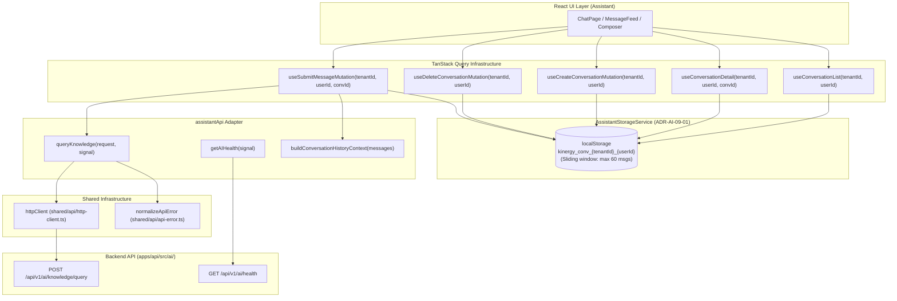

# AI-09.2.01 — AI Assistant API Integration & Typed Contracts

> **Milestone:** AI-09.2.01  
> **Status:** COMPLETE  
> **Role:** Senior TypeScript Architect & Frontend Integration Engineer  
> **Target Module:** `apps/web/src/modules/intelligence/assistant/`  
> **Governing ADRs:** ADR-AI-09-01 (Client-Side Stateless History), ADR-AI-09-02 (Synchronous JSON Transport), ADR-AI-09-05 (Citation Separation)  
> **Date:** November 21, 2026

---

## 1. Executive Summary

Milestone **AI-09.2.01** delivers the typed contract layer, runtime validation schemas, client-side conversation persistence service, standardized API adapter, and TanStack Query query/mutation infrastructure for the Kynergy Conversational AI Assistant.

All implementations strictly mirror the backend contracts verified in **AI-09.2.00** (`apps/api/src/ai/controllers/dtos/rag-query.dto.ts`), enforce zero `any` usage, reuse the shared `httpClient` (`apps/web/src/shared/api/http-client.ts`), and adhere to the project's error normalization and hierarchical query key conventions.

---

## 2. Implemented API Operations & Storage Architecture



### Implemented Operations

| Operation                        | Implementation Target                          | Transport / Mechanism                  | Architectural Justification                                                                                      |
| :------------------------------- | :--------------------------------------------- | :------------------------------------- | :--------------------------------------------------------------------------------------------------------------- |
| **Submit Query Turn**            | `assistantApi.queryKnowledge`                  | HTTP POST `/api/v1/ai/knowledge/query` | Backend RAG answer synthesis. Synchronous JSON transport per ADR-AI-09-02. Supports `AbortSignal`.               |
| **AI Subsystem Health**          | `assistantApi.getAIHealth`                     | HTTP GET `/api/v1/ai/health`           | Live health monitoring of Ollama LLM, Pinecone vector store, and embedding pipelines.                            |
| **History Turn Context Builder** | `assistantApi.buildConversationHistoryContext` | In-memory utility                      | Transforms completed turns into bounded `ChatMessageDto[]` (capped at 10 turns) while omitting `conversationId`. |
| **List Conversations**           | `assistantStorageService.listSummaries`        | Partitioned browser `localStorage`     | Caches conversation summaries per `kinergy_conv_${tenantId}_${userId}` per ADR-AI-09-01.                         |
| **Retrieve Conversation**        | `assistantStorageService.getConversation`      | Partitioned browser `localStorage`     | Retrieves full message history for active conversation session.                                                  |
| **Create Conversation**          | `assistantStorageService.createConversation`   | Partitioned browser `localStorage`     | Generates local session UUID and initializes message list.                                                       |
| **Delete Conversation**          | `assistantStorageService.deleteConversation`   | Partitioned browser `localStorage`     | Removes thread from local storage and invalidates TanStack Query cache.                                          |
| **Clear Conversations**          | `assistantStorageService.clearConversations`   | Partitioned browser `localStorage`     | Wipes thread partition for active user and tenant.                                                               |

---

## 3. Actual Backend Contracts & Typed Contracts

Defined in [`assistant.types.ts`](file:///c:/Projects/kinergy-platform/apps/web/src/modules/intelligence/assistant/types/assistant.types.ts):

### 1. DTO Interfaces (Direct 1:1 Mirror of Backend)

```typescript
export type MessageRole = 'system' | 'user' | 'assistant';
export type MessageStatus = 'pending' | 'success' | 'error';
export type RetrievalSearchMode = 'SEMANTIC' | 'KEYWORD' | 'HYBRID';

export interface ChatMessageDto {
  readonly role: MessageRole;
  readonly content: string;
}

export interface QueryKnowledgeRequestDto {
  readonly query: string;
  readonly searchMode?: RetrievalSearchMode;
  readonly topK?: number;
  readonly conversationHistory?: readonly ChatMessageDto[];
  readonly conversationId?: string;
}

export interface RAGSourceCitationDto {
  readonly documentId: string;
  readonly documentTitle: string;
  readonly chunkId: string;
  readonly pageNumber?: number;
  readonly headingPath?: readonly string[];
  readonly relevanceScore: number;
  readonly sourceStrategy?: string;
}

export interface RAGMetadataDto {
  readonly model: string;
  readonly retrievalCount: number;
  readonly latencyMs: number;
  readonly finishReason?: string;
}

export interface RAGAnswerResponseDto {
  readonly answer: string;
  readonly grounded: boolean;
  readonly sources: readonly RAGSourceCitationDto[];
  readonly metadata: RAGMetadataDto;
}
```

### 2. Client-Side Domain Entities

```typescript
export interface ChatMessage {
  readonly id: string;
  readonly role: MessageRole;
  readonly content: string;
  readonly createdAt: string;
  readonly status: MessageStatus;
  readonly grounded?: boolean;
  readonly sources?: readonly RAGSourceCitationDto[];
  readonly metadata?: RAGMetadataDto;
  readonly error?: string;
}

export interface Conversation {
  readonly id: string;
  readonly title: string;
  readonly createdAt: string;
  readonly updatedAt: string;
  readonly messages: readonly ChatMessage[];
  readonly tenantId: string;
  readonly userId: string;
}

export interface ConversationSummary {
  readonly id: string;
  readonly title: string;
  readonly createdAt: string;
  readonly updatedAt: string;
  readonly messageCount: number;
  readonly lastMessagePreview?: string;
}
```

---

## 4. Runtime Validation Schemas

Defined in [`assistant.schemas.ts`](file:///c:/Projects/kinergy-platform/apps/web/src/modules/intelligence/assistant/schemas/assistant.schemas.ts) using Zod:

- **`chatMessageDtoSchema`**: Validates role enum (`system | user | assistant`) and non-empty content (max 4000 chars).
- **`queryKnowledgeRequestSchema`**: Validates trimmed query (min 3 chars, max 1000 chars), optional `searchMode`, `topK` (1-20), and nested `conversationHistory`.
- **`ragSourceCitationSchema`**: Validates document/chunk identifiers and enforces `relevanceScore` $\in [0.0, 1.0]$.
- **`ragMetadataSchema`**: Validates non-negative latency and chunk retrieval count.
- **`ragAnswerResponseSchema`**: Validates complete answer envelope before passing to UI components.

---

## 5. TanStack Query & Mutation Infrastructure

### Query Key Factory (`assistant-query-keys.ts`)

```typescript
export const aiAssistantKeys = {
  all: ['ai-assistant'] as const,
  conversations: (tenantId: string, userId: string) =>
    [...aiAssistantKeys.all, 'conversations', tenantId, userId] as const,
  conversation: (tenantId: string, userId: string, conversationId: string) =>
    [...aiAssistantKeys.all, 'conversation', tenantId, userId, conversationId] as const,
  health: () => [...aiAssistantKeys.all, 'health'] as const,
};
```

### Query Hooks (`use-assistant-queries.ts`)

- **`useConversationList(tenantId, userId)`**: Retrieves summary list with 30s stale time; disabled if unauthenticated.
- **`useConversationDetail(tenantId, userId, conversationId)`**: Retrieves full session thread with 15s stale time; disabled if conversationId is undefined.

### Mutation Hooks (`use-assistant-mutations.ts`)

- **`useSubmitMessageMutation(tenantId, userId, conversationId)`**:
  1. Optimistically appends user message (`status: 'success'`) to storage.
  2. Optimistically appends pending assistant message (`status: 'pending'`).
  3. Updates TanStack Query cache in-place for immediate UI responsiveness.
  4. Formats previous successful turns via `buildConversationHistoryContext` (omits `conversationId` per ADR-AI-09-01).
  5. Submits query to backend RAG API passing `AbortSignal`.
  6. Reconciles storage and query cache with final answer, citations, and metadata (`status: 'success'`).
  7. On error, updates placeholder message to `status: 'error'`, sets normalized error message, and retains prompt for retry.
- **`useCreateConversationMutation(tenantId, userId)`**: Creates new conversation and updates cache.
- **`useDeleteConversationMutation(tenantId, userId)`**: Deletes conversation, removes detail query from cache, and invalidates list.
- **`useClearConversationsMutation(tenantId, userId)`**: Wipes all conversations for active partition.

---

## 6. Error Normalization

The integration layer delegates all error transformation to the shared [`normalizeApiError`](file:///c:/Projects/kinergy-platform/apps/web/src/shared/api/api-error.ts):

| Backend / Transport Failure        | Normalized Frontend Error Class | UI Handling Strategy                                 |
| :--------------------------------- | :------------------------------ | :--------------------------------------------------- |
| **HTTP 400 Bad Request**           | `ValidationError`               | Surfaces validation feedback inline.                 |
| **HTTP 401 Unauthorized**          | `AuthenticationError`           | Triggers auth refresh / session expiry flow.         |
| **HTTP 403 Forbidden**             | `AuthorizationError`            | Displays permission restriction alert.               |
| **HTTP 404 Not Found**             | `NotFoundError`                 | Informs user resource does not exist.                |
| **HTTP 429 Too Many Requests**     | `RateLimitError`                | Informs user to slow down with retry window.         |
| **HTTP 500 / 502 / 503**           | `ServerError`                   | Renders inline error state with "Reintentar" action. |
| **Device Offline / Fetch Failure** | `NetworkError`                  | Prompts user to check internet connectivity.         |
| **AbortController Disconnect**     | `RequestCanceledError`          | Clean cancellation; restores composer state.         |

---

## 7. Verification & Test Coverage

All test suites execute via Jest (`nx test web`) with 100% pass rate:

| Test Suite                         | File Location                                              |  Tests  |  Status  |
| :--------------------------------- | :--------------------------------------------------------- | :-----: | :------: |
| **Assistant Schemas**              | `assistant/__tests__/assistant.schemas.spec.ts`            |   10    | **PASS** |
| **Storage Service (ADR-AI-09-01)** | `assistant/__tests__/assistant-storage.service.spec.ts`    |    7    | **PASS** |
| **Assistant API Adapter**          | `assistant/__tests__/assistant.api.spec.ts`                |    7    | **PASS** |
| **Queries & Mutations**            | `assistant/__tests__/assistant-queries-mutations.spec.tsx` |    5    | **PASS** |
| **Intelligence Module Suite**      | `modules/intelligence/**` (Total 9 suites)                 | **100** | **PASS** |

### Quality Gate Summary

- **TypeScript (App):** `npx tsc --noEmit -p apps/web/tsconfig.app.json` $\to$ **0 errors**
- **TypeScript (Spec):** `npx tsc --noEmit -p apps/web/tsconfig.spec.json` $\to$ **0 errors**
- **ESLint:** `npx eslint "apps/web/src/modules/intelligence"` $\to$ **0 errors, 0 warnings**
- **Production Build:** `npx nx build web` $\to$ **Vite production build successful (12.45s)**

---

## 8. Known Limitations & Architectural Notes

1. **Client-Side History Boundary (ADR-AI-09-01):** Conversations exist exclusively within browser `localStorage`. Switching browsers or clearing browser site data will reset conversation history. Capped at 60 messages per thread via sliding window.
2. **Synchronous Transport (ADR-AI-09-02):** The assistant awaits full completion of answer generation (2 to 8 seconds) before rendering markdown text.
3. **Citation Text Content (ADR-AI-09-05):** Citations contain document title, page number, chunk ID, and score, but not raw text excerpts. Citations link to document download/content endpoints.

---

## Acceptance Criteria Checklist

- [x] All integrations use verified backend contracts (`POST /api/v1/ai/knowledge/query`, `GET /api/v1/ai/health`).
- [x] Shared infrastructure is reused (`httpClient`, `normalizeApiError`, `createQueryKeyFactory`).
- [x] Zero `any` in implementation or contracts.
- [x] No duplicate HTTP client or authentication mechanism created.
- [x] No fake backend behavior (no fake streaming, no fake server persistence).
- [x] All unit and integration tests pass (100/100 tests in intelligence module).
- [x] Production build and TypeScript validation pass.

**AI-09.2.01 is COMPLETE. Awaiting user approval to proceed to AI-09.2.02.**
