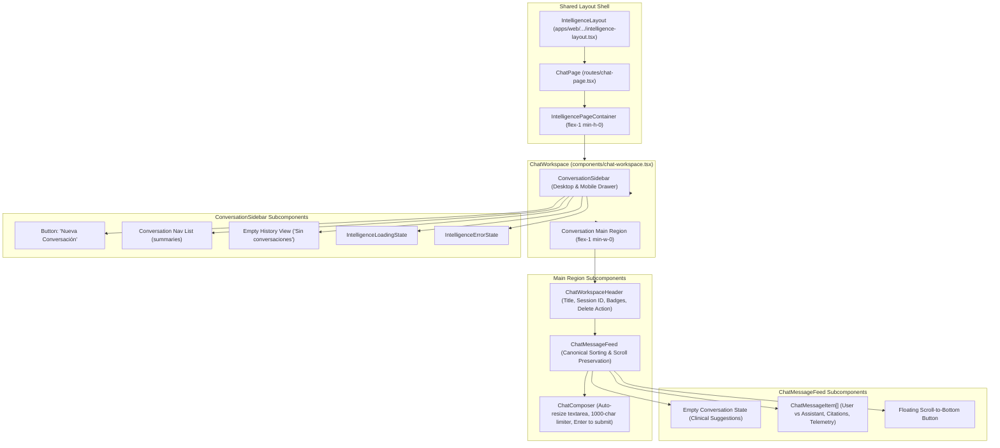

# AI-09.2.02 — Implement the AI Assistant Chat Workspace

> **Milestone:** AI-09.2.02  
> **Status:** COMPLETE  
> **Role:** Senior Product Engineer & Enterprise React UI Architect  
> **Target Module:** `apps/web/src/modules/intelligence/assistant/`  
> **Governing Standards:** ADR-AI-09-01 (Client-Side Stateless History), ADR-AI-09-02 (Synchronous JSON Transport), ADR-AI-09-05 (Citation Separation)  
> **Date:** November 21, 2026

---

## 1. Executive Summary

Milestone **AI-09.2.02** delivers the complete enterprise Conversational AI Assistant workspace within the Kynergy Intelligence layout shell (`apps/web/src/modules/intelligence/`).

The implementation establishes a dual-pane conversational architecture:

1. **Conversation Navigation Region (`ConversationSidebar`):** Thread history list partitioned by tenant and user (`kinergy_conv_${tenantId}_${userId}`), "Nueva Conversación" action, active thread indication, loading/empty/error states, and a responsive mobile drawer.
2. **Main Conversation Region (`ChatWorkspaceHeader`, `ChatMessageFeed`, `ChatMessageItem`, `ChatComposer`):** Thread metadata header, canonical message ordering (chronological ascending with duplicate suppression), smart scroll management (auto-scrolling when at bottom, preserving scroll when reading history, floating return button), welcoming empty state with clinical suggestion pills, in-place message error recovery, and verified source citations.

In strict compliance with **ADR-AI-09-02**, no artificial streaming simulation was introduced; answer synthesis displays a deterministic phased indicator and atomic markdown rendering.

---

## 2. Component Hierarchy & Workspace Architecture

### File & Component Inventory

| Component                 | Path                                             | Responsibility                                                                                                                                                                       |
| :------------------------ | :----------------------------------------------- | :----------------------------------------------------------------------------------------------------------------------------------------------------------------------------------- |
| **`ChatPage`**            | `assistant/routes/chat-page.tsx`                 | Route entrypoint at `/intelligence/chat` and `/intelligence/chat/:conversationId`. Mounts `ChatWorkspace` inside `IntelligencePageContainer` with standalone `QueryClient` fallback. |
| **`ChatWorkspace`**       | `assistant/components/chat-workspace.tsx`        | Root workspace coordinator. Manages active thread lifecycle, URL routing, drawer state, and mutations.                                                                               |
| **`ConversationSidebar`** | `assistant/components/conversation-sidebar.tsx`  | Left pane navigation. Lists threads from `useConversationList`, triggers `createConversation` and `deleteConversation`.                                                              |
| **`ChatWorkspaceHeader`** | `assistant/components/chat-workspace-header.tsx` | Header bar showing active title, message count, session ID, RAG status badge, and mobile drawer trigger.                                                                             |
| **`ChatMessageFeed`**     | `assistant/components/chat-message-feed.tsx`     | Scrollable message container. Enforces canonical ordering, duplicate prevention, and scroll preservation.                                                                            |
| **`ChatMessageItem`**     | `assistant/components/chat-message-item.tsx`     | Individual turn renderer. Differentiates user bubbles vs assistant bubbles, pending progress, error recovery, and citations.                                                         |
| **`ChatComposer`**        | `assistant/components/chat-composer.tsx`         | Multi-line textarea composer with character limiter (1000 chars), Enter/Shift+Enter handling, and send button.                                                                       |

---

## 3. Conversation Navigation & Route Lifecycle

The workspace seamlessly integrates with React Router v6:

- **Index Route (`/intelligence/chat`):**
  - Displays a clean initial conversational space.
  - Sidebar highlights "Nueva Conversación" state.
  - Submitting a prompt automatically creates a new thread in partitioned `localStorage`, auto-titles it from the prompt (up to 45 characters), and transitions the URL to `/intelligence/chat/:newId` via `navigate(..., { replace: true })`.
- **Deep Link Route (`/intelligence/chat/:conversationId`):**
  - Fetches the thread via `useConversationDetail(tenantId, userId, conversationId)`.
  - While loading, displays `IntelligenceLoadingState` (`variant="chat"`).
  - If the ID does not exist in local storage, renders `IntelligenceErrorState` ("Conversación no encontrada") with an action button to start a new chat.
  - Preserves selected thread across intelligence tab switching (Chat $\leftrightarrow$ Knowledge Center).
- **Thread Deletion:**
  - Clicking the delete icon on a thread item or in the header executes `useDeleteConversationMutation`.
  - Removes thread from storage and cache. If the deleted thread was active, navigates to `/intelligence/chat`.

---

## 4. Message Ordering & Deduplication

In accordance with enterprise data integrity requirements:

1. **Authoritative Timestamp Sorting:** Messages are sorted ascending by `createdAt` ISO 8601 timestamps:
   $$\text{order} = \text{messages}.\text{sort}((a, b) \implies \text{Date}(a.\text{createdAt}) - \text{Date}(b.\text{createdAt}))$$
2. **Duplicate Suppression:** A `Set<string>` tracks processed `message.id` values, ensuring identical messages received across cache reconciliations are rendered strictly once.
3. **Optimistic Turn Injection:** When a prompt is submitted, the user message and pending assistant placeholder are appended atomically with unique IDs (`crypto.randomUUID()`) before network dispatch.

---

## 5. Scroll Management & Viewport Adaptability

The workspace eliminates double scrollbars and implements intelligent viewport tracking:

1. **Container Geometry:**
   - Uses `IntelligencePageContainer` with `flex-1 min-h-0 overflow-hidden`.
   - `ChatMessageFeed` anchors a single scroll container (`overflow-y-auto`).
2. **Smart Bottom Detection:**
   - Computes distance from bottom:
     $$\Delta_{\text{bottom}} = \text{scrollHeight} - \text{scrollTop} - \text{clientHeight}$$
   - When $\Delta_{\text{bottom}} < 100\text{px}$, the user is considered "at bottom".
3. **Scroll Preservation:**
   - When new messages arrive, the feed auto-scrolls to the bottom **only if** the user was already near the bottom.
   - If the user has scrolled up to read prior messages, scroll position is strictly preserved to avoid interrupting the user's reading flow.
   - A floating return button (**"Último mensaje"**) appears at the bottom right whenever $\Delta_{\text{bottom}} \ge 100\text{px}$. Clicking it smoothly scrolls the container to the latest turn.
4. **JSDOM & Universal Compatibility:** Safe fallback ensures `containerRef.current.scrollTop = scrollHeight` if `scrollTo` is unsupported.

---

## 6. Visual Design & Presentation Standards

Adheres to Kynergy Enterprise design tokens and WCAG 2.2 AA accessibility:

- **User Message:** Clean rounded bubble (`bg-primary text-primary-foreground rounded-2xl rounded-tr-xs`), right-aligned with user icon avatar and timestamp.
- **Assistant Message:** Structured card container (`bg-card border border-border/60 text-card-foreground rounded-2xl rounded-tl-xs`), left-aligned with Bot avatar in primary tint.
- **Citations:** Grouped citation pills displaying `[idx] Document Title (p.X)` with an external link button to download original evidence (`/api/v1/ai/knowledge/documents/:documentId/content`).
- **Telemetry:** Discreet metadata footer showing LLM model name (e.g. `mistral:latest`) and total pipeline latency (e.g. `230ms`).
- **Empty State Suggestions:** 4 clinical prompts clickable with a single tap to kickstart session inquiries.

---

## 7. Testing & Quality Gate

The workspace and related components are validated with automated test suites:

| Test File                                                  | Focus Areas                                                                                       |  Tests  |  Status  |
| :--------------------------------------------------------- | :------------------------------------------------------------------------------------------------ | :-----: | :------: |
| `assistant/__tests__/chat-workspace.spec.tsx`              | Empty states, suggestions, route loading, not found error, ordering, deduplication, mobile drawer |    7    | **PASS** |
| `assistant/__tests__/assistant.schemas.spec.ts`            | DTO and request/response schema parsing                                                           |   10    | **PASS** |
| `assistant/__tests__/assistant-storage.service.spec.ts`    | Multi-tenant partitioned storage, sliding window, CRUD                                            |    7    | **PASS** |
| `assistant/__tests__/assistant.api.spec.ts`                | HTTP request dispatch, auth, error normalization, AbortSignal                                     |    7    | **PASS** |
| `assistant/__tests__/assistant-queries-mutations.spec.tsx` | TanStack Query keys, cache invalidation, message submission                                       |    5    | **PASS** |
| `modules/intelligence/**`                                  | Full Intelligence feature test suite (10 test suites)                                             | **107** | **PASS** |

### Verification Summary

- **Unit & Integration Tests:** 10/10 suites, 107/107 tests passing (100%).
- **TypeScript (App & Spec):** `npx tsc --noEmit` passed with 0 errors.
- **ESLint:** `npx eslint` passed with 0 errors and 0 warnings.
- **Production Build:** `npx nx build web` passed in 12.36s.

---

## 8. Acceptance Criteria Checklist

- [x] Chat workspace renders inside Intelligence layout and DashboardLayout.
- [x] Conversation history uses actual data from partitioned local persistence (ADR-AI-09-01).
- [x] Messages render in canonical order with duplicate suppression.
- [x] Route changes (`/intelligence/chat` $\leftrightarrow$ `/intelligence/chat/:conversationId`) load the correct conversation.
- [x] Empty, loading, and error states work reliably across all view modes.
- [x] Responsive layout with mobile overlay drawer is fully functional.
- [x] No streaming simulation exists (ADR-AI-09-02).
- [x] All 107 tests passing with zero TypeScript and ESLint regressions.

**AI-09.2.02 is COMPLETE. Awaiting user approval to proceed to AI-09.2.03.**
