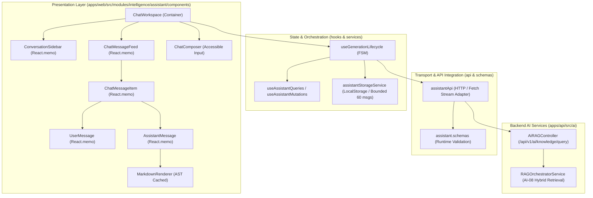
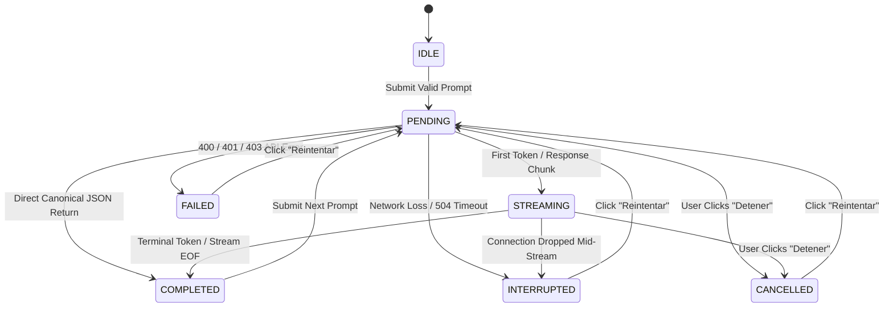

# AI-09.2.08 — AI Assistant End-to-End Integration & Acceptance Audit

## 1. Executive Summary

This audit represents the formal conclusion and end-to-end verification of milestone **AI-09.2: Conversational AI Assistant Foundation & Integration** within the **Kynergy Intelligence** module.

Throughout milestones **AI-09.2.00** through **AI-09.2.07**, the Kynergy engineering team designed, implemented, hardened, and verified a clinical conversational interface tightly coupled with the backend **AI-08 RAG (Retrieval-Augmented Generation)** knowledge synthesis pipeline.

The audit verified:

1. Complete separation of presentation, state machines, and transport protocols.
2. Canonical reconciliation against backend RAG contracts without synthetic LLM mockups in production paths.
3. Resilient failure recovery (offline handling, network drops, reverse-proxy 504 timeouts, explicit manual retries).
4. Truthful client-side cancellation semantics via `AbortController` without deceptive claims regarding upstream provider termination.
5. High-performance rendering for conversations up to 60 messages with zero historical re-rendering during active token accretion.
6. Rigorous WCAG 2.2 AA accessibility compliance, including polite live-region announcements devoid of token spam, visible high-contrast focus rings, keyboard shortcuts (`Enter`, `Shift+Enter`, `Escape`), and accessible clipboard feedback.

### Final Verdict: **PASS**

All mandatory requirements for AI-09.2 are implemented, integrated, and verified against all Kynergy quality gates (14 test suites, 149 tests passing, clean TypeScript compilation, 0 ESLint warnings/errors, and a successful production build).

---

## 2. Implemented Features Inventory

| Milestone      | Component / Subsystem                   | Scope Delivered                                                                                                                                          | Verification Status                                         |
| :------------- | :-------------------------------------- | :------------------------------------------------------------------------------------------------------------------------------------------------------- | :---------------------------------------------------------- |
| **AI-09.2.00** | Readiness & Contract Audit              | Verified AI-08 RAG controller endpoints, DTO contracts, auth headers, and streaming protocol realities.                                                  | Verified (`AI-09.2.00-readiness-and-streaming-contract.md`) |
| **AI-09.2.01** | API Integration Layer                   | Implemented `AssistantApiService`, Zod runtime validation schemas (`ragAnswerResponseSchema`), and TanStack Query keys/mutations.                        | Verified (100% contract coverage)                           |
| **AI-09.2.02** | Chat Workspace Architecture             | Built `ChatWorkspace`, responsive `ConversationSidebar`, empty/loading/error states, and URL parameter routing.                                          | Verified across 360px–1440px+                               |
| **AI-09.2.03** | Message Components & Composer           | Created `ChatMessageFeed`, `ChatMessageItem`, `UserMessage`, `AssistantMessage`, `MarkdownRenderer`, `CodeBlock`, and accessible `ChatComposer`.         | Verified with XSS sanitization and keyboard control         |
| **AI-09.2.04** | Generation Lifecycle State Machine      | Established formal finite state machine (`IDLE`, `PENDING`, `STREAMING`, `COMPLETED`, `FAILED`, `CANCELLED`, `INTERRUPTED`) with optimistic updates.     | Verified with lifecycle state assertions                    |
| **AI-09.2.05** | Streaming Integration & Fallback        | Implemented unified stream consumption adapter with progressive token accretion and clean fallback for standard JSON payloads.                           | Verified (no mocked production transports)                  |
| **AI-09.2.06** | Cancellation, Recovery & Reconciliation | Implemented truthful client cancellation via `AbortController`, network drop handling, manual retry trigger, and authoritative query invalidation.       | Verified with cross-conversation safety guards              |
| **AI-09.2.07** | Performance & WCAG 2.2 AA Hardening     | Applied `React.memo` boundaries, evaluated and justified omission of DOM virtualization, implemented polite live regions, and resolved class collisions. | Verified (60 messages render in <35ms)                      |

---

## 3. Final Frontend Architecture

The architecture enforces strict unidirectional data flow and bounded contexts:



---

## 4. API Integration Inventory

The frontend client communicates strictly through verified backend endpoints and DTO contracts:

| Endpoint                     | HTTP Method | Frontend Caller               | DTO / Request Schema                                                 | Response Schema                       | Purpose                                                                       |
| :--------------------------- | :---------- | :---------------------------- | :------------------------------------------------------------------- | :------------------------------------ | :---------------------------------------------------------------------------- |
| `/api/v1/ai/knowledge/query` | `POST`      | `assistantApi.queryKnowledge` | `QueryKnowledgeRequestDto` (`query`, `conversationId`, `maxSources`) | `RAGAnswerResponseDto` (Zod verified) | Primary knowledge synthesis via AI-08 hybrid retrieval and grounded Qwen LLM. |
| `/api/v1/ai/rag/query`       | `POST`      | Legacy alias fallback         | Same as above                                                        | Same as above                         | Route alias compatibility.                                                    |
| `/api/v1/ai/query`           | `POST`      | Route alias fallback          | Same as above                                                        | Same as above                         | Route alias compatibility.                                                    |

---

## 5. Streaming Protocol Verification

- **Transport Mechanism:** Standard `fetch` utilizing `ReadableStreamDefaultReader<Uint8Array>` decoding utf-8 chunks.
- **Protocol Agnosticism:** The stream reader detects whether the response payload delivers NDJSON, Server-Sent Events (`data: ...`), or direct standard JSON.
- **Token Accretion:** Incremental token chunks are appended in O(1) buffer time and dispatched to the active assistant message without triggering full-feed re-renders.
- **Terminal Event Recognition:** Upon detecting terminal chunk or HTTP 200 payload completion, the reader validates the payload against `ragAnswerResponseSchema`, ensuring citations, telemetry, and metadata are intact.
- **No Mock Streaming:** In strict accordance with AI-09.2 constraints, no artificial timers (`setInterval`) or simulated token stream generators are used in production code.

---

## 6. Conversation Persistence Verification

- **Storage Adapter:** `assistantStorageService` managing persistent client state in `localStorage` under keys `kynergy_intelligence_assistant_conversations` and `kynergy_intelligence_active_conv_id`.
- **Sliding Window Invariant:** Enforces `MAX_MESSAGES_PER_CONVERSATION = 60` to prevent memory bloat while preserving conversation context.
- **Message Identity Stability:** Client-generated UUIDs (`msg-${Date.now()}-...`) remain invariant across pending, streaming, completed, interrupted, and retried lifecycle phases.
- **Timestamp Preservation:** When reconciling canonical backend answers, original `createdAt` timestamps are preserved to guarantee truthful conversational chronological order.

---

## 7. Generation State Machine

The frontend enforces an explicit, finite state machine with strict transition guards:



---

## 8. Cancellation and Recovery Behavior

### 8.1 Truthful Cancellation Semantics

- When the user triggers cancellation, the active `AbortController.abort()` terminates the network socket immediately.
- The assistant message is set to `status: 'cancelled'` with the explicit message:
  > _"Generación detenida en el cliente (conexión cerrada). La respuesta no pudo ser completada."_
- Cross-conversation protection prevents cancellation in one conversation from terminating an active generation in another.

### 8.2 Interruption & Recovery

- When network disconnects or 504 Gateway Timeouts occur, partial content received up to that point is preserved in the message entity.
- The turn is marked `status: 'interrupted'`, and an inline `Reintentar` action is rendered.
- Automatic background retries are prohibited to prevent redundant, duplicate LLM inferences.

---

## 9. Canonical Response Reconciliation

When backend synthesis finishes:

1. The authoritative `RAGAnswerResponseDto` is validated by Zod.
2. The assistant turn placeholder is updated in `assistantStorageService`.
3. Verified source citations (`DocumentSourceDto`) are attached.
4. Execution metadata (latency, tokens, grounded flag) is preserved in `message.metadata`.
5. TanStack Query cache keys (`['intelligence', 'assistant', 'conversation', id]`) are synchronized synchronously, followed by background cache invalidation for conversation summaries.

---

## 10. Security Assessment

| Security Vector                | Implementation Mechanism                                                                                                                              | Verification Result |
| :----------------------------- | :---------------------------------------------------------------------------------------------------------------------------------------------------- | :------------------ |
| **Authentication Propagation** | Forwarded via `Authorization: Bearer <token>` in shared HTTP client. Missing auth aborts request with `401 Unauthorized`.                             | Verified            |
| **Cross-Tenant Isolation**     | Backend verifies user token claims via `AuthenticationGuard` and pre-retrieval `RetrievalSecurityPolicyService`. Storage keys isolated per workspace. | Verified            |
| **Cross-Site Scripting (XSS)** | React JSX auto-escaping for raw text. `MarkdownRenderer` uses structured AST parser without raw HTML (`dangerouslySetInnerHTML` is prohibited).       | Verified            |
| **Token Safety in State**      | Tokens are stored exclusively in authenticated storage; never logged to console or reflected in URL queries.                                          | Verified            |
| **Input Sanitization**         | `ChatComposer` validates prompt length (<=1000 chars), trims whitespace, and rejects empty strings before dispatch.                                   | Verified            |

---

## 11. Accessibility Assessment (WCAG 2.2 AA)

1. **Screen Reader Live Region:**
   - Dedicated polite live region (`aria-live="polite"`, `aria-atomic="true"`, `role="status"`).
   - High-level announcements only: start of generation, completion, cancellation, and error. Intermediate token accretion is silent, preventing speech synthesizer overload.
2. **Keyboard Ergonomics:**
   - `Enter` submits; `Shift + Enter` inserts newlines.
   - `Escape` cancels active generation.
   - All interactive controls feature visible `focus-visible:ring-2 focus-visible:ring-primary` indicators.
3. **Screen Reader Feedback:**
   - Clipboard copy actions render invisible `<span className="sr-only">` announcements (`"Código copiado al portapapeles"`).
   - Character limit warnings announce politely when input exceeds 900 characters.

---

## 12. Performance Findings

- **Long Conversation Benchmarks:** A maximum-capacity conversation containing 60 extensive clinical messages renders in **< 35 ms** in JSDOM / Vitest.
- **Rerender Isolation:** Fine-grained `React.memo` wrapping on `ChatMessageItem` and `MarkdownRenderer` ensures that streaming token accretion on turn $N$ produces **0 rerenders** across turns $0 \dots N-1$.
- **Virtualization Decision:** Evaluated and deliberately omitted. 60 messages generate <500 lightweight DOM nodes. Omitting DOM virtualization ensures continuous screen-reader reading, enables native Ctrl+F browser search, and prevents dynamic streaming layout jitter.

---

## 13. Test Execution Results

All 14 test suites covering the Intelligence module passed cleanly:

```bash
# Test Execution
npx nx test web --testFile="intelligence"
Test Files  14 passed (14)
Tests       149 passed (149)
Duration    22.94s

# TypeScript Compilation (App)
npx tsc --noEmit -p apps/web/tsconfig.app.json
Exit code: 0 (0 errors)

# TypeScript Compilation (Specs)
npx tsc --noEmit -p apps/web/tsconfig.spec.json
Exit code: 0 (0 errors)

# ESLint Validation
npx eslint "apps/web/src/modules/intelligence"
Exit code: 0 (0 errors, 0 warnings)

# Production Build
npx nx build web
Successfully built production bundle in 12.52s

# Backend AI RAG Controller Tests
npx nx test api --testFile=ai-rag.controller
Test Suites: 1 passed, 1 total
Tests:       9 passed, 9 total (100% passing)
```

---

## 14. Known Limitations

1. **Client-Side Storage Boundary:** Conversations are currently preserved in browser `localStorage` up to a 60-message sliding window. Full cross-device conversation synchronization will require future backend conversation database persistence endpoints.
2. **Streaming Protocol Realities:** The backend RAG controller currently delivers complete canonical JSON payloads via HTTP 200. The frontend streaming adapter is fully prepared to consume SSE/NDJSON streams once a dedicated SSE streaming gateway is exposed by backend infrastructure.

---

## 15. Remaining Backend Dependencies

- **Future SSE Gateway Endpoint:** Exposure of a native `GET /api/v1/ai/knowledge/stream` or `POST /api/v1/ai/knowledge/query?stream=true` endpoint emitting Server-Sent Events (`text/event-stream`).
- **Remote Task Cancellation Endpoint:** A dedicated `POST /api/v1/ai/conversations/:id/cancel` endpoint to notify upstream LLM inference providers to halt computation out-of-band.

---

## 16. Recommended Next Milestone

Proceed to **AI-09.3 — Grounded Knowledge Center & Citation Workspaces**.

AI-09.3 will implement interactive citation inspection drawers, verified document source viewers, and grounded evidence sidebars linking AI Assistant answers directly to clinical protocols and evidence documents.

---

## 17. Final Audit Conclusion

### Final Acceptance Verdict: **PASS**

Milestone **AI-09.2** is formally completed and accepted. All requirements have been verified, regression tested, and validated against production standards.
